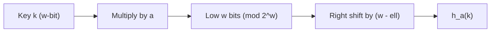
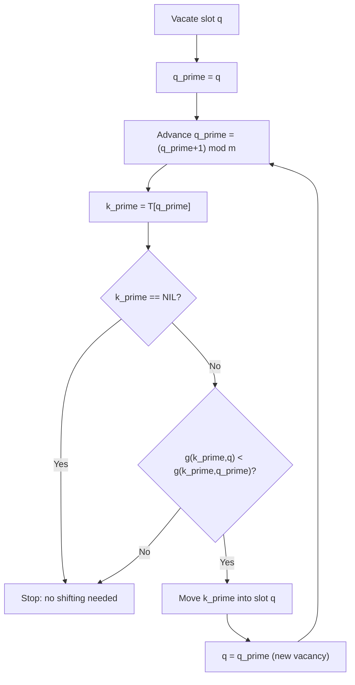

---
tags:
  - CCT3
  - Algoritmer
Topic: Elementary Data Structures, Hash Tables
Semester: CCT3
Course: Algoritmer
Litterature:
  - Introduction to Algorithms 4th ed.
Created: 24-10-2026
---

# 1. Introduction

**Quick Reference**

| Symbol / Operator | Meaning |
|---|---|
| $O(g)$, $\Theta(g)$, $\Omega(g)$ | Asymptotic upper, tight, and lower bounds |
| $\lg x$ | Logarithm base 2 |
| $\ln x$ | Natural logarithm |
| $\sum$ | Summation (add a sequence of terms) |
| $\prod$ | Product (multiply a sequence of terms) |
| $\langle \cdots \rangle$ | Sequence or tuple notation |
| $k \bmod m$ | Remainder of $k$ divided by $m$ |
| $\lfloor x \rfloor$ | Floor: largest integer $\le x$ |
| $\lceil x \rceil$ | Ceiling: smallest integer $\ge x$ |
| $x \gg s$, $x \ll s$ | Logical right / left shift by $s$ bits |
| $x \cdot y$ | Multiplication (dot) |
| $x \times y$ | Multiplication (sign) |
| $a \in S$ | $a$ is a member of the set $S$ |
| $a \equiv b \pmod m$ | $a$ is congruent to $b$ modulo $m$ |
| $\mathbb{Z}_p$ | Integers modulo $p$: $\{0, 1, \ldots, p-1\}$ |
| $\mathbb{Z}_p^*$ | Nonzero integers modulo $p$: $\{1, 2, \ldots, p-1\}$ |
| $h(k)$ | Hash function: the slot assigned to key $k$ |
| $h(k, i)$ | $i$th probe position for key $k$ in open addressing |
| $h_1(k), h_2(k)$ | Two auxiliary hash functions used in double hashing |
| $g(k, q)$ | Inverse probe function: the probe number that reaches slot $q$ |
| $h_{ab}(k)$ | Number-theoretic hash function $((ak + b) \bmod p) \bmod m$ |
| $\alpha = n/m$ | Load factor: average number of elements per slot |
| $U$ | Universe of all possible keys |
| $K$ | Set of keys actually stored |
| $m$ | Number of slots in a hash table |
| $n$ | Number of elements stored in a hash table |
| $w$ | Machine word size in bits (e.g., 32 or 64) |
| $\ell$ | Number of bits in the hash output, where $m = 2^\ell$ |
| $\text{swap}(x)$ | Exchanges the two halves of a $w$-bit word $x$ |
| $\text{chop}(k)$ | Splits a $t$-bit input into $w$-bit words |
| $f_a^{(r)}(k)$ | Round function $f_a$ applied $r$ times |
| $\text{NIL}$ | Null pointer (empty / not present) |
| $\text{DELETED}$ | Marker for a deleted slot in open addressing |

_Table 1.1: Symbols and operators defined in this note._

| Abbreviation | Full Term |
|---|---|
| LIFO | Last-In, First-Out |
| FIFO | First-In, First-Out |
| RAM | Random Access Memory |
| SHA-256 | Secure Hash Algorithm-256 |
| AES-NI | Advanced Encryption Standard – New Instructions |
| CBC-MAC | Cipher-Block-Chaining Message Authentication Code |

_Table 1.2: Abbreviations and acronyms introduced in this note._

---

Sets are fundamental to both computer science and mathematics. However, there is a key distinction: while mathematical sets are static and unchanging, the sets manipulated by algorithms are _dynamic_ — they can grow, shrink, or otherwise change over time during execution.

Various techniques exist for representing finite dynamic sets and manipulating them on a computer. The specific operations an algorithm requires will determine the most appropriate implementation.

Different algorithms demand different operations on sets. Some of the most common operations include:

- **Insert:** Adding a new element to the set.
- **Delete:** Removing an element from the set.
- **Membership test:** Checking whether a given element exists in the set.

> [!info] Definition: Dictionary
> A _dictionary_ is a dynamic set that supports three core operations: **insert**, **delete**, and **membership test**. It is one of the most fundamental abstract data types encountered in algorithm design.

Other algorithms require more specialized operations beyond these basics. For example, a _min-priority queue_ is a dynamic set that supports **inserting** an element and **extracting the smallest element** from the set. This type of structure is commonly implemented using a heap data structure.

Ultimately, the best way to implement a dynamic set depends on which operations need to be supported and how efficiently they must perform.

# 2. Elements of a dynamic set

In a typical implementation, each element of a dynamic set is represented by an _object_. This object has attributes that can be examined and manipulated through a pointer to the object.

One of the object's attributes often serves as an _identifying key_. When all keys are distinct, the dynamic set can be thought of as simply a set of key values.

> [!info] Definition: Satellite Data
> _Satellite data_ refers to additional information stored in an object's attributes beyond the key. This data is carried along with the object but is not directly used by the set's internal operations. The set implementation only cares about the key for its core logic; the satellite data exists for the benefit of the application using the set.

Beyond the key and satellite data, an object may also have attributes that are actively manipulated by the set operations themselves. These attributes can contain data or pointers to other objects within the set, enabling the structural links needed for efficient operations.

Some dynamic sets require that keys come from a _totally ordered set_ — a set where every pair of elements can be meaningfully compared. Common examples include the real numbers or the set of all words under standard alphabetic ordering.

> [!info] Definition: Total Ordering
> A _total ordering_ on a set of keys means that for any two keys, one is definitively less than, equal to, or greater than the other. This property enables operations such as finding the **minimum element** of the set or identifying the **next element larger** than a given element.

# 3. Operations on dynamic sets

Operations on a dynamic set fall into two broad categories:

- **Queries:** Return information about the set without modifying it.
- **Modifying operations:** Change the contents or structure of the set.

Any specific application will typically require only a subset of the operations described below.

**`SEARCH(S, k)`** — A query that, given a set $S$ and a key value $k$, returns a pointer $x$ to an element in $S$ such that `x.key` $= k$, or `NIL` if no such element belongs to $S$.

**`INSERT(S, x)`** — A modifying operation that adds the element pointed to by $x$ to the set $S$. It is generally assumed that any attributes in element $x$ needed by the set implementation have already been initialized prior to the call.

**`DELETE(S, x)`** — A modifying operation that, given a pointer $x$ to an element already in the set $S$, removes $x$ from $S$. Importantly, this operation takes a _pointer to an element_, not a key value.

**`MINIMUM(S)` and `MAXIMUM(S)`** — Queries on a totally ordered set $S$ that return a pointer to the element with the smallest key (`MINIMUM`) or the largest key (`MAXIMUM`).

**`SUCCESSOR(S, x)`** — A query that, given an element $x$ whose key is drawn from a totally ordered set $S$, returns a pointer to the next larger element in $S$, or `NIL` if $x$ is already the maximum element.

**`PREDECESSOR(S, x)`** — A query that, given an element $x$ whose key is drawn from a totally ordered set $S$, returns a pointer to the next smaller element in $S$, or `NIL` if $x$ is already the minimum element.

The `SUCCESSOR` and `PREDECESSOR` operations can be extended to handle sets with nondistinct keys. For a set of $n$ keys, the standard expectation is that a call to `MINIMUM` followed by $n - 1$ calls to `SUCCESSOR` will enumerate all elements of the set in sorted order.

The running time of a set operation is typically measured in terms of the size of the set. More advanced data structures can support all of the operations listed above on a set of size $n$ in $O(\lg n)$ time.

**Array Implementation Trade-offs.**
A dynamic set can always be implemented using a simple array. While the algorithms are straightforward, many operations suffer a worst-case running time of $\Theta(n)$. The specific trade-off depends on whether the array is maintained in sorted order:

| Operation | Unsorted Array | Sorted Array |
|---|---|---|
| `INSERT` | $\Theta(1)$ | $\Theta(n)$ |
| `DELETE` | $\Theta(1)$ | $\Theta(n)$ |
| `SEARCH` | $\Theta(n)$ | $O(\lg n)$ (via binary search) |
| `MINIMUM` | $\Theta(n)$ | $\Theta(1)$ |
| `MAXIMUM` | $\Theta(n)$ | $\Theta(1)$ |
| `SUCCESSOR` | $\Theta(n)$ | $\Theta(1)$ |
| `PREDECESSOR` | $\Theta(n)$ | $\Theta(1)$ |

_Table 3.1: Worst-case running times of dynamic-set operations implemented with an array, depending on whether the array is kept sorted._

More sophisticated data structures improve upon these array-based bounds for many of the dynamic-set operations.

# 10. Elementary Data Structures

This chapter examines the representation of dynamic sets using simple data structures built with pointers. The fundamental structures covered include arrays, matrices, stacks, queues, linked lists, and rooted trees. While pointers can construct far more complex structures, these rudimentary ones form the essential building blocks.

## 10.1 Simple array-based data structures: arrays, matrices, stacks, queues

### 10.1.1 Arrays

An array is stored as a _contiguous sequence of bytes_ in memory. Given the starting address, element size, and indexing origin, the exact memory location of any element can be computed directly.

**Array Address Calculation.**
If the first element of an array has index $s$, the array starts at memory address $a$, and each element occupies $b$ bytes, then the $i$th element occupies bytes:

$$a + b(i - s) \quad \text{through} \quad a + b(i - s + 1) - 1$$

**Breakdown:**
- **$a$** : The starting memory address of the array (the address of the first byte).
- **$b$** : The size of each element in bytes. This must be constant across all elements for the formula to apply.
- **$s$** : The starting index of the array (the index of the first element). Common values are $s = 1$ (1-origin) or $s = 0$ (0-origin).
- **$i$** : The index of the element being accessed.

**Simplified cases:**
- When $s = 1$: the $i$th element occupies bytes $a + b(i - 1)$ through $a + bi - 1$.
- When $s = 0$: the $i$th element occupies bytes $a + bi$ through $a + b(i + 1) - 1$.

Under the standard computational model where all memory locations can be accessed in the same amount of time, accessing any array element takes _constant time_ regardless of the index. This is the key advantage of arrays: direct, $O(1)$ random access.

Most programming languages require every element of a given array to be the same size. When elements might vary in size, the formula above no longer applies because $b$ is no longer a constant. The typical solution is to store _pointers_ in the array instead of the objects themselves:

- Each array slot holds a pointer to a variable-sized object stored elsewhere in memory.
- Since pointers are uniform in size (regardless of what they reference), the address formula still works for locating the pointer.
- Accessing the actual object then requires _following the pointer_ — an extra indirection step beyond the initial address calculation.

![[Pasted image 20261024155049.png]]
_Figure 10.1: Four ways to store the $2 \times 3$ matrix $M$ from equation (10.1). (a) In row-major order, in a single array. (b) In column-major order, in a single array. (c) In row-major order, with one array per row (tan) and a single array (blue) of pointers to the row arrays. (d) In column-major order, with one array per column (tan) and a single array (blue) of pointers to the column arrays._

### 10.1.2 Matrices

A matrix (or two-dimensional array) is typically represented using one or more one-dimensional arrays. Consider an $m \times n$ matrix — a matrix with $m$ rows and $n$ columns.

The two most common storage strategies are:

- **Row-major order:** The matrix is stored row by row.
- **Column-major order:** The matrix is stored column by column.

> [!example] **Row-Major vs Column-Major Storage**
> Given the $2 \times 3$ matrix:
> $$M = \begin{bmatrix} 1 & 2 & 3 \\ 4 & 5 & 6 \end{bmatrix} \tag{10.1}$$
> - **Row-major** stores the rows sequentially: $1, 2, 3, 4, 5, 6$
> - **Column-major** stores the columns sequentially: $1, 4, 2, 5, 3, 6$

#### Single-Array Representation

When a matrix is flattened into a single one-dimensional array, the index of element $M[i, j]$ (row $i$, column $j$) depends on the storage order and the starting index $s$.

**Matrix Index Formulas (Single Array).**
**General formulas** (starting index $s$):
- Row-major: $s + n(i - s) + (j - s)$
- Column-major: $s + m(j - s) + (i - s)$

**Breakdown:**
- **$m$** : The number of rows in the matrix.
- **$n$** : The number of columns in the matrix.
- **$i$** : The row index of the desired element.
- **$j$** : The column index of the desired element.
- **$s$** : The starting index of the array (typically $0$ or $1$).

**Simplified cases:**

| Starting Index | Row-Major | Column-Major |
|---|---|---|
| $s = 1$ | $n(i - 1) + j$ | $i + m(j - 1)$ |
| $s = 0$ | $ni + j$ | $i + mj$ |

_Table 10.1: Index formulas for a flattened matrix by storage order and starting index s._

> [!example] **Index Calculation**
> For the $2 \times 3$ matrix $M$ above with 1-origin indexing ($s = 1$), element $M[2, 1]$:
> - **Row-major:** $3(2 - 1) + 1 = 4$ → stored at index 4 in the flat array.
> - **Column-major:** $2 + 2(1 - 1) = 2$ → stored at index 2 in the flat array.
>
> **Check:** $3(2-1)+1 = 3+1 = 4$ ✓; $2+2(1-1) = 2+0 = 2$ ✓

#### Multiple-Array Representation

An alternative approach uses an _array of arrays_:

- **Row-major version:** A top-level array $A$ of length $m$ stores pointers, where $A[i]$ points to a separate array of length $n$ holding the entries for row $i$. The matrix element $M[i, j]$ is accessed as $A[i][j]$.
- **Column-major version:** A top-level array $A$ of length $n$ stores pointers, where $A[j]$ points to a separate array of length $m$ holding the entries for column $j$. The matrix element $M[i, j]$ is accessed as $A[j][i]$.

**Single-Array vs Multiple-Array Trade-offs.**
- **Single-array** representations are generally more efficient on modern machines due to better cache locality and simpler address arithmetic.
- **Multiple-array** representations offer greater flexibility. For example, they naturally support `ragged arrays`, where rows (in row-major) or columns (in column-major) may have different lengths.

#### Block Representation

Another scheme divides the matrix into contiguous _blocks_, each stored as a unit. For example, a $4 \times 4$ matrix divided into $2 \times 2$ blocks:

$$\begin{bmatrix} 1 & 2 & 3 & 4 \\ 5 & 6 & 7 & 8 \\ 9 & 10 & 11 & 12 \\ 13 & 14 & 15 & 16 \end{bmatrix}$$

might be stored in a single array in the order: $\langle 1, 2, 5, 6, 3, 4, 7, 8, 9, 10, 13, 14, 11, 12, 15, 16 \rangle$. Each $2 \times 2$ block is stored contiguously before moving to the next block, which can improve cache performance for block-oriented algorithms.

### 10.1.3 Stacks and queues

Stacks and queues are dynamic sets in which the element removed by the `DELETE` operation is _prespecified_ — unlike a general dictionary, you don't choose which element to remove.

- A **stack** implements a _last-in, first-out_ (**LIFO**) policy: the element deleted is always the one most recently inserted.
- A **queue** implements a _first-in, first-out_ (**FIFO**) policy: the element deleted is always the one that has been in the set the longest.

Both can be efficiently implemented using an array with a few auxiliary attributes.

#### Stacks

The `INSERT` operation on a stack is called **PUSH**, and the `DELETE` operation is called **POP**. These names evoke a physical stack of plates: you can only access the top plate, so the last plate placed on the stack is the first one removed.

A stack of at most $n$ elements can be implemented with an array $S[1 \ldots n]$. The stack uses two attributes:

- `S.top`: the index of the most recently inserted element (the top of the stack).
- `S.size`: the maximum capacity $n$ of the array.

The stack elements occupy positions $S[1 \ldots S\text{.top}]$, where $S[1]$ is the bottom and $S[S\text{.top}]$ is the top. When `S.top` $= 0$, the stack is empty.

![[Pasted image 20261024155318.png]]
_Figure 10.2: An array implementation of a stack $S$. Stack elements appear only in the tan positions. (a) Stack $S$ has 4 elements. The top element is 9. (b) Stack $S$ after the calls PUSH($S$, 17) and PUSH($S$, 3). (c) Stack $S$ after the call POP($S$) has returned the element 3, which is the one most recently pushed. Although element 3 still appears in the array, it is no longer in the stack. The top is element 17._

**Stack Overflow and Underflow.**
- **Underflow:** Attempting to `POP` from an empty stack (`S.top` $= 0$) is an error condition.
- **Overflow:** Attempting to `PUSH` when `S.top` exceeds `S.size` is an error condition.

All three stack operations run in $O(1)$ time.

```
STACK-EMPTY(S)
    if S.top == 0
        return TRUE
    else
        return FALSE

PUSH(S, x)
    if S.top == S.size
        error "overflow"          // No room left in the array
    else
        S.top = S.top + 1         // Move the top pointer up
        S[S.top] = x              // Place the new element at the top

POP(S)
    if STACK-EMPTY(S)
        error "underflow"         // Nothing to remove
    else
        S.top = S.top - 1         // Move the top pointer down
        return S[S.top + 1]       // Return the element that was at the top
```

#### Queues

The `INSERT` operation on a queue is called **ENQUEUE**, and the `DELETE` operation is called **DEQUEUE**. Like `POP`, `DEQUEUE` takes no element argument. A queue operates like a line of customers: new arrivals join the _tail_, and the customer at the _head_ (who has waited the longest) is served first.

A queue of at most $n - 1$ elements can be implemented using an array $Q[1 \ldots n]$ with the following attributes:

- `Q.head`: the index of the head of the queue (the next element to be dequeued).
- `Q.tail`: the index of the next available slot for insertion.
- `Q.size`: the size $n$ of the array.

The elements of the queue reside in positions $Q\text{.head}, Q\text{.head} + 1, \ldots, Q\text{.tail} - 1$, with the array treated as _circular_: location $1$ immediately follows location $n$. Initially, $Q\text{.head} = Q\text{.tail} = 1$.

![[Pasted image 20261024155343.png]]
_Figure 10.3: A queue implemented using an array $Q[1 \ldots 12]$. Queue elements appear only in the tan positions. (a) The queue has 5 elements, in locations $Q[7 \ldots 11]$. (b) The configuration of the queue after the calls ENQUEUE($Q$, 17), ENQUEUE($Q$, 3), and ENQUEUE($Q$, 5). (c) The configuration of the queue after the call DEQUEUE($Q$) returns the key value 15 formerly at the head of the queue. The new head has key 6._

> [!warning] **Queue Overflow and Underflow**
> - **Empty:** When $Q\text{.head} = Q\text{.tail}$, the queue is empty. Attempting to `DEQUEUE` causes underflow.
> - **Full:** When $Q\text{.head} = Q\text{.tail} + 1$, or when $Q\text{.head} = 1$ and $Q\text{.tail} = Q\text{.size}$, the queue is full. Attempting to `ENQUEUE` causes overflow.
> - Note that an array of size $n$ can hold at most $n - 1$ queue elements, because one slot must remain empty to distinguish the full state from the empty state.

Both `ENQUEUE` and `DEQUEUE` run in $O(1)$ time.

```
ENQUEUE(Q, x)
    Q[Q.tail] = x                 // Place the new element at the tail
    if Q.tail == Q.size
        Q.tail = 1                // Wrap around to the beginning
    else
        Q.tail = Q.tail + 1       // Advance the tail pointer

DEQUEUE(Q)
    x = Q[Q.head]                 // Retrieve the element at the head
    if Q.head == Q.size
        Q.head = 1                // Wrap around to the beginning
    else
        Q.head = Q.head + 1       // Advance the head pointer
    return x
```

## 10.2 Linked lists

A _linked list_ is a data structure in which objects are arranged in a linear order. Unlike an array, where the order is determined by indices, the order in a linked list is determined by _pointers_ stored within each object. Because linked list elements often contain searchable keys, they are sometimes called _search lists_. Linked lists provide a simple, flexible representation for dynamic sets, supporting all standard dynamic-set operations (though not necessarily with optimal efficiency).

Each element of a **doubly linked list** $L$ is an object with:

- A `key` attribute.
- A `next` pointer to its successor in the list.
- A `prev` pointer to its predecessor in the list.
- Optionally, additional satellite data.

The list itself has an attribute `L.head` pointing to the first element. If `L.head` $=$ `NIL`, the list is empty. An element with `x.prev` $=$ `NIL` is the _head_ (first element), and an element with `x.next` $=$ `NIL` is the _tail_ (last element).

![[Pasted image 20261024155515.png]]
_Figure 10.4: (a) A doubly linked list $L$ representing the dynamic set $\{1, 4, 9, 16\}$. Each element in the list is an object with attributes for the key and pointers (shown by arrows) to the next and previous objects. The next attribute of the tail and the prev attribute of the head are NIL, indicated by a diagonal slash. The attribute $L$.head points to the head. (b) Following the execution of LIST-PREPEND($L$, $x$), where $x$.key $= 25$, the linked list has an object with key 25 as the new head. This new object points to the old head with key 9. (c) The result of calling LIST-INSERT($x$, $y$), where $x$.key $= 36$ and $y$ points to the object with key 9. (d) The result of the subsequent call LIST-DELETE($L$, $x$), where $x$ points to the object with key 4._

**Variations of Linked Lists.**
Linked lists can take several forms depending on the application:
- **Singly linked:** Each element has a `next` pointer but no `prev` pointer.
- **Doubly linked:** Each element has both `next` and `prev` pointers.
- **Sorted:** The linear order of the list matches the order of the keys. The minimum element is the head, and the maximum is the tail.
- **Unsorted:** Elements may appear in any order.
- **Circular:** The `prev` pointer of the head points to the tail, and the `next` pointer of the tail points to the head, forming a ring of elements.

The discussion below assumes **unsorted, doubly linked** lists.

### Searching a linked list

The `LIST-SEARCH` procedure finds the first element with a given key $k$ by performing a linear scan from the head of the list. If no matching element exists, it returns `NIL`. In the worst case, the entire list of $n$ elements must be traversed, giving a running time of $\Theta(n)$.

```
LIST-SEARCH(L, k)
    x = L.head
    while x != NIL and x.key != k
        x = x.next
    return x
```

### Inserting into a linked list

**Prepending** adds a new element $x$ (whose key has already been set) to the _front_ of the list. This runs in $O(1)$ time.

```
LIST-PREPEND(L, x)
    x.next = L.head
    x.prev = NIL
    if L.head != NIL
        L.head.prev = x       // Update the old head's back-pointer
    L.head = x                // x is now the new head
```

**Splicing** inserts a new element $x$ immediately _after_ a given element $y$ somewhere in the list. This also runs in $O(1)$ time. Note that this procedure does not need a reference to the list object $L$ itself.

```
LIST-INSERT(x, y)
    x.next = y.next
    x.prev = y
    if y.next != NIL
        y.next.prev = x       // Update the successor's back-pointer
    y.next = x                // Link y forward to x
```

### Deleting from a linked list

`LIST-DELETE` removes an element $x$ from the list by updating the surrounding pointers to "splice out" $x$. It requires a pointer to $x$; if you only have a key, you must first call `LIST-SEARCH` to find the element. The deletion itself takes $O(1)$ time, but the preceding search makes the worst-case total $\Theta(n)$.

```
LIST-DELETE(L, x)
    if x.prev != NIL
        x.prev.next = x.next  // Bypass x going forward
    else
        L.head = x.next       // x was the head; update L.head
    if x.next != NIL
        x.next.prev = x.prev  // Bypass x going backward
```

**Linked Lists vs Arrays for Insertion and Deletion.**
Doubly linked lists offer a significant advantage over arrays for insertion and deletion. In an array, inserting or deleting the first element while maintaining order requires shifting all existing elements by one position, taking $\Theta(n)$ time in the worst case. In a doubly linked list, these operations take $O(1)$ time.

However, arrays excel at _random access_: finding the $k$th element takes $O(1)$ time in an array but $\Theta(k)$ time in a linked list, since you must traverse $k$ elements from the head.

### Sentinels

A _sentinel_ is a dummy object that simplifies boundary condition handling in linked list code. In a list $L$, the sentinel `L.nil` replaces all `NIL` references. It has the same attributes as any other list element and sits between the head and tail, effectively turning the list into a circular, doubly linked list with a sentinel.

Key properties of the sentinel arrangement:

- `L.nil.next` points to the head of the list (replacing the need for a separate `L.head` attribute).
- `L.nil.prev` points to the tail of the list.
- The tail's `next` and the head's `prev` both point to `L.nil`.
- An empty list consists of just the sentinel, with both `L.nil.next` and `L.nil.prev` pointing to `L.nil` itself.

![[Pasted image 20261024155539.png]]
_Figure 10.5: A circular, doubly linked list with a sentinel. The sentinel $L$.nil, in blue, appears between the head and tail. The attribute $L$.head is no longer needed, since the head of the list is $L$.nil.next. (a) An empty list. (b) The linked list from Figure 10.4(a), with key 9 at the head and key 1 at the tail. (c) The list after executing LIST-INSERT'($x$, $L$.nil), where $x$.key $= 25$. The new object becomes the head of the list. (d) The list after deleting the object with key 1. The new tail is the object with key 4. (e) The list after executing LIST-INSERT'($x$, $y$), where $x$.key $= 36$ and $y$ points to the object with key 9._

With a sentinel, the delete operation collapses to just two lines, since there are no boundary cases to check — every element always has both a predecessor and a successor:

```
LIST-DELETE'(x)
    x.prev.next = x.next
    x.next.prev = x.prev
```

**Sentinel Deletion Caution.**
The sentinel `L.nil` should never be deleted unless the entire list is being destroyed.

The insert operation similarly simplifies. To insert at the head, pass `L.nil` as $y$; to insert at the tail, pass `L.nil.prev` as $y$. No separate prepend procedure is needed.

```
LIST-INSERT'(x, y)
    x.next = y.next
    x.prev = y
    y.next.prev = x
    y.next = x
```

**Sentinel-Optimized Search.**
A sentinel can also reduce the constant factor in searching. The standard `LIST-SEARCH` loop performs _two_ comparisons per iteration: one to check for the end of the list and one to check the key. By placing the search key into the sentinel before starting, the search is guaranteed to terminate (it will find the key at the sentinel if nowhere else), eliminating the end-of-list check:

```
LIST-SEARCH'(L, k)
    L.nil.key = k            // Guarantee the key exists somewhere
    x = L.nil.next           // Start at the head
    while x.key != k         // Only one comparison per iteration
        x = x.next
    if x == L.nil            // Key was only in the sentinel
        return NIL           // Not actually in the list
    else
        return x             // Found in a real element
```

Sentinels often simplify code and may speed it up by a small constant factor, but they do not improve asymptotic running time. They should be used judiciously: when there are many small lists, the extra storage per sentinel can represent significant wasted memory.

## 10.3 Representing rooted trees

Linked lists are well suited for linear relationships, but many data relationships are hierarchical rather than linear. Rooted trees can be represented using linked data structures, where each node is an object containing a `key` attribute and pointer attributes to other nodes. The specific pointer attributes depend on the type of tree being represented.

### Binary trees

A binary tree $T$ can be represented using three pointer attributes per node:

- `x.p`: points to the parent of node $x$. If `x.p` $=$ `NIL`, then $x$ is the root.
- `x.left`: points to the left child of $x$. If $x$ has no left child, `x.left` $=$ `NIL`.
- `x.right`: points to the right child of $x$. If $x$ has no right child, `x.right` $=$ `NIL`.

The tree itself has an attribute `T.root` pointing to the root node. If `T.root` $=$ `NIL`, the tree is empty.

### Rooted trees with unbounded branching

For trees where every node has at most some constant $k$ children, the binary tree scheme extends naturally: replace `left` and `right` with `child_1`, `child_2`, $\ldots$, `child_k`. However, this approach breaks down when the number of children is _unbounded_, since the number of pointer attributes to allocate is not known in advance. Even when $k$ is a large constant but most nodes have only a few children, this scheme wastes significant memory on unused `NIL` pointers.

> [!info] Definition: Left-Child, Right-Sibling Representation
> A space-efficient scheme for representing rooted trees with an arbitrary number of children uses only $O(n)$ space for any $n$-node tree. Each node $x$ has exactly two child-related pointers:
> 
> 1. `x.left-child`: points to the _leftmost_ child of $x$. If $x$ has no children, this is `NIL`.
> 2. `x.right-sibling`: points to the sibling immediately to the _right_ of $x$. If $x$ is the rightmost child of its parent, this is `NIL`.
> 
> Each node also retains a `x.p` parent pointer, and the tree has a `T.root` attribute pointing to the root.
> 
> This representation effectively chains siblings together in a linked list, with each parent holding a pointer only to the first child in the chain. To access all children of a node, you follow `left-child` to the first child, then traverse the `right-sibling` pointers until reaching `NIL`.

![[Pasted image 20261024155841.png]]
_Figure 10.6: The representation of a binary tree $T$. Each node $x$ has the attributes $x$.p (top), $x$.left (lower left), and $x$.right (lower right). The key attributes are not shown._

![[Pasted image 20261024155853.png]]
_Figure 10.7: The left-child, right-sibling representation of a tree $T$. Each node $x$ has attributes $x$.p (top), $x$.left-child (lower left), and $x$.right-sibling (lower right). The key attributes are not shown._

### Other tree representations

Rooted trees can be represented in various other ways depending on the application:

- A **heap** (based on a complete binary tree) can be stored in a single array with an attribute tracking the index of the last node, eliminating the need for explicit pointers entirely.
- Trees that are only ever traversed _toward the root_ need only parent pointers — no child pointers are necessary.

The best representation depends entirely on the operations the application needs to perform and the structural properties of the tree.

# 11. Hash Tables

Many applications require a dynamic set supporting only the dictionary operations: `INSERT`, `SEARCH`, and `DELETE`. A common example is a compiler's _symbol table_, where keys are arbitrary character strings corresponding to identifiers in the programming language.

A **hash table** is a highly effective data structure for implementing dictionaries. While the worst-case search time can be $\Theta(n)$ — comparable to a linked list — hashing performs extremely well in practice. Under reasonable assumptions, the _average_ time to search for an element is $O(1)$.

**Hash Tables as a Generalization of Arrays.**
A hash table generalizes the idea of an ordinary array. Direct array access exploits the $O(1)$ lookup time of array indexing, but it requires allocating a slot for _every possible key_. When the number of keys actually stored is small relative to the total number of possible keys, a hash table becomes a far more space-efficient alternative. Instead of using the key directly as an array index, a **hash function** computes the index from the key. The table size is proportional to the number of keys actually stored, not the size of the entire key universe.

Two key challenges arise with hashing:

- **Collisions** occur when more than one key maps to the same array index. Common strategies for handling collisions include _chaining_ (linking colliding elements together) and _open addressing_ (probing for alternative slots within the table).
- **Hash function design** determines how keys are mapped to array indices. A good hash function distributes keys uniformly to minimize collisions.

The bottom line is that hashing is an extremely effective and practical technique: the basic dictionary operations require only $O(1)$ time on average.

## 11.1 Direct-address tables

_Direct addressing_ is a simple technique that works well when the universe of possible keys is reasonably small.

> [!info] Definition: Direct-Address Table
> Suppose each element has a distinct key drawn from a universe $U = \{0, 1, \ldots, m - 1\}$, where $m$ is not too large. A _direct-address table_ is an array $T[0 \ldots m - 1]$ in which each slot corresponds directly to a key in $U$.
> 
> **Breakdown:**
> - **$U$** : The universe of all possible keys. Every key that could ever appear is a member of this set.
> - **$m$** : The size of the universe — the total number of distinct keys that could exist. This determines the size of the array.
> - **$T$** : The direct-address table (an array of size $m$).
> - **$T[k]$** : The slot corresponding to key $k$. It points to the element with key $k$, or is `NIL` if no such element exists in the set.

![[Pasted image 20261024160528.png]]
_Figure 11.1: How to implement a dynamic set by a direct-address table $T$. Each key in the universe $U = \{0, 1, \ldots, 9\}$ corresponds to an index into the table. The set $K = \{2, 3, 5, 8\}$ of actual keys determines the slots in the table that contain pointers to elements. The other slots, in blue, contain NIL._

All three dictionary operations are trivial to implement and each runs in $O(1)$ time:

```
DIRECT-ADDRESS-SEARCH(T, k)
    return T[k]                   // Direct lookup by key

DIRECT-ADDRESS-INSERT(T, x)
    T[x.key] = x                  // Place element at the slot matching its key

DIRECT-ADDRESS-DELETE(T, x)
    T[x.key] = NIL                // Clear the slot matching the element's key
```

> [!tip] **Storing Elements Directly in Slots**
> In some applications, the direct-address table itself can hold the elements rather than storing pointers to external objects. Since the array index _is_ the key, there is no need to store the key separately within the element. The only additional requirement is a mechanism to distinguish empty slots from occupied ones — for example, using a special sentinel key value to mark empty slots. This approach saves space by eliminating both the external objects and the redundant key storage.

## 11.2 Hash tables

Direct addressing becomes impractical when the universe $U$ of possible keys is large or infinite — allocating a table of size $|U|$ may be impossible given available memory. Even when feasible, if the set $K$ of keys actually stored is much smaller than $U$, most of the allocated space is wasted.

A **hash table** solves this problem by using an array whose size is proportional to the number of keys _actually stored_, rather than the size of the entire key universe. Storage drops to $\Theta(|K|)$ while maintaining $O(1)$ _average-case_ search time. The trade-off is that this bound is average-case, whereas direct addressing guarantees $O(1)$ in the worst case.

> [!info] Definition: Hash Function
> Instead of using the key directly as an array index, a _hash function_ $h$ computes the slot number from the key. The hash function maps the universe of keys $U$ into the slots of a hash table $T[0 \ldots m - 1]$:
> 
> $$h : U \to \{0, 1, \ldots, m - 1\}$$
> 
> **Breakdown:**
> - **$U$** : The universe of all possible keys (the domain of $h$).
> - **$m$** : The number of slots in the hash table. Typically $m \ll |U|$.
> - **$h$** : The hash function. It compresses the large key space into a small range of array indices.
> - **$h(k)$** : The _hash value_ of key $k$ — the slot in which the element with key $k$ is stored.
> 
> A simple (though not particularly good) example is $h(k) = k \bmod m$.

### Collisions

Because $|U| > m$, at least two distinct keys must map to the same slot (by the pigeonhole principle). When two keys hash to the same slot, a **collision** occurs. Avoiding collisions entirely is impossible, so we need strategies for resolving them.

![[Pasted image 20261024161422.png]]
_Figure 11.2: Using a hash function $h$ to map keys to hash-table slots. Because keys $k_2$ and $k_5$ map to the same slot, they collide._

A well-designed hash function aims to appear "random" — distributing keys as uniformly as possible across slots to minimize the number of collisions. The term "to hash" evokes this idea of random mixing. However, a hash function must still be _deterministic_: the same input $k$ must always produce the same output $h(k)$.

Two common collision resolution strategies are **chaining** (linking colliding elements in a list at each slot) and **open addressing** (probing for alternative slots within the table itself).

### Independent uniform hashing

> [!info] Definition: Independent Uniform Hashing
> An _ideal_ hash function would produce, for each key $k \in U$, an output $h(k)$ that is chosen randomly and independently from the uniform distribution over $\{0, 1, \ldots, m - 1\}$. Once chosen, the value is fixed — subsequent calls with the same $k$ always return the same $h(k)$. Such a function is called an **independent uniform hash function** (or _random oracle_).
> 
> This is a theoretical abstraction that cannot be perfectly implemented in practice, but it serves as the foundation for analyzing hash table performance. Practical hash functions aim to approximate this ideal.

Independent uniform hashing implies two essential properties:
- **Uniformity:** Each key is equally likely to hash to any of the $m$ slots.
- **Independence:** The hash values of distinct keys are independent of each other, so any two distinct keys $k_1$ and $k_2$ collide with probability at most $1/m$. This property is known as _universality_.

![[Pasted image 20261024162017.png]]

_Figure 11.3: Independent uniform hashing — each key is equally likely to hash to any of the $m$ slots, and two distinct keys collide with probability at most $1/m$._

### Collision resolution by chaining

In **chaining**, each slot of the hash table points to a linked list containing all elements that hash to that slot. If no elements hash to slot $j$, then $T[j] = \text{NIL}$.

![[Pasted image 20261024161440.png]]
_Figure 11.4: Collision resolution by chaining. Each nonempty hash-table slot $T[j]$ points to a linked list of all the keys whose hash value is $j$. For example, $h(k_1) = h(k_4)$ and $h(k_5) = h(k_2) = h(k_7)$. The list can be either singly or doubly linked. We show it as doubly linked because deletion may be faster that way when the deletion procedure knows which list element (not just which key) is to be deleted._

Conceptually, hashing with chaining is like a nonrecursive divide-and-conquer: the $n$ input elements are randomly distributed into $m$ subsets of approximate size $n/m$, and each subset is managed as an independent linked list.

The dictionary operations are straightforward, leveraging standard linked-list procedures:

```
CHAINED-HASH-INSERT(T, x)
    LIST-PREPEND(T[h(x.key)], x)   // Insert x at the head of the list at slot h(x.key)

CHAINED-HASH-SEARCH(T, k)
    return LIST-SEARCH(T[h(k)], k)  // Search the list at slot h(k) for key k

CHAINED-HASH-DELETE(T, x)
    LIST-DELETE(T[h(x.key)], x)     // Remove x from the list at slot h(x.key)
```

- **Insertion** takes $O(1)$ worst-case time. This assumes the element $x$ is not already in the table; enforcing this requires an additional search before inserting.
- **Searching** takes time proportional to the length of the list at the hashed slot, using the [[#Searching a linked list|LIST-SEARCH]] procedure (analyzed in detail below).
- **Deletion** takes $O(1)$ time if the lists are doubly linked and a pointer to the element $x$ (not just its key) is provided, using the [[#Deleting from a linked list|LIST-DELETE]] procedure. With singly linked lists, deletion would take time proportional to the list length.

### Analysis of hashing with chaining

> [!info] Definition: Load Factor
> The **load factor** $\alpha$ of a hash table with $m$ slots storing $n$ elements is defined as:
> 
> $$\alpha = \frac{n}{m}$$
> 
> **Breakdown:**
> - **$\alpha$** : The load factor. It represents the average number of elements per chain (average list length).
> - **$n$** : The total number of elements stored in the hash table.
> - **$m$** : The number of slots in the hash table.
> 
> The load factor can be less than, equal to, or greater than $1$. It is the central quantity in the analysis of hash table performance.

**Worst case:** All $n$ keys hash to the same slot, creating a single list of length $n$. Search time becomes $\Theta(n)$ — no better than a single linked list. Hash tables are not used for their worst-case performance.

**Average case:** Under the assumption of independent uniform hashing, the expected length of the list at any slot $j$ is $E[n_j] = \alpha = n/m$, where $n_j$ denotes the length of the list at slot $j$ and $n = n_0 + n_1 + \cdots + n_{m-1}$.

Assuming $O(1)$ time to compute $h(k)$, search time depends linearly on the length of the list at slot $h(k)$. We analyze two cases: unsuccessful search (key not in the table) and successful search (key is present).

> [!summary] Theorem 1: Unsuccessful Search Time
> In a hash table with collision resolution by chaining, an **unsuccessful search** takes $\Theta(1 + \alpha)$ time on average, under the assumption of independent uniform hashing.
> 
> **Breakdown:**
> - **$\Theta(1 + \alpha)$** : The $1$ accounts for computing the hash function and accessing the slot. The $\alpha$ accounts for traversing the expected chain length.
> - **Unsuccessful search** : The key $k$ is not present in the table, so the search must traverse the entire list at slot $h(k)$.
> 
> **Proof:**
> Under independent uniform hashing, a key $k$ not in the table is equally likely to hash to any of the $m$ slots. The expected time to search unsuccessfully is the expected time to traverse the entire list at slot $h(k)$, which has expected length $E[n_{h(k)}] = \alpha$. The expected number of elements examined is $\alpha$, and the total time (including computing $h(k)$) is $\Theta(1 + \alpha)$.

> [!summary] Theorem 2: Successful Search Time
> In a hash table with collision resolution by chaining, a **successful search** takes $\Theta(1 + \alpha)$ time on average, under the assumption of independent uniform hashing.
> 
> **Breakdown:**
> - **$\Theta(1 + \alpha)$** : Same asymptotic bound as unsuccessful search. The constant factors differ slightly.
> - **Successful search** : The key $k$ is present in the table. The search is assumed to be equally likely to target any of the $n$ stored elements, meaning longer lists are proportionally more likely to be searched.
> - **$x_i$** : The $i$th element inserted into the table ($i = 1, 2, \ldots, n$).
> - **$k_i$** : The key of element $x_i$, so $k_i = x_i\text{.key}$.
> - **$X_{ijq}$** : An indicator random variable equal to $1$ when the search is for $x_i$, and both $h(k_i) = q$ and $h(k_j) = q$ (i.e., keys $k_i$ and $k_j$ collide at slot $q$).
> - **$Y_j$** : An indicator random variable equal to $1$ when element $x_j$ appears in the list _before_ the element being searched for.
> - **$Z$** : The total count of elements appearing before the searched element in its list.
> 
> **Proof:**
> The number of elements examined during a successful search for element $x$ is $1$ plus the number of elements appearing before $x$ in its list. Since new elements are prepended to the front, elements before $x$ were all inserted _after_ $x$.
> 
> For each slot $q$ and each pair of distinct keys $k_i$, $k_j$, define:
> $$X_{ijq} = I\{\text{search is for } x_i,\; h(k_i) = q,\; h(k_j) = q\}$$
> 
> Since $\Pr\{\text{search is for } x_i\} = 1/n$, $\Pr\{h(k_i) = q\} = 1/m$, $\Pr\{h(k_j) = q\} = 1/m$, and these events are independent:
> $$E[X_{ijq}] = \frac{1}{nm^2}$$
> 
> Define $Y_j = \sum_{q=0}^{m-1} \sum_{i=1}^{j-1} X_{ijq}$, which indicates whether $x_j$ precedes the searched element. The total number of preceding elements is $Z = \sum_{j=1}^{n} Y_j$.
> 
> Using linearity of expectation:
> $$E[Z + 1] = 1 + \sum_{q=0}^{m-1} \sum_{j=1}^{n} \sum_{i=1}^{j-1} E[X_{ijq}]$$
> $$= 1 + \sum_{q=0}^{m-1} \sum_{j=1}^{n} \sum_{i=1}^{j-1} \frac{1}{nm^2}$$
> $$= 1 + m \cdot \frac{n(n-1)}{2} \cdot \frac{1}{nm^2}$$
> $$= 1 + \frac{n-1}{2m} = 1 + \frac{\alpha}{2} - \frac{\alpha}{2n}$$
> 
> The total time (including hash computation) is $\Theta(1 + \alpha)$.

**Practical Implications.**
If the number of stored elements $n$ is at most proportional to the number of slots $m$ (i.e., $n = O(m)$), then $\alpha = n/m = O(1)$. This means all dictionary operations — search, insert, and delete — run in $O(1)$ _average_ time. This is the key result that makes hash tables so effective in practice: by keeping the load factor bounded by a constant, constant-time average performance is guaranteed for all three core operations.

## 11.3 Hash functions

For hashing to perform well, the hash function must be efficiently computable and should distribute keys uniformly across slots. This section covers two broad approaches: **static hashing** (a single fixed function) and **random hashing** (choosing a function at random from a family at runtime).

### What makes a good hash function?

A good hash function approximately satisfies the assumption of independent uniform hashing: each key is equally likely to hash to any of the $m$ slots, independently of where other keys have hashed. In practice, verifying this condition is difficult because the probability distribution of input keys is usually unknown, and keys may not be drawn independently.

A good **static** hashing approach derives the hash value in a way that is expected to be independent of any patterns in the data. A **random hashing** approach picks the hash function at random from a suitable family, removing the need to know anything about the input distribution — the randomization comes from the choice of function, not the data. Random hashing is the recommended approach.

### Keys are integers, vectors, or strings

In practice, hash functions handle two main types of keys:

- A **short nonnegative integer** that fits in a $w$-bit machine word (typically $w = 32$ or $w = 64$).
- A **short vector of nonnegative integers** of bounded size, such as a byte string. The vector may be of variable length.

The discussion below initially assumes keys are short nonnegative integers. Handling vector keys is more complex and addressed later.

### Static hashing

Static hashing uses a single, fixed hash function. The only source of randomization is the (usually unknown) distribution of input keys.

#### The division method

The division method maps a key $k$ into one of $m$ slots by taking the remainder when $k$ is divided by $m$:

$$h(k) = k \bmod m$$

> [!example] **Division Method**
> - **Equation:** $h(k) = k \bmod m$
> - **Breakdown:**
>     - **$k$** : The key being hashed (a nonnegative integer).
>     - **$m$** : The number of slots in the hash table.
>     - **$\bmod$** : The modulo operator. It returns the remainder after dividing $k$ by $m$.
> - **Example:** If $m = 12$ and $k = 100$, then $h(100) = 100 \bmod 12 = 4$.
> - **Check:** $12 \times 8 = 96$; $100 - 96 = 4$ ✓

This method is fast (a single division), but it works best when $m$ is a prime not too close to an exact power of $2$. There is no guarantee of good average-case performance, and constraining $m$ to be prime can complicate applications.

#### The multiplication method

The multiplication method operates in two steps: multiply the key $k$ by a constant $A$ in the range $0 < A < 1$, extract the fractional part, then scale by $m$ and take the floor:

$$h(k) = \lfloor m(kA \bmod 1) \rfloor$$

> [!example] **Multiplication Method**
> - **Equation:** $h(k) = \lfloor m(kA \bmod 1) \rfloor$
> - **Breakdown:**
>     - **$k$** : The key being hashed.
>     - **$A$** : A constant in the range $0 < A < 1$. The choice of $A$ affects the quality of the hash.
>     - **$kA \bmod 1$** : The fractional part of $kA$, computed as $kA - \lfloor kA \rfloor$.
>     - **$m$** : The number of hash table slots. Unlike the division method, the value of $m$ is not critical and can be chosen independently of $A$.
>     - **$\lfloor \cdot \rfloor$** : The floor function. It rounds down to the nearest integer.

#### The multiply-shift method

The multiplication method is most efficiently implemented when $m = 2^\ell$ for some integer $\ell \leq w$, where $w$ is the machine word size. Choose a fixed $w$-bit positive odd integer $a = A \cdot 2^w$ (so $0 < a < 2^w$). The hash function becomes:

$$h_a(k) = (ka \bmod 2^w) \gg (w - \ell)$$

> [!example] **Multiply-Shift Method**
> - **Equation:** $h_a(k) = (ka \bmod 2^w) \gg (w - \ell)$
> - **Breakdown:**
>     - **$k$** : The $w$-bit key being hashed.
>     - **$a$** : A fixed nonzero $w$-bit integer (the multiplicative constant). Choosing $a$ to be odd is recommended.
>     - **$w$** : The machine word size in bits (e.g., 32 or 64).
>     - **$\ell$** : The number of bits in the hash output, where $m = 2^\ell$.
>     - **$ka \bmod 2^w$** : The product of $k$ and $a$, truncated to the low-order $w$ bits. This effectively discards the high-order $w$ bits of the $2w$-bit product.
>     - **$\gg (w - \ell)$** : A logical right shift by $w - \ell$ bits. This extracts the $\ell$ most significant bits of the low-order $w$-bit half of the product.
> 
> This can be implemented in just three machine instructions: multiplication, subtraction (implicit in the modulo), and logical right shift.

> [!example] **Multiply-Shift Computation**
> Suppose $k = 123456$, $\ell = 14$, $m = 2^{14} = 16384$, $w = 32$, and $a = 2654435769$.
> 
> Then $ka = 327706022297664 = (76300 \times 2^{32}) + 17612864$.
> - The high-order word $r_1 = 76300$ (discarded).
> - The low-order word $r_0 = 17612864$.
> - The 14 most significant bits of $r_0$ yield $h_a(k) = 67$.
>
> **Check:** $17612864 \gg (32-14) = 17612864 \gg 18 = 67$ ✓



_Figure 11.5a: The multiply-shift bit pipeline — the w-bit key is multiplied, truncated to w bits, then shifted to expose the top ℓ bits as the hash value._

Despite its speed, the multiply-shift method provides no guarantee of good average-case performance. A randomized variant (choosing $a$ as a random odd integer at runtime) performs well on average.
![[Pasted image 20261024163339.png]]
_Figure 11.5: The multiply-shift method to compute a hash function. The $w$-bit representation of the key $k$ is multiplied by the $w$-bit value $a = A \cdot 2^w$. The $\ell$ highest-order bits of the lower $w$-bit half of the product form the desired hash value $h_a(k)$._

### Random hashing

Any static hash function is vulnerable to a malicious adversary who can choose $n$ keys that all hash to the same slot, forcing $\Theta(n)$ retrieval time. The only effective defense is to choose the hash function _randomly_ at runtime, independently of the keys to be stored. This is called **random hashing**.

> [!info] Definition: Universal Hashing
> A finite family $\mathcal{H}$ of hash functions mapping a universe $U$ to $\{0, 1, \ldots, m - 1\}$ is **universal** if, for each pair of distinct keys $k_1, k_2 \in U$, the number of hash functions $h \in \mathcal{H}$ for which $h(k_1) = h(k_2)$ is at most $|\mathcal{H}|/m$.
> 
> **Breakdown:**
> - **$\mathcal{H}$** : The family (set) of hash functions to choose from.
> - **$|\mathcal{H}|$** : The total number of hash functions in the family.
> - **$m$** : The number of hash table slots.
> - **$|\mathcal{H}|/m$** : The maximum number of functions in the family that may cause a collision for any given pair of distinct keys.
> 
> Equivalently, if $h$ is chosen uniformly at random from $\mathcal{H}$, the probability that two distinct keys collide is at most $1/m$ — the same as if the hash values were chosen independently and uniformly at random.

At the start of program execution, a hash function is selected at random from the family. This guarantees that no single input always triggers worst-case behavior, much like randomization in quicksort. The algorithm may behave differently on each run, even for the same set of keys.

> [!summary] Corollary 3: Universal Hashing with Chaining
> Using universal hashing and collision resolution by chaining in an initially empty table with $m$ slots, any sequence of $s$ `INSERT`, `SEARCH`, and `DELETE` operations containing $n = O(m)$ `INSERT` operations takes $\Theta(s)$ expected time.
> 
> **Breakdown:**
> - **$s$** : The total number of operations in the sequence.
> - **$n$** : The number of `INSERT` operations, bounded by $O(m)$.
> - **$\Theta(s)$** : The expected total time is linear in the number of operations, meaning each operation takes $O(1)$ expected time on average.
> 
> **Proof:**
> `INSERT` and `DELETE` take constant time. Since $n = O(m)$, the load factor $\alpha = O(1)$. The expected time for each `SEARCH` is $O(1)$ because the analysis depends only on collision probabilities, which are at most $1/m$ for any pair of keys under a universal family. By linearity of expectation, the expected time for the entire sequence of $s$ operations is $O(s)$. Since each operation takes $\Omega(1)$ time, the bound is $\Theta(s)$.

### Achievable properties of random hashing

Let $\mathcal{H}$ be a family of hash functions with domain $U$ and range $\{0, 1, \ldots, m - 1\}$, and let $h$ be chosen uniformly at random from $\mathcal{H}$. Key properties include:

- **Uniform:** For any key $k \in U$ and any slot $q$, $\Pr\{h(k) = q\} = 1/m$.
- **Universal:** For any distinct keys $k_1, k_2 \in U$, $\Pr\{h(k_1) = h(k_2)\} \leq 1/m$.
- **$\epsilon$-universal:** For any distinct keys $k_1, k_2 \in U$, $\Pr\{h(k_1) = h(k_2)\} \leq \epsilon$. A universal family is $1/m$-universal.
- **$d$-independent:** For any $d$ distinct keys $k_1, k_2, \ldots, k_d$ and any slots $q_1, q_2, \ldots, q_d$ (not necessarily distinct), $\Pr\{h(k_i) = q_i \text{ for all } i\} = 1/m^d$.

Universal families are of particular interest as the simplest type supporting provably efficient hash-table operations for any input data set.

### Designing a universal family of hash functions

Two approaches to designing universal (or $\epsilon$-universal) families: one based on number theory (easier to prove) and one based on a randomized multiply-shift variant (faster in practice).

#### A universal family based on number theory

Choose a prime $p$ large enough that every possible key $k$ lies in the range $0$ to $p - 1$. Let $\mathbb{Z}_p = \{0, 1, \ldots, p - 1\}$ and $\mathbb{Z}_p^* = \{1, 2, \ldots, p - 1\}$. Since $p > m$ (otherwise direct addressing would suffice), define the hash function:

$$h_{ab}(k) = ((ak + b) \bmod p) \bmod m$$

> [!example] **Number-Theoretic Hash Function**
> - **Equation:** $h_{ab}(k) = ((ak + b) \bmod p) \bmod m$
> - **Breakdown:**
>     - **$k$** : The key being hashed, an element of $\mathbb{Z}_p$.
>     - **$a$** : A multiplicative coefficient chosen from $\mathbb{Z}_p^*$ (i.e., $1 \leq a \leq p - 1$). The restriction $a \neq 0$ ensures distinct keys map to distinct intermediate values.
>     - **$b$** : An additive offset chosen from $\mathbb{Z}_p$ (i.e., $0 \leq b \leq p - 1$).
>     - **$p$** : A prime number larger than both the maximum key value and $m$. Primality ensures that arithmetic modulo $p$ has no zero divisors.
>     - **$m$** : The number of hash table slots. Notably, $m$ need not be prime.
>     - **First $\bmod p$** : Reduces the linear combination $ak + b$ into the range $\{0, \ldots, p-1\}$, ensuring no collisions at this stage for distinct keys.
>     - **Second $\bmod m$** : Compresses the result into the hash table's slot range. Collisions can only occur at this stage.

The family of all such functions is:

$$\mathcal{H}_{pm} = \{h_{ab} : a \in \mathbb{Z}_p^* \text{ and } b \in \mathbb{Z}_p\}$$

This family contains $p(p - 1)$ hash functions.

> [!example] **Number-Theoretic Hash Computation**
> With $p = 17$ and $m = 6$:
> $$h_{3,4}(8) = ((3 \cdot 8 + 4) \bmod 17) \bmod 6 = (28 \bmod 17) \bmod 6 = 11 \bmod 6 = 5$$
>
> **Check:** $3 \times 8 + 4 = 28$; $28 \bmod 17 = 11$; $11 \bmod 6 = 5$ ✓

> [!summary] Theorem 4: The Family $\mathcal{H}_{pm}$ is Universal
> The family $\mathcal{H}_{pm}$ defined above is universal.
> 
> **Proof:**
> Consider two distinct keys $k_1, k_2 \in \mathbb{Z}_p$. For a given $h_{ab}$, let $r_1 = (ak_1 + b) \bmod p$ and $r_2 = (ak_2 + b) \bmod p$.
> 
> First, $r_1 \neq r_2$: since $r_1 - r_2 \equiv a(k_1 - k_2) \pmod{p}$, and $p$ is prime with both $a \neq 0$ and $(k_1 - k_2) \neq 0$ modulo $p$, their product is also nonzero modulo $p$. Thus distinct inputs produce distinct intermediate values — no collisions at the "mod $p$" level.
> 
> Each of the $p(p-1)$ choices for $(a, b)$ with $a \neq 0$ yields a unique pair $(r_1, r_2)$ with $r_1 \neq r_2$, since $a$ and $b$ can be recovered from $r_1$ and $r_2$:
> $$a = ((r_1 - r_2)(k_1 - k_2)^{-1} \bmod p) \bmod p$$
> $$b = (r_1 - ak_1) \bmod p$$
> where $(k_1 - k_2)^{-1} \bmod p$ is the unique multiplicative inverse modulo $p$.
> 
> There is a one-to-one correspondence between pairs $(a, b)$ with $a \neq 0$ and pairs $(r_1, r_2)$ with $r_1 \neq r_2$. So picking $(a, b)$ uniformly at random makes $(r_1, r_2)$ equally likely to be any pair of distinct values modulo $p$.
> 
> A collision occurs when $r_1 \equiv r_2 \pmod{m}$. For a given $r_1$, of the $p - 1$ remaining values for $r_2$, at most $\lceil p/m \rceil - 1 \leq (p - 1)/m$ satisfy $r_2 \equiv r_1 \pmod{m}$. The collision probability is therefore at most $((p-1)/m) / (p-1) = 1/m$.
> 
> Thus $\Pr\{h_{ab}(k_1) = h_{ab}(k_2)\} \leq 1/m$, confirming that $\mathcal{H}_{pm}$ is universal.

#### A $2/m$-universal family based on multiply-shift

In practice, a faster alternative uses the multiply-shift method with randomly chosen odd constants:

$$\mathcal{H} = \{h_a : a \text{ is odd},\; 1 \leq a < 2^w,\; h_a \text{ defined by the multiply-shift formula}\}$$

> [!summary] Theorem 5: Multiply-Shift Family is $2/m$-Universal
> The family $\mathcal{H}$ of multiply-shift hash functions with odd constants $a$ is $2/m$-universal. That is, the probability that any two distinct keys collide is at most $2/m$.
> 
> In many practical situations, the speed of computing this hash function more than compensates for the slightly higher collision probability compared to a strictly universal family.

### Hashing long inputs such as vectors or strings

When keys are too long to fit in a single machine word — such as variable-length byte strings — specialized approaches are needed.

**Number-theoretic approaches** extend the universal hashing ideas to variable-length inputs by processing the input in blocks and combining the results using modular arithmetic.

**Cryptographic hashing** uses hash functions designed for cryptographic applications, such as SHA-256, which takes an arbitrary byte string and produces a fixed-length output (256 bits). These functions serve as practical approximations of a random oracle (independent uniform hash function). A simple way to use one as a hash table hash function is:

$$h(k) = \text{SHA-256}(k) \bmod m$$

To create a _family_ of such functions, prepend a random "salt" string $a$ to the input:

$$h_a(k) = \text{SHA-256}(a \| k) \bmod m$$

where $a \| k$ denotes the concatenation of strings $a$ and $k$.

**Cryptographic Hash Functions in Practice.**
Cryptographic hash functions are becoming increasingly practical for hash tables as modern CPUs include specialized instructions (e.g., AES-NI) that execute cryptographic operations in tens of nanoseconds. They provide robust, well-tested implementations that approximate the ideal of a random oracle, making them a strong choice when simplicity and collision resistance are priorities.

## 11.4 Open addressing

**Open addressing** is a collision resolution method in which all elements are stored directly within the hash table itself. Unlike chaining, no linked lists or external storage are used. Each table slot contains either an element of the dynamic set or `NIL` (indicating an empty slot).

Because all elements reside in the table, it can "fill up," meaning no further insertions are possible. Consequently, the load factor $\alpha = n/m$ can never exceed $1$.

**Open Addressing vs Chaining.**
The primary advantage of open addressing over [[#Collision resolution by chaining|chaining]] is that it avoids pointers entirely. Instead of following pointer chains, the sequence of slots to examine is _computed_. The memory freed by not storing pointers allows the hash table to have more slots in the same amount of memory, potentially yielding fewer collisions and faster retrieval.

### Probe sequences

When inserting a new element, open addressing tries the element's "first-choice" slot. If occupied, it tries the "second-choice," and so on, until an empty slot is found. Different elements have different preference orders for slots.

To search for an element, the same sequence of preferred slots is examined in order until either the element is found or an empty slot is encountered (proving the element is absent).

The hash function takes the probe number as a second input, producing a sequence of slots rather than a single slot:

$$h : U \times \{0, 1, \ldots, m - 1\} \to \{0, 1, \ldots, m - 1\}$$

> [!info] Definition: Probe Sequence
> For every key $k$, the probe sequence $\langle h(k, 0), h(k, 1), \ldots, h(k, m-1) \rangle$ must be a **permutation** of $\langle 0, 1, \ldots, m-1 \rangle$. This guarantees that every slot in the table is eventually considered as the table fills up.
> 
> **Breakdown:**
> - **$U$** : The universe of keys.
> - **$m$** : The number of slots in the hash table.
> - **$h(k, i)$** : The slot to probe on the $i$th attempt for key $k$, where $i = 0$ is the first probe.
> - **Permutation requirement** : Ensures no slot is skipped and the search will always terminate (either finding the key or an empty slot).

### Insertion and search procedures

The `HASH-INSERT` procedure assumes elements are keys with no satellite data (the key _is_ the element). Each slot holds either a key or `NIL`.

```
HASH-INSERT(T, k)
    i = 0
    repeat
        q = h(k, i)               // Compute the i-th probe position
        if T[q] == NIL
            T[q] = k              // Found an empty slot; insert here
            return q
        else
            i = i + 1             // Slot occupied; try the next probe
    until i == m
    error "hash table overflow"   // All m slots examined; table is full
```

The `HASH-SEARCH` procedure probes the same sequence of slots that insertion would have used. It can terminate unsuccessfully upon finding an empty slot, because the key would have been placed there during insertion if it existed.

```
HASH-SEARCH(T, k)
    i = 0
    repeat
        q = h(k, i)
        if T[q] == k
            return q              // Found the key at slot q
        i = i + 1
    until T[q] == NIL or i == m   // Empty slot or all slots checked
    return NIL                    // Key not in the table
```

### Deletion challenges

Deletion from an open-address hash table is tricky. Simply marking a deleted slot as `NIL` would break searches: any key $k$ whose probe sequence passed through that slot during insertion would become unreachable, because the search would terminate prematurely at the now-empty slot.

The standard solution is to mark deleted slots with a special value `DELETED` instead of `NIL`:

- `HASH-INSERT` treats `DELETED` slots as empty and may insert new keys there.
- `HASH-SEARCH` skips over `DELETED` slots during the probe sequence, since those slots were occupied when the searched-for key was originally inserted.

> [!warning] **Drawback of the DELETED Marker**
> Using `DELETED` means that search times no longer depend solely on the current load factor $\alpha$, because deleted slots are still traversed during searches. Over time, accumulated `DELETED` markers can degrade performance. For this reason, chaining is often preferred when frequent deletions are expected.

### Independent uniform permutation hashing

The analysis of open addressing assumes **independent uniform permutation hashing**: the probe sequence for each key is equally likely to be any of the $m!$ permutations of $\langle 0, 1, \ldots, m - 1 \rangle$. This is a generalization of independent uniform hashing to entire probe sequences rather than single slot values. True independent uniform permutation hashing is difficult to implement, so practical approximations like double hashing are used instead.

### Double hashing

**Double hashing** is one of the best open-addressing methods because its probe sequences closely resemble random permutations. The hash function uses two auxiliary hash functions $h_1$ and $h_2$:

$$h(k, i) = (h_1(k) + i \cdot h_2(k)) \bmod m$$

> [!example] **Double Hashing**
> - **Equation:** $h(k, i) = (h_1(k) + i \cdot h_2(k)) \bmod m$
> - **Breakdown:**
>     - **$h_1(k)$** : The first auxiliary hash function. Determines the initial probe position $T[h_1(k)]$.
>     - **$h_2(k)$** : The second auxiliary hash function. Determines the step size (offset) between successive probes.
>     - **$i$** : The probe number ($0, 1, \ldots, m-1$). Each successive probe advances by $h_2(k)$ positions.
>     - **$m$** : The number of slots in the hash table.
> 
> The probe sequence depends on the key in two ways: through the starting position $h_1(k)$ and the step size $h_2(k)$.

![[Pasted image 20261025093420.png]]
_Figure 11.6: Insertion by double hashing. The hash table has size 13 with $h_1(k) = k \bmod 13$ and $h_2(k) = 1 + (k \bmod 11)$. Since $14 \equiv 1 \pmod{13}$ and $14 \equiv 3 \pmod{11}$, the key 14 goes into empty slot 9, after slots 1 and 5 are examined and found to be occupied._

For the entire table to be searchable, $h_2(k)$ must be **relatively prime** to $m$. Two common ways to ensure this:

- Let $m$ be a power of $2$ and design $h_2$ to always return an odd number.
- Let $m$ be prime and design $h_2$ to always return a positive integer less than $m$.

> [!example] **Double Hashing with Prime Table Size**
> Choose $m$ prime and define:
> $$h_1(k) = k \bmod m$$
> $$h_2(k) = 1 + (k \bmod m')$$
> where $m'$ is slightly less than $m$ (e.g., $m' = m - 1$).
> 
> For instance, with $k = 123456$, $m = 701$, and $m' = 700$: $h_1(k) = 80$ and $h_2(k) = 257$. The first probe goes to slot $80$, and successive probes advance by $257$ positions (modulo $701$).
>
> **Check:** $123456 \bmod 701 = 80$ ✓; $1 + (123456 \bmod 700) = 1 + 256 = 257$ ✓

When $m$ is prime or a power of $2$, double hashing generates $\Theta(m^2)$ distinct probe sequences (one for each $(h_1(k), h_2(k))$ pair), which is far fewer than the $m!$ required by ideal independent uniform permutation hashing but still large enough to perform well in practice.

### Linear probing

**Linear probing** is the simplest open-addressing strategy and a special case of double hashing where the step size is fixed at $1$:

$$h(k, i) = (h_1(k) + i) \bmod m$$

> [!example] **Linear Probing**
> - **Equation:** $h(k, i) = (h_1(k) + i) \bmod m$
> - **Breakdown:**
>     - **$h_1(k)$** : The auxiliary hash function determining the initial probe position.
>     - **$i$** : The probe number. Each successive probe simply checks the next sequential slot.
>     - **$m$** : The number of slots. The probe wraps around from slot $m - 1$ back to slot $0$.
> 
> Linear probing generates only $m$ distinct probe sequences (one per possible value of $h_1(k)$), making it far more restricted than double hashing.

If slot $T[h_1(k)]$ is occupied, linear probing checks $T[h_1(k) + 1]$, then $T[h_1(k) + 2]$, and so on, wrapping around at the end of the table.

### Analysis of open-address hashing

The analysis assumes independent uniform permutation hashing, no deletions, and a load factor $\alpha = n/m < 1$ (at least one slot must be empty).

**Intuition Behind the Bounds.**
The bound $1/(1 - \alpha) = 1 + \alpha + \alpha^2 + \alpha^3 + \cdots$ has a natural interpretation: the first probe always occurs. With probability approximately $\alpha$, the first slot is occupied, triggering a second probe. With probability approximately $\alpha^2$, the first two slots are occupied, triggering a third, and so on.

> [!summary] Theorem 6: Unsuccessful Search in Open Addressing
> Given an open-address hash table with load factor $\alpha = n/m < 1$, the expected number of probes in an **unsuccessful search** is at most $1/(1 - \alpha)$, assuming independent uniform permutation hashing and no deletions.
> 
> **Breakdown:**
> - **$\alpha$** : The load factor $n/m$. Must be strictly less than $1$.
> - **$X$** : The random variable denoting the number of probes in an unsuccessful search.
> - **$A_i$** : The event that the $i$th probe occurs and lands on an occupied slot.
> - **$1/(1 - \alpha)$** : The upper bound on expected probes. For example, at $\alpha = 0.5$ (half full), at most $2$ probes; at $\alpha = 0.9$ (90% full), at most $10$ probes.
> 
> **Proof:**
> In an unsuccessful search, every probe except the last hits an occupied slot, and the final probe hits an empty slot. The event $\{X \geq i\}$ means the first $i - 1$ probes all hit occupied slots: $\{X \geq i\} = A_1 \cap A_2 \cap \cdots \cap A_{i-1}$.
> 
> By the chain rule of probability:
> $$\Pr\{A_1 \cap \cdots \cap A_{i-1}\} = \Pr\{A_1\} \cdot \Pr\{A_2 \mid A_1\} \cdots \Pr\{A_{i-1} \mid A_1 \cap \cdots \cap A_{i-2}\}$$
> 
> Since there are $n$ elements in $m$ slots, $\Pr\{A_1\} = n/m$. Given that the first $j - 1$ probes hit occupied slots, the $j$th probe finds one of the remaining $n - (j-1)$ elements in one of the $m - (j-1)$ unexamined slots, so $\Pr\{A_j \mid A_1 \cap \cdots \cap A_{j-1}\} = (n - j + 1)/(m - j + 1)$.
> 
> Since $n < m$ implies $(n - j)/(m - j) \leq n/m$ for all $0 \leq j < m$:
> $$\Pr\{X \geq i\} = \frac{n}{m} \cdot \frac{n-1}{m-1} \cdots \frac{n-i+2}{m-i+2} \leq \left(\frac{n}{m}\right)^{i-1} = \alpha^{i-1}$$
> 
> If all $n$ occupied slots are probed, the $(n+1)$st probe must hit an empty slot, so $\Pr\{X \geq i\} = 0$ for $i > n + 1$. Using the identity $E[X] = \sum_{i=1}^{\infty} \Pr\{X \geq i\}$:
> $$E[X] = \sum_{i=1}^{n+1} \Pr\{X \geq i\} \leq \sum_{i=1}^{\infty} \alpha^{i-1} = \sum_{i=0}^{\infty} \alpha^i = \frac{1}{1 - \alpha}$$
> since $0 \leq \alpha < 1$.

> [!summary] Corollary 7: Insertion in Open Addressing
> Inserting an element into an open-address hash table with load factor $\alpha < 1$ requires at most $1/(1 - \alpha)$ probes on average, assuming independent uniform permutation hashing and no deletions.
> 
> **Breakdown:**
> - Insertion requires an unsuccessful search (to find the first empty slot) followed by placing the key there. The expected number of probes is therefore the same as for an unsuccessful search.
> 
> **Proof:**
> An element is inserted only when room exists ($\alpha < 1$). Insertion performs an unsuccessful search to locate the first empty slot, then stores the key. The expected probe count is at most $1/(1 - \alpha)$.

> [!summary] Theorem 8: Successful Search in Open Addressing
> Given an open-address hash table with load factor $\alpha < 1$, the expected number of probes in a **successful search** is at most:
> $$\frac{1}{\alpha} \ln \frac{1}{1 - \alpha}$$
> assuming independent uniform permutation hashing, no deletions, and that each key is equally likely to be searched for.
> 
> **Breakdown:**
> - **$\alpha$** : The current load factor $n/m$.
> - **$\ln$** : The natural logarithm.
> - **$1/\alpha \cdot \ln(1/(1-\alpha))$** : The upper bound. For $\alpha = 0.5$ (half full), fewer than $1.387$ probes; for $\alpha = 0.9$ (90% full), fewer than $2.559$ probes.
> - **$i$** : The index used to iterate over the insertion order of keys ($i = 0, 1, \ldots, n-1$).
> - **$i/m$** : The load factor at the time the $(i+1)$st key was inserted.
> 
> **Proof:**
> A search for key $k$ reproduces the same probe sequence used when $k$ was inserted. If $k$ was the $(i+1)$st key inserted, the load factor at that time was $i/m$, so by Corollary 7, the expected number of probes for $k$ is at most $1/(1 - i/m) = m/(m - i)$.
> 
> Averaging over all $n$ keys:
> $$\frac{1}{n} \sum_{i=0}^{n-1} \frac{m}{m - i} = \frac{m}{n} \sum_{i=0}^{n-1} \frac{1}{m - i} = \frac{1}{\alpha} \sum_{k=m-n+1}^{m} \frac{1}{k}$$
> 
> Bounding the sum by an integral:
> $$\leq \frac{1}{\alpha} \int_{m-n}^{m} \frac{1}{x} \, dx = \frac{1}{\alpha} (\ln m - \ln(m - n)) = \frac{1}{\alpha} \ln \frac{m}{m - n} = \frac{1}{\alpha} \ln \frac{1}{1 - \alpha}$$

## 11.5 Practical considerations

Efficient hash table algorithms are of immense practical importance, and constant factors matter. Two aspects of modern CPUs not captured by the standard Random Access Memory (RAM) model significantly affect hash table performance:

**Memory hierarchies:** Modern CPUs have multiple levels of memory — from fast registers, through one or more levels of cache, to main memory. Each successive level stores more data but is slower to access. A complex computation that runs entirely within fast registers can take less time than a single read from main memory. Cache memory is organized in _cache blocks_ (e.g., 64 bytes each) that are always fetched together. Reusing data within the same cache block is far more efficient than fetching a different block from main memory. This means that the standard metric of counting probe slots is only a crude approximation: once a cache block is loaded, successive probes within that block are nearly free.

**Advanced instruction sets:** Modern CPUs may include specialized instructions for cryptographic primitives (e.g., AES-NI instructions for the Advanced Encryption Standard). These can be leveraged to build exceptionally efficient hash functions.

### 11.5.1 Linear probing

Linear probing is often criticized for poor performance in the standard RAM model, but it excels in hierarchical memory models because successive probes are sequential and tend to stay within the same cache block.

#### Deletion with linear probing

Deletion from a linear-probing hash table can be performed without the special `DELETED` marker. This works specifically for linear probing (not open addressing in general) because all keys follow the same simple cyclic probe sequence, differing only in their starting points.

The approach uses an _inverse_ of the linear-probing hash function $h(k, i) = (h_1(k) + i) \bmod m$. The inverse function $g$ maps a key $k$ and a slot number $q$ to the probe number that reaches slot $q$:

$$g(k, q) = (q - h_1(k)) \bmod m$$

![[Pasted image 20261025093450.png]]
_Figure 11.7: Deletion in a hash table that uses linear probing. The hash table has size 10 with $h_1(k) = k \bmod 10$. (a) The hash table after inserting keys in the order 74, 43, 93, 18, 82, 38, 92. (b) The hash table after deleting the key 43 from slot 3. Key 93 moves up to slot 3 to keep it accessible, and then key 92 moves up to slot 5 just vacated by key 93. No other keys need to be moved._

> [!example] **Inverse Probe Function**
> - **Equation:** $g(k, q) = (q - h_1(k)) \bmod m$
> - **Breakdown:**
>     - **$k$** : The key whose probe sequence is being analyzed.
>     - **$q$** : A slot number in the hash table ($0 \leq q < m$).
>     - **$h_1(k)$** : The initial probe position for key $k$ (the auxiliary hash function).
>     - **$m$** : The number of slots in the hash table.
>     - **$g(k, q)$** : The probe number $i$ such that $h(k, i) = q$. In other words, how many steps into $k$'s probe sequence it takes to reach slot $q$.
> 
> If $h(k, i) = q$, then $g(k, q) = i$, and therefore $h(k, g(k, q)) = q$.

The deletion procedure removes the key at slot $q$, then scans forward to find any subsequent keys that need to be shifted backward into the newly vacated slot to preserve their accessibility.

```
LINEAR-PROBING-HASH-DELETE(T, q)
    while TRUE
        T[q] = NIL                          // Vacate slot q
        q' = q                              // Start scanning from q
        repeat
            q' = (q' + 1) mod m             // Move to the next slot (linear probing)
            k' = T[q']                      // Key in the next slot
            if k' == NIL
                return                      // Empty slot found; no more shifting needed
        until g(k', q) < g(k', q')          // Was the empty slot q probed before q'?
        T[q] = k'                           // Move k' into the vacated slot q
        q = q'                              // Slot q' is now the new vacancy
```

**How Deletion Works.**
The critical test `g(k', q) < g(k', q')` asks: during the original insertion of key $k'$, was the now-empty slot $q$ examined _before_ slot $q'$? If so, a search for $k'$ would encounter the empty slot $q$ and terminate prematurely, making $k'$ unreachable. To fix this, $k'$ is moved into slot $q$, and the process continues to check whether the newly vacated slot $q'$ also needs to be filled by a later key.



_Figure 11.7a: The linear-probing deletion algorithm — after vacating slot q, subsequent keys are checked and shifted backward if the vacated slot was on their original probe path._

#### Analysis of linear probing

Linear probing exhibits a phenomenon called **primary clustering**: long runs of occupied slots build up over time, increasing average search time. Clusters grow because an empty slot preceded by $i$ full slots gets filled next with probability $(i + 1)/m$, so long runs tend to get longer.

In the standard RAM model, primary clustering is a disadvantage and double hashing generally performs better. In a hierarchical memory model, however, primary clustering is _beneficial_: elements in a cluster are stored contiguously in the same cache block, so searching through a cluster is fast once the block is loaded.

> [!summary] Theorem 9: Linear Probing with 5-Independent Hashing
> If $h_1$ is 5-independent and $\alpha \leq 2/3$, then searching for, inserting, or deleting a key in a linear-probing hash table takes expected $O(1)$ time.
> 
> **Breakdown:**
> - **5-independent** : The hash function family is 5-independent, meaning that for any 5 distinct keys, their hash values are uniformly and independently distributed. This is a stronger requirement than universality.
> - **$\alpha \leq 2/3$** : The load factor must be bounded away from $1$. More precisely, for $\alpha = 1 - \epsilon$, the expected operation time is $O(1/\epsilon^2)$.

### 11.5.2 Hash functions for hierarchical memory models

Because of the memory hierarchy, linear probing is a strong choice for collision resolution (sequential probes stay within cache blocks). However, linear probing is most efficient when the hash function provides a high degree of independence (e.g., 5-independence). Fortunately, the memory hierarchy also makes complex hash functions cheap to evaluate: if the hash function operates entirely within fast registers, its latency is small compared to a single random memory access.

One approach is to use a cryptographic hash function (e.g., SHA-256), which provides strong pseudorandomness and can be efficient on machines with specialized cryptographic instructions. An alternative is the lightweight construction described below.

#### The wee hash function

The **wee hash function** is based only on addition, multiplication, and swapping the halves of a machine word. It can be implemented entirely within fast registers and serves as a practical approximation of a random oracle. It is related to the RC6 encryption algorithm.

Let $w$ be the machine word size (e.g., $w = 64$), assumed to be even. Let $a$ and $b$ be $w$-bit unsigned integers with $a$ odd. Define the `swap` operation, which exchanges the two $w/2$-bit halves of a $w$-bit word:

$$\text{swap}(x) = (x \gg (w/2)) + (x \ll (w/2))$$

> [!example] **Swap Operation**
> - **Equation:** $\text{swap}(x) = (x \gg (w/2)) + (x \ll (w/2))$
> - **Breakdown:**
>     - **$x$** : A $w$-bit unsigned integer.
>     - **$w$** : The machine word size in bits (e.g., 64).
>     - **$\gg$** : Logical right shift. Moves bits to the right, filling vacated positions with zeros.
>     - **$\ll$** : Left shift. Moves bits to the left, filling vacated positions with zeros.
>     - **$w/2$** : Half the word size. The swap exchanges the upper and lower halves of the word.

The core round function is:

$$f_a(k) = \text{swap}((2k^2 + ak) \bmod 2^w)$$

> [!example] **Core Round Function**
> - **Equation:** $f_a(k) = \text{swap}((2k^2 + ak) \bmod 2^w)$
> - **Breakdown:**
>     - **$k$** : The $w$-bit input value.
>     - **$a$** : An odd $w$-bit constant (the "key" of the round function).
>     - **$2k^2 + ak$** : A quadratic polynomial evaluated modulo $2^w$. The quadratic term provides nonlinearity; the linear term (controlled by $a$) provides key-dependent mixing.
>     - **$\bmod 2^w$** : Truncation to $w$ bits (natural overflow on a $w$-bit machine).
>     - **$\text{swap}$** : Exchanges the upper and lower halves of the result, providing diffusion between the two halves.

The function $f_a^{(r)}(k)$ denotes iterating $f_a$ a total of $r$ times (i.e., $r$ rounds). For any odd $a$ and any $r \geq 0$, the function $f_a^{(r)}$ is one-to-one. A cryptographer would view it as a simple block cipher operating on $w$-bit blocks with $r$ rounds and key $a$.

For **short inputs** (at most $w$ bits, fitting in a single word), the wee hash function with parameters $a$, $b$, $t$ (input length in bits), and $r$ (number of rounds) is:

$$h_{a,b,t,r}(k) = f_{a+2t}^{(r)}(k + b) \bmod m$$

> [!example] **Wee Hash Function (Short Inputs)**
> - **Equation:** $h_{a,b,t,r}(k) = f_{a+2t}^{(r)}(k + b) \bmod m$
> - **Breakdown:**
>     - **$k$** : The $t$-bit input key ($t \leq w$).
>     - **$a$** : A randomly chosen odd $w$-bit constant. Serves as the primary hash function parameter.
>     - **$b$** : A randomly chosen $w$-bit constant. Provides input randomization and ensures that the zero-length input does not have a fixed hash value.
>     - **$t$** : The length of the input in bits. Adding $2t$ to $a$ ensures that inputs of different lengths are hashed differently. The factor of $2$ (rather than $1$) preserves the oddness of $a + 2t$.
>     - **$r$** : The number of rounds of $f$. A recommended value is $r = 4$.
>     - **$m$** : The number of hash table slots.
>     - **$f_{a+2t}^{(r)}$** : The round function $f$ with key $a + 2t$, iterated $r$ times.

The name "wee" reflects the fact that this hash function uses a tiny amount of memory — it can be implemented efficiently using only the computer's fast registers.

#### Speed of the wee hash function

Experiments suggest that evaluating the wee hash function takes less time than probing a single randomly chosen slot in a hash table. On a modern laptop with $w = 64$, evaluating the wee hash function was 2 to 10 times faster than a single random hash table probe for large tables. This demonstrates how much efficiency can be gained through locality: the hash computation stays in registers while a random probe may require a main-memory access.

#### The wee hash function for variable-length inputs

For inputs longer than one $w$-bit word or of variable length, the input $k$ of $t$ bits is broken into a sequence of $w$-bit words $\langle k_1, k_2, \ldots, k_u \rangle$, where $u = \lceil t/w \rceil$, $k_1$ contains the least-significant $w$ bits, and $k_u$ contains the most-significant bits (padded with zeros if necessary).

> [!info] Definition: `chop` Operation
> The function $\text{chop}(k) = \langle k_1, k_2, \ldots, k_u \rangle$ splits a $t$-bit input into $w$-bit words. Its key property is that it is **one-to-one** given $t$: if $k \neq k'$, then $\text{chop}(k) \neq \text{chop}(k')$, and $k$ can be recovered from $\text{chop}(k)$ and $t$. A single-word input yields a single-word output: $\text{chop}(k) = \langle k \rangle$.

The variable-length wee hash function processes each word sequentially, chaining the output of each round into the next:

```
WEE(k, a, b, t, r, m)
    u = ceil(t / w)                         // Number of w-bit words in the input
    <k_1, k_2, ..., k_u> = chop(k)          // Split input into words
    q = b                                   // Initialize the running hash with b
    for i = 1 to u
        q = f^{(r)}_{a + 2t}(k_i + q)      // Mix the next word with the running hash
    return q mod m                          // Reduce to a hash table slot
```

> [!example] **Wee Hash Function (Variable-Length)**
> - **Breakdown of the procedure:**
>     - **$u = \lceil t/w \rceil$** : The number of $w$-bit words needed to represent the $t$-bit input.
>     - **$\lceil \cdot \rceil$** : The ceiling function. Rounds up to the nearest integer.
>     - **$q$** : The running hash value, initialized to $b$ and updated by mixing in each word.
>     - **$k_i + q$** : The current word is added to the running hash before being processed by the round function. This creates a chaining effect similar to cipher-block chaining.
>     - **$f_{a+2t}^{(r)}$** : The round function with key $a + 2t$, applied $r$ times to each word.

This construction is a consistent extension of the single-word definition: for a single-word input, $\text{chop}(k) = \langle k \rangle$, and the loop executes once, yielding $f_{a+2t}^{(r)}(k + b) \bmod m$, matching the short-input formula.

> [!tip] **Recommended Parameters**
> For practical use, choose $a$ as a randomly chosen odd $w$-bit word, $b$ as a randomly chosen $w$-bit word, and $r = 4$ rounds. The approximate 5-independence of the wee hash function family can be argued based on the assumption that the single-word version acts as a random oracle and the security properties of cipher-block-chaining message authentication codes (CBC-MAC).

> [!important] **Key Takeaway: Hashing with Hierarchical Memory**
> When the memory system is hierarchical, two design principles emerge:
> 1. **Use linear probing** for collision resolution, since sequential probes stay within cache blocks and benefit from spatial locality.
> 2. **Use complex, register-friendly hash functions** (like the wee hash function) that provide the high degree of independence (e.g., 5-independence) needed for linear probing to achieve expected $O(1)$ performance. Because these functions operate entirely in fast registers, their computational cost is negligible compared to the cost of a random memory access.

---

> [!summary] Summary
> - **1. Introduction:** Dynamic sets differ from static mathematical sets — they grow, shrink, and change while an algorithm runs. The three core operations are _insert_, _delete_, and _membership test_, which together define a _dictionary_; a more specialized set such as a _min-priority queue_ adds operations like extracting the smallest element.
> - **2. Elements of a dynamic set:** Each element is an object with an identifying _key_ and _satellite data_. Some sets require keys from a _totally ordered_ set, which makes minimum, maximum, successor, and predecessor operations well defined.
> - **3. Operations on dynamic sets:** Operations split into _queries_ (`SEARCH`, `MINIMUM`, `SUCCESSOR`, …) and _modifying operations_ (`INSERT`, `DELETE`). An array-based implementation trades constant-time insertion against linear or logarithmic search, depending on whether the array is kept sorted.
> - **10. Elementary Data Structures:** Arrays provide $O(1)$ random access; matrices can be stored row-major, column-major, or in blocks. Stacks (LIFO) and queues (FIFO) support $O(1)$ `PUSH`/`POP` and `ENQUEUE`/`DEQUEUE`. Linked lists trade random access for $O(1)$ insertion and deletion, and sentinels simplify boundary handling. Rooted trees are represented with parent/child pointers, including the space-efficient left-child, right-sibling scheme.
> - **11. Hash Tables:** Hash tables implement dictionaries with $O(1)$ average-case operations by mapping keys to slots and resolving collisions with chaining or open addressing. Universal hash functions (number-theoretic or multiply-shift) make performance provable: chaining searches take expected $\Theta(1 + \alpha)$ time, while unsuccessful open-address searches take at most $1/(1 - \alpha)$ probes. Linear probing and register-friendly hash functions exploit the memory hierarchy for real-world speed.
