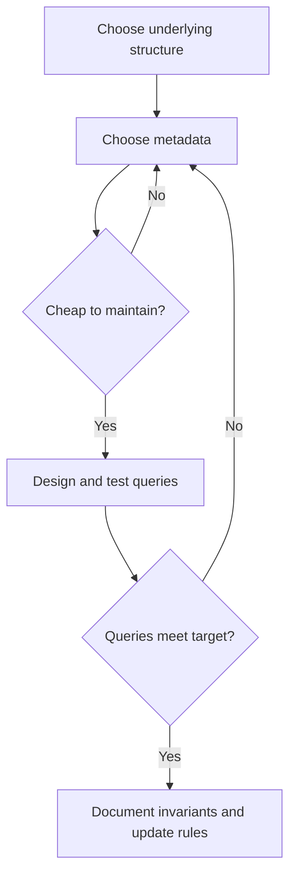

---
tags:
  - CCT3
  - Algoritmer
Topic: BST, Augmenting Data Structures, Dynamic order statistics, Interval trees
Semester: CCT3
Course: Algoritmer
Litterature:
  - Introduction to Algorithms 4th ed.
Created: 08-11-2026
---
## Table of Contents

1. [[#12. Binary Search Trees|12. Binary Search Trees]]
	1. [[#12. Binary Search Trees#12.1 What is a binary search tree?|12.1 What is a binary search tree?]]
		1. [[#12.1 What is a binary search tree?#12.1.1 Inorder Tree Walk|12.1.1 Inorder Tree Walk]]
	2. [[#12. Binary Search Trees#12.2 Querying a binary search tree|12.2 Querying a binary search tree]]
		1. [[#12.2 Querying a binary search tree#12.2.1 Searching|12.2.1 Searching]]
		2. [[#12.2 Querying a binary search tree#12.2.2 Minimum and maximum|12.2.2 Minimum and maximum]]
		3. [[#12.2 Querying a binary search tree#12.2.3 Successor and predecessor|12.2.3 Successor and predecessor]]
	3. [[#12. Binary Search Trees#12.3 Insertion and deletion|12.3 Insertion and deletion]]
		1. [[#12.3 Insertion and deletion#12.3.1 Insertion|12.3.1 Insertion]]
		2. [[#12.3 Insertion and deletion#12.3.2 Deletion|12.3.2 Deletion]]
			1. [[#12.3.2 Deletion#12.3.2.1 The TRANSPLANT Subroutine|12.3.2.1 The TRANSPLANT Subroutine]]
			2. [[#12.3.2 Deletion#12.3.2.2 The TREE-DELETE Procedure|12.3.2.2 The TREE-DELETE Procedure]]
2. [[#17. Augmenting Data Structures|17. Augmenting Data Structures]]
	1. [[#17. Augmenting Data Structures#17.1 Dynamic order statistics|17.1 Dynamic order statistics]]
		1. [[#17.1 Dynamic order statistics#17.1.1 Retrieving the element with a given rank|17.1.1 Retrieving the element with a given rank]]
		2. [[#17.1 Dynamic order statistics#17.1.2 Determining the rank of an element|17.1.2 Determining the rank of an element]]
		3. [[#17.1 Dynamic order statistics#17.1.3 Maintaining subtree sizes|17.1.3 Maintaining subtree sizes]]
	2. [[#17. Augmenting Data Structures#17.2 How to augment a data structure|17.2 How to augment a data structure]]
		1. [[#17.2 How to augment a data structure#17.2.1 Applying the four steps: order-statistic trees|17.2.1 Applying the four steps: order-statistic trees]]
		2. [[#17.2 How to augment a data structure#17.2.2 Augmenting red-black trees|17.2.2 Augmenting red-black trees]]
	3. [[#17. Augmenting Data Structures#17.3 Interval trees|17.3 Interval trees]]
		1. [[#17.3 Interval trees#17.3.1 Step 1: Underlying data structure|17.3.1 Step 1: Underlying data structure]]
		2. [[#17.3 Interval trees#17.3.2 Step 2: Additional information|17.3.2 Step 2: Additional information]]
		3. [[#17.3 Interval trees#17.3.3 Step 3: Maintaining the information|17.3.3 Step 3: Maintaining the information]]
		4. [[#17.3 Interval trees#17.3.4 Step 4: Developing new operations|17.3.4 Step 4: Developing new operations]]
		5. [[#17.3 Interval trees#17.3.5 Correctness of INTERVAL-SEARCH|17.3.5 Correctness of INTERVAL-SEARCH]]
	4. [[#17. Augmenting Data Structures#17.4 Operation reference and implementation checks|17.4 Operation reference and implementation checks]]
		1. [[#17.4 Operation reference and implementation checks#17.4.1 Operation costs and preconditions|17.4.1 Operation costs and preconditions]]
		2. [[#17.4 Operation reference and implementation checks#17.4.2 Invariant-based implementation checklist|17.4.2 Invariant-based implementation checklist]]


# 12. Binary Search Trees

| Concept or notation | Meaning / use |
|---|---|
| Binary search tree (BST) | Binary linked tree ordered by subtree key inequalities. |
| $T$, $x,y,z,u,v$, $k$ | Tree, nodes, and a key or left-subtree node count (context specified). |
| $n$, $h$, $\lg n$ | Node count, edge height, and base-two logarithm. |
| `key`, satellite data | Comparison value and associated record. |
| `left`, `right`, `p`, `root` | Child, parent, and root links. |
| `NIL` | Missing-node marker. |
| $\leq,\geq,<,>,=$ | Non-strict/strict ordering and equality. |
| $O$, $\Omega$, $\Theta$ | Asymptotic upper, lower, and tight bounds. |
| $T(n)$, $c,d$, $k$, $n-k-1$ | Traversal cost, positive constant bounds, left and right subtree sizes. |
| $\{\ldots\}$, $\to$, $\cdot$ | Set notation, a path/transition, multiplication. |
| $\min$, $\max$, $\blacksquare$, ✓ | Minimum, maximum, proof end, and verification mark. |
| `SEARCH`, `MINIMUM`, `MAXIMUM` | Find matching key or an extreme key. |
| `SUCCESSOR`, `PREDECESSOR` | Next/previous node in inorder, possibly with equal key. |
| `INSERT`, `DELETE`, `TRANSPLANT` | Add, remove, or replace a rooted subtree link. |
| $(\ldots)$; multiset | Ordered sequence notation; a collection retaining duplicate occurrences. |
| Height; satellite data | Longest root-to-leaf edge count; associated non-key record. |
| Dictionary; priority queue; rotation | Key-to-record map; extreme-priority access; local order-preserving link change. |
| Inorder / preorder / postorder | Visit root between / before / after its subtrees. |
_Table 12.1: Binary-search-tree concepts, operation syntax, and mathematical notation._

A binary search tree (BST) is a data structure that supports the core *dynamic-set operations*: `SEARCH`, `MINIMUM`, `MAXIMUM`, `PREDECESSOR`, `SUCCESSOR`, `INSERT`, and `DELETE`.
Because of this versatility, a binary search tree can serve as both a *dictionary* and a *priority queue*.

**Time Complexity and Tree Height.**

Basic single-path operations have worst-case upper bound $O(h+1)$, where $h$ is the tree’s edge height.
Individual calls may stop earlier; the tree’s shape controls the worst case:
- **Complete binary tree** with $n$ nodes: the standard operations have $O(\lg n)$ worst-case upper bounds; operations whose worst-case paths reach the bottom take $\Theta(\lg n)$ for $n\geq2$.
- **Linear chain** of $n$ nodes (degenerate case): height is $n-1$; operations that must follow the chain take $\Theta(n)$ in the worst case, though particular operations can finish sooner.

A variation called *red-black trees* guarantees a height of $O(\lg n)$, ensuring efficient operations regardless of insertion order.
Additionally, inserting $n$ distinct keys in a uniformly random permutation gives a standard BST expected height $O(\lg n)$ without explicit balancing.

> [!warning] Correction: Randomness assumption
> A random set of keys alone does not guarantee logarithmic expected height: insertion order matters. The stated bound assumes a uniformly random insertion order of distinct keys; sorted insertion still produces a chain.

The fundamental operations on binary search trees include:

- **Tree traversal** — walking the tree to produce values in sorted order.
- **Searching** — finding a specific value within the tree.
- **Finding extremes** — locating the minimum or maximum element.
- **Finding neighbors** — determining the predecessor or successor of a given element.
- **Modification** — inserting new elements and deleting existing ones.
---

## 12.1 What is a binary search tree?

> [!info] Definition: Tree height
> Height $h$ is the number of edges on the longest root-to-leaf path. A singleton has height $0$; an empty tree is handled separately in operation preconditions.

> [!example] Shape controls cost
> Insert $1,2,3,4$ into an empty ordinary BST: every new node goes right, giving height $3$. Insert $2,1,3,4$ instead: height $2$. Both inorder outputs are $1,2,3,4$; checking their longest paths gives $3$ and $2$ edges. ✓

> [!info] Definition: Satellite data
> Satellite data is the associated record stored alongside a node’s comparison key; it does not determine the tree’s ordering.

> [!example] Key versus associated record
> A student identifier is the key; the student’s name and enrollment details are satellite data. Changing the name does not change the key’s place in the tree.

> [!info] Definition: Dictionary and priority queue
> A dictionary associates keys with records and supports finding and updating them. A priority queue maintains items by priority and supports retrieving an extreme-priority item.

> [!example] Dictionary and priority-queue views
> Store student records keyed by identifier to obtain a dictionary; store jobs keyed by urgency to obtain a priority queue. With smaller keys meaning higher priority, `MINIMUM` identifies the next job. Deleting that node implements extraction.

> [!info] Definition: Red-black tree
> A red-black tree is a BST whose node colors enforce balancing: each node is red or black; the root and sentinel leaves are black; red nodes have black children; and all downward paths from any node to descendant sentinels contain the same number of black nodes. These invariants imply height at most $2\lg(n+1)$ for $n$ internal nodes.

> [!example] Checking the balancing rules
> Take a black root with key $2$ and two red leaf nodes with keys $1$ and $3$, each with black sentinel children. The inorder sequence is $(1,2,3)$; every red node has black children; and each root-to-sentinel path has the same black-node count.
> The edge height is $1$, consistent with $1\leq2\lg(3+1)=4$. Making the root red would violate the root rule even though key order is unchanged. ✓

> [!info] Definition: Rotation
> A rotation locally changes parent/child links while preserving the inorder sequence. A left rotation promotes the right child; a right rotation is its inverse. Rotations support balancing without changing the sorted node order.

> [!example] A local rotation
> Let node $x$ have key $2$, no left child, and a right child $y$ with key $3$. A left rotation makes $y$ the subtree root with left child $x$. Inorder is $(2,3)$ both before and after. No key comparison changes truth value. ✓

A BST is organized as a binary tree and can be represented using a linked data structure.
Each node contains a `key`, satellite data, and three pointer attributes:

- `left` — points to the node's left child.
- `right` — points to the node's right child.
- `p` — points to the node's parent.

If a child or parent is missing, the corresponding attribute is set to `NIL`.
The tree itself has a `root` attribute pointing to the root node (or `NIL` if the tree is empty).
The root is the only node in the tree whose parent is `NIL`.
![[Pasted image 20261108204336.png]]
_Figure 12.1: Binary search trees with the same six keys but different shapes: (a) height $2$, shown conceptually and with `left`, `right`, and `p` links; (b) height $4$. At every node, left-subtree keys are no greater and right-subtree keys no smaller. Source compares the pointer representation with its Figure 10.6 (p. 266). (Image file not supplied; description retained from the source.)_

> [!info] Definition: Binary-search-tree property
> The keys in a BST are always stored to satisfy the following invariant:
> 
> Let $x$ be any node in the tree.
> - If $y$ is a node in the **left subtree** of $x$, then $y.\text{key} \leq x.\text{key}$.
> - If $y$ is a node in the **right subtree** of $x$, then $y.\text{key} \geq x.\text{key}$.
> 
> This property holds recursively for *every* node in the tree.

> [!example] Checking the invariant
> If the root has key $6$, left-subtree keys $2,5,5$ satisfy $\leq 6$, and right-subtree keys $7,8$ satisfy $\geq 6$. Check the same condition at every descendant, not only the root. ✓

> [!warning] The invariant is global within each subtree
> Checking only immediate children is insufficient. Duplicate keys are allowed by the weak inequalities; the insertion code chooses the right branch on equality. Search returns a matching node, not necessarily every duplicate.

> [!example] A hidden ordering violation
> A root $10$ with left child $5$ and a right child $12$ under that $5$ passes the immediate-child checks at $5$, but fails the root’s invariant because $12>10$. ✓

### 12.1.1 Inorder Tree Walk


> [!info] Definition: Tree traversal orders
> Because of the binary-search-tree property, all keys can be printed in sorted order using a simple recursive algorithm called an *inorder tree walk*. It is named "inorder" because it prints the root of a subtree **between** visiting its left and right subtrees. (By contrast, a *preorder* walk prints the root **before** its subtrees, and a *postorder* walk prints the root **after** its subtrees.)

> [!example] Three traversal orders
> For root $6$, left child $2$, and right child $8$: inorder gives $2,6,8$; preorder gives $6,2,8$; postorder gives $2,8,6$. Inorder is the sorted one. ✓

> [!example] Pseudocode
> ```text
> INORDER-TREE-WALK(x)
>     if x ≠ NIL
>         INORDER-TREE-WALK(x.left)    // visit left subtree first
>         print x.key                   // then print the current node
>         INORDER-TREE-WALK(x.right)   // then visit right subtree
> ```

To print all elements in a tree $T$, call `INORDER-TREE-WALK(T.root)`.

> [!example] Inorder output
> For six nodes with sorted key sequence $(2,5,5,6,7,8)$, inorder output is $2,5,5,6,7,8$. Substitution check: every adjacent pair is nondecreasing, and all six nodes appear. ✓

> [!warning] Correction: Duplicate keys are not a six-element mathematical set
> The source writes the keys with set braces, but sets do not retain repeated occurrences. The tree contains six distinct nodes; their keys form a multiset, or an inorder sequence, with two occurrences of $5$.

Walking an $n$-node binary search tree takes $\Theta(n)$ time, because after the initial call the procedure recurses exactly twice per node — once for the left child and once for the right child.

> [!summary] Theorem: 1 — Inorder Tree Walk Time Complexity
> If $x$ is the root of an $n$-node subtree, then the call `INORDER-TREE-WALK(x)` takes $\Theta(n)$ time.
>
> **Breakdown:** $n$ counts nodes; $T(n)$ is traversal time; $k$ counts left-subtree nodes; $c,d>0$ bound base-case and per-node work.
>
> **Proof:** Every real node is printed once, giving the lower bound. The recurrence $T(n)\leq T(k)+T(n-k-1)+d$, with $T(0)=c$, implies $T(n)\leq(c+d)n+c$ by induction, proving the matching upper bound.

> [!example] Applying Theorem 1
> For a six-node tree, there are $6$ real-node visits and $7$ empty-child calls, hence $13$ total calls. Check: $2\cdot6+1=13$. ✓

**Detailed breakdown (Theorem 1).**

- $T(n)$: The time taken by `INORDER-TREE-WALK` when called on the root of an $n$-node subtree.
- $n$: The total number of nodes in the subtree.
- $k$: The number of nodes in the left subtree of the current node.
- $n - k - 1$: The number of nodes in the right subtree (total minus left subtree minus the root itself).
- $c$: A constant representing the time for the base case (the `NIL` check on an empty subtree), where $c > 0$.
- $d$: A constant representing the upper bound on the time to execute the body of the procedure (the comparison and print), exclusive of recursive calls, where $d > 0$.

**Detailed proof (Theorem 1).**

Let $T(n)$ denote the running time on an $n$-node subtree.

*Lower bound:* Since the procedure visits all $n$ nodes, $T(n) = \Omega(n)$.

*Upper bound:* We show $T(n) = O(n)$ using the **substitution method**, proving that $T(n) \leq (c + d)n + c$.

**Base case** ($n = 0$): The procedure performs only the `NIL` check, so $T(0) = c$.
Our bound gives $(c + d) \cdot 0 + c = c = T(0)$. ✓

**Inductive step** ($n > 0$): Suppose the current node $x$ has a left subtree of $k$ nodes and a right subtree of $n - k - 1$ nodes.
Then:

$$T(n) \leq T(k) + T(n - k - 1) + d$$

Applying the inductive hypothesis to both recursive calls:

$$T(n) \leq \bigl((c+d)k + c\bigr) + \bigl((c+d)(n-k-1) + c\bigr) + d$$

Expanding and simplifying:

$$= (c+d)n - (c+d) + 2c + d$$

$$= (c+d)n + c$$

This completes the proof that $T(n) = O(n)$.
Combined with the lower bound, $T(n) = \Theta(n)$. $\blacksquare$


---

## 12.2 Querying a binary search tree

> [!warning] Correction: Height counts edges
> A root-to-leaf path of height $h$ contains $h+1$ nodes, not $h$ nodes. We use $O(h+1)$ throughout so that a singleton is explicitly covered. Textbooks conventionally shorten this to $O(h)$ for positive height. A singleton still takes constant time.

Binary search trees support the query operations `SEARCH`, `MINIMUM`, `MAXIMUM`, `SUCCESSOR`, and `PREDECESSOR`.
Each of these operations can be performed in $O(h+1)$ time on any binary search tree of height $h$.

**Query Time Complexity.**

All five dynamic-set query operations — `SEARCH`, `MINIMUM`, `MAXIMUM`, `SUCCESSOR`, and `PREDECESSOR` — run in $O(h+1)$ time, where $h$ is the height of the tree.
This is because each operation traces a simple path either downward or upward through the tree, visiting at most $h+1$ non-sentinel nodes.

### 12.2.1 Searching


Iterative search uses constant auxiliary space; recursive search uses stack space proportional to the path length.
Inorder traversal also needs stack space $O(h+1)$, even though its total work is linear.

To search for a node with a given key, the `TREE-SEARCH` procedure takes a pointer $x$ to the root of a subtree and a key $k$.
It returns a pointer to a node with key $k$ if one exists, or `NIL` otherwise.
To search the entire tree $T$, call `TREE-SEARCH(T.root, k)`.

> [!example] Search decisions
> For the source path $15\to6\to7\to13$, substitute target $13$ into each comparison: $13<15$, $13>6$, $13>7$, then equality. The search returns the node with key $13$. ✓

> [!example] Pseudocode
> ```text
> TREE-SEARCH(x, k)
>     if x == NIL or k == x.key       // base case: found it or hit a dead end
>         return x
>     if k < x.key
>         return TREE-SEARCH(x.left, k)   // key must be in left subtree
>     else
>         return TREE-SEARCH(x.right, k)  // key must be in right subtree
> ```

The procedure starts at the root and traces a simple path downward.
At each node $x$, it compares $k$ with `x.key`.
If they are equal, the search terminates.
If $k$ is smaller, the search continues in the left subtree (the binary-search-tree property guarantees $k$ cannot be in the right subtree).
If $k$ is larger, the search continues in the right subtree.
The running time is $O(h+1)$ because the nodes visited form a simple downward path from the root.
![[Pasted image 20261108204850.png]]
_Figure 12.2: Searching for key $13$ follows $15 \to 6 \to 7 \to 13$ from the root. (Image file not supplied; description retained from the source.)_

Since `TREE-SEARCH` recurses on only one subtree at each step (not both), the recursion can be unrolled into a `while` loop.
The iterative version is typically more efficient on most computers:

> [!example] Pseudocode
> ```text
> ITERATIVE-TREE-SEARCH(x, k)
>     while x ≠ NIL and k ≠ x.key     // loop until found or dead end
>         if k < x.key
>             x = x.left               // move to left child
>         else
>             x = x.right              // move to right child
>     return x
> ```

### 12.2.2 Minimum and maximum

> [!warning] Empty-subtree precondition
> `TREE-MINIMUM` and `TREE-MAXIMUM` below require a non-`NIL` starting node. They stop at the last real node, not at `NIL`. An empty-tree wrapper should return `NIL` before calling them.

> [!example] Extreme keys
> The source tree has minimum $2$ and maximum $20$. Following only left links reaches $2$; following only right links reaches $20$. Each returned node lacks a child in the searched direction.

Finding the minimum key in a subtree is straightforward: follow left child pointers from the root of the subtree until reaching `NIL`.
The correctness follows from the binary-search-tree property — if a node $x$ has no left subtree, then `x.key` is the minimum since every key in the right subtree is at least as large.
If $x$ does have a left subtree, the minimum must reside there because all keys in the left subtree are no larger than `x.key`, and no key in the right subtree is smaller.

> [!example] Pseudocode
> ```text
> TREE-MINIMUM(x)
>     while x.left ≠ NIL       // keep going left
>         x = x.left
>     return x                  // leftmost node is the minimum
> ```

The `TREE-MAXIMUM` procedure is symmetric, following right child pointers instead:

> [!example] Pseudocode
> ```text
> TREE-MAXIMUM(x)
>     while x.right ≠ NIL      // keep going right
>         x = x.right
>     return x                  // rightmost node is the maximum
> ```

Both procedures run in $O(h+1)$ time since the sequence of nodes encountered forms a simple downward path from the root.
![[Pasted image 20261108204938.png]]
_Figure 12.3: Minimum key $2$ is reached by following left links; maximum key $20$ is reached by following right links. (Image file not supplied; description retained from the source.)_

### 12.2.3 Successor and predecessor

> [!info] Definition: Successor and predecessor
> The *successor* of a node $x$ is defined as the next node that would be visited in an inorder tree walk. If all keys are distinct, this is the node with the smallest key greater than `x.key`. The structure of the BST allows the successor to be determined *without comparing keys*. The `TREE-SUCCESSOR` procedure returns the successor of $x$ if it exists, or `NIL` if $x$ is the last node in an inorder walk.
> The predecessor is the previous node in inorder; its cases exchange left and right. The first node has no predecessor, and the last has no successor.

> [!example] Adjacent nodes in sorted order
> For inorder keys $(2,5,5,6)$, the successor of the first key-$5$ node is the second key-$5$ node. The predecessor of the key-$6$ node is the second key-$5$ node. Equal key values do not erase node identity.

The algorithm handles two cases:

1.
**Right subtree is nonempty:** The successor is the leftmost node in $x$'s right subtree (i.e., the minimum of the right subtree).

> [!example] Successor in a right subtree
> A node with key $15$ whose right subtree contains $17$ and $19$ has successor $17$. Check: $17=\min\{17,19\}$. ✓
![[Pasted image 20261108205042.png]]
_Figure 12.4: The successor of key $15$ is key $17$, the minimum in its right subtree. (Image file not supplied; description retained from the source.)_

2.
**Right subtree is empty:** The successor is the *lowest ancestor* of $x$ whose left child is also an ancestor of $x$.
To find it, walk up the tree from $x$ until you encounter a node that is the left child of its parent (or reach the root).

> [!example] Successor above a node
> A node with key $13$ and no right subtree is followed by the first ancestor reached from a left-child link. In the source’s example this is key $15$, so the successor is $15$. ✓
![[Pasted image 20261108205059.png]]
_Figure 12.5: Key $13$ has no right subtree; its successor is key $15$, the lowest ancestor reached through an ancestral left-child link. (Image file not supplied; description retained from the source.)_

> [!example] Pseudocode
> ```text
> TREE-SUCCESSOR(x)
>     if x.right ≠ NIL
>         return TREE-MINIMUM(x.right)    // Case 1: leftmost in right subtree
>     else                                // Case 2: go up to find lowest ancestor
>         y = x.p                         //   whose left child is an ancestor of x
>         while y ≠ NIL and x == y.right  //   keep going up while x is a right child
>             x = y
>             y = y.p
>         return y
> ```

The running time is $O(h+1)$ because the procedure either follows a simple path down the tree (Case 1) or a simple path up the tree (Case 2).
The `TREE-PREDECESSOR` procedure is symmetric to `TREE-SUCCESSOR` and also runs in $O(h+1)$ time.

> [!summary] Theorem: 2 — Query Operations Time Bound
> The dynamic-set operations `SEARCH`, `MINIMUM`, `MAXIMUM`, `SUCCESSOR`, and `PREDECESSOR` can each be implemented to run in $O(h+1)$ time on a binary search tree of height $h$.
>
> **Breakdown:** $h$ is edge height; $O$ gives an asymptotic upper bound.
>
> **Proof:** Each operation follows a rootward or leafward path with at most $h+1$ nodes and constant work per node. Thus its time is $O(h+1)$, with constant time for a singleton.

> [!example] Applying Theorem 2
> Searching a height-$3$ chain can inspect $4$ nodes. Check: $h+1=3+1=4$. ✓

**Detailed breakdown (Theorem 2).**

- $h$: The height of the binary search tree.
This determines the maximum length of any root-to-leaf path.
- $O(h+1)$: Each query operation traces at most one simple path (upward or downward) through the tree, visiting no more than $h+1$ non-sentinel nodes.

**Detailed proof (Theorem 2).**

Each of the five operations follows a simple path in the tree — either downward from the root (`SEARCH`, `MINIMUM`, `MAXIMUM` ) or along a single upward/downward traversal (`SUCCESSOR`, `PREDECESSOR` ).
Since each path followed here is ancestor-to-descendant or descendant-to-ancestor and contains at most $h+1$ nodes, and each node requires $O(1)$ work, every operation completes in $O(h+1)$ time. $\blacksquare$


---

## 12.3 Insertion and deletion

The operations of insertion and deletion cause the dynamic set represented by a binary search tree to change.
The data structure must be modified to reflect this change while preserving the binary-search-tree property.
Inserting a new element is relatively straightforward, but deleting a node is more complicated.

### 12.3.1 Insertion


The `TREE-INSERT` procedure inserts a new node into a binary search tree.
It takes a tree $T$ and a node $z$ whose `key` has already been set, with `z.left = NIL` and `z.right = NIL`.
It modifies $T$ and some attributes of $z$ to place $z$ in the correct position.

> [!example] Inserting key $13$
> Following comparisons from the root locates the missing child link where $13$ belongs. If the search reaches node $7$ and its right link is empty, set `z.p` to that node and `7.right` to `z`; initialize both children of `z` to `NIL`. Substitution check: $13>7$, and all earlier ancestor comparisons must also hold. ✓

> [!example] Pseudocode
> ```text
> TREE-INSERT(T, z)
>     x = T.root          // x traces the path down the tree
>     y = NIL             // y will become z's parent
>     while x ≠ NIL       // descend until reaching a leaf position
>         y = x           // y trails behind x
>         if z.key < x.key
>             x = x.left  // go left
>         else
>             x = x.right // go right
>     z.p = y             // found the location — insert z with parent y
>     if y == NIL
>         T.root = z      // tree T was empty
>     else if z.key < y.key
>         y.left = z      // z becomes y's left child
>     else
>         y.right = z     // z becomes y's right child
> ```

The procedure begins at the root and traces a simple path downward, searching for the `NIL` position to replace with the input node $z$.
A trailing pointer $y$ maintains the parent of $x$ throughout the descent.
The `while` loop moves both pointers down the tree, going left or right based on comparing `z.key` with `x.key`, until $x$ becomes `NIL`.
This `NIL` marks the position where $z$ belongs — it is either a left or right attribute of the node that will become $z$'s parent, or it is `T.root` if the tree is currently empty.
The trailing pointer $y$ is necessary because by the time the correct `NIL` is found, the search has already moved one step past the node that needs to be modified.
![[Pasted image 20261108213713.png]]
_Figure 12.6: Insertion of key $13$: the source marks the descent path in blue and the new node and parent link in orange. (Image file not supplied; description retained from the source.)_

Like other primitive BST operations, `TREE-INSERT` runs in $O(h+1)$ time on a tree of height $h$.

### 12.3.2 Deletion

> [!example] Deleting a node with two children
> Let $z$ have key $15$, left child $6$, and right child $20$ whose left child is $17$. The successor is $17$. First replace $17$ at its old position by its right child (here `NIL`); then move $17$ into $15$’s position with children $6$ and $20$.
> Check: inorder changes from $6,15,17,20$ to $6,17,20$, removing exactly $15$. ✓

The three conceptual cases below explain the idea; the four implementation cases distinguish where the successor is located.
See [[#12.2 Querying a binary search tree]] for successor selection.

The overall strategy for deleting a node $z$ from a binary search tree has three conceptual cases:

1.
**$z$ has no children:** Simply remove $z$ by modifying its parent to replace $z$ with `NIL`.
2.
**$z$ has one child:** Elevate that child to take $z$'s position by modifying $z$'s parent to replace $z$ with $z$'s child.
3.
**$z$ has two children:** Find $z$'s successor $y$, which must be in $z$'s right subtree and has no left child.
Move $y$ to take $z$'s position.
The rest of $z$'s right subtree becomes $y$'s new right subtree, and $z$'s left subtree becomes $y$'s new left subtree.
Since $y$ is $z$'s successor, it cannot have a left child, and $y$'s original right child moves into $y$'s original position with the rest of $y$'s original right subtree following automatically.
This case is the trickiest because the implementation differs depending on whether $y$ is $z$'s right child.

The actual `TREE-DELETE` procedure reorganizes these into four implementation cases:

- **$z$ has no left child:** Replace $z$ by its right child (which may or may not be `NIL`).
When the right child is `NIL`, this handles the no-children case.
When it is non-`NIL`, this handles the single-right-child case.
- **$z$ has a left child but no right child:** Replace $z$ by its left child.
- **$z$ has two children, and its successor $y$ is $z$'s right child:** Replace $z$ by $y$, leaving $y$'s right child alone.
- **$z$ has two children, and its successor $y$ is not $z$'s right child:** First replace $y$ by its own right child, then replace $z$ by $y$.

![[Pasted image 20261108213743.png]]
_Figure 12.7: Deleting node $z$ (blue), which may be root or either child of $q$: (a) replace it by right child $r$, possibly `NIL`; (b) replace it by its sole left child $l$; (c) promote its immediate-right-child successor $y$, attach $l$, retain $y$’s right child $x$; (d) splice deeper successor $y \ne r$ out with its right child $x$, then give $y$ the position of $z$ and children $l,r$. Replacement nodes are orange in the source. (Image file not supplied; description retained from the source.)_
#### 12.3.2.1 The TRANSPLANT Subroutine


As part of deletion, subtrees need to move around within the tree.
The `TRANSPLANT` subroutine replaces one subtree as a child of its parent with another subtree.
When `TRANSPLANT` replaces the subtree rooted at node $u$ with the subtree rooted at node $v$, node $u$'s parent becomes node $v$'s parent, and $u$'s parent ends up having $v$ as the appropriate child.
The argument $v$ is allowed to be `NIL`.

> [!example] Transplant is not a full deletion
> If `u` is the root and `v` is its right child, `TRANSPLANT(T,u,v)` assigns `T.root = v` and `v.p = NIL`. It does not attach `u.left` to `v`; deletion must perform any needed child assignments separately.

> [!example] Pseudocode
> ```text
> TRANSPLANT(T, u, v)
>     if u.p == NIL
>         T.root = v          // u was the root; v becomes the new root
>     else if u == u.p.left
>         u.p.left = v        // u is a left child; replace it with v
>     else
>         u.p.right = v       // u is a right child; replace it with v
>     if v ≠ NIL
>         v.p = u.p           // update v's parent pointer
> ```

The first two lines handle the case where $u$ is the root of $T$.
Otherwise, $u$ is either a left or right child of its parent, and the appropriate pointer is updated.
Because $v$ may be `NIL`, the parent pointer of $v$ is only updated when $v$ is non-`NIL`.
Importantly, `TRANSPLANT` does *not* update `v.left` or `v.right` — that responsibility belongs to the caller.

#### 12.3.2.2 The TREE-DELETE Procedure

> [!example] Pseudocode
> ```text
> TREE-DELETE(T, z)
>     if z.left == NIL
>         TRANSPLANT(T, z, z.right)       // Case 1: replace z by its right child
>     else if z.right == NIL
>         TRANSPLANT(T, z, z.left)        // Case 2: replace z by its left child
>     else
>         y = TREE-MINIMUM(z.right)       // y is z's successor (in right subtree)
>         if y ≠ z.right                  // Case 4: y is deeper in the right subtree
>             TRANSPLANT(T, y, y.right)   //   splice y out: replace y by its right child
>             y.right = z.right           //   z's right child becomes y's right child
>             y.right.p = y
>         TRANSPLANT(T, z, y)             // Case 3 or 4: replace z by successor y
>         y.left = z.left                 //   give z's left child to y
>         y.left.p = y                    //   (y had no left child, being the successor)
> ```

The procedure executes the four cases as follows.
The first two lines handle $z$ having no left child.
The next two lines handle $z$ having a left child but no right child.
The remaining lines deal with $z$ having two children: the successor $y$ is found via `TREE-MINIMUM(z.right)`.
If $y$ is not $z$'s right child, $y$ is first spliced out of its current position by replacing it with its own right child, and then $z$'s right child is reassigned to $y$.
Finally, $z$ is replaced by $y$, and $z$'s left child is given to $y$.

Each line of `TREE-DELETE`, including the calls to `TRANSPLANT`, takes constant time, except for the call to `TREE-MINIMUM`.
Thus, `TREE-DELETE` runs in $O(h+1)$ time on a tree of height $h$.

> [!summary] Theorem: 3 — Insertion and Deletion Time Bound
> The dynamic-set operations `INSERT` and `DELETE` can each be implemented to run in $O(h+1)$ time on a binary search tree of height $h$.
>
> **Breakdown:** $h$ is edge height; transplants take $O(1)$ and the minimum search takes $O(h+1)$.
>
> **Proof:** Insertion follows one descent; deletion performs at most one minimum search and constantly many transplants. Each costs $O(h+1)$ overall.

> [!example] Applying Theorem 3
> Deleting a leaf uses a constant-time transplant; deleting a two-child node can additionally descend for a successor. Both satisfy the height bound.

**Detailed breakdown (Theorem 3).**

- $h$: The height of the binary search tree, representing the maximum length of any root-to-leaf path.
- $O(h+1)$: Both operations trace simple paths through the tree. `TREE-INSERT` descends from the root to a leaf position. `TREE-DELETE` performs at most one call to `TREE-MINIMUM` (which descends a path of length at most $h$) plus a constant number of `TRANSPLANT` operations (each $O(1)$).

**Detailed proof (Theorem 3).**

`TREE-INSERT` follows a single downward path from the root to a `NIL` position, performing $O(1)$ work at each node, yielding $O(h+1)$ total time. `TREE-DELETE` executes a constant number of `TRANSPLANT` calls (each taking $O(1)$ time) and at most one `TREE-MINIMUM` call (which takes $O(h+1)$ time), so its total running time is also $O(h+1)$. $\blacksquare$


---

# 17. Augmenting Data Structures

| Concept or notation | Meaning / use |
|---|---|
| $A,B,C$; $a,b,c$ | Unchanged subtrees in the rotation diagram and their respective node counts. |
| Auxiliary space | Temporary working memory, excluding the stored tree nodes. |
| Order-statistic (OS), `OS-SELECT`, `OS-RANK` | Select by position or rank an existing node. |
| Red-black tree; BST | Balanced colored binary search tree; binary search tree. |
| $T,n,x,y$, $i,r$ | Tree, node count, nodes, requested position/query interval, and rank accumulator (context specified). |
| `T.nil`, `color` | Shared empty-child sentinel and red/black node color. |
| `size` | Internal-node count including the subtree root. |
| $f$, `x.f` | Augmented attribute and its value at node $x$. |
| $[t_1,t_2]$, `int`, `low`, `high` | Closed interval, interval object, and endpoints. |
| $i'$, $i''$ | Additional intervals used in the correctness proof. |
| `max`, $\max$, $-\infty$ | Subtree maximum high endpoint, maximum operator, empty-subtree identity. |
| $\cap$, $\emptyset$, $\neq$, $\in$ | Set intersection, empty set, inequality, and membership. |
| $\{1,\ldots,n\}$ | Valid one-based ranks. |
| $\leq,\geq,<,>,=$ | Endpoint/rank comparisons and equality. |
| $O,\Theta,\lg,\lg^2 n$ | Upper/tight bounds, base-two logarithm, and $(\lg n)^2$. |
| `INTERVAL-INSERT`, `INTERVAL-DELETE`, `INTERVAL-SEARCH` | Maintain intervals and find any overlap. |
| `left`, `right`, `p`, `root`, `key` | Node links and comparison key inherited from the underlying tree. |
_Table 17.1: Augmentation, order-statistic queries, interval notation, and abbreviations._

> [!info] Definition: Augmentation
> Augmentation stores extra information in an existing structure to support additional operations while preserving its original invariants.

> [!example] A useful cached answer
> Storing each subtree’s node count allows selection by sorted position without visiting every preceding node. The benefit depends on keeping those counts correct after every update.

Some algorithmic problems can be solved with standard data structures — such as doubly linked lists, hash tables, or binary search trees — but many others require a bit more creativity.
Rather than inventing an entirely new data structure from scratch, a more practical approach is to *augment* an existing one by storing additional information within it.
New operations can then be programmed on top of the augmented structure to support specific application needs.

> [!warning] The Challenge of Augmentation
> Augmenting a data structure is not always straightforward. The additional information stored in the structure must be **updated and maintained** by all of the ordinary operations (insertion, deletion, rotation, etc.) on the underlying data structure. If any operation fails to keep the extra information consistent, the augmented structure will produce incorrect results.

The four-step augmentation framework is developed in [[#17.2 How to augment a data structure]]; the two applications below put it into practice.

**Two Key Applications of Augmented Red-Black Trees.**

This topic explores two concrete examples of augmenting red-black trees with extra information:

- **Order-statistic trees:** A red-black tree augmented to support *order-statistic operations* on a dynamic set — specifically, quickly finding the $i$th smallest element or determining the *rank* of a given element (its position in sorted order).
- **Interval trees:** A red-black tree augmented to maintain a dynamic set of *intervals* (such as time intervals), enabling fast queries to find any interval that overlaps a given query interval.

Between these two examples, a general methodology for augmenting data structures is formalized, including a theorem that provides a systematic way to verify whether a proposed augmentation of a red-black tree can be maintained efficiently.

---

## 17.1 Dynamic order statistics


> [!info] Definition: Order statistic and node rank
> The $i$th order statistic of $n$ nodes, for $i\in\{1,2,\ldots,n\}$, is the node in position $i$ in nondecreasing key order. A node’s rank is its one-based position in an inorder walk. Duplicate keys belong to distinct nodes with distinct positions.
> Selection takes a position and returns a node; ranking takes a node and returns its position. Rank is not uniquely determined by a key value when duplicate keys exist.

> [!example] Order statistics and ranks
> In sorted node order $2,5,5,6,7,8$, the fourth order statistic is the node with key $6$. The two nodes with key $5$ have ranks $2$ and $3$, respectively. Substitution check: there are exactly three nodes before key $6$. ✓

An order statistic can be found in $O(n)$ time from unordered input.
An order-statistic tree maintains a dynamic set of nodes and supports selection and node ranking in $O(\lg n)$ time, rather than rebuilding sorted order after every update.

> [!info] Definition: Order-statistic tree
> An order-statistic tree is a red-black tree augmented with one additional attribute per node: `x.size`. Each node $x$ contains the standard red-black tree attributes (`x.key`, `x.color`, `x.p`, `x.left`, `x.right`) plus:
> - `x.size`: The number of internal nodes in the subtree rooted at $x$, **including** $x$ itself but **excluding** sentinels.
> 
> This gives the identity:
> 
> $$x.\text{size} = x.\text{left}.\text{size} + x.\text{right}.\text{size} + 1$$
> 
> where the sentinel's size is defined as $0$ (i.e., $T.\text{nil}.\text{size} = 0$).

> [!example] Applying the size identity
> With left size $3$ and right size $2$, a node has size $3+2+1=6$. A leaf has size $0+0+1=1$. The sentinel contributes $0$ in both computations. ✓

The identity’s terms are the counts for the left subtree, the right subtree, and the current node; `T.nil` is the shared empty-child sentinel.

Keys in an order-statistic tree need not be distinct.
The inorder-position definition of node rank resolves equal-key ties without treating their nodes as identical.

> [!example] Equal keys, distinct node ranks
> If two nodes both have key $14$, the one appearing earlier in inorder has the lower rank. Their keys are equal, but their positions are distinct.
![[Pasted image 20261108215915.png]]
_Figure 17.1: An order-statistic tree: each red-black node stores `size`, counting its subtree’s internal nodes but excluding the sentinel. (Image file not supplied; description retained from the source.)_
### 17.1.1 Retrieving the element with a given rank

> [!warning] Valid-rank precondition
> `OS-SELECT(x,i)` requires a real node and $1\leq i\leq x.\text{size}$. An out-of-range index is not handled by the pseudocode. When descending right, subtract the local root rank, not just the left-subtree size.

The order-statistic (OS) procedures use subtree sizes to navigate by position.
The `OS-SELECT` procedure returns a pointer to the node containing the $i$th smallest key in the subtree rooted at $x$.
To find the $i$th smallest element in the entire tree $T$, call `OS-SELECT(T.root, i)`.

> [!example] Pseudocode
> ```text
> OS-SELECT(x, i)
>     r = x.left.size + 1          // rank of x within its own subtree
>     if i == r
>         return x                 // x is the ith smallest
>     else if i < r
>         return OS-SELECT(x.left, i)       // ith smallest is in left subtree
>     else
>         return OS-SELECT(x.right, i - r)  // adjust rank for right subtree
> ```

The logic works as follows.
The value `x.left.size + 1` gives the rank of $x$ within the subtree rooted at $x$, because `x.left.size` counts the nodes that precede $x$ in an inorder walk of that subtree.
Three cases arise:

- If $i = r$, then $x$ itself is the $i$th smallest element.
- If $i < r$, the $i$th smallest element must be in $x$'s left subtree, so the procedure recurses left with the same $i$.
- If $i > r$, the $i$th smallest element is in $x$'s right subtree.
Since $r$ elements in the subtree rooted at $x$ come before the right subtree in an inorder walk, the target is the $(i - r)$th smallest element in the right subtree.

> [!example] OS-SELECT Walkthrough
> Suppose we search for the 17th smallest element in a tree whose root has key $26$ with a left subtree of size $12$.
> 
> 1. **Root (key 26):** $r = 12 + 1 = 13$. Since $17 > 13$, recurse right with $i = 17 - 13 = 4$.
> 2. **Node (key 41):** $r = 5 + 1 = 6$. Since $4 < 6$, recurse left with $i = 4$.
> 3. **Node (key 30):** $r = 1 + 1 = 2$. Since $4 > 2$, recurse right with $i = 4 - 2 = 2$.
> 4. **Node (key 38):** $r = 1 + 1 = 2$. Since $i = r = 2$, return this node.
> 
> The 17th smallest element has key $38$.
> Check: the path skips $13$ nodes at the root, then $2$ at key $30$, then chooses local rank $2$ at key $38$; $13+2+2=17$. ✓

Because each recursive call descends one level in the tree, the running time is proportional to the height.
Since the underlying structure is a red-black tree, `OS-SELECT` runs in $O(\lg n)$ time.

### 17.1.2 Determining the rank of an element


Given a pointer to a node $x$ in an order-statistic tree $T$, the `OS-RANK` procedure returns the position of $x$ in the linear order determined by an inorder tree walk of $T$.

> [!example] Accumulating rank upward
> Suppose `x.left.size` is $1$, so the initial rank is $2$. If `x` is a right child whose parent’s left subtree has size $3$, add $3+1=4$ to get $6$. If that parent is a left child of the root, add nothing further.
> Check: within the full tree, the four nodes newly passed plus the two locally counted nodes give rank $4+2=6$. ✓

> [!example] Pseudocode
> ```text
> OS-RANK(T, x)
>     r = x.left.size + 1    // rank of x within its own subtree
>     y = x                  // y tracks the current subtree root being examined
>     while y ≠ T.root
>         if y == y.p.right  // if y is a right child...
>             r = r + y.p.left.size + 1  // ...add parent's left subtree + parent itself
>         y = y.p            // move y toward the root
>     return r
> ```

The idea is that a node's rank equals the number of nodes preceding it in an inorder walk, plus $1$ for itself.
The procedure walks upward from $x$ to the root, accumulating the sizes of left subtrees of ancestors whenever the path comes from the right.

> [!summary] Theorem: 4 — Correctness of OS-RANK via Loop Invariant
> **Loop invariant:** At the start of each iteration of the `while` loop, $r$ is the rank of node $x$ in the subtree rooted at node $y$.
>
> **Breakdown:** $r$ is the accumulated rank of node $x$ within the subtree rooted at the current ancestor $y$.
>
> **Proof:** The accumulator initially ranks $x$ within its own subtree. Climbing from a right child adds exactly the parent and its left subtree; climbing from a left child adds nothing. At the root it is the full-tree node rank.

> [!example] Applying Theorem 4
> With local rank $2$ and a right-child climb past a left subtree of size $3$, the new rank is $2+3+1=6$. ✓

**Detailed breakdown (Theorem 4).**

- $r$: The running rank accumulator, initialized to `x.left.size + 1`.
- $y$: The current ancestor being examined, initialized to $x$ and moving upward toward the root each iteration.
- $y.\text{p}.\text{left}.\text{size} + 1$: When $y$ is a right child, this counts all nodes in the parent's left subtree plus the parent itself — all of which precede $x$ in the inorder walk.

**Detailed proof (Theorem 4).**

- *Initialization:* Before the first iteration, $r = x.\text{left}.\text{size} + 1$, which is the rank of node $x$ within the subtree rooted at $x$.
Setting $y = x$ makes the invariant true.
- *Maintenance:* At the end of each iteration, $y$ is set to $y.\text{p}$.
If $y$ was a left child, neither $y.\text{p}$ nor any node in $y.\text{p}$'s right subtree precedes $x$, so $r$ is unchanged and remains correct for the larger subtree.
If $y$ was a right child, all nodes in $y.\text{p}$'s left subtree and $y.\text{p}$ itself precede $x$ in the inorder walk, so $r$ is increased by $y.\text{p}.\text{left}.\text{size} + 1$, correctly reflecting the rank within the subtree rooted at $y.\text{p}$.
- *Termination:* The loop terminates when $y = T.\text{root}$, at which point the subtree rooted at $y$ is the entire tree, so $r$ is the rank of node $x$ in the full tree. $\blacksquare$


Each iteration takes $O(1)$ time and moves $y$ one level up the tree, so `OS-RANK` runs in $O(\lg n)$ time on an $n$-node order-statistic tree.

### 17.1.3 Maintaining subtree sizes

> [!example] Left rotation: unchanged order, changed links and sizes
> Let $A,B,C$ denote unchanged child subtrees with node counts $a,b,c$. Before rotation, $x$ has left subtree $A$ and right child $y$; $y$ has children $B,C$. After rotation, $y$ is the subtree root, with children $x,C$; $x$ has children $A,B$.
>
> ```mermaid
> flowchart TB
>     subgraph Before["Before: rotate left at x"]
>         X0["x: old size = a + b + c + 2"] --> A0["A: size a"]
>         X0 --> Y0["y: old size = b + c + 1"]
>         Y0 --> B0["B: size b"]
>         Y0 --> C0["C: size c"]
>     end
>     subgraph After["After: y is the new subtree root"]
>         Y1["y: new size = old x.size"] --> X1["x: new size = a + b + 1"]
>         Y1 --> C1["C: size c"]
>         X1 --> A1["A: size a"]
>         X1 --> B1["B: size b"]
>     end
> ```
> _Figure 17.2: A left rotation preserves the inorder sequence while changing only the links around $x,y$ and the two affected size fields; $A,B,C$ retain their nodes and metadata._
>
> The inorder sequence in both cases is $A,x,B,y,C$, where a subtree name stands for its inorder sequence. The old parent of $x$ now links to $y$ (or `T.root` becomes $y$); `y.p` inherits the old `x.p`, `x.p` becomes `y`, and the root of nonempty $B$ gets parent `x`. The roots of $A$ and $C$ keep their existing parents.
> Set $y.\text{size}$ to the **old** $x.\text{size}$ before recomputing $x.\text{size}=a+b+1$. Only these two size fields change; ancestors see the same total subtree size. Substituting gives $y.\text{size}=(a+b+1)+c+1=a+b+c+2$, the old total. ✓

> [!example] Local repair after a left rotation
> Before rotation, let $x$ have a left subtree of size $2$, and let its right child $y$ have subtree sizes $3$ and $4$. Then $y.\text{size}=3+4+1=8$ and $x.\text{size}=2+8+1=11$.
> After rotation, $x.\text{size}=2+3+1=6$ and $y.\text{size}=6+4+1=11$. The new root inherits the old total size. ✓

The rotation repair uses the **old** value of `x.size` for `y.size` before recomputing `x.size`.
Reversing that assignment order corrupts the count.

The `size` attribute must be efficiently maintained during insertion and deletion to preserve the $O(\lg n)$ query times.
Fortunately, this can be done without affecting the asymptotic running time of either operation.

**Insertion** into a red-black tree consists of two phases:

1.
**Downward phase:** The new node is inserted as a child of an existing leaf.
To maintain sizes, increment `x.size` for every node $x$ on the simple path traversed from the root to the insertion point.
The new node receives a size of $1$.
Since this path has $O(\lg n)$ nodes, the additional cost is $O(\lg n)$.

2.
**Upward phase:** Colors are changed and at most two rotations are performed to restore red-black properties.
A rotation is a local operation that invalidates the `size` attributes of only the two nodes incident on the rotation link.
The fix is to add two lines to the rotation procedure.
For a left rotation on node $x$ producing node $y$ as the new subtree root:

> [!example] Pseudocode
> ```text
> // After the standard rotation pointer updates:
> y.size = x.size                            // y inherits x's old subtree size
> x.size = x.left.size + x.right.size + 1    // recompute x's size from its new children
> ```

The right rotation update is symmetric.
Since at most two rotations occur, the second phase adds only $O(1)$ time.
Total insertion time remains $O(\lg n)$.
![[Pasted image 20261108220918.png]]
_Figure 17.3: Local subtree-size repair during a rotation: only the two nodes on the rotated link need new sizes; the triangular subtrees retain their own sizes. (Image file not supplied; description retained from the source.)_

**Deletion** from a red-black tree also has two phases:

1.
**Structural phase:** One node is removed and at most two other nodes may be repositioned within the tree.
To update sizes, repair the affected ancestor path or paths bottom-up after the structural changes, recomputing each affected node as the sum of its children’s sizes plus one.
If the successor is moved, repair its old ancestor path first and compute its size at the new position from its new children.
These paths have total length $O(\lg n)$, so the additional cost is $O(\lg n)$.

> [!warning] Correction: Size maintenance after moving a successor
> Blindly decrementing sizes along one path is not a complete rule for the node-moving `TREE-DELETE` above: the successor acquires different children and needs a freshly computed size. Bottom-up recomputation on the affected paths handles this safely in $O(\lg n)$ time.

2.
**Rotation phase:** At most three rotations are performed, handled identically to the insertion case — each rotation requires $O(1)$ time to update the two affected `size` attributes.

> [!summary] Theorem: 5 — Order-Statistic Tree Operation Times
> On an order-statistic tree with $n$ nodes, all dynamic-set operations — including `OS-SELECT`, `OS-RANK`, `INSERT`, and `DELETE` — run in $O(\lg n)$ time.
>
> **Breakdown:** $n$ counts internal nodes; $\lg$ is base-two logarithm; all bounds are $O(\lg(n+1))$ including empty or singleton cases.
>
> **Proof:** The red-black height bounds selection and ranking paths. Each structural update repairs logarithmically many ancestors and constantly many rotations with constant-time size repairs.

> [!example] Applying Theorem 5
> After inserting a new minimum, a formerly rank-$4$ node has rank $5$ without storing that rank explicitly. Selection and ranking recompute positions from maintained sizes. Substitution check: $4+1=5$. ✓

**Detailed breakdown (Theorem 5).**

- $n$: The number of nodes in the order-statistic tree.
- $O(\lg n)$: The height of the underlying red-black tree, which bounds the length of any root-to-leaf or leaf-to-root path.
- `OS-SELECT`: Descends one level per recursive call → $O(\lg n)$.
- `OS-RANK`: Ascends one level per loop iteration → $O(\lg n)$.
- `INSERT`: Downward path update $O(\lg n)$ + at most 2 rotations $O(1)$ → $O(\lg n)$.
- `DELETE`: Upward path update $O(\lg n)$ + at most 3 rotations $O(1)$ → $O(\lg n)$.

**Detailed proof (Theorem 5).**

The height bounds both query paths.
Structural updates repair only a constant number of height-bounded ancestor paths; at most two insertion rotations or three deletion rotations each add constant work for sizes.
Therefore all listed operations remain $O(\lg n)$.


---

## 17.2 How to augment a data structure

The design dependency is circular in practice: a query needs metadata, and the metadata is worthwhile only if updates can maintain it.
The following diagram emphasizes that feedback rather than a rigid one-pass recipe.


_Figure 17.4: Augmentation design revisits metadata whenever maintenance or query costs are unsuitable._

The process of augmenting a basic data structure to support additional functionality is a common technique in algorithm design.
It can be broken down into four steps:

1.
**Choose an underlying data structure.**
2.
**Determine additional information** to maintain in the underlying data structure.
3.
**Verify** that the additional information can be maintained by the basic modifying operations (insertion, deletion, etc.) on the underlying data structure.
4.
**Develop new operations** that leverage the augmented information.

In practice, these steps are rarely followed in strict order.
Design work involves trial and error, and progress on all steps usually proceeds in parallel.
Steps 2 and 4 are useful only if step 3 establishes that their information can be maintained efficiently.
Nevertheless, the four-step framework provides useful focus and a good structure for documenting an augmented data structure.

**Practical Guidance on Choosing Additional Information.**

The additional information should make new operations more efficient, but it must also be *cheap to maintain*.
Ideally, a modification to the data structure should update the augmented information in only a small number of nodes.

> [!example] Why store sizes instead of absolute ranks?
> Storing each node’s rank directly makes rank queries fast, but inserting a new minimum increases every old rank by $1$, costing $O(n)$. Subtree sizes instead change along only $O(\lg n)$ ancestors, plus local rotation repairs.
> For old ranks $1,2,3$, inserting a new minimum gives old-node ranks $2,3,4$; all three changed. ✓

### 17.2.1 Applying the four steps: order-statistic trees

> [!example] Applying all four augmentation steps
> The order-statistic tree from the previous section serves as a concrete illustration of the methodology:
>
> - **Step 1:** Red-black trees were chosen as the underlying structure because they already support dynamic-set operations on a total order (`MINIMUM`, `MAXIMUM`, `SUCCESSOR`, `PREDECESSOR`) in $O(\lg n)$ time.
> - **Step 2:** A `size` attribute was added to each node $x$, storing the number of internal nodes in the subtree rooted at $x$. This enables $O(\lg n)$ order-statistic queries that would otherwise require $O(n)$ time using keys alone.
> - **Step 3:** It was verified that insertion and deletion can maintain the `size` attributes while still running in $O(\lg n)$ time. Insertion changes `size` along a single root-to-leaf path ($O(\lg n)$ nodes) plus at most two rotations ($O(1)$ nodes each). Deletion similarly affects $O(\lg n)$ nodes plus at most three rotations.
> - **Step 4:** The new operations `OS-SELECT` and `OS-RANK` were developed to exploit the `size` attribute.

### 17.2.2 Augmenting red-black trees

> [!example] Testing the locality condition
> Subtree sum is maintained by adding the current key to the two child sums; with key $5$ and child sums $7$ and $9$, the result is $5+7+9=21$. ✓
> Absolute depth is different: inserting or rotating above a subtree can change many descendants’ depths, so the theorem’s upward-only dependency argument does not directly apply to storing depth.

The locality test concerns dependencies, not just storage size.
Metadata used by an update must be available from the node and its immediate children in constant time.
If a chosen attribute depends on color, recompute it after recolorings too; red-black fix-up changes only logarithmically many nodes overall.

When a red-black tree is the underlying data structure, a general theorem simplifies step 3 by guaranteeing that certain kinds of augmented attributes can always be maintained efficiently.

> [!summary] Theorem: 6 — Augmenting a Red-Black Tree
> Let $f$ be an attribute that augments a red-black tree $T$ of $n$ nodes. Suppose that the value of $f$ for each node $x$ depends only on information in $x$, $x.\text{left}$, and $x.\text{right}$ (possibly including $x.\text{left}.f$ and $x.\text{right}.f$), and that $x.f$ can be computed from this information in $O(1)$ time. Then, insertion and deletion can maintain the values of $f$ in all nodes of $T$ without asymptotically affecting the $O(\lg n)$ running times of these operations.
>
> **Breakdown:** $f$ is constant-time locally computable metadata; $T$ has $n$ nodes; $x$ is any node.
>
> **Proof:** Local dependencies propagate only toward ancestors. A structural update affects a constant number of ancestor paths, and red-black insertion/deletion use at most two/three rotations; even rootward propagation after each rotation remains logarithmic.

> [!example] Applying Theorem 6
> Subtree size obeys $x.\text{size}=x.\text{left}.\text{size}+x.\text{right}.\text{size}+1$, so it meets the theorem’s constant-time locality condition.

**Detailed breakdown (Theorem 6).**

- $f$: The augmenting attribute stored at each node (e.g., `size` in an order-statistic tree).
It represents any additional information you wish to maintain.
- $T$: The red-black tree being augmented, containing $n$ nodes.
- $n$: The total number of nodes in the tree.
- $x$: An arbitrary node in the tree.
- $x.\text{left}$, $x.\text{right}$: The left and right children of $x$.
The theorem requires that $x.f$ depends *only* on local information at $x$ and its immediate children.
- $x.f$: The value of the augmenting attribute at node $x$.
It must be computable in $O(1)$ time from $x$'s own data and its children's $f$ values.
- $O(\lg n)$: The height bound of a red-black tree, which limits the length of any propagation path from a changed node to the root.

**Detailed proof (Theorem 6).**

The key insight is that a change to $x.f$ propagates only *upward* to ancestors of $x$.
Changing $x.f$ may require updating $x.\text{p}.f$, which may require updating $x.\text{p}.\text{p}.f$, and so on up to the root.
Once the root's $f$ value is updated, no other node depends on the new value, so propagation terminates.
Since the height of a red-black tree is $O(\lg n)$, updating all dependent nodes after a single change costs $O(\lg n)$ time.

*Insertion* has two phases.
In the first phase, the new node $x$ is inserted as a child of an existing node (or becomes the root if the tree was empty).
Since $x$'s children are both sentinels, $x.f$ can be computed in $O(1)$ time.
The change then propagates up the tree in $O(\lg n)$ time.
In the second phase, at most two rotations occur to restore red-black properties.
Each rotation changes only two nodes locally, but the resulting $f$-value changes may propagate to the root, costing $O(\lg n)$ per rotation.
With at most two rotations, the total insertion time remains $O(\lg n)$.

*Deletion* also has two phases.
In the first phase, one node is removed and at most two others may be repositioned.
Propagating the resulting $f$-updates along the path from the lowest changed node to the root costs $O(\lg n)$.
In the second phase, at most three rotations occur, each requiring at most $O(\lg n)$ time for $f$-propagation.
Total deletion time is therefore $O(\lg n)$. $\blacksquare$


**Rotation Update Costs in Practice.**

In many practical cases — such as maintaining subtree sizes — the cost of updating the augmented attribute after a single rotation is actually $O(1)$ rather than the $O(\lg n)$ worst case derived in the theorem's proof.
This is because the new $f$ value at the rotated node can be recomputed from its children without any upward propagation.
However, when an update *does* require traversal all the way to the root, it is critical that red-black trees perform only a *constant* number of rotations per insertion or deletion.
Other balanced-tree schemes that may require $\Theta(\lg n)$ rotations per operation could degrade to $\Theta(\lg^2 n)$ time per operation if each rotation triggers a full rootward propagation.

---

## 17.3 Interval trees

> [!example] Why overlap is not ordinary key search
> A query $[22,25]$ can overlap stored interval $[15,23]$ even though their low endpoints differ. An ordinary exact-key search for $22$ would not answer the overlap question.

Interval trees augment red-black trees to support operations on dynamic sets of intervals.
Intervals are convenient for representing events that each occupy a continuous period of time — for example, querying a database of time intervals to find which events occurred during a given period.
Throughout this discussion, intervals are assumed to be *closed* (including both endpoints), though the results extend conceptually to open and half-open intervals.

> [!info] Definition: Closed interval and overlap
> An interval $[t_1, t_2]$ is represented as an object $i$ with two attributes:
> - $i.\text{low} = t_1$: The low (left) endpoint.
> - $i.\text{high} = t_2$: The high (right) endpoint.
> 
> Two intervals $i$ and $i'$ **overlap** if $i \cap i' \neq \emptyset$, which occurs when both $i.\text{low} \leq i'.\text{high}$ and $i'.\text{low} \leq i.\text{high}$.

> [!example] Closed endpoints count as overlap
> $[2,5]$ and $[5,8]$ overlap at $5$: substituting into the two conditions gives $2\leq8$ and $5\leq5$. ✓

The endpoint symbols $t_1,t_2$ satisfy $t_1\leq t_2$.
The symbol $\cap$ denotes set intersection, $\emptyset$ the empty set, and $\neq$ “not equal.”

> [!info] Definition: Interval trichotomy
> For any two intervals $i$ and $i'$, exactly one of the following three properties holds:
> 1. $i$ and $i'$ **overlap**.
> 2. $i$ is **to the left** of $i'$ (i.e., $i.\text{high} < i'.\text{low}$).
> 3. $i$ is **to the right** of $i'$ (i.e., $i'.\text{high} < i.\text{low}$).
> 
> This trichotomy is fundamental to the correctness of interval tree search operations.

> [!example] The three possibilities
> Relative to $[4,7]$, interval $[6,9]$ overlaps, $[1,3]$ lies strictly left because $3<4$, and $[8,10]$ lies strictly right because $7<8$. Substitution verifies exactly one case for each pair. ✓

![[Pasted image 20261108231431.png]]
_Figure 17.5: Closed-interval trichotomy: (a) four relative arrangements give overlap, satisfying both endpoint inequalities; (b) $i.\text{high}<i' .\text{low}$ places $i$ strictly left; (c) $i' .\text{high}<i.\text{low}$ places $i$ strictly right. (Image file not supplied; description retained from the source.)_

An interval tree maintains a dynamic set of elements, each containing an interval `x.int`, and supports three operations:

- `INTERVAL-INSERT(T, x)`: Adds element $x$ (whose `int` attribute contains an interval) to the interval tree $T$.
- `INTERVAL-DELETE(T, x)`: Removes element $x$ from the interval tree $T$.
- `INTERVAL-SEARCH(T, i)`: Returns a pointer to an element $x$ in $T$ such that `x.int` overlaps interval $i$, or the sentinel `T.nil` if no such element exists.

### 17.3.1 Step 1: Underlying data structure


A red-black tree serves as the underlying structure.
Each node $x$ contains an interval `x.int`, and the **key** of $x$ is the low endpoint `x.int.low`.
An inorder tree walk therefore lists the intervals in sorted order by low endpoint.

> [!example] Low endpoint is the key
> For intervals $[8,9]$, $[15,23]$, and $[16,21]$, inorder by low endpoint is exactly that sequence. Their high endpoints are not sorted: $9,23,21$. ✓
![[Pasted image 20261108231445.png]]
_Figure 17.6: A set of ten intervals sorted bottom-to-top by low endpoint and its interval tree. Each node shows its interval above a dashed line and subtree maximum endpoint below; inorder lists nondecreasing low endpoints. (Image file not supplied; description retained from the source.)_
### 17.3.2 Step 2: Additional information


In addition to the intervals themselves, each node $x$ stores an augmented attribute `x.max`, which is the **maximum value of any interval endpoint** stored in the subtree rooted at $x$.

> [!example] A subtree’s maximum
> For intervals $[8,9]$, $[15,23]$, and $[16,21]$ in one subtree, the stored maximum is $\max\{9,23,21\}=23$. This summarizes how far any interval in that subtree reaches, not the largest low endpoint. ✓

### 17.3.3 Step 3: Maintaining the information

> [!info] Definition: Interval-tree maximum recurrence
> For a real node, compute its subtree summary in constant time:
> $$
> x.\text{max}=\max\{x.\text{int}.\text{high},\;x.\text{left}.\text{max},\;x.\text{right}.\text{max}\}.
> $$
> **Breakdown:** $x.\text{int}.\text{high}$ is the current interval’s high endpoint; $x.\text{left}.\text{max}$ and $x.\text{right}.\text{max}$ are the largest high endpoints in the two child subtrees; $\max$ selects the largest candidate. Use $T.\text{nil}.\text{max}=-\infty$, where $-\infty$ is below every finite endpoint, so a missing child cannot win the maximum.

> [!example] Recomputing max
> For current interval $[16,21]$, left maximum $23$, and right maximum $30$, compute $x.\text{max}=\max\{21,23,30\}=30$. For a leaf $[16,21]$, compute $\max\{21,-\infty,-\infty\}=21$. ✓

Since $x.\text{max}$ depends only on information in $x$, $x.\text{left}$, and $x.\text{right}$, and can be computed in $O(1)$ time, Theorem 6 guarantees that insertion and deletion can maintain the `max` attributes without affecting the $O(\lg n)$ running time.
In fact, the `max` attributes affected by a rotation can be updated in just $O(1)$ time.

### 17.3.4 Step 4: Developing new operations

Unlike [[#12.2 Querying a binary search tree]], the decision uses both the key ordering and a subtree summary.
The maximum test does not promise that the chosen left subtree contains an overlap; it guarantees that choosing left cannot lose the only possible answer.

> [!warning] Boundary conventions and query scope
> The comparisons below are for closed intervals. Open or half-open intervals require revised overlap and pruning tests; for nonempty half-open intervals, touching endpoints alone do not overlap. `INTERVAL-SEARCH` returns **any one** overlapping node, not all overlaps or necessarily the earliest one.

The key new operation is `INTERVAL-SEARCH`, which finds a node whose interval overlaps a given query interval $i$.

> [!example] Pseudocode
> ```text
> INTERVAL-SEARCH(T, i)
>     x = T.root
>     while x ≠ T.nil and i does not overlap x.int
>         if x.left ≠ T.nil and x.left.max ≥ i.low
>             x = x.left      // overlap may exist in left subtree
>         else
>             x = x.right     // no overlap possible in left subtree
>     return x
> ```

The search starts at the root and proceeds downward, terminating when it either finds an overlapping interval or reaches the sentinel.
Each loop iteration takes $O(1)$ time, and the tree height is $O(\lg n)$, so `INTERVAL-SEARCH` runs in $O(\lg n)$ time.

> [!example] INTERVAL-SEARCH Walkthrough
> **Successful search:** Suppose we search for an interval overlapping $i = [22, 25]$.
> 1. **Root** contains $[16, 21]$, which does not overlap $i$. Since $x.\text{left}.\text{max}=23\geq22=i.\text{low}$, go left.
> 2. **Left child** contains $[8, 9]$, which does not overlap $i$. Since $x.\text{left}.\text{max}=10<22=i.\text{low}$, go right.
> 3. **Right child** contains $[15, 23]$, which overlaps $[22, 25]$. Return this node.
> 
> Check: $15\leq25$ and $22\leq23$, so $[15,23]$ overlaps the query. ✓

> [!example] INTERVAL-SEARCH: unsuccessful query
> **Unsuccessful search:** Suppose we search for an interval overlapping $i = [11, 14]$.
> 1. **Root** contains $[16, 21]$, no overlap. $x.\text{left}.\text{max}=23\geq11$, go left.
> 2. **Left child** contains $[8, 9]$, no overlap. $x.\text{left}.\text{max}=10<11$, go right.
> 3. **Right child** contains $[15, 23]$, no overlap. Left child is `T.nil`, go right.
> 4. Reach `T.nil`. Return `T.nil` — no overlapping interval exists.
> Check the visited intervals against $[11,14]$: $21$ is irrelevant because $16>14$; $9<11$; and $15>14$. The skipped left subtree has maximum $10<11$; the safe-direction proof excludes missed overlaps. ✓

### 17.3.5 Correctness of INTERVAL-SEARCH


The reason it suffices to examine only a single path from the root is that at every node $x$, if `x.int` does not overlap $i$, the search always proceeds in a *safe* direction — one that is guaranteed to find an overlapping interval if one exists anywhere in the tree.

> [!example] Why “go left” need not guarantee a hit
> Let the current interval be $[16,21]$, a left interval be $[15,23]$, and the query be $[11,14]$. The left maximum $23\geq11$ sends the search left, yet $15>14$ prevents overlap. All right-subtree low endpoints are at least $16>14$, so going right could not help. ✓

> [!summary] Theorem: 7 — Correctness of INTERVAL-SEARCH
> Any execution of `INTERVAL-SEARCH(T, i)` either returns a node whose interval overlaps $i$, or it returns `T.nil` and the tree $T$ contains no node whose interval overlaps $i$.
>
> **Breakdown:** $i$ is the query; $x$ is current; $i'$ and $i''$ are left- and right-subtree intervals; `max` bounds high endpoints.
>
> **Proof:** Going right excludes all left intervals because their high endpoints are too small. Going left either retains an overlap there or, using a left interval attaining the maximum, proves all right intervals start after the query ends. Thus a possible answer is never discarded.

> [!example] Applying Theorem 7
> For query $[22,25]$, the stored interval $[15,23]$ passes both overlap inequalities: $15\leq25$ and $22\leq23$. ✓

**Detailed breakdown (Theorem 7).**

- $T$: The interval tree (a red-black tree augmented with `max` attributes).
- $i$: The query interval being searched for.
- $x$: The current node being examined during the search.
- $x.\text{left}.\text{max}$: The maximum endpoint value in $x$'s left subtree.
This is the key augmented attribute that guides the search direction.
- $i.\text{low}$: The low endpoint of the query interval, compared against `x.left.max` to decide which subtree to explore.
- $i'$: An arbitrary interval in $x$'s left subtree (used in the proof).
- $i''$: An arbitrary interval in $x$'s right subtree (used in the proof).

**Detailed proof (Theorem 7).**

The `while` loop terminates when either $x = T.\text{nil}$ or $i$ overlaps `x.int`.
In the latter case, returning $x$ is clearly correct.
The interesting case is when the loop terminates because $x = T.\text{nil}$, meaning no overlap was found.
We must show that no overlapping interval was missed.

The proof establishes two claims about the search direction at any node $x$ where `x.int` does not overlap $i$:

**Claim 1: If the search goes right** (line 5), then $x$'s left subtree contains no interval overlapping $i$.

The search goes right when either $x.\text{left} = T.\text{nil}$ or $x.\text{left}.\text{max} < i.\text{low}$.
If the left subtree is empty, it trivially contains no overlapping interval.
Otherwise, $x.\text{left}.\text{max} < i.\text{low}$.
For any interval $i'$ in $x$'s left subtree, $i'.\text{high} \leq x.\text{left}.\text{max} < i.\text{low}$.
By the interval trichotomy, $i'.\text{high} < i.\text{low}$ means $i'$ is to the left of $i$, so they do not overlap.
Therefore, no interval in the left subtree overlaps $i$, and going right is safe.

**Claim 2: If the search goes left** (line 4), then either the left subtree contains an overlapping interval, or the right subtree contains no overlapping interval.

The search goes left when $x.\text{left} \neq T.\text{nil}$ and $x.\text{left}.\text{max} \geq i.\text{low}$.
Assume (for the sake of proving safety) that no interval in the left subtree overlaps $i$.
By the definition of `max`, the left subtree contains some interval $i'$ such that $i'.\text{high} = x.\text{left}.\text{max} \geq i.\text{low}$.
Since $i'$ is in the left subtree and does not overlap $i$ (by assumption), and since $i'.\text{high} \geq i.\text{low}$, the interval trichotomy tells us it must be that $i.\text{high} < i'.\text{low}$.

Now, because the tree is keyed on low endpoints and $i'$ is in $x$'s left subtree, $i'.\text{low} \leq x.\text{int}.\text{low}$.
For any interval $i''$ in $x$'s right subtree, $x.\text{int}.\text{low} \leq i''.\text{low}$.
Chaining these inequalities:

$$i.\text{high} < i'.\text{low} \leq x.\text{int}.\text{low} \leq i''.\text{low}$$

Since $i.\text{high} < i''.\text{low}$, the interval trichotomy tells us that $i$ and $i''$ do not overlap.
Since $i''$ was arbitrary, no interval in $x$'s right subtree overlaps $i$.
Therefore, going left does not miss any overlap in the right subtree.

Together, Claims 1 and 2 show that the search never overlooks an overlapping interval, completing the proof. $\blacksquare$


![[Pasted image 20261108231508.png]]
_Figure 17.7: Intervals used in Theorem 7: a dashed line marks `x.left.max`. Going right excludes every interval in the left subtree. Going left either finds a possible overlap on the left (not pictured in the source) or uses a witness $i'$ with $i'.\text{high}=x.\text{left}.\text{max}$ to prove every right-subtree interval $i''$ starts too late. (Image file not supplied; description retained from the source.)_

---

## 17.4 Operation reference and implementation checks

### 17.4.1 Operation costs and preconditions

> [!info] Definition: Auxiliary space
> Auxiliary space is temporary working memory used by an operation, excluding the input tree and its stored nodes. Recursive call frames count as auxiliary space.

> [!example] Iteration versus recursion
> Searching down a path can use a constant number of pointer variables iteratively, but a recursive implementation can retain one frame per visited level: $O(1)$ versus $O(h+1)$ auxiliary space.

The matrix distinguishes operations already implemented above from simple traversal baselines for an unaugmented BST.
Times are **worst-case upper bounds**, with $n$ internal nodes and ordinary-tree edge height $h$.
Logarithmic entries assume $n\geq2$; valid empty/singleton operations take constant time.
The size-augmented tree supports order statistics; the max-augmented interval tree supports overlap queries.
Neither augmentation automatically provides the other’s specialized query.

| Operation | Ordinary BST time | Relevant augmented red-black tree time | Auxiliary space | Input / precondition | No answer or result |
|---|---|---|---|---|---|
| Iterative key search | $O(h+1)$ | $O(\lg n)$ | $O(1)$ | A key; empty tree allowed | `NIL` or `T.nil` if absent |
| Recursive key search | $O(h+1)$ | $O(\lg n)$ | $O(h+1)$ ordinary; $O(\lg n)$ balanced | A key; empty tree allowed | `NIL` or `T.nil` if absent |
| Minimum / maximum | $O(h+1)$ | $O(\lg n)$ | $O(1)$ | A real starting node | Empty-tree wrapper returns sentinel; core code requires nonempty subtree |
| Successor / predecessor | $O(h+1)$ | $O(\lg n)$ | $O(1)$ | Pointer to a real node in the tree | Sentinel at the relevant end of inorder |
| Insert | $O(h+1)$ | $O(\lg n)$, including metadata repair | $O(1)$ with iterative standard fix-up | A new node with initialized key and empty children | Modifies the tree; duplicates follow the chosen policy |
| Delete | $O(h+1)$ | $O(\lg n)$, including metadata repair | $O(1)$ with iterative standard fix-up and ancestor repair | Pointer to an existing real node | Removes that node; invalid pointers are outside the contract |
| Inorder traversal | $O(n)$ | $O(n)$ | $O(h+1)$ ordinary; $O(\lg n)$ balanced | Root, possibly empty | Empty tree produces no keys |
| Select by rank | $O(n)$ via traversal baseline | $O(\lg n)$ with `size` | $O(h+1)$ traversal; $O(\lg n)$ recursive `OS-SELECT` | $1\leq i\leq T.\text{root}.\text{size}$ | Invalid rank is not handled by the core procedure |
| Rank an existing node | $O(n)$ via traversal baseline | $O(\lg n)$ with `size` | $O(h+1)$ traversal; $O(1)$ iterative `OS-RANK` | Pointer to a node belonging to the tree | Missing/foreign node is outside the core procedure’s contract |
| Find any interval overlap | $O(n)$ via scan baseline | $O(\lg n)$ with `max` | $O(h+1)$ traversal scan; $O(1)$ `INTERVAL-SEARCH` | Valid closed query interval | Sentinel if no overlap exists |
| Insert / delete an interval | $O(h+1)$ when stored by low endpoint | $O(\lg n)$ with `max` repair | $O(1)$ with iterative update and ancestor repair | Valid interval; deletion needs its node pointer | Modifies the set; query by low endpoint alone does not identify every duplicate |
_Table 17.2: Worst-case operation costs, auxiliary space excluding stored nodes, preconditions, and no-answer behavior. Traversal baselines are comparisons, not additional implemented algorithms._

> [!example] Choosing the right operation contract
> To find a node with key $14$, use key search; it may return any matching node. To find the node in sorted position $4$, use `OS-SELECT` with rank $4$ after checking the rank is valid. To find an existing node’s position, pass that node’s pointer to `OS-RANK`, not merely the key $14$.
> On an empty tree, key search returns the sentinel; the core minimum and select procedures must not be called without their precondition checks.

The distinction between key equality and node identity is explained in [[#17.1 Dynamic order statistics]].
The height-based ordinary-tree costs follow [[#12.2 Querying a binary search tree]] and [[#12.3 Insertion and deletion]].

### 17.4.2 Invariant-based implementation checklist

Use these checks after insertion, deletion, and rotation in small test trees.
An independent recursive walk may be slower than the target operation; that is acceptable in a test because it serves as a separate reference calculation rather than trusting the metadata being tested.

- **Ordering:** Verify that inorder keys are nondecreasing and that every subtree obeys its ancestor bounds.
Duplicate keys are allowed by the weak invariant.
- **Link consistency:** For every non-sentinel child, confirm its parent pointer refers to the node that owns the child link.
In an ordinary BST, a real root has parent `NIL`; in a sentinel-based red-black tree, use that implementation’s root-parent sentinel convention.
Do not require one shared sentinel to have every absent child’s parent simultaneously.
- **Subtree counts:** Independently count the real nodes in each subtree and compare with its stored `size`; require sentinel size $0$.
Do not calculate the expected answer from the cached child sizes alone.
- **Interval summaries:** Independently scan each subtree’s intervals and compare the greatest high endpoint with its stored `max`; require the empty-subtree identity $-\infty$.
- **Overlap-search answers:** For small collections, compare `INTERVAL-SEARCH` with a linear scan using both closed-endpoint inequalities.
Any overlapping returned node is acceptable; the two methods need not choose the same node.
A sentinel result is correct only if the scan finds no overlap.
- **Test cases:** Include an empty tree, a singleton, repeated keys or low endpoints, deletion of the root, both successor-location cases in two-child deletion, and intervals that just touch at an endpoint.
Preserve the established red-black color invariants after fix-up.

> [!example] Detecting a stale cached count
> A tree with root key $5$ and leaf children keyed $2$ and $9$ has inorder sequence $(2,5,9)$ and independently counted subtree sizes $1,1,3$. If the root’s cached size is $2$, ordering still passes but the count check fails: $1+1+1=3\ne2$. Check each leaf’s parent points to the root as well. ✓

> [!example] Testing overlap without requiring the same returned node
> Store $[2,5]$ and $[4,8]$; query $[5,6]$. A scan accepts both intervals: for the first, $2\leq6$ and $5\leq5$; for the second, $4\leq6$ and $5\leq8$. Either node is a correct tree-search answer, but a sentinel would fail the test. For query $[9,10]$, both stored high endpoints are below $9$, so the expected answer is the sentinel. ✓

---

> [!summary] Summary
> - **12. Binary Search Trees:** The subtree ordering invariant makes inorder traversal sorted. Traversal takes $\Theta(n)$ time; searches, extremes, neighbors, insertion, and deletion follow height-bounded paths. Tree shape controls performance; red-black balancing prevents linear-height degeneration. Transplant rewires a parent link but does not finish child reassignment.
> - **17. Augmenting Data Structures:** Store metadata that supports useful queries and remains cheap to maintain. Subtree sizes enable logarithmic selection and node ranking. Local dependency gives the augmentation theorem; rotations require metadata repair. Interval trees order by low endpoint and cache maximum high endpoints to find one closed-interval overlap along a single safe search path. The operation matrix separates costs, preconditions, and no-answer cases; independent invariant checks test ordering, links, sizes, interval summaries, and overlap answers.
