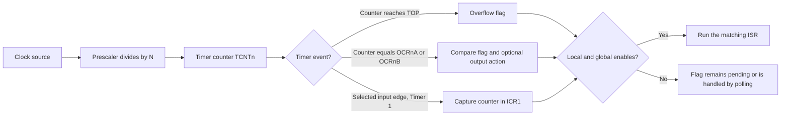

---
tags:
  - CCT3
  - indlejrede_systemer
Topic: the timing subsystem, Timer Prescaler & TOUT Relationship, Interrupt Service Routines
Semester: CCT3
Course: Programmering af indlejrede systemer
Litterature:
  - "Arduino II: Systems"
  - Secrets of Arduino PWM 
  - The Arduino reference, two short passages
  - "\rArduino Timer Interrupts Tutorial & Examples"
Created: 11-10-2026
---

# 4. The Timing Subsystem: Timers, Prescalers, Pulse-Width Modulation, and Interrupts

| Symbol or term | Meaning |
|---|---|
| $x(t)$, $t$, $t_1$, $t_2$, $T$ | Signal value at time $t$; $t_1$ and $t_2$ are captured event times; $T$ is one period. A periodic signal obeys $x(t+T)=x(t)$. |
| $f$, $T$ | Frequency and period: $f=1/T$ and $T=1/f$. |
| $T_{\text{ON}}$, $D$, $D_B$, $D_{\%}$ | High-state duration; duty-cycle fraction (with $D_B$ for channel B); multiply $D$ by $100\%$ to express it as a percentage. |
| $f_{\text{clk}}$, $f_{\text{clk\_I/O}}$ | Source clock frequency and the microcontroller's input/output (I/O) clock frequency. |
| $f_T$, $T_{\text{tick}}$ | Timer clock frequency and one timer tick: $f_T=f_{\text{clk}}/N$, $T_{\text{tick}}=N/f_{\text{clk}}$. |
| $f_{\text{PWM}}$, $f_A$, $f_B$ | Pulse-width modulation (PWM) carrier frequency and output frequencies for channels A and B. |
| $N$ | Prescaler division factor. |
| $k$ | Generic number of elapsed timer ticks in a measured interval. |
| $T_{\text{OUT}}$, $T_{\text{OUT(MAX)}}$, $T_{\text{PWM}}$, `TicksCount` | Timer-event interval, maximum normal-mode overflow interval, PWM period, and the number of timer ticks in an interval. |
| $b$, $2^b$, $n$ | Counter width in bits, count capacity per full cycle, and number of overflow events in an interval. |
| $\Delta t$, $\Delta\text{count}$ | Elapsed time and elapsed counter ticks. |
| Free-running counter (FRC) | Counter that advances continuously from timer-clock ticks. |
| `BOTTOM`, `MAX`, `TOP` | Counter boundary terms: zero, the fixed maximum code, and the current cycle's upper limit. `TOP` can be mode-dependent. |
| Pulse-width modulation (PWM) | Varying the high-time fraction of a periodic digital waveform. |
| Clear Timer on Compare Match (CTC) | Timer mode that clears the counter at a programmed compare boundary. |
| Arduino Development Environment (ADE) | The source's term for the Arduino programming environment and its built-in timing functions. |
| Interrupt Service Routine (ISR) | Function entered automatically when an enabled interrupt event occurs. |
| Central processing unit (CPU) | Processor that executes the program. |
| Resistor-capacitor network or oscillator (RC) | A clock-source circuit or oscillator. |
| Direct current (DC) | Unidirectional electric current. |
| General-purpose input/output (GPIO) | A digital pin configurable as an input or output. |
| Digital-to-analog converter (DAC) | Circuit or method that produces an analog-valued output. |
| Infrared (IR) | Electromagnetic radiation used in remote-control signaling. |
| Light-emitting diode (LED) | Diode that emits light when forward-biased. |
| Hertz (Hz), kilohertz (kHz), megahertz (MHz) | Frequency units: cycles per second and its multiples. |
| Second (s), millisecond (ms), microsecond ($\mu\text{s}$), volt (V) | Time and voltage units used in this note. |
| $V_{CC}$, $V_{\text{avg}}$ | Supply voltage and average voltage of an ideal PWM waveform. |
| Timer/Counter Control Registers A and B (`TCCRnA/B`) | `n` is the timer number; the registers select mode, output behavior, and clock source. |
| Timer/Counter Register (`TCNTn`) | Holds the current count. |
| Output Compare Registers A and B (`OCRnA/B`, `OCRnx`) | `x` denotes a channel; the registers hold comparison thresholds. |
| Timer Interrupt Mask and Flag Registers (`TIMSKn`, `TIFRn`) | Local interrupt enables and pending-event flags. |
| Waveform Generation Mode, Compare Match Output Mode, Clock Select (`WGM`, `COM`, `CS`) | Timer control-bit groups for mode, output action, and clock selection. |
| Timer Overflow Flag (`TOF`), `TOVn`, `OCFnA/B`, `ICF1` | Generic and timer-specific overflow, output-compare, and Timer 1 input-capture flags. |
| Overflow, compare-match, and Timer 1 input-capture enables (`TOIEn`, `OCIEnA/B`, `ICIE1`) | Local interrupt enables for those timer events. |
| Status Register (`SREG`), I-bit | The global interrupt-enable bit; both it and a local timer enable must permit an interrupt. |
| Compare-output pin (`OCnx`), Timer 1 capture pin (`ICP1`) and register (`ICR1`) | Timer output channel and input-capture hardware identifiers. |
| `T0`, `T1`, `TOSC1/TOSC2` | External clock inputs for Timers 0 and 1, and Timer 2's asynchronous timer-oscillator pins. |
| `TIMERn_*_vect` | Interrupt-vector naming pattern for timer overflow, compare, and capture events. |
| `_BV(bit)` | C/C++ macro used with the timer headers to form a one-bit mask from a named bit. |
| `delay()`, `delayMicroseconds()`, `pulseIn()`, `analogWrite()` | Arduino functions for blocking delays, pulse-width measurement, and PWM output. |
| `pin`, `value` | Arduino pin argument and integer PWM duty value used by `analogWrite()`. |
| `HIGH`, `LOW`, `OUTPUT` | Arduino constants for digital logic levels and output-pin configuration. |
| `LED_BUILTIN` | Arduino constant naming the board's built-in LED pin. |
| `pinMode()`, `digitalWrite()`, `digitalRead()` | Arduino functions to configure, write, and read digital pins. |
| `volatile` | C/C++ qualifier telling the compiler that a value can change asynchronously relative to the current instruction flow. |
| `Serial.println(..., BIN)` | Arduino serial-print function with a binary-format output option. |

_Table 4.1: Quick reference for the symbols, units, acronyms, timer registers, and Arduino functions used in this note._

---

## 4.1 Signals, frequency, period, and duty cycle

Microcontrollers use timing hardware for tasks ranging from switching an external device at a chosen instant to producing waveforms with controlled pulse widths. The same timing ideas support real-time monitoring, motor control, pulse measurement, and periodic software actions.

### 4.1.1 Periodic signals, frequency, and period

>[!info] Definition: Periodic signal
>A signal is periodic if $x(t+T)=x(t)$ for a positive period $T$; its fundamental period is the smallest such $T$. Frequency is cycles per second, with $f=1/T$ and $T=1/f$.

>[!example] Reading a signal frequency
>A sinusoid at $60\text{ Hz}$ completes $60$ cycles each second. Its period is $T=1/60\text{ s}\approx16.67\text{ ms}$. Check: $60\text{ Hz}\times0.01667\text{ s}\approx1$ cycle $\;✓$

A frequency target is often the reciprocal of a required response window.

>[!example] Sampling a real-time condition
>If an anti-slip controller must check for wheel slip every $20\text{ ms}=0.020\text{ s}$, the corresponding check rate is $f=1/0.020\text{ s}=50\text{ Hz}$. Check: $50\text{ Hz}\times0.020\text{ s}=1$ check interval $\;✓$

### 4.1.2 Duty cycle

>[!info] Definition: Duty cycle
>The duty-cycle fraction is the share of a period spent at the active (usually logic-high) level: $D=T_{\text{ON}}/T$, and $D_{\%}=100D\%$. The remaining portion is low for a two-state waveform.

>[!example] Same period, different duty cycles
>For two $20\text{ ms}$ pulses, a $50\%$ duty cycle is high for $10\text{ ms}$ and low for $10\text{ ms}$; a $25\%$ duty cycle is high for $5\text{ ms}$ and low for $15\text{ ms}$. Check: $10/20=0.50$ and $5/20=0.25\;✓$

![[Pasted image 20261011181729.png]]
_Figure 4.1: Two pulse trains with the same period but different duty cycles: the upper waveform is $50\%$ high and the lower waveform is $25\%$ high._
[Image unavailable in the workspace; the source caption identifies the two duty-cycle waveforms described above.]

Pulse-width control is used in motor drives and servo systems. For a standard positional servo, pulse width generally commands position; a continuous-rotation servo can interpret pulse width as speed and direction.

>[!example] Positional and continuous-rotation servo commands
>For a model specified as a positional servo, choose a supported pulse width from that model's pulse-to-angle mapping to command a shaft position. For a continuous-rotation model, calibrate the model-specific neutral pulse for stop; pulse widths on either side command opposite directions, and their offsets typically control speed. Check: the first mapping specifies position, while the offset from continuous-rotation neutral specifies direction and speed; use the exact model's documentation rather than assuming universal pulse endpoints.

>[!warning] Correction: Servo pulse-width meaning
>The source describes pulse-width variation as controlling both speed and direction of a servo. That is true for a continuous-rotation servo, but a conventional positional servo normally interprets pulse width as a position command.

---

## 4.2 The timer time base and elapsed-time measurement

### 4.2.1 Clock sources and the free-running counter

A timer needs a clock time base. On each timer-clock tick, its counter advances; input-capture and output-compare hardware can use that count without asking the central processing unit (CPU) to time every edge in software. A continuously advancing counter is often called a free-running counter (FRC).

Clock-source and startup choices are selected through configuration fuses. The ATmega328P can use its internal calibrated resistor-capacitor (RC) oscillator or an external clock source. External choices include an RC network, a ceramic resonator, or a crystal oscillator; in general, a crystal provides better frequency accuracy and stability than a resonator, which in turn is generally better than an RC network. The ATmega328P is specified for operation up to $20\text{ MHz}$ at a suitable $5\text{ V}$ supply. The standard Arduino UNO R3 runs at $16\text{ MHz}$.

>[!example] Converting a timer tick to elapsed time
>At a $16\text{ MHz}$ source clock with prescaler $N=64$, each tick lasts $64/(16\times10^6)=4\,\mu\text{s}$. A count difference of $250$ ticks represents $1\text{ ms}$. Check: $250\times4\,\mu\text{s}=1\text{ ms}\;✓$

>[!warning] Correction: ATmega328P and UNO R3 clock sources
>The ATmega328P's calibrated internal RC oscillator is nominally $8\text{ MHz}$; lower system-clock rates are obtained by dividing it, not by selecting separate fixed RC oscillator settings. The standard UNO R3's $16\text{ MHz}$ ATmega328P clock source is commonly a ceramic resonator, not a crystal oscillator, which matters when comparing accuracy and stability.

>[!example] Deriving lower system-clock rates
>Divide the nominal $8\text{ MHz}$ oscillator by $2$, $4$, or $8$ to obtain $4$, $2$, or $1\text{ MHz}$. Check: $8\text{ MHz}/8=1\text{ MHz}\;✓$

For timer-based operation, a prescaler divides the source clock before it reaches the counter. If the source clock is $f_{\text{clk}}$ and the division factor is $N$, then the timer tick period is $T_{\text{tick}}=N/f_{\text{clk}}$. A count difference of $k$ ticks therefore represents $kT_{\text{tick}}$ seconds. See Section 4.7 for selecting $N$ and calculating an output interval.

### 4.2.2 Capturing timestamps and generating outputs

Input-capture hardware latches the counter value when a selected electrical edge arrives. Subtracting two captured values gives elapsed ticks; dividing by the elapsed time gives the signal frequency. Output-compare hardware performs the complementary job: a comparator checks the counter against a programmed register and can change an output pin, set a flag, or request an interrupt when the counts match.

>[!example] Measuring a pulse from edge timestamps
>If the rising edge is captured at $t_1=1.5\text{ s}$ and the falling edge at $t_2=1.6\text{ s}$, the pulse width is $\Delta t=t_2-t_1=1.6-1.5=0.1\text{ s}$. Check: $1.5\text{ s}+0.1\text{ s}=1.6\text{ s}\;✓$

![[Pasted image 20261011182549.png]]
_Figure 4.2: Timer input capture records an incoming waveform's edge times; timer output-compare hardware produces timed transitions for an external device._
[Image unavailable in the workspace; the source caption describes an input waveform used for frequency measurement and a separately generated output waveform.]

### 4.2.3 Converting counts to time and handling rollover

An up-counter of width $b$ bits has $2^b$ distinct states, from $0$ through $2^b-1$. In normal counting, the counter wraps to zero after the maximum code. A generic Timer Overflow Flag (TOF) indicates that a rollover occurred; on the ATmega328P the register bit is named `TOVn` for timer `n`.

>[!info] Definition: Elapsed time from timer counts
>If no rollover occurs, $\Delta\text{count}=\text{stop count}-\text{start count}$. With $n$ rollovers in a $b$-bit timer, $\text{elapsed ticks}=n\,2^b+(\text{stop count}-\text{start count})$ and $\Delta t=\text{elapsed ticks}\,T_{\text{tick}}$, where $n$ is overflow count, $2^b$ is count capacity, and $T_{\text{tick}}=N/f_{\text{clk}}$.

>[!example] Pulse width from hexadecimal counts
>For a $16$-bit counter clocked at $2\text{ MHz}$, one tick is $T_{\text{tick}}=1/(2\text{ MHz})=0.5\,\mu\text{s}$. The rollover interval is $65{,}536\times0.5\,\mu\text{s}=32.768\text{ ms}$. If the rising edge is captured at $0x0010=16_{10}$ and the falling edge at $0x0114=276_{10}$, then $276-16=260$ ticks and the pulse width is $260\times0.5\,\mu\text{s}=130\,\mu\text{s}$. Check: $130\,\mu\text{s}/0.5\,\mu\text{s}=260$ ticks $\;✓$

>[!warning] Correction: Rollover-time rounding
>The source gives $32.78\text{ ms}$ for $65{,}536$ ticks at $0.5\,\mu\text{s}$ per tick. The exact result is $32.768\text{ ms}$, which rounds to $32.77\text{ ms}$ at two decimal places.

>[!example] Measuring across one rollover
>For an $8$-bit counter that starts at $250$ and stops at $4$ after one overflow, the elapsed count is $1\times256+(4-250)=10$ ticks. At $4\,\mu\text{s}$ per tick, the interval is $40\,\mu\text{s}$. Check: $10\times4\,\mu\text{s}=40\,\mu\text{s}\;✓$

The overflow equation assumes that the number of rollovers is known. Since a hardware overflow flag is a latched status bit, several unserviced rollovers may not be distinguishable; long measurements usually extend the counter in software by servicing overflow interrupts.

---

## 4.3 Timer operations: capture, count, and compare

Timer subsystems support four broad jobs: input capture for measuring intervals and frequencies; event counting; output compare for deterministic transitions and pulses; and pulse-width modulation (PWM) for variable-duty-cycle power control.

### 4.3.1 Input capture

Input capture determines a signal's period, frequency, or pulse width by recording the timer value at an electrical transition. On the ATmega328P, Timer 1 has the dedicated input-capture unit; the other two timers do not.

After reset, a timer with its clock-select bits cleared is stopped; explicitly configure its mode and clock source when starting it. A typical input-capture setup chooses a prescaler, configures the capture pin, selects rising or falling edge detection, and decides whether the CPU will poll the capture flag or respond through an interrupt. The capture register preserves the timestamp even if the CPU is busy briefly.

- **Polling:** The program checks a capture flag, reads the captured value, clears or acknowledges the flag as required by the device, then waits for another capture. Polling consumes CPU time.
- **Interrupts:** An enabled capture event invokes an Interrupt Service Routine (ISR), which can save the captured count and return to the main program. This leaves the CPU available between edges, but the ISR should be short.

>[!example] Frequency measurement with Timer 1 input capture
>Two consecutive rising edges are captured with a timer clock of $f_{\text{clk}}=10\text{ MHz}$ and no additional prescaler. The first count is $0x1000=4{,}096$ and the second is $0x5000=20{,}480$. Thus $\Delta\text{count}=0x4000=16{,}384$ ticks. Each tick is $0.1\,\mu\text{s}$, so $T=16{,}384\times0.1\,\mu\text{s}=1.6384\text{ ms}$ and $f=1/T\approx610.35\text{ Hz}$. Check: $610.35\text{ Hz}\times1.6384\text{ ms}\approx1$ cycle $\;✓$

### 4.3.2 Counting external events

Event counting means incrementing a count for each external pulse or edge. A timer can count edges from a supported external clock input; alternatively, an external-interrupt routine can increment a software counter. Polling a flag and incrementing a variable is another software approach, but it can miss events if the CPU does not service them quickly enough.

>[!warning] Correction: Input capture is not an event counter
>The source says the input-capture subsystem can be repurposed to count events. Input capture timestamps selected edges; it does not itself accumulate an event total. On the ATmega328P, Timers 0 and 1 can use their external clock pins `T0` and `T1` for edge counting. Timer 2's asynchronous `TOSC1/TOSC2` clock option is intended for an asynchronous oscillator, not as a general-purpose event-count input.

>[!example] Counting sensor pulses with an external timer clock
>Route each sensor edge to a timer's supported external clock input and configure the edge polarity. If the counter changes from $120$ to $170$ without wrapping, it has counted $50$ pulses. Check: $170-120=50$ pulses $\;✓$

### 4.3.3 Output compare and timed pulses

For an output-compare transition, configure the timer output pin, choose the timer mode and output action, and set a compare threshold corresponding to the target count. Hardware checks for a match on timer clocks; the programmed action can set, clear, or toggle the pin and can also set a flag or request an interrupt. For a pulse, schedule a second transition that returns the output to its inactive state.

A typical sequence is to enable the timer and configure the output pin; initialize its known state; write the next target count to an output-compare register; let hardware test the counter against that threshold on each tick; perform the programmed set, clear, or toggle at a match; and, for a pulse, schedule a later compare for the opposite transition.

>[!example] Generating a $2\text{ ms}$ active-high pulse
>A $2\text{ MHz}$ timer has a $0.5\,\mu\text{s}$ tick. The desired pulse therefore spans $2\text{ ms}/0.5\,\mu\text{s}=4{,}000$ ticks, or hexadecimal $0x0FA0$. Start the pin high at the chosen start event, then arrange for a compare match at the start count plus $4{,}000$ ticks to clear it. Check: $4{,}000\times0.5\,\mu\text{s}=2\text{ ms}\;✓$

>[!warning] Correction: Start the pulse at a real event
>The source's example first loads compare value $0x0000$ to create the rising edge, then loads $0x0FA0$ to end the pulse. A running counter already at zero will not necessarily produce a new compare event at that instant; instead, make the rising edge at a defined start event and schedule the falling compare for the corresponding future count (accounting for rollover if needed).

### 4.3.4 PWM as a motor-control case

PWM delivers power to a load through rapid on/off voltage pulses. A direct-current (DC) motor's inductance and mechanical inertia smooth the switching, so its torque and speed respond to the average applied voltage and load.

>[!example] Elevator acceleration profile
>An elevator controller can ramp PWM duty cycle up during acceleration, hold a steady value at target speed, then ramp it down during deceleration.

>[!warning] Correction: Average voltage does not determine motor speed alone
>The source describes speed as proportional to average applied voltage. Average voltage influences motor speed, but the actual speed also depends on load, back electromotive force, and the motor/driver characteristics; the relationship is not universally linear.

![[Pasted image 20261011183358.png]]
_Figure 4.3: The source-referenced motor profile illustrates speed changing over time while a PWM drive is applied._
[Image unavailable in the workspace; the source caption identifies a DC-motor speed profile under PWM control.]

>[!example] A $25\%$ threshold in a $16$-bit PWM cycle
>A full $16$-bit count cycle has $65{,}536$ ticks. In the simplified set-at-zero, clear-at-compare model, a $25\%$ high-time target corresponds to $0.25\times65{,}536=16{,}384$ counts, or $0x4000$. Check: $16{,}384/65{,}536=0.25\;✓$

>[!example] Ramping a $16$-bit PWM compare value
>With a $2\text{ MHz}$ timer clock, one $16$-bit PWM cycle has $65{,}536$ ticks, so $T_{\text{PWM}}=65{,}536\times0.5\,\mu\text{s}=32.768\text{ ms}$. Moving the compare value from $0x4000$ ($16{,}384$, nominally $25\%$) to $0x8000$ ($32{,}768$, nominally $50\%$) changes it by $16{,}384$ counts. One second contains $1/0.032768\approx30.5176$ PWM periods, so a linear update each rollover averages $16{,}384/30.5176\approx536.87$ counts per period. Integer updates can alternate $536$ and $537$ counts or use elapsed-time interpolation. Check: $30.5176\times536.87\approx16{,}384$ counts $\;✓$

>[!warning] Correction: Duty-ramp step size
>The source uses approximately $30$ periods to calculate $16{,}384/30\approx546$ counts per update, despite calculating $30.51$ periods in one second. Using the full $30.5176$ periods gives about $536.87$ counts per period; a fractional accumulator or time-based interpolation avoids endpoint drift.

---

## 4.4 ATmega328P timer channels and operating modes

The ATmega328P contains three independent timer/counter channels. Each uses a counter, compare registers, control logic, and a selectable clock. Their widths and uses differ:

| Feature | Timer 0 | Timer 1 | Timer 2 |
|---|---|---|---|
| Counter width | $8$ bit ($0$–$255$) | $16$ bit ($0$–$65{,}535$) | $8$ bit ($0$–$255$) |
| Typical Arduino PWM pins | `D5`, `D6` | `D9`, `D10` | `D3`, `D11` |
| Notable use | Core timekeeping (`delay()`, `millis()`, `micros()`) | Higher-resolution timing; Servo library commonly uses it | `tone()` commonly uses it; asynchronous clock option |
| Input capture | No | Yes (`ICP1`) | No |
| Clocking options | Internal prescaler or external `T0` | Internal prescaler or external `T1` | Internal prescaler; asynchronous oscillator on `TOSC1/TOSC2` |
| Internal prescaler factors | $1,8,64,256,1024$ | $1,8,64,256,1024$ | $1,8,32,64,128,256,1024$ |
| Interrupt vectors | `TIMER0_OVF_vect`, `TIMER0_COMPA_vect`, `TIMER0_COMPB_vect` | `TIMER1_OVF_vect`, `TIMER1_COMPA_vect`, `TIMER1_COMPB_vect`, `TIMER1_CAPT_vect` | `TIMER2_OVF_vect`, `TIMER2_COMPA_vect`, `TIMER2_COMPB_vect` |

_Table 4.2: ATmega328P timer widths, common Arduino uses, input-capture support, clocks, prescalers, and interrupt vectors._

>[!info] Definition: Timer mode and counter mode
>In timer mode, the counter is clocked from the microcontroller's internal clock (usually through a prescaler) to measure elapsed time. In counter mode, a supported external clock input supplies the edges to be counted.

>[!example] Internal timer clock versus external pulse count
>With a $16\text{ MHz}$ source and a $1:64$ prescaler, the timer advances at $250\text{ kHz}$. If an external counter input receives $50$ valid edges, the counter advances by $50$ counts. Check: $16\text{ MHz}/64=250\text{ kHz}$ and $50$ edges produce $50$ increments $\;✓$

All three timers can support compare events and PWM, but external event-counting inputs and asynchronous clocking are not identical across the channels. Timer 0 is used by the Arduino core's clock and delay functions; changing its settings can therefore corrupt `millis()`, `micros()`, and `delay()`. Timer 1 can be convenient for custom timing, but check whether a timer-dependent library has already reserved it.

![[Pasted image 20261011183506.png]]
_Figure 4.4: Overview of the ATmega328P timer channels and their independent clocking and timing functions._
[Image unavailable in the workspace; the source references a Microchip timer-system overview.]

### 4.4.1 The four primary timer modes

>[!info] Definition: Normal mode
>In normal mode, the counter counts upward from `BOTTOM` to its maximum count, then wraps to zero and sets the overflow flag. It repeats continuously.

>[!example] Normal-mode use
>A timer can generate a periodic overflow event; software can extend the short hardware cycle by counting overflows in an ISR. For an $8$-bit counter, one complete count cycle is $256$ timer ticks. Check: $2^8=256$ states $\;✓$

>[!info] Definition: Clear Timer on Compare Match (CTC) mode
>In CTC mode, a selected compare boundary clears the counter so a shorter, repeatable cycle can be produced. The exact register that defines `TOP` depends on the timer and mode; for Timer 0, `OCR0A` defines the CTC boundary.

>[!example] CTC frequency setting
>For a timer clock of $250\text{ kHz}$ and an `OCR0A` value of $249$, the counter traverses $250$ states per cycle. The compare-event rate is $250{,}000/250=1{,}000\text{ Hz}$. Check: $250\text{ ticks}\times4\,\mu\text{s}=1\text{ ms}$ per event $\;✓$

>[!info] Definition: Fast PWM mode
>Fast PWM is single-slope: the counter rises from zero through `TOP` and then restarts. It offers a higher carrier frequency than dual-slope phase-correct PWM for the same timer clock and `TOP`.

>[!example] Fast-PWM use
>Use Fast PWM when a comparatively high switching frequency is useful, such as for power switching or a filtered output approximating a digital-to-analog converter (DAC). The duty threshold changes high-time while the timer provides the carrier.

>[!info] Definition: Phase-correct PWM mode
>Phase-correct PWM is dual-slope: the counter counts up to `TOP`, then down to zero. Its symmetric waveform is useful when centered pulses or reduced low-frequency harmonic content are desirable, including some motor-control applications.

>[!example] Phase-correct-PWM use
>At the same clock and fixed `TOP = 255`, a phase-correct cycle takes $510$ ticks, while Fast PWM takes $256$ ticks. The phase-correct carrier is therefore about half as high. Check: $510/256\approx1.99\;✓$

---

## 4.5 Timer 0 architecture, modes, and registers

Timer 0 is an $8$-bit timer/counter and a useful model for the other channels. It can be clocked from the internal input/output clock through a prescaler or from the external `T0` pin. The resulting timer clock advances `TCNT0`; two comparators continuously compare `TCNT0` against `OCR0A` and `OCR0B`, and waveform generators can drive `OC0A` and `OC0B`.

```text
                  +---------------------------+
                  | Clock-source selection   |
                  | Internal / prescaled / T0 |
                  +-------------+-------------+
                                | clk_T0
                                v
                  +---------------------------+
                  |    8-bit counter TCNT0    |
                  +-------------+-------------+
                                |
             +------------------+------------------+
             |                                     |
             v                                     v
+------------------------+             +------------------------+
| Comparator A           |             | Comparator B           |
| TCNT0 compared to      |             | TCNT0 compared to      |
| OCR0A                  |             | OCR0B                  |
+-----------+------------+             +-----------+------------+
            |                                      |
            v                                      v
+------------------------+             +------------------------+
| Waveform generator A   |             | Waveform generator B   |
| OC0A                   |             | OC0B                   |
+------------------------+             +------------------------+
```
_Figure 4.5: Simplified Timer 0 architecture from the source, showing clock selection, the counter, two compare channels, and their output generators._

![[Pasted image 20261011183918.png]]
_Figure 4.6: Timer 0 block diagram referenced from Microchip; it complements the simplified architecture above._
[Image unavailable in the workspace; the source attributes this detailed Timer 0 diagram to Microchip.]

### 4.5.1 Counter boundaries and waveform generation

- `BOTTOM` is the zero count (`0x00`).
- `MAX` is the fixed maximum of the $8$-bit counter (`0xFF`).
- `TOP` is the upper boundary used by the selected mode. It is `0xFF` in fixed-top modes; CTC and selected PWM modes can use `OCR0A` as a programmable upper boundary.

Timer 0's waveform-generation mode is selected by `WGM02:0`, split between `TCCR0A` and `TCCR0B`:

- **Normal mode:** `TCNT0` counts from `0x00` to `0xFF`; on rollover, `TOV0` is set.
- **CTC mode:** `OCR0A` sets `TOP`; the counter clears when it reaches `OCR0A`. `OCF0A` is set at that compare event. `OCR0B` can still produce its own compare event, but it does not define the clear boundary.
- **Phase-correct PWM:** The counter counts up and down. Compare events control the output according to `COM0A` or `COM0B` settings.
- **Fast PWM:** The counter counts in one direction and restarts at `TOP`; compare matches control pulse edges. With a fixed `TOP` of $255$, its carrier is twice the phase-correct carrier at the same timer clock.

>[!warning] Correction: Timer 0 TOP and CTC behavior
>The source says Timer 0 can use either `OCR0A` or `OCR0B` as `TOP` and that CTC clears at a match with either. On the ATmega328P, `OCR0A` defines the applicable variable-TOP modes and the CTC clear boundary; `OCR0B` is only a compare threshold and does not reset the counter.

![[Pasted image 20261011184104.png]]
_Figure 4.7: Timer 0 mode reference for Normal, CTC, Phase-Correct PWM, and Fast PWM operation._
[Image unavailable in the workspace; the source identifies this as a Timer 0 modes-of-operation diagram.]

### 4.5.2 Timer 0 registers and flags

![[Pasted image 20261011184247.png]]
_Figure 4.8: Timer 0 register reference, including control, count, compare, interrupt-mask, and flag registers._
[Image unavailable in the workspace; the surrounding source lists the Timer 0 registers summarized below.]

- `TCCR0A` and `TCCR0B` configure Timer 0. `WGM02:0` selects the mode; `COM0A[1:0]` and `COM0B[1:0]` select compare-output behavior; `CS02:0` selects the internal prescaler or external clock.
- `TCNT0` is the $8$-bit current count.
- `OCR0A` and `OCR0B` are the $8$-bit compare thresholds.
- `TIMSK0` contains the local enable bits `OCIE0A`, `OCIE0B`, and `TOIE0` for compare-A, compare-B, and overflow interrupts.
- `TIFR0` contains `OCF0A`, `OCF0B`, and `TOV0`, set by the corresponding hardware events.

---

## 4.6 Arduino timing functions and interrupt model

### 4.6.1 Built-in timing functions

The Arduino Development Environment (ADE) includes convenient timing functions that avoid direct register setup:

- `delay(unsigned long)` pauses program execution for a specified number of milliseconds.
- `delayMicroseconds(unsigned int)` pauses for a specified number of microseconds; its useful range and accuracy depend on the board clock and implementation.
- `pulseIn(pin, value)` measures the length of a digital pulse in microseconds. With `value` equal to `HIGH`, it waits for the pin to go high, measures until it returns low, and returns the elapsed duration as an `unsigned long`. The default timeout is about one second unless a different timeout is supplied.
- `analogWrite(pin, value)` requests hardware PWM on a PWM-capable pin. On the ATmega328P, `value` ranges from $0$ to $255$; the Arduino core treats $0$ as fully off and $255$ as fully on.

>[!warning] Correction: `analogWrite()` frequency depends on the pin
>The source assigns approximately $490\text{ Hz}$ to `analogWrite()` generally. On a standard $16\text{ MHz}$ UNO, the frequency depends on the timer: it is about $490\text{ Hz}$ on most PWM pins and about $980\text{ Hz}$ on Timer 0 pins `D5` and `D6`. The Arduino core special-cases values $0$ and $255$ to produce fully off/on outputs.

>[!example] Fading a light-emitting diode (LED) with `analogWrite()`
>On a PWM-capable pin, progressively changing `analogWrite(pin, value)` between $0$ and $255$, with a short delay between updates, ramps the light-emitting diode's average power and perceived brightness. The pin still switches digitally; the eye perceives the changing average light output.

### 4.6.2 Timer interrupts

A timer can request an interrupt on overflow, output-compare match, or (for Timer 1) input capture. Each source has its own interrupt vector and local enable bit in a timer interrupt-mask register. The global I-bit in the status register must also be enabled for the CPU to enter the ISR; the Arduino core normally enables global interrupts during initialization, while bare-metal firmware must enable them explicitly. A compare event can independently update a hardware output pin and set an interrupt flag.

>[!example] Local and global interrupt enables
>If `OCIE1A` is set but the global I-bit is clear, Timer 1 can set its compare flag, but the CPU will not enter `TIMER1_COMPA_vect` until global interrupts are enabled.


_Figure 4.9: Timer clocking leads to counter events; enabled overflow, compare, or capture sources can dispatch their corresponding interrupt service routine._

![[Pasted image 20261011185457.png]]
_Figure 4.10: Source-referenced timer interrupt illustration accompanying the discussion of overflow and compare-match events._
[Image unavailable in the workspace; the surrounding text and flowchart describe the timer interrupt sources and their vectors.]

Timer interrupt flags are hardware status bits. On ATmega328P timer flag registers, many flags are cleared by writing a one to the bit; some are also cleared automatically when the corresponding interrupt vector executes. Do not assume that writing zero clears a pending flag—check the register's documented behavior.

>[!example] Clearing a pending compare flag
>When polling a Timer 1 flag, writing `_BV(OCF1A)` to `TIFR1` clears that flag on the ATmega328P; writing zero does not clear it.

Keep an ISR short: do only time-critical work, avoid blocking calls and lengthy serial output, and mark shared state `volatile` where appropriate. Long ISR execution can delay or lose timing work.

Timer 0 underlies `millis()`, `micros()`, and `delay()` on the standard UNO core. Reconfiguring it disrupts those functions as well as its PWM outputs. Timer 1 can be a convenient custom-timing resource, but check library timer assignments before reconfiguring it.

### 4.6.3 Common timer control registers

For timer number `n` ($0$, $1$, or $2$), the general register families are:

- `TCCRnA` and `TCCRnB`: waveform mode, compare-output mode, and clock selection.
- `TCNTn`: current counter value.
- `OCRnA` and `OCRnB`: output-compare thresholds.
- `TIMSKn`: local interrupt enables.
- `TIFRn`: event flags.

Timer 0's corresponding registers are `TCCR0A`, `TCCR0B`, `TCNT0`, `OCR0A`, `OCR0B`, `TIMSK0`, and `TIFR0`; Timer 1 and Timer 2 use the same naming pattern with their timer number.

---

## 4.7 Prescalers and the $T_{\text{OUT}}$ relationship

A prescaler is a digital clock divider between the source clock and a timer counter. A larger division factor slows the counter, lengthens the time before overflow, and lowers the base PWM carrier frequency. It trades timing resolution for a longer representable interval and can reduce the rate of overflow interrupts.

The equations below distinguish the timer clock rate, the duration of one tick, and the event interval obtained from a tick count.

>[!info] Definition: Timer tick and output interval
>
>$$
>f_T=\frac{f_{\text{clk}}}{N},\qquad T_{\text{tick}}=\frac{N}{f_{\text{clk}}},\qquad T_{\text{OUT}}=\text{TicksCount}\,T_{\text{tick}}=\frac{\text{TicksCount}\,N}{f_{\text{clk}}},\qquad \text{TicksCount}=\frac{T_{\text{OUT}}f_{\text{clk}}}{N}.
>$$
>
>**Breakdown:** $f_T$ is the timer frequency; $T_{\text{tick}}$ is one tick; $f_{\text{clk}}$ is the source clock; $N$ is the prescaler; $T_{\text{OUT}}$ is the event interval; and `TicksCount` is the number of timer ticks. PWM count length depends on mode and `TOP`.

>[!example] Tick period at a $16\text{ MHz}$ source
>With $N=64$, $T_{\text{tick}}=64/(16\times10^6)=4\,\mu\text{s}$. A $1\text{ ms}$ interval requires $1\text{ ms}/4\,\mu\text{s}=250$ ticks. Check: $250\times4\,\mu\text{s}=1\text{ ms}\;✓$

![[Pasted image 20261011184607.png]]
_Figure 4.11: Prescaler illustration referenced by the source; the clock-divider relationship is $f_T=f_{\text{clk}}/N$._
[Image unavailable in the workspace; the adjacent source text describes the divider between the microcontroller clock and timer counter.]

The following table assumes a $16\text{ MHz}$ source clock. “Minimum” is one timer tick; “maximum” is the full normal-mode overflow interval $T_{\text{OUT(MAX)}}$. Timer 0 does not support prescaler values $32$ or $128$; those are Timer 2-only values.

| Prescaler $N$ | Timer 0/2 tick | Timer 0/2 overflow | Timer 1 tick | Timer 1 overflow |
|---:|---:|---:|---:|---:|
| $1$ | $62.5\text{ ns}$ | $16\,\mu\text{s}$ | $62.5\text{ ns}$ | $4.096\text{ ms}$ |
| $8$ | $0.5\,\mu\text{s}$ | $128\,\mu\text{s}$ | $0.5\,\mu\text{s}$ | $32.768\text{ ms}$ |
| $32$ (Timer 2 only) | $2\,\mu\text{s}$ | $512\,\mu\text{s}$ | — | — |
| $64$ | $4\,\mu\text{s}$ | $1.024\text{ ms}$ | $4\,\mu\text{s}$ | $262.144\text{ ms}$ |
| $128$ (Timer 2 only) | $8\,\mu\text{s}$ | $2.048\text{ ms}$ | — | — |
| $256$ | $16\,\mu\text{s}$ | $4.096\text{ ms}$ | $16\,\mu\text{s}$ | $1.048576\text{ s}$ |
| $1024$ | $64\,\mu\text{s}$ | $16.384\text{ ms}$ | $64\,\mu\text{s}$ | $4.194304\text{ s}$ |

_Table 4.3: Single-tick resolution and full-overflow intervals for ATmega328P timers at a $16\text{ MHz}$ source clock._

![[Pasted image 20261011185538.png]]
_Figure 4.12: Source-referenced visual summary of timer output interval and tick-count calculations._
[Image unavailable in the workspace; the equations are reproduced and explained in this section.]

### 4.7.1 Choosing a prescaler for a $100\text{ ms}$ interval

>[!example] Calculate a Timer 1 interval
>For a $16\text{-bit}$ Timer 1 on a $16\text{ MHz}$ board, choose $N=64$. The tick is $64/(16\times10^6)=4\,\mu\text{s}$, and the full-overflow interval is $65{,}536\times4\,\mu\text{s}=262.144\text{ ms}$, which exceeds the target. The required count is $0.1\text{ s}\times16\times10^6/64=25{,}000$ ticks. Check: $25{,}000\times4\,\mu\text{s}=100\text{ ms}\;✓$

A desired interval longer than one hardware cycle can be implemented by counting overflows or by using a compare schedule that advances across counter wrap. If an output toggles once per compare event, the full output waveform period is twice the event interval; distinguish interrupt rate from output frequency.

![[Pasted image 20261011185552.png]]
_Figure 4.13: Source-referenced worked selection of Timer 1 prescaler and tick count for a $100\text{ ms}$ interval._
[Image unavailable in the workspace; the adjacent worked calculation gives the prescaler, 25,000-tick count, and interval.]

---

## 4.8 Programming periodic timer interrupts

There are two common software patterns for periodic timer interrupts: preload the counter so it overflows after a chosen number of ticks, or let the counter run and schedule compare matches. Compare-match scheduling usually gives steadier intervals because the counter is not restarted on every event.

### 4.8.1 Overflow interrupt with preloading

If a $16$-bit counter must overflow after $25{,}000$ ticks, its preload is $65{,}536-25{,}000=40{,}536$.

>[!warning] Correction: Preload off by one
>The source uses $65{,}535-25{,}000=40{,}535$. A $16$-bit counter has $65{,}536$ distinct states, so a preload of $40{,}536$ is needed for $25{,}000$ timer increments before overflow. Start the clock only after the mode, preload, and interrupt mask are configured.

>[!example] Timer 1 overflow sketch for a nominal $100\text{ ms}$ event
>```cpp
>#include <avr/interrupt.h>
>
>ISR(TIMER1_OVF_vect)
>{
>  TCNT1 = 40536; // Reload for 25,000 ticks at a 4 us timer tick
>  digitalWrite(LED_BUILTIN, !digitalRead(LED_BUILTIN));
>}
>
>void setup()
>{
>  pinMode(LED_BUILTIN, OUTPUT);
>  TCCR1A = 0;                 // Normal mode
>  TCCR1B = 0;                 // Stop while configuring
>  TCNT1 = 40536;              // Initial preload
>  TIMSK1 |= _BV(TOIE1);       // Enable Timer 1 overflow interrupt
>  TCCR1B = _BV(CS11) | _BV(CS10); // Start with prescaler 64
>}
>
>void loop()
>{
>  // Main application work
>}
>```
>Check: $(65{,}536-40{,}536)\times4\,\mu\text{s}=25{,}000\times4\,\mu\text{s}=100\text{ ms}\;✓$
>The LED toggles at each nominal $100\text{ ms}$ event. One high interval and one low interval form a full blink cycle of $2\times100\text{ ms}=200\text{ ms}$. Check: $2\times100\text{ ms}=200\text{ ms}\;✓$

Preloading inside an ISR adds interrupt-entry and register-write latency to each interval. This method is useful for simple periodic work but is less precise than compare scheduling.

### 4.8.2 Compare-match interrupt

A compare channel can schedule an event while the counter continues running. Advancing the target from the previous target, rather than from the ISR's current counter reading, avoids accumulating the ISR's execution time into every period, provided the ISR finishes before the next compare event.

>[!example] Timer 1 Compare A for a nominal $100\text{ ms}$ event
>```cpp
>#include <avr/interrupt.h>
>
>ISR(TIMER1_COMPA_vect)
>{
>  OCR1A += 25000; // Schedule the next event 25,000 ticks later
>  digitalWrite(LED_BUILTIN, !digitalRead(LED_BUILTIN));
>}
>
>void setup()
>{
>  pinMode(LED_BUILTIN, OUTPUT);
>  TCCR1A = 0;                   // Normal mode
>  TCCR1B = 0;                   // Stop while configuring
>  TCNT1 = 0;
>  OCR1A = 25000;                // First event after 25,000 ticks
>  TIMSK1 |= _BV(OCIE1A);       // Enable Compare A interrupt
>  TCCR1B = _BV(CS11) | _BV(CS10); // Start with prescaler 64
>}
>
>void loop()
>{
>  // Main application work
>}
>```
>Check: $25{,}000\times(64/16\,\text{MHz})=25{,}000\times4\,\mu\text{s}=100\text{ ms}\;✓$

Timer 1's A and B compare channels can schedule different intervals from the same counter. The compare thresholds must be advanced by their own intervals after each event.

>[!example] Two independent compare intervals on Timer 1
>```cpp
>#include <avr/interrupt.h>
>
>#define LED_A_PIN 13
>#define LED_B_PIN 8
>
>ISR(TIMER1_COMPA_vect)
>{
>  OCR1A += 20000; // 80 ms at 4 us per tick
>  digitalWrite(LED_A_PIN, !digitalRead(LED_A_PIN));
>}
>
>ISR(TIMER1_COMPB_vect)
>{
>  OCR1B += 8750; // 35 ms at 4 us per tick
>  digitalWrite(LED_B_PIN, !digitalRead(LED_B_PIN));
>}
>
>void setup()
>{
>  pinMode(LED_A_PIN, OUTPUT);
>  pinMode(LED_B_PIN, OUTPUT);
>  TCCR1A = 0;
>  TCCR1B = 0; // Normal mode; stopped during setup
>  TCNT1 = 0;
>  OCR1A = 20000;
>  OCR1B = 8750;
>  TIMSK1 |= _BV(OCIE1A) | _BV(OCIE1B);
>  TCCR1B = _BV(CS11) | _BV(CS10); // Start at prescaler 64
>}
>
>void loop()
>{
>  // Main application work
>}
>```
>Check: $20{,}000\times4\,\mu\text{s}=80\text{ ms}$ and $8{,}750\times4\,\mu\text{s}=35\text{ ms}\;✓$

---

## 4.9 Pulse-width modulation (PWM)

>[!info] Definition: Pulse-width modulation
>PWM rapidly switches a digital output between low and high, typically between $0\text{ V}$ and a supply such as $5\text{ V}$ or $3.3\text{ V}$. For ideal supply $V_{CC}$ and duty fraction $D$, the period-average voltage is $V_{\text{avg}}=V_{CC}D$. The pin itself remains a digital waveform; a filter or load dynamics can smooth it.

>[!example] Average voltage at $25\%$ duty
>With $V_{CC}=5\text{ V}$ and $D=0.25$, the ideal average is $V_{\text{avg}}=5\times0.25=1.25\text{ V}$. Check: $1.25\text{ V}/5\text{ V}=0.25\;✓$

### 4.9.1 Applications and Arduino's `analogWrite()`

Common PWM applications include LED dimming, efficient DC-motor speed control, filtered analog-like voltages, audio generation, and carrier modulation.

>[!example] PWM application examples
>For filtered voltage generation, an RC low-pass filter smooths the pulse train toward a value between $0\text{ V}$ and $V_{CC}$. A remote-control infrared LED can be driven by a carrier near $38\text{ kHz}$, with the carrier gated into bursts. A speaker can receive modulated frequencies and pulse widths to produce tones. PWM also controls motor power without the large losses of a continuously resistive drop.

![[Pasted image 20261011185733.png]]
_Figure 4.14: Source-referenced PWM illustration accompanying the discussion of digital switching and average output._
[Image unavailable in the workspace; the source did not include a caption or the image file, so the note's PWM definition and applications provide the available context.]

On the ATmega328P, `analogWrite(pin, value)` accepts values from $0$ to $255$ on hardware PWM pins `D3`, `D5`, `D6`, `D9`, `D10`, and `D11`. It provides a convenient duty-cycle control but no built-in argument for changing the timer's base frequency; direct timer-register configuration is needed for frequency control.

>[!example] LED brightness ramp
>Connect an LED with a suitable current-limiting resistor to a PWM-capable pin. Increase `value` gradually from $0$ to $255$ and then decrease it, with short delays between updates. The duty cycle changes the average LED power, producing a fade rather than a change in the LED's forward voltage.

### 4.9.2 Bit-banging PWM in software

A software loop can approximate PWM on a general-purpose input/output (GPIO) pin, but it occupies the CPU and can be disturbed by interrupts.

>[!example] Approximately $1\text{ kHz}$, $10\%$ duty cycle by bit-banging
>```cpp
>void setup()
>{
>  pinMode(13, OUTPUT);
>}
>
>void loop()
>{
>  digitalWrite(13, HIGH);
>  delayMicroseconds(100);       // On-time: 100 us
>  digitalWrite(13, LOW);
>  delayMicroseconds(900);       // Off-time: 900 us
>}
>```
>The idealized period is $100+900=1{,}000\,\mu\text{s}=1\text{ ms}$, with $100/1{,}000=10\%$ duty cycle. Check: $1/(1\text{ ms})=1\text{ kHz}$ and $100/1{,}000=0.10\;✓$

Software PWM works on many digital pins and makes the timing pattern explicit, but an interrupt can add jitter, delay loops block other work, and function-call overhead makes exact timing difficult. Measure it with an oscilloscope or calibrate the waveform when timing accuracy matters.

---

## 4.10 Register-level PWM: fixed and variable TOP

The ATmega328P has six timer output-compare channels: `OC0A`, `OC0B`, `OC1A`, `OC1B`, `OC2A`, and `OC2B`. Each timer has compare registers A and B; channels on the same timer share the carrier period but can use different compare thresholds and duty cycles.

- `TCCRnA` and `TCCRnB` set waveform-generation mode (`WGM`), output behavior (`COM`), and clock selection (`CS`).
- `TCNTn` stores the current count; `OCRnA` and `OCRnB` store compare thresholds.
- `TIMSKn` enables timer interrupts, and `TIFRn` reports timer events.

### 4.10.1 Fast PWM with fixed `TOP = 255`

For non-inverting Fast PWM, the output is set at `BOTTOM` and cleared at the compare match. With a fixed $8$-bit `TOP`, the counter visits $256$ states per cycle.

Because counting starts at zero, the $256$ visited states—not the maximum code alone—set the fixed-top period.

>[!info] Definition: Fixed-top Fast PWM equations
>
>$$
>f_{\text{PWM}}=\frac{f_{\text{clk}}}{256N},\qquad D=\frac{\text{OCR}_{nx}+1}{256},\qquad D_{\%}=100D\%.
>$$
>
>**Breakdown:** $f_{\text{PWM}}$ is the carrier frequency; $f_{\text{clk}}$ is the source clock; $N$ is the prescaler; and `OCRnx` is the channel compare value, from $0$ to $255$.

>[!example] Timer 2 Fast PWM register setup
>```cpp
>pinMode(3, OUTPUT);   // OC2B
>pinMode(11, OUTPUT);  // OC2A
>
>// Fast PWM, non-inverting outputs A and B, fixed TOP = 255
>TCCR2A = _BV(COM2A1) | _BV(COM2B1) | _BV(WGM21) | _BV(WGM20);
>TCCR2B = _BV(CS22); // Timer 2 prescaler = 64
>OCR2A = 180;
>OCR2B = 50;
>```

>[!example] Fast PWM frequency and duty cycles
>With $f_{\text{clk}}=16\text{ MHz}$ and $N=64$, both outputs have $f_{\text{PWM}}=16{,}000{,}000/(64\times256)=976.5625\text{ Hz}$. Channel A at `OCR2A = 180` has $181/256\approx70.7\%$ duty; channel B at `OCR2B = 50` has $51/256\approx19.9\%$. Check: $64\times256\times(1/16{,}000{,}000\text{ s})=1.024\text{ ms}$ per cycle and its reciprocal is $976.5625\text{ Hz}\;✓$

```text
Timer count
  255  |             /|              /|
       |            / |             / |
OCRnx  | - - - - - / -| - - - - - -/ -| - - -
       |          /   |           /   |
    0  +---------/----+----------/----+--------> time
Pin    +---------- HIGH ----------+---- LOW -----
       |<--- T_ON --->|
       |<--------- T_period --------->|
```
_Figure 4.15: Fast-PWM timing sketch: the counter rises to fixed `TOP`, and the compare threshold sets the high-time in non-inverting mode._

![[Pasted image 20261011185759.png]]
_Figure 4.16: Source-referenced Fast-PWM waveform and compare threshold, retained alongside the explanatory timing sketch._
[Image unavailable in the workspace; the source's neighboring code and formula identify the Fast-PWM waveform being illustrated.]

### 4.10.2 Phase-correct PWM with fixed `TOP = 255`

Phase-correct PWM counts up from $0$ to $255$ and then back down. In non-inverting mode, the output clears on an up-count compare match and sets on a down-count match, centering the pulse within the period; this symmetry can reduce motor vibration and harmonic noise.

Both slopes contribute to the period, while the compare threshold determines the centered high-time.

>[!info] Definition: Fixed-top phase-correct PWM equations
>
>$$
>f_{\text{PWM}}=\frac{f_{\text{clk}}}{510N},\qquad D=\frac{\text{OCR}_{nx}}{255},\qquad D_{\%}=100D\%.
>$$
>
>**Breakdown:** $f_{\text{PWM}}$ is the carrier frequency; $f_{\text{clk}}$ is the source clock; $N$ is the prescaler; and `OCRnx` is the compare value. The period has $510=2\times255$ timer ticks, one count on each slope.

>[!example] Timer 2 phase-correct PWM setup and calculation
>```cpp
>pinMode(3, OUTPUT);   // OC2B
>pinMode(11, OUTPUT);  // OC2A
>
>// 8-bit phase-correct PWM, non-inverting outputs, prescaler = 64
>TCCR2A = _BV(COM2A1) | _BV(COM2B1) | _BV(WGM20);
>TCCR2B = _BV(CS22);
>OCR2A = 180;
>OCR2B = 50;
>```
>At $16\text{ MHz}$ and $N=64$, $f=16{,}000{,}000/(64\times510)\approx490.196\text{ Hz}$. The compare values give $180/255\approx70.6\%$ and $50/255\approx19.6\%$ duty. Check: $180/255\approx70.6\%$, $50/255\approx19.6\%$, and $1/(2.04\text{ ms})\approx490.196\text{ Hz}\;✓$

![[Pasted image 20261011185813.png]]
_Figure 4.17: Source-referenced phase-correct PWM waveform, with symmetric up/down counting around the compare threshold._
[Image unavailable in the workspace; the adjacent formula and code identify the phase-correct mode being illustrated.]

### 4.10.3 Using `OCRnA` as variable `TOP`

Some Timer 2 PWM modes use `OCR2A` as the upper count boundary. When `OCRnA` supplies `TOP`, channel B (`OCnB`) can provide a variable PWM duty cycle using `OCRnB`; channel A (`OCnA`) cannot also provide an independent duty cycle. In modes that permit toggle-on-compare for channel A, it can instead produce a fixed $50\%$ square wave at half the channel-B PWM frequency.

The equations below summarize how that shared period sets both channel frequencies and how `OCRnB` controls channel-B duty.

>[!info] Definition: Variable-top Fast PWM equations
>
>$$
>f_B=\frac{f_{\text{clk}}}{N(\text{OCR}_{nA}+1)},\qquad f_A=\frac{f_B}{2},\qquad D_B=\frac{\text{OCR}_{nB}+1}{\text{OCR}_{nA}+1}.
>$$
>
>**Breakdown:** $f_A$ and $f_B$ are the channel frequencies; $f_{\text{clk}}$ is the source clock; $N$ is the prescaler; and `OCRnB` is the B threshold, with $0\le\text{OCR}_{nB}\le\text{OCR}_{nA}$. Channel A requires a supported toggle mode.

>[!example] Timer 2 Fast PWM with `OCR2A = 180` as `TOP`
>```cpp
>pinMode(3, OUTPUT);   // OC2B
>pinMode(11, OUTPUT);  // OC2A
>
>// Fast PWM with OCR2A as TOP; toggle A, non-inverting PWM on B
>TCCR2A = _BV(COM2A0) | _BV(COM2B1) | _BV(WGM21) | _BV(WGM20);
>TCCR2B = _BV(WGM22) | _BV(CS22); // Prescaler = 64
>OCR2A = 180;
>OCR2B = 50;
>```
>At $16\text{ MHz}$, $N=64$, and `OCR2A = 180`, channel B runs at $16{,}000{,}000/[64(181)]\approx1{,}381.2\text{ Hz}$, with duty $51/181\approx28.2\%$. Toggling channel A at each compare gives about $690.6\text{ Hz}$ at $50\%$ duty. Check: $64\times181/16{,}000{,}000\text{ s}\approx0.724\text{ ms}$ per B cycle and $1/0.724\text{ ms}\approx1{,}381.2\text{ Hz}\;✓$

![[Pasted image 20261011185837.png]]
_Figure 4.18: Source-referenced Fast-PWM diagram with `OCR2A` setting `TOP` and `OCR2B` setting channel-B duty._
[Image unavailable in the workspace; the adjacent explanation and code describe the variable-top Fast-PWM configuration.]

For phase-correct PWM, the two-slope count changes the period formula, while channel A still toggles at half the channel B rate when the mode supports it.

>[!info] Definition: Variable-top phase-correct PWM equations
>
>$$
>f_B=\frac{f_{\text{clk}}}{2N\,\text{OCR}_{nA}},\qquad f_A=\frac{f_B}{2},\qquad D_B=\frac{\text{OCR}_{nB}}{\text{OCR}_{nA}}.
>$$
>
>**Breakdown:** $f_B$ and $f_A$ are the channel frequencies; $N$ is the prescaler; `OCRnA` is the positive `TOP`; and `OCRnB` is the non-inverting B threshold. Channel-A toggling is mode-dependent.

>[!example] Timer 2 phase-correct PWM with `OCR2A = 180` as `TOP`
>```cpp
>pinMode(3, OUTPUT);   // OC2B
>pinMode(11, OUTPUT);  // OC2A
>
>// Phase-correct PWM with OCR2A as TOP; toggle A, non-inverting B
>TCCR2A = _BV(COM2A0) | _BV(COM2B1) | _BV(WGM20);
>TCCR2B = _BV(WGM22) | _BV(CS22); // Prescaler = 64
>OCR2A = 180;
>OCR2B = 50;
>```
>At $16\text{ MHz}$ and $N=64$, channel B runs at $16{,}000{,}000/(2\times64\times180)\approx694.4\text{ Hz}$, with duty $50/180\approx27.8\%$. Channel A toggles at about $347.2\text{ Hz}$ and $50\%$ duty. Check: $2\times64\times180/16{,}000{,}000\text{ s}=1.44\text{ ms}$, whose reciprocal is $694.4\text{ Hz}\;✓$

![[Pasted image 20261011185846.png]]
_Figure 4.19: Source-referenced phase-correct PWM diagram with `OCR2A` as `TOP` and `OCR2B` as the duty threshold._
[Image unavailable in the workspace; the adjacent explanation and code describe the variable-top phase-correct configuration.]

### 4.10.4 Off-by-one behavior and duty-cycle endpoints

The Fast-PWM count includes values from $0$ through `TOP`, so a fixed `TOP` of $255$ gives $256$ ticks. A phase-correct cycle counts up and down, taking $2\times255=510$ timer ticks at `TOP = 255`.

>[!example] Fast-PWM non-inverting endpoint checks
>With fixed `TOP = 255`, the ideal high-time fraction is $D=(\text{OCR}_{nx}+1)/256$. At `OCRnx = 255`, $D=(255+1)/256=1$, or $100\%$. At `OCRnx = 0`, $D=(0+1)/256=1/256\approx0.39\%$, a minimum hardware pulse rather than true $0\%$.
>Check: $(255+1)/256=1=100\%$ and $(0+1)/256=0.00390625\approx0.39\%\;✓$

>[!example] Phase-correct non-inverting endpoint checks
>With fixed `TOP = 255`, the duty ratio is $D=\text{OCR}_{nx}/255$. At `OCRnx = 255`, $D=255/255=1$, or $100\%$; at `OCRnx = 0`, $D=0/255=0\%$.
>Check: $255/255=100\%$ and $0/255=0\%\;✓$

Hardware PWM endpoints are mode-specific: do not assume the raw compare value maps linearly to a percentage in every mode. The count sequence and output action determine off-by-one behavior; the Arduino core may override raw endpoint behavior when an endpoint is requested through its library function.

>[!example] Arduino `analogWrite(5, 0)` endpoint
>On a standard Arduino UNO with an ATmega328P, `D5` is the `OC0B` output. Raw non-inverting Timer 0 Fast PWM with `OCR0B = 0` gives a high-time fraction of $(0+1)/256=1/256\approx0.39\%$. The UNO core handles `analogWrite(5, 0)` specially by forcing D5 low; at the opposite endpoint, `analogWrite(5, 255)` forces D5 high.
>Check: raw $1/256\times100\%\approx0.39\%$; `analogWrite(5, 0)` gives $0\%$ and `analogWrite(5, 255)` gives $100\%\;✓$.

---

## 4.11 Arduino pin mapping, defaults, and troubleshooting

### 4.11.1 Timer output pin mapping

| Timer output | Arduino UNO pin | ATmega328P package pin | Port bit |
|---|---:|---:|---|
| `OC0A` | `D6` | `12` | `PD6` |
| `OC0B` | `D5` | `11` | `PD5` |
| `OC1A` | `D9` | `15` | `PB1` |
| `OC1B` | `D10` | `16` | `PB2` |
| `OC2A` | `D11` | `17` | `PB3` |
| `OC2B` | `D3` | `5` | `PD3` |

_Table 4.4: ATmega328P timer compare outputs mapped to Arduino UNO digital pins, package pins, and port bits._

### 4.11.2 Arduino core defaults and board differences

The standard UNO core configures all three timer prescalers to divide the $16\text{ MHz}$ clock by $64$. Timer 0 runs Fast PWM and supports core timekeeping; Timers 1 and 2 run phase-correct PWM by default. These settings explain the typical PWM frequencies and the fact that Timer 0 is not freely available for reconfiguration.

On an Arduino Mega 2560, the ATmega2560 provides four $16$-bit timers with three compare-output channels each and two $8$-bit timers with two channels each. The Arduino core exposes $15$ PWM-capable pins (`D2`–`D13` and `D44`–`D46`); not every timer channel necessarily appears as a separate library PWM pin. The ATmega8 used on some legacy boards has three timers but only three PWM outputs in the cited configuration: Timer 0 has none, Timer 1 has two, and Timer 2 has one.

>[!warning] Correction: Mega PWM-pin count
>The source states that Mega-class boards provide 14 library PWM pins. The common Arduino Mega 2560 exposes $15$ PWM pins: `D2`–`D13` and `D44`–`D46`. Check the exact board and core variant before relying on a pin count.

### 4.11.3 Practical register-configuration checks

When programming timer registers directly:

- Set the physical pin to output with `pinMode(pin, OUTPUT)` and enable the appropriate `COMnx` output mode.
- Verify the target timer's `WGM`, `COM`, and `CS` bit positions; they differ across timer types.
- Verify that the selected mode and compare-output combination is supported by the target timer.
- Inspect register values in binary when debugging, but do not print from a time-critical ISR.
- Avoid reconfiguring Timer 0 if the sketch depends on `delay()`, `millis()`, or `micros()`; check whether a library already uses Timer 1 or Timer 2.
- Place decoupling capacitors near power rails to suppress switching noise and voltage spikes.

>[!warning] Toggle-on-compare restriction
>On the ATmega328P, toggle-on-compare is not supported for fixed-top Fast PWM and is not available on `OCnB`. It is supported only in specific modes and channels, including modes where `OCRnA` supplies `TOP`; verify the datasheet mode table.

>[!example] Inspecting a timer register
>In a non-time-critical section of a sketch, `Serial.println(TCCR2A, BIN)` prints the Timer 2 control register in binary so its configured bits can be checked.

---

>[!summary] Summary
>This note introduced the signal quantities used by timing systems, then showed how a clock and free-running counter convert timer ticks into elapsed time. Input capture records timestamps, external clocking counts pulses, and output compare schedules transitions. The ATmega328P provides three timer channels with different widths, clock inputs, registers, modes, and interrupt sources; Timer 0 also supports Arduino core timekeeping and needs particular care. Prescalers set timer resolution and overflow range, while the $T_{\text{OUT}}$ equations turn a required interval into a tick count. Overflow-preload and compare-match ISRs implement periodic actions, with compare scheduling generally giving steadier timing. Finally, PWM controls average power through duty cycle: `analogWrite()` is convenient, bit-banging is flexible but blocking and jitter-prone, and direct register setup offers the most control over carrier frequency, `TOP`, and output behavior. Check timer width, prescaler, compare mode, output pin, and any Arduino-library conflicts before applying a configuration.
