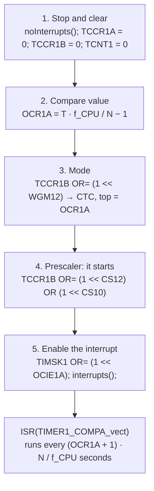
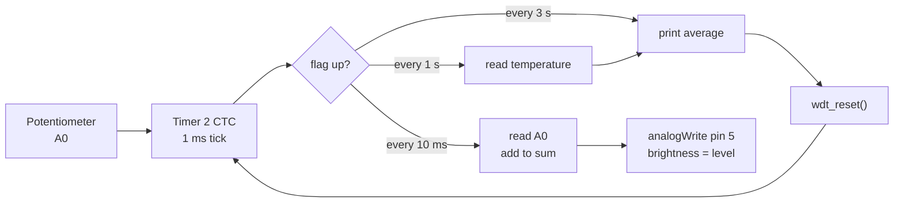
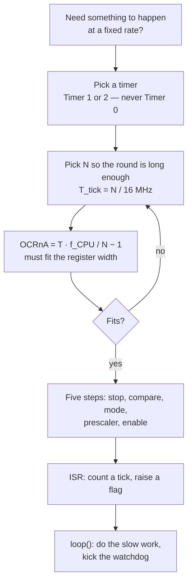

# 4. Timers, Watchdog & PWM

## 4.0 Quick reference

Everything the note defines, in one place. $n$ stands for the timer number: $0$, $1$ or $2$.

### Quantities and symbols

| Symbol | Meaning | Section |
|---|---|---|
| $f_{CPU}$ | CPU (central processing unit) clock frequency — **16 MHz** on the Arduino Uno | [[#4.2 Timers: counting time]] |
| $N$ | Prescaler division factor — $1, 8, 64, 256, 1024$ (Timer 2 also $32, 128$) | [[#4.2 Timers: counting time]] |
| $T_{tick}$ | Duration of one count: $T_{tick} = N / f_{CPU}$ | [[#4.2 Timers: counting time]] |
| $T$ | Period — the duration of one full on–off cycle | [[#4.5 PWM: signals from a timer]] |
| $t_{on}$ | How long the signal is high inside one period | [[#4.5 PWM: signals from a timer]] |
| $D$ | Duty cycle: $D = t_{on} / T$, usually quoted in % | [[#4.5 PWM: signals from a timer]] |
| $V_{CC}$ | Supply voltage — **5 V** on the Uno | [[#4.5 PWM: signals from a timer]] |
| $V_{avg}$ | Average (DC) voltage left after filtering: $V_{avg} = D \cdot V_{CC}$ | [[#4.6 PWM as a cheap DAC]] |
| $f$ | Frequency, in hertz (Hz): $f = 1 / T$ | [[#4.5 PWM: signals from a timer]] |
| $\div$ | "divided by" — the prescaler *divides* the clock before the counter sees it | [[#4.2 Timers: counting time]] |

### Registers and pins

| Name | Meaning | Section |
|---|---|---|
| $TCNTn$ | Timer/Counter register — the count itself, the number that goes $0, 1, 2, \dots$ | [[#4.2 Timers: counting time]] |
| $OCRnA$, $OCRnB$ | Output Compare Register A / B — the number the count is compared against | [[#4.2 Timers: counting time]] |
| $ICR1$ | Input Capture Register — Timer 1's hardware time stamp | [[#4.7 Input capture: measuring a signal]] |
| $TCCRnA$, $TCCRnB$ | Timer/Counter Control Registers — mode and clock select | [[#4.3 Configuring Timer 1: the registers and the five steps]] |
| $TIMSKn$ | Timer/Counter Interrupt Mask Register — which interrupts are enabled | [[#4.3 Configuring Timer 1: the registers and the five steps]] |
| $TIFRn$ | Timer/Counter Interrupt Flag Register — which interrupts have fired | [[#4.2 Timers: counting time]] |
| $OCnA$, $OCnB$ | Output Compare **pins** — where the hardware drives the waveform | [[#4.5 PWM: signals from a timer]] |
| $ICP1$ | Input Capture (ICP) **pin** — pin 8, Timer 1 only | [[#4.7 Input capture: measuring a signal]] |

### Abbreviations

| Abbrev. | Full term | Section |
|---|---|---|
| PWM | pulse-width modulation | [[#4.5 PWM: signals from a timer]] |
| ISR | interrupt service routine | [[#4.4 Interrupt rules and the watchdog]] |
| CTC | clear timer on compare match | [[#4.2 Timers: counting time]] |
| WDT | watchdog timer | [[#4.4 Interrupt rules and the watchdog]] |
| DAC | digital-to-analog converter | [[#4.6 PWM as a cheap DAC]] |
| ADC | analog-to-digital converter | [[#4.8 The water-plant meter: putting it together]] |
| MCU | microcontroller unit | [[#4.4 Interrupt rules and the watchdog]] |
| ICP | input capture (pin) | [[#4.7 Input capture: measuring a signal]] |
| WGM | waveform generation mode | [[#4.3 Configuring Timer 1: the registers and the five steps]] |
| CS | clock select (the prescaler bits) | [[#4.3 Configuring Timer 1: the registers and the five steps]] |
| INT0 | external interrupt request 0 — pin 2 on the Uno | [[#4.8 The water-plant meter: putting it together]] |
| RC | resistor–capacitor | [[#4.6 PWM as a cheap DAC]] |
| LED | light-emitting diode | [[#4.1 Where Module 4 sits]] |

### The four formulas worth memorising

| Want | Formula | Section |
|---|---|---|
| Interrupt period (CTC) | $T = (OCRnA + 1) \cdot N / f_{CPU}$ | [[#4.2 Timers: counting time]] |
| Compare value (CTC) | $OCRnA = T \cdot f_{CPU} / N - 1$ | [[#4.3 Configuring Timer 1: the registers and the five steps]] |
| Fast PWM frequency | $f = f_{CPU} / (N \cdot 256)$ | [[#4.5 PWM: signals from a timer]] |
| Phase-correct PWM frequency | $f = f_{CPU} / (N \cdot 510)$ | [[#4.5 PWM: signals from a timer]] |

---

## 4.1 Where Module 4 sits

Module 4 of *Programming of Embedded Systems* (Cyber & Computer Engineering · Cyber Security, Autumn 2026), taught by Vasilis Ntinas (Department of Electronic Systems, Aalborg University — vntinas@es.aau.dk). The lecture is built around the Arduino Uno, whose MCU (microcontroller unit) is the ATmega328P.

In the course roadmap, Module 4 is the third of four **bare-metal (no-OS)** modules: the code runs directly on the chip, with no operating system scheduling anything. Modules 1–3 gave us digital input/output, analog input and interrupts; Module 4 adds the thing that makes all of them *timed*.

The deck opens by contrasting what you could already do after Module 3 with what this module adds.

![[M4 Fig 4.1 Course overview - last time this time.png]]

_Figure 4.1: "Last time, this time". Module 3 left us with a knob read as $0$–$1023$ and a button that fires an interrupt service routine (ISR) on pin 2. Module 4 adds a counter on the clock that paces the readings and generates pulse-width modulation (PWM), rules for safe ISRs, and a watchdog for when the program hangs._

![[M4 Fig 4.2 Course roadmap.png]]

_Figure 4.2: The ten-module roadmap. Modules 1–4 are bare metal, 5–6 cover serial buses and real-time basics, 7–8 a real-time operating system (RTOS) and networking, 9–10 embedded Linux and system integration. Module 4 — Timers, Watchdog & PWM — is the last no-OS module._

### Objectives

By the end of this module you can:

1. **Explain** what a timer is, and set one to interrupt at a fixed rate.
2. **Compute** the prescaler and the compare value for a given period.
3. **Write** an interrupt routine that follows the rules, and say why the rules exist.
4. **Use** a watchdog to restart a program that hangs.
5. **Generate** PWM (pulse-width modulation) to dim an LED (light-emitting diode), and explain duty cycle and frequency.

The agenda follows the three technical blocks: timers, then interrupt rules and the watchdog, then PWM.

### Sources cited in the lecture

The deck points at primary sources rather than reproducing them. These are the four you will actually need at the bench.

| Cited in the deck | What it is | Used for |
|---|---|---|
| ATmega328P datasheet, Table 15-5, p. 109 | Waveform Generation Mode (WGM) bit description, Timer 1 | Choosing CTC (clear timer on compare match): $WGM13{:}0 = 0100$ |
| ATmega328P datasheet, Table 15-6, p. 110 | Clock Select bit description, Timer 1 | Choosing the prescaler: $CS12{:}0 = 101$ |
| ATmega328P datasheet, Table 17-8, p. 130 | WGM bit description, Timer 2 | Timer 2's mode bits — the CTC bit lives in `TCCR2A`, not `TCCR2B` |
| ATmega328P datasheet, Table 17-9, p. 131 | Clock Select bit description, Timer 2 | Timer 2's prescaler — also $32$ and $128$, different bit patterns |
| ATmega328P datasheet, Figure 10-7 | Watchdog timer block diagram | The WDT (watchdog timer) runs from its own 128 kHz clock |
| ATmega328P datasheet, §15.6 | Input capture unit | Exercise 6: time-stamping edges on pin 8 |
| Register pages: p. 108 (`TCCR1A`), p. 110 (`TCCR1B`), p. 112 (`TIMSK1`) | Timer 1 register bit layouts | Which bit to set for mode, prescaler and interrupt enable |
| `avr/wdt.h` — the AVR C library | Watchdog API | `wdt_enable()`, `wdt_reset()`, `wdt_disable()` |
| Arduino Language Reference | Arduino core API | `analogWrite()`, `map()`, `millis()`, `noInterrupts()`, `interrupts()` |

_Table 4.1: Primary sources cited in the lecture, and what each is used for in this module._

**Which datasheet?** The page numbers above refer to the ATmega328P **complete** datasheet (Atmel/Microchip, the long ~600-page version). Page numbers differ in the short summary datasheet — search for "Table 15-5" or "Waveform Generation Mode Bit Description" instead of paging.

---

## 4.2 Timers: counting time

### The demo that poses the question

The lecture opens with a live demo. An LED on pin 5 blinks: one second on, one second off. Meanwhile `loop()` does something completely different.

```cpp
void loop() {
  Serial.print("At time ");
  Serial.print(millis() / 1000.0, 1);
  Serial.print(" s the value is: ");
  Serial.println(analogRead(A0));
  delay(300);
}
```

Nothing in `loop()` touches pin 5. Yet the LED keeps perfect time.

![[M4 Fig 4.3 Live demo - blink that keeps its own time.png]]

_Figure 4.3: The timing diagram for the demo. `loop()` reads the knob, prints, and blocks in `delay(300)` — at 0 s, 0.3 s, 0.6 s and so on. The LED still toggles at exactly 1 s and 2 s, because the toggling is done by hardware and an ISR, not by `loop()`._

The answer to "so what keeps the time?" is the subject of this whole section: **a timer, plus an interrupt**.

**The mental model.** `delay()` is you watching the clock. A timer interrupt is an alarm clock: you set it once, it wakes the CPU (central processing unit) at exactly the right moment, and you go back to whatever you were doing. Everything in Module 4 is about setting the alarm correctly.

This matters because `delay()` and `millis()` polling both have the same weakness: they only know the time at the instant your code happens to look. If `loop()` spends 40 ms printing, a `millis()`-based 10 ms schedule silently slips. A timer interrupt fires on schedule regardless of what the CPU is executing, because the counting happens in hardware, in parallel with the processor.

### What a timer is

> [!info] Definition: Timer
> A **timer** is a register that adds $1$ at every tick of its clock. On the Arduino Uno the clock ticks 16 million times a second, so one tick lasts $62.5$ ns.
>
> - **8 bits:** counts $0$ to $255$ ($2^8 = 256$ values).
> - **16 bits:** counts $0$ to $65{,}535$ ($2^{16} = 65{,}536$ values).
> - **Overflow:** one tick past the maximum, the count goes back to $0$ and a flag is set in $TIFRn$.

![[M4 Fig 4.4 Timer is a counter on a clock.png]]

_Figure 4.4: A timer as a counter on a clock. `TCNT` — the count — steps $0, 1, 2, \dots, 255$, and on the next tick wraps to $0$ with the overflow flag set._

> [!example] Reading a timer as a clock
> The Uno's timer clock ticks at $f_{CPU} = 16$ MHz, so one tick lasts
> $$T_{tick} = \frac{1}{f_{CPU}} = \frac{1}{16 \times 10^6} = 62.5 \text{ ns}$$
> - **Breakdown:**
>     - $f_{CPU}$: the CPU clock frequency, $16$ MHz on the Uno.
>     - $T_{tick}$: how long one count of the timer lasts.
>     - $16 \times 10^6$: sixteen million ticks per second.
> - **Substitution check:** a 16-bit timer at this rate runs from $0$ to $65{,}535$ in $65{,}536 \times 62.5 \text{ ns} = 4.096$ ms, so it overflows about $244$ times a second. ✓

### The three timers — and one to leave alone

| Timer | Width | What it does | May you use it? |
|---|---|---|---|
| Timer 0 | 8 bits | Runs `millis()`, `delay()` and `micros()` | **No — leave it alone** |
| Timer 1 | 16 bits | Free | Yes |
| Timer 2 | 8 bits | Free | Yes |

_Table 4.2: The ATmega328P's three timers on an Arduino Uno._

> [!warning] Reprogramming Timer 0 breaks the Arduino core
> `millis()`, `micros()` and `delay()` are all built on Timer 0's overflow interrupt. Change Timer 0's prescaler or mode and all three silently go wrong — `delay(1000)` will no longer be a second. This is the single most common way to lose an afternoon in this module.

### The problem: one second does not fit

Suppose we want Timer 1 to mark exactly one second. The clock ticks 16 million times a second; Timer 1 holds at most $65{,}536$ counts. At $62.5$ ns per tick it overflows after $4.1$ ms. One second is $16{,}000{,}000$ ticks — about $244$ overflows' worth.

Two things fix this: **slow the clock down** (the prescaler) and **stop at a number you choose** — CTC, clear timer on compare match.

### The prescaler slows the timer's clock

> [!info] Definition: Prescaler
> A **prescaler** divides the system clock by a factor $N$ before the counter sees it, so one timer tick lasts $N$ CPU cycles instead of one:
> $$T_{tick} = \frac{N}{f_{CPU}}$$
> **Breakdown:**
> - $N$: the prescaler factor. Timer 0 and Timer 1 offer $1, 8, 64, 256, 1024$; Timer 2 also offers $32$ and $128$.
> - $f_{CPU}$: the 16 MHz system clock.
> - $T_{tick}$: the resulting time per count — the resolution of every measurement you make with this timer.
>
> A bigger $N$ buys you longer periods but coarser resolution. That trade is the whole game in this module.

![[M4 Fig 4.5 Prescaler slows the timer clock.png]]

_Figure 4.5: The 16 MHz clock passes through the prescaler $(\div N)$ before it reaches the counter. One tick $= N / 16$ MHz._

| $N$ | One tick | One round, 8 bits (256 ticks) | One round, 16 bits (65,536 ticks) |
|---|---|---|---|
| 1 | 62.5 ns | 16 µs | 4.1 ms |
| 8 | 0.5 µs | 128 µs | 32.8 ms |
| 64 | 4 µs | 1.02 ms | 262 ms |
| 256 | 16 µs | 4.1 ms | 1.05 s |
| 1024 | 64 µs | 16.4 ms | 4.19 s |

_Table 4.3: Prescaler choices on a 16 MHz Uno. Note the deck's conclusion: only at $\div 1024$ does one second fit inside a 16-bit round._

> [!example] Picking a prescaler for a 1 s period
> We want Timer 1 (16 bits, $65{,}536$ counts per round) to reach one second in a single round.
> $$N \ge \frac{T \cdot f_{CPU}}{65{,}536} = \frac{1 \cdot 16 \times 10^6}{65{,}536} = 244.1$$
> - **Breakdown:**
>     - $T$: the target period, $1$ s.
>     - $65{,}536$: the number of counts in one full 16-bit round.
>     - $244.1$: the minimum prescaler that stretches one round to at least a second.
> - The available values are $1, 8, 64, 256, 1024$; the smallest one $\ge 244.1$ is **$256$**.
> - **Check:** at $N = 256$, one round is $65{,}536 \times 256 / 16 \text{ MHz} = 1.049$ s. ✓
> - The lecture's worked example uses $N = 1024$ instead (one round $4.19$ s), which leaves more headroom and a cleaner tick of exactly $64$ µs.

**Choosing $N$ in practice: the smallest one that fits.** Among the prescalers that make your period fit, prefer the *smallest*. A smaller $N$ means a finer tick, and the tick is your measurement resolution — with $N = 1024$ you cannot place an event more precisely than $64$ µs, whereas $N = 64$ resolves to $4$ µs. Choosing the largest prescaler that fits is the classic beginner move: it works, but it throws away resolution you could have had for free by picking a smaller divisor and a larger compare value.

**Timer 1 or Timer 2?** Timer 1 is 16-bit, so it reaches long periods in a single round and is the natural first choice — and it is the only one that can do input capture. Timer 2 is 8-bit, so anything longer than $256$ ticks needs software tick counting, but it offers the extra $\div 32$ and $\div 128$ prescalers, which sometimes give an exact period where Timer 1 cannot. Reach for Timer 1 unless you have a reason; in the exercises the reason is that Timer 1 is busy capturing.

### Overflow or compare match

Two ways to get an interrupt at a chosen rate.

![[M4 Fig 4.6 Overflow versus CTC.png]]

_Figure 4.6: Left — **overflow**: the count runs to the top ($65{,}535$) and wraps, and you reload a preload value in every interrupt. Right — **CTC**: the count stops at $OCR1A$, fires, and resets to $0$ by hardware, with nothing to reload._

> [!info] Definition: CTC (clear timer on compare match)
> In **CTC** mode the counter counts up to the value in $OCRnA$, fires the compare-match interrupt, and is cleared back to $0$ **by hardware** on the next tick. The period is
> $$T = \frac{(OCRnA + 1) \cdot N}{f_{CPU}}$$
> **Breakdown:**
> - $OCRnA$: the compare value you write. The count runs $0, 1, \dots, OCRnA$, which is $OCRnA + 1$ ticks — the $+1$ is because counting starts at zero.
> - $N$: the prescaler factor.
> - $f_{CPU}$: the 16 MHz system clock.
> - $T$: the resulting period between successive interrupts.
>
> The alternative, **overflow**, always runs to $2^{16} - 1$ and needs a *preload* written back into $TCNT1$ inside every interrupt.

> [!example] The same 25,000 ticks, both ways
> Suppose we need an interrupt every 25,000 ticks.
> - **Overflow:** preload $TCNT1 = 65{,}536 - 25{,}000 = 40{,}536$. The count runs $40{,}536 \to 65{,}535$, which is $65{,}536 - 40{,}536 = 25{,}000$ ticks. The ISR must rewrite $40{,}536$ every single time. ✓
> - **CTC:** $OCR1A = 25{,}000 - 1 = 24{,}999$. The count runs $0 \to 24{,}999$, which is $25{,}000$ ticks, then resets itself. ✓
>
> CTC wins because there is nothing to reload — no lost ticks from interrupt latency, and no arithmetic to get wrong twice. **The module uses CTC throughout.**

> [!warning] The off-by-one that catches everyone
> The period is $OCRnA + 1$ ticks, not $OCRnA$. Counting from $0$ to $15{,}624$ inclusive is $15{,}625$ ticks. If you write $OCR1A = 15{,}625$ you get $15{,}626$ ticks and your "one second" is $64$ µs long. Same trap in reverse for the preload: it is $2^{16} - \text{ticks}$, not $2^{16} - 1 - \text{ticks}$.

---

## 4.3 Configuring Timer 1: the registers and the five steps

### The three registers you touch

![[M4 Fig 4.7 Registers of Timer 1.png]]

_Figure 4.7: The Timer 1 registers as set up for a one-second CTC interrupt. `TCCR1A` is cleared to $0$, `TCCR1B` is $0b00001101$ (mode: CTC; prescaler: $\div 1024$) and `TIMSK1` is $0b00000010$ (compare-match A interrupt enabled)._

**`TCCR1A` — Timer/Counter Control Register A (datasheet p. 108).** Cleared to zero for plain CTC.

| Bit | 7 | 6 | 5 | 4 | 3 | 2 | 1 | 0 |
|---|---|---|---|---|---|---|---|---|
| Name | COM1A1 | COM1A0 | COM1B1 | COM1B0 | – | – | WGM11 | WGM10 |
| Value | 0 | 0 | 0 | 0 | 0 | 0 | 0 | 0 |

_Table 4.4: `TCCR1A`. The `COM1A`/`COM1B` bits control what the waveform generator does to the output pins — irrelevant in plain CTC, so all zero. `WGM11` and `WGM10` are two of the four mode bits._

> [!warning] `TCCR1A = 0` is not optional
> The Arduino start-up code sets `WGM10` (it configures Timer 1 for 8-bit phase-correct PWM so that `analogWrite()` works on pins 9 and 10). If you only write `TCCR1B`, you land in mode 5, not mode 4. Clear `TCCR1A` first.

**`TCCR1B` — Timer/Counter Control Register B (datasheet p. 110).** Mode bits and the clock select.

| Bit | 7 | 6 | 5 | 4 | 3 | 2 | 1 | 0 |
|---|---|---|---|---|---|---|---|---|
| Name | ICNC1 | ICES1 | – | WGM13 | WGM12 | CS12 | CS11 | CS10 |
| Value | 0 | 0 | 0 | 0 | 1 | 1 | 0 | 1 |

_Table 4.5: `TCCR1B` $= 0b00001101 = 13$. `WGM12 = 1` with `WGM13 = WGM11 = WGM10 = 0` gives $WGM13{:}0 = 0100$, mode 4, CTC with top $= OCR1A$. `CS12:0 = 101` selects $\div 1024$ and starts the timer._

`CS12:0` — the clock select (CS) bits (datasheet Table 15-6, p. 110):

| CS12:0 | Meaning | | CS12:0 | Meaning |
|---|---|---|---|---|
| `000` | stopped | | `100` | $\div 256$ |
| `001` | $\div 1$ | | `101` | $\div 1024$ |
| `010` | $\div 8$ | | `110` | external clock, falling edge |
| `011` | $\div 64$ | | `111` | external clock, rising edge |

_Table 4.6: Timer 1 clock-select bit patterns. Note there is no $\div 32$ or $\div 128$ on Timer 1 — only Timer 2 has those._

**`TIMSK1` — Timer/Counter Interrupt Mask Register (datasheet p. 112).** Which interrupts are switched on.

| Bit | 7 | 6 | 5 | 4 | 3 | 2 | 1 | 0 |
|---|---|---|---|---|---|---|---|---|
| Name | – | – | ICIE1 | – | – | OCIE1B | OCIE1A | TOIE1 |
| Value | 0 | 0 | 0 | 0 | 0 | 0 | 1 | 0 |

_Table 4.7: `TIMSK1` $= 0b00000010 = 2$. Only `OCIE1A` (output compare A match interrupt enable) is set. `TOIE1` would enable the overflow interrupt — used in overflow mode, not in CTC. `ICIE1` enables input capture, see [[#4.7 Input capture: measuring a signal]]._

### The five steps, in this order



_Figure 4.8: The five configuration steps. Order matters: write the compare value **before** starting the clock, and start the clock last of all so the timer never runs with a half-written configuration._

> [!warning] Why the order matters
> Step 4 is the one that starts the timer, so everything else must already be in place. And the whole block runs between `noInterrupts()` and `interrupts()` so that an interrupt cannot fire while the configuration is half written — a compare match against a stale `OCR1A` would fire immediately.

### Worked example: Timer 1 interrupts once a second

This is the demo of Figure 4.3, written out in full.

```cpp
const byte LED = 5;                      // class wiring: LED on pin 5
void setup() {
  pinMode(LED, OUTPUT);
  noInterrupts();                        // no interrupts while we set up
  TCCR1A = 0;                            // clear it all: Arduino start-up set WGM10
  TCCR1B = 0;                            // timer stopped, mode bits cleared
  TCNT1  = 0;                            // count from 0
  OCR1A  = 15624;                        // 16 MHz / 1024 = 15625 ticks: 0..15624
  TCCR1B |= (1 << WGM12);                // CTC mode, top = OCR1A (Table 15-5)
  TCCR1B |= (1 << CS12) | (1 << CS10);   // prescaler 1024 (Table 15-6): it runs
  TIMSK1 |= (1 << OCIE1A);               // enable the compare match A interrupt
  interrupts();                          // set the I bit again
}
ISR(TIMER1_COMPA_vect) {                 // runs once every second
  digitalWrite(LED, !digitalRead(LED));  // toggle the LED
}
void loop() {
}
```

> [!example] Where `15624` comes from
> Target period $T = 1$ s, prescaler $N = 1024$, so the timer clock is $f_{CPU} / N = 16\text{ MHz} / 1024 = 15{,}625$ ticks per second.
> $$OCR1A = \frac{T \cdot f_{CPU}}{N} - 1 = \frac{1 \cdot 16 \times 10^6}{1024} - 1 = 15{,}625 - 1 = 15{,}624$$
> - **Breakdown:**
>     - $T$: the wanted period, $1$ s.
>     - $f_{CPU} / N$: the timer's own clock rate, $15{,}625$ Hz.
>     - $-1$: because the count starts at $0$, so it passes through $15{,}625$ values on the way from $0$ to $15{,}624$.
> - **Substitution check:** $T = (15{,}624 + 1) \times 1024 / 16 \times 10^6 = 15{,}625 \times 64\ \mu\text{s} = 1.000000$ s. ✓
> - **Fit check:** $15{,}624 \le 65{,}535$, so it fits in the 16-bit `OCR1A`. ✓

> [!example] A second target: 100 ms on Timer 1 at $\div 64$
> Timer clock $= 16\text{ MHz} / 64 = 250$ kHz, one tick $= 4$ µs.
> $$OCR1A = \frac{0.100 \cdot 16 \times 10^6}{64} - 1 = 25{,}000 - 1 = 24{,}999$$
> **Check:** $(24{,}999 + 1) \times 4\ \mu\text{s} = 100.000$ ms. ✓ And $24{,}999 \le 65{,}535$, so it fits. ✓

### From Timer 1 to Timer 2

| | Carries over | Changes |
|---|---|---|
| Steps | The same five steps, same order | — |
| Names | — | `TCCR2A`, `TCCR2B`, `OCR2A`, `TIMSK2`, `TIMER2_COMPA_vect` |
| Width | — | 8 bits: $OCR2A \le 255$; for longer periods, count interrupts |
| Mode bit | — | CTC bit (`WGM21`) is in **`TCCR2A`**, not `TCCR2B` (Table 17-8, p. 130) |
| Prescaler | — | Also $32$ and $128$, and **different bit patterns** (Table 17-9, p. 131) |

_Table 4.8: Porting a Timer 1 CTC setup to Timer 2._

> [!example] 10 ms on Timer 2 — and why it takes two stages
> Try every prescaler for a single 8-bit CTC round of 10 ms ($OCR2A = 0.010 \cdot 16\text{ MHz} / N - 1$):
>
> | $N$ | ticks needed | $OCR2A$ | fits in 8 bits? |
> |---|---|---|---|
> | 1 | 160,000 | 159,999 | no |
> | 8 | 20,000 | 19,999 | no |
> | 32 | 5,000 | 4,999 | no |
> | 64 | 2,500 | 2,499 | no |
> | 128 | 1,250 | 1,249 | no |
> | 256 | 625 | 624 | no |
> | 1024 | 156.25 | — | not an integer |
>
> _Table 4.9: Every Timer 2 prescaler tried against a single 8-bit CTC round of 10 ms. None fits, so the design needs a two-stage tick._
>
> **No prescaler gives exactly 10 ms in one 8-bit round.** The fix is a two-stage design: generate an exact **1 ms** tick and count ten of them in software.
> - $N = 128$: one tick $= 8$ µs, $1\text{ ms} / 8\ \mu\text{s} = 125$ ticks, so $OCR2A = 124$.
> - **Check:** $(124 + 1) \times 128 / 16\text{ MHz} = 1.000$ ms exactly, and $124 \le 255$. ✓
> - $N = 64$: one tick $= 4$ µs, $250$ ticks, $OCR2A = 249$. **Check:** $250 \times 4\ \mu\text{s} = 1.000$ ms, and $249 \le 255$. ✓
>
> Either works. This is exactly what Exercise 1 asks for — see [[#4.10 Exercises and worked solutions]].

```cpp
// Timer 2, 1 ms tick, CTC mode (WGM21 is in TCCR2A)
noInterrupts();
TCCR2A = 0;
TCCR2B = 0;
TCNT2  = 0;
OCR2A  = 124;                    // (124 + 1) * 128 / 16 MHz = 1.000 ms
TCCR2A |= (1 << WGM21);          // CTC: WGM21 lives in TCCR2A for Timer 2
TCCR2B |= (1 << CS22) | (1 << CS20);   // prescaler 128 (Table 17-9, p. 131)
TIMSK2 |= (1 << OCIE2A);         // compare match A interrupt — note the 2
interrupts();
```

> [!warning] Three Timer 2 traps
> 1. `WGM21` is in **`TCCR2A`**. Copying the Timer 1 pattern `TCCR2B |= (1 << WGM21)` silently does nothing useful.
> 2. The prescaler bit patterns are **different** from Timer 1: on Timer 2, `CS22:0 = 110` is $\div 256$ and `101` is $\div 128$, whereas on Timer 1 `101` is $\div 1024$. Look it up in Table 17-9 every time.
> 3. Every name carries the timer number: it is `OCIE2A` in `TIMSK2`, never `OCIE1A`. A one-digit slip compiles fine and simply never fires.

---

## 4.4 Interrupt rules and the watchdog

### What is wrong with this routine?

The lecture puts a broken ISR (interrupt service routine) on the board and asks for three faults.

```cpp
int count = 0;
ISR(TIMER1_COMPA_vect) {      // runs every 10 ms
  count++;
  Serial.print("tick ");
  Serial.println(count);
  delay(100);
}
void loop() {
  if (count >= 10) digitalWrite(5, HIGH);
}
```

> [!example] The three faults
> 1. **`Serial.print()` inside an ISR.** Serial output is interrupt-driven: bytes leave the buffer thanks to an interrupt that fires when the transmit register empties. Interrupts are disabled while an ISR runs, so once the output buffer fills, `Serial.print()` waits for space that will never come. The program deadlocks.
> 2. **`delay(100)` inside an ISR.** `delay()` watches `millis()`, and `millis()` only advances when Timer 0's overflow interrupt runs. Inside an ISR that interrupt cannot run, so `millis()` freezes and `delay()` never returns. A permanent hang.
> 3. **`count` is not `volatile`.** The compiler does not know an ISR can change it, so it is free to keep `count` in a register inside `loop()` and never re-read it. `loop()` then tests a stale copy forever.
>
> **Bonus fault:** the ISR lasts over $100$ ms but fires every $10$ ms. Even if the first three were fixed, the routine cannot keep up — interrupts are missed.
> **Bonus fault:** nothing ever sets pin 5 back to `LOW`, so the LED latches on.
>
> **Check:** the routine is scheduled every $10$ ms but `delay(100)` alone is $10$ times that, so even a correct ISR could not finish before the next one was due. ✓

### The rules

| Rule | Why |
|---|---|
| Keep the ISR short — store a value or set a flag | Every other interrupt is blocked while it runs |
| Never print, never `delay()`, never block | Both depend on interrupts that cannot fire inside an ISR |
| Declare shared data `volatile` | Otherwise the compiler caches it and never sees the update |
| Read multi-byte shared data atomically | AVR (the ATmega instruction set) is 8-bit; a 16-bit read takes two instructions |
| Do the work in `loop()` | `loop()` can afford to be slow; the ISR cannot |

_Table 4.10: The rules for sharing work between an ISR and the main loop._

> [!example] The broken routine, rewritten properly
> ```cpp
> volatile unsigned long tickCount = 0;   // volatile: an ISR writes it
> volatile bool flag = false;             // the ISR's only output: a flag
>
> ISR(TIMER1_COMPA_vect) {                // fires every 10 ms
>   tickCount++;                          // store a value ...
>   flag = true;                          // ... and raise a flag. Nothing else.
> }
>
> void loop() {
>   bool mine;
>   noInterrupts(); mine = flag; flag = false; interrupts();   // atomic take
>   if (mine) {
>     Serial.print("tick "); Serial.println(tickCount);        // slow work here
>     digitalWrite(5, tickCount >= 10);                        // and it can go LOW again
>   }
> }
> ```
> Every rule in Table 4.10 is honoured: the ISR is two statements and blocks on nothing; `tickCount` and `flag` are `volatile`; the flag is copied with interrupts off; and printing and pin-writing happen in `loop()`, where a wait is harmless.
> - **Check:** with `OCR1A = 24{,}999` at $\div 64$ the period is $(24{,}999 + 1) \times 4\ \mu\text{s} = 100.000$ ms. ✓

### `volatile` is not enough: the atomic read

An `int` on the AVR is **two bytes**, read one byte at a time. An ISR that fires between the two reads leaves `loop()` with half of the old value and half of the new one.

![[M4 Fig 4.9 Volatile is not enough - atomic read.png]]

_Figure 4.9: The classic torn-read race. `count` is $255$ $= 0x00FF$. `loop()` reads the low byte $FF$; the ISR fires and makes it $256$ $= 0x0100$; `loop()` reads the high byte $01$ and assembles $0x01FF = 511$ — a value that never existed._

```cpp
noInterrupts();
int copy = count;   // both bytes, nothing in between
interrupts();
```

Now `loop()` sees $255$ or $256$, never $511$.

> [!example] Why $511$ is impossible in a single read
> $255 = 0x00FF$ and $256 = 0x0100$. A correct read returns one of those two. The torn read glues the new high byte $0x01$ onto the old low byte $0xFF$:
> $$0x01FF = 1 \cdot 256 + 255 = 511$$
> - **Breakdown:**
>     - $0x01$: the high byte, read *after* the ISR incremented.
>     - $0xFF$: the low byte, read *before* the ISR incremented.
>     - $511$: the assembled value — larger than either real value, and nonsense as a counter.
> - **Check:** $1 \times 256 + 255 = 511$. ✓
> - **The fix:** `volatile` tells the compiler to re-read the variable, but it does not make the two-byte read indivisible. Only disabling interrupts around the copy does that.

> [!warning] `volatile` and atomicity are different problems
> `volatile` defeats the compiler's caching. It does **not** make a two-byte access indivisible. You need both: `volatile int count;` *and* a `noInterrupts()` / `interrupts()` sandwich around every read in `loop()` that is longer than one byte.

### The watchdog restarts a stuck program

> [!info] Definition: Watchdog timer (WDT)
> A **watchdog timer** is a separate timer with **its own 128 kHz clock**, independent of the main system clock.
> - `wdt_reset()` sets its count back to $0$ — "kicking" or "petting" the dog.
> - If the count ever reaches the time-out — selectable from **16 ms to 8 s** — it resets the chip, and `setup()` runs again from the beginning.
> - Because it uses its own clock, it keeps running even if the main clock or the software has gone completely wrong.
>
> Datasheet Figure 10-7 shows the block diagram.

![[M4 Fig 4.10 Watchdog restarts a stuck program.png]]

_Figure 4.10: The watchdog's own 128 kHz clock drives a counter. Either a time-out or an explicit reset restarts the MCU. `wdt_reset()` clears the count before it gets there._

| `wdt_enable()` argument | Time-out |
|---|---|
| `WDTO_15MS` | 16 ms |
| `WDTO_30MS` | 32 ms |
| `WDTO_60MS` | 64 ms |
| `WDTO_120MS` | 128 ms |
| `WDTO_250MS` | 250 ms |
| `WDTO_500MS` | 500 ms |
| `WDTO_1S` | 1 s |
| `WDTO_2S` | 2 s |
| `WDTO_4S` | 4 s |
| `WDTO_8S` | 8 s |

_Table 4.11: The watchdog time-outs available through `avr/wdt.h`, spanning the 16 ms – 8 s range the lecture quotes._

> [!example] How many 128 kHz ticks is a 2-second time-out?
> The WDT (watchdog timer) runs from its own $128$ kHz oscillator, independent of the 16 MHz system clock.
> $$\text{ticks} = f_{WDT} \cdot T_{out} = 128{,}000 \times 2 = 256{,}000$$
> - **Breakdown:**
>     - $f_{WDT}$: the watchdog's own oscillator, $128$ kHz — roughly $1/125$ of the system clock.
>     - $T_{out}$: the selected time-out, $2$ s with `WDTO_2S`.
>     - $\text{ticks}$: how many counts the watchdog's internal counter reaches before it resets the MCU.
> - **Check:** $256{,}000 / 128{,}000 = 2.0$ s. ✓
> - **Why it matters:** because the watchdog counts on a *different* clock, a program that has stopped the main clock, or wedged itself in an interrupt-disabled loop, still gets reset. That independence is the entire point of the peripheral.

> [!warning] Kick the watchdog from `loop()`, never from a timer ISR
> A timer interrupt keeps firing perfectly while `loop()` is stuck in an infinite loop. If you call `wdt_reset()` there, the watchdog is happily kicked by a program that is doing nothing useful — and it will never reset the board. The kick must live in the code path whose health you want to prove: the main loop.

### Live demo: the watchdog catches a hang

```cpp
#include <avr/wdt.h>
const byte LED = 5, BUTTON = 2;          // class wiring
void setup() {
  // (pins, Serial.begin, "Started", three quick flashes)
  wdt_enable(WDTO_2S);                   // reset the chip after 2 s without wdt_reset()
}
void loop() {
  digitalWrite(LED, !digitalRead(LED));  // slow blink: the program is alive
  delay(500);
  if (digitalRead(BUTTON) == LOW) {      // a press simulates a hang
    Serial.println("Hanging...");
    while (true) { }                     // stuck: wdt_reset() never runs again
  }
  wdt_reset();                           // healthy: watchdog count back to 0
}
```

![[M4 Fig 4.11 Watchdog demo timeline.png]]

_Figure 4.11: The demo timeline. The LED blinks normally; a button press sends the program into `while (true)`; about 1.5 s later the watchdog fires, the board resets, and `setup()` prints "Started" and flashes three times before the blinking resumes._

This is not a classroom curiosity. A watchdog is why a remote sensor node buried in a field can recover from a fault nobody can physically reach, and why a satellite or a medical pump survives a software fault without a human pressing reset. The design rule that follows from it is the same one the demo illustrates: kick the dog only from a code path that proves the whole program ran. Kicking it from an interrupt that keeps firing during a hang gives you the appearance of safety and none of the substance.

> [!warning] A too-short time-out can brick your upload
> If the watchdog resets the board before the bootloader finishes, you cannot upload a new sketch. The recovery: hold the reset button, release it the moment the upload starts, or power-cycle while the upload begins. Older Uno bootloaders do not disable the watchdog on entry — which is why Exercise 5 warns "if it resets for ever, hold reset while uploading".

---

## 4.5 PWM: signals from a timer

### Blinking too fast to see

The section opens with another demo. The LED is on for a quarter of each period. The knob shortens the period from 1 s down to 1 ms.

![[M4 Fig 4.12 Blinking too fast to see.png]]

_Figure 4.12: The perceptual point behind PWM. At a 1 s period you see distinct blinks; at 20 ms it flickers; at 1 ms the switching is far faster than the eye can follow and you see one steady, dimmer light. The duty cycle never changed — only the frequency._

### Duty cycle, period, average

> [!info] Definition: PWM (pulse-width modulation)
> In **PWM** the pin switches between 0 V and 5 V at a fixed rate.
> $$D = \frac{t_{on}}{T} \qquad V_{avg} = D \cdot V_{CC} \qquad f = \frac{1}{T}$$
> **Breakdown:**
> - $D$: the duty cycle — the *share* of each period spent high, usually as a percentage.
> - $t_{on}$: how long the pulse is high.
> - $T$: the period — one complete on–off cycle.
> - $V_{CC}$: the supply voltage, 5 V on the Uno.
> - $V_{avg}$: the average voltage, which is what a slow load actually responds to.
> - $f$: the base frequency, in Hz — how many periods happen per second.

![[M4 Fig 4.13 Duty cycle and average voltage.png]]

_Figure 4.13: A PWM waveform. The pin is high for a quarter of each period, so $D = 25\%$ and the average is $1.25$ V. The period marks one full cycle._

> [!example] Duty cycle → average voltage
> With $V_{CC} = 5$ V:
> - $D = 25\%$ → $V_{avg} = 0.25 \times 5 = 1.25$ V ✓
> - $D = 50\%$ → $V_{avg} = 0.50 \times 5 = 2.50$ V ✓
> - $D = 75\%$ → $V_{avg} = 0.75 \times 5 = 3.75$ V ✓
>
> A quarter duty cycle at a 1 ms period is a $250$ µs pulse repeated $1000$ times a second — which is why the eye reads it as a dim, steady light rather than a blink.

**Duty cycle and frequency are two independent knobs.** Duty cycle sets *how much* — brightness, average voltage, motor torque. Frequency sets *how fast* — and it must be high enough that the load averages instead of following each individual pulse. Changing one does not change the other, which is exactly why the Figure 4.12 demo can shrink the period from 1 s to 1 ms while the LED stays precisely as dim as it was.

A practical consequence: for a given duty cycle there are infinitely many signals that deliver the same average. What differs is how the load reacts — 25 % duty at 1 Hz is a visible blink, at 100 Hz it is a steady dim lamp, and at 20 kHz it is a silent motor drive instead of an audible whine.

### A timer makes PWM by itself

The counter does the switching with no CPU involvement at all: you write one number, and the pin toggles itself forever.

![[M4 Fig 4.14 Fast versus phase-correct PWM.png]]

_Figure 4.14: Fast PWM counts straight up $0 \to 255$ and resets; phase-correct PWM counts up and back down, giving symmetric pulses centred on the period._

> [!info] Definition: Fast PWM and phase-correct PWM
> **Fast PWM** — the count runs $0$ to $255$, then wraps. The pin is switched **on at $0$** and **off at the compare value**, so the compare value sets the duty cycle:
> $$f_{PWM} = \frac{f_{CPU}}{N \cdot 256}$$
>
> **Phase-correct PWM** — the count runs up and back down, so each pulse is symmetric about the middle of the period. The round trip is $510$ counts:
> $$f_{PWM} = \frac{f_{CPU}}{N \cdot 510}$$
>
> **Breakdown:**
> - $f_{CPU}$: the 16 MHz system clock.
> - $N$: the prescaler factor.
> - $256$: one 8-bit round trip, $0 \to 255$.
> - $510$: $2 \times 255$ — up *and* back down, which is why phase-correct is half the frequency.
>
> The waveform leaves the chip on the output compare pins, $OCnA$ and $OCnB$.

> [!warning] Mind the R: `OCR1A` is a number, `OC1A` is a pin
> `OCR1A` (with the R) is the **register** holding the compare value — a number you write. `OC1A` (no R) is the **physical pin** the waveform comes out of (pin 9 on the Uno). Mixing them up is the most common notational slip in this topic.

> [!example] Fast PWM frequency at several prescalers
> With $f_{CPU} = 16$ MHz and $f = f_{CPU} / (N \cdot 256)$:
>
> | $N$ | Fast PWM | Phase-correct PWM |
> |---|---|---|
> | 1 | 62.5 kHz | 31.4 kHz |
> | 8 | 7.81 kHz | 3.92 kHz |
> | 64 | **976.6 Hz** | **490.2 Hz** |
> | 256 | 244 Hz | 123 Hz |
> | 1024 | 61.0 Hz | 30.6 Hz |
>
> _Table 4.12: Fast and phase-correct PWM frequencies at each prescaler, on a 16 MHz Uno._
>
> - **Check:** $16 \times 10^6 / (64 \times 256) = 976.5625$ Hz; $16 \times 10^6 / (64 \times 510) = 490.196$ Hz. ✓
> - **Note:** phase-correct is always $256/510 \approx 0.502$ times the fast rate — the up-and-down round trip is twice as long.

### `analogWrite()` and the PWM pins

| Pins | Timer | `analogWrite()` frequency |
|---|---|---|
| 5, 6 | Timer 0 | about 980 Hz |
| 9, 10 | Timer 1 | about 490 Hz |
| 3, 11 | Timer 2 | about 490 Hz |

_Table 4.13: The PWM-capable pins on the Uno, marked with `~` on the board._

`analogWrite(pin, value)` sets the duty cycle with `value` from $0$ to $255$: $0$ switches the pin off, $255$ switches it fully on, and anything between gives that fraction of the period.

> [!example] Why 980 Hz on pins 5 and 6 but 490 Hz everywhere else
> The Arduino core configures **Timer 0** for *fast* PWM at $\div 64$, and Timers 1 and 2 for *phase-correct* PWM at $\div 64$.
> - Pins 5, 6 (Timer 0, fast): $16\text{ MHz} / (64 \times 256) = 976.6$ Hz $\approx$ **980 Hz** ✓
> - Pins 9, 10 and 3, 11 (phase-correct): $16\text{ MHz} / (64 \times 510) = 490.2$ Hz $\approx$ **490 Hz** ✓
>
> Same prescaler, different mode — that is the entire difference.

> [!warning] Reprogramming a timer costs you its two PWM pins
> Take over Timer 2 for your own CTC timing and `analogWrite()` stops working on pins 3 and 11: you have changed the mode the Arduino core assumed. This is why the module's demos put the dimmed LED on **pin 5** — pin 5 belongs to Timer 0, which we promised to leave alone, and `analogWrite()` does not reprogram it, only writes the duty value.

---

## 4.6 PWM as a cheap DAC

A DAC (digital-to-analog converter) turns a number into a voltage. Most small MCUs have no DAC, but every one of them has PWM — and a resistor and a capacitor turn one into the other.

![[M4 Fig 4.15 PWM as a cheap DAC.png]]

_Figure 4.15: PWM through an RC (resistor–capacitor) low-pass filter. The capacitor stores charge, so it lets slow changes through and smooths away fast ones. What is left is the average, $D \cdot 5$ V — here $25\%$ gives about $1.25$ V._

> [!info] Definition: Low-pass filter
> An **RC low-pass filter** passes slow changes and attenuates fast ones. The resistor limits how fast the capacitor can charge; the capacitor stores charge and holds the voltage steady between pulses. What survives at the output is the running average of the input.
>
> Choose the corner frequency $f_c = 1 / (2\pi RC)$ far below the PWM frequency so the ripple is smoothed away, but far above the fastest change you need the output to follow.

**Resolution is the price you pay.** An 8-bit PWM signal has $256$ duty-cycle steps, so on a 5 V supply the smallest voltage step this fake DAC can produce is $5 / 255 = 19.6$ mV. That is plenty for dimming an LED and marginal for a precision reference. Raising the resolution means a wider counter — Timer 1's 16 bits give $65{,}536$ steps — or accepting a lower PWM frequency, since the counter has to get through more states per period. Resolution, ripple and response speed pull against each other, and every real design picks a compromise.

> [!example] Choosing R and C for a 490 Hz PWM signal
> For $f_{PWM} = 490$ Hz, a corner frequency of about $5$ Hz smooths the ripple well while still tracking a knob turned by hand.
> $$RC = \frac{1}{2\pi f_c} = \frac{1}{2\pi \cdot 5} = 0.0318\ \text{s}$$
> - **Breakdown:**
>     - $f_c$: the corner frequency — signals well below it pass, well above it are attenuated.
>     - $R$: the series resistor, in ohms.
>     - $C$: the capacitor to ground, in farads.
>     - $RC$: the time constant, in seconds.
> - Pick $R = 10\ \text{k}\Omega$, then $C = 0.0318 / 10{,}000 = 3.18\ \mu\text{F}$ — use $3.3\ \mu\text{F}$.
> - **Check:** $f_c = 1 / (2\pi \cdot 10{,}000 \cdot 3.3 \times 10^{-6}) = 4.8$ Hz, which is $490 / 4.8 \approx 102$ times below the PWM frequency. ✓

**Some loads filter for free.** You do not always need the RC network. Your **eye** integrates light over roughly 20 ms, so any PWM above about 50 Hz looks continuous — which is why 490 Hz is plenty for dimming an LED. A **motor** has mechanical inertia and winding inductance, so it averages current on its own; hobby servos and DC motor drivers take PWM directly. An audio output or a precision reference voltage, by contrast, does need the filter — and a much higher PWM frequency, so the filter can be small.

---

## 4.7 Input capture: measuring a signal

So far the timer *generates* signals. Input capture makes it *measure* them.

![[M4 Fig 4.16 Input capture.png]]

_Figure 4.16: On each chosen edge on pin 8 (`ICP1` — the input capture pin), Timer 1 copies its count into `ICR1` — a time stamp taken by hardware, with no software latency. The period is $T_2 - T_1$ ticks._

> [!info] Definition: Input capture
> At each chosen edge on pin 8 (`ICP1`), Timer 1 **copies its count into $ICR1$** — a time stamp taken by hardware.
> $$\text{period (ticks)} = T_2 - T_1 \qquad f = \frac{f_{CPU} / N}{\text{period (ticks)}}$$
> **Breakdown:**
> - $T_1, T_2$: two successive captured values of `ICR1`.
> - $f_{CPU} / N$: the timer's own clock rate in Hz — the conversion factor from ticks to seconds.
> - $\text{period (ticks)}$: how many timer ticks elapsed between the two edges.
> - $f$: the measured frequency of the incoming signal.
>
> **Only Timer 1 can capture** — it is the only timer wired to the `ICP1` pin.

> [!example] The lecture's 976.6 Hz example
> A PWM signal at $976.6$ Hz is measured with Timer 1 running at $\div 8$, so the timer clock is $16\text{ MHz} / 8 = 2$ MHz.
> $$\text{ticks} = \frac{2 \times 10^6}{976.5625} = 2048$$
> - **Breakdown:**
>     - $2 \times 10^6$: the timer clock in Hz at $\div 8$.
>     - $976.5625$: the incoming signal's true frequency — which is exactly $16\text{ MHz} / (64 \times 256)$, the fast-PWM rate of pins 5 and 6.
>     - $2048$: the difference between two successive captures.
> - **Check:** $2 \times 10^6 / 2048 = 976.5625$ Hz. ✓
> - **Fit check:** $2048 \le 65{,}535$, so the 16-bit `ICR1` cannot overflow between edges. ✓
> - At $\div 64$ the same signal gives only $256$ ticks — half the resolution for the same measurement. Coarser ticks, worse precision.

The point of doing this in hardware is precision. Reading a pin in software and recording `micros()` gives you a time stamp with all the jitter of whatever else the CPU was doing — several microseconds, at best. Input capture latches the count in the same clock cycle as the edge arrives, so the only uncertainty is the timer's own resolution, one tick. That is why the technique is used for measuring pulse widths, RC receiver signals, ultrasonic rangefinder echoes and the period of an incoming frequency.

> [!warning] Capture is a difference, not an absolute
> `ICR1` holds a *count*, not a time. Always subtract two consecutive captures, and take the difference as an unsigned 16-bit value so it stays correct when the timer wraps between the two edges.

---

## 4.8 The water-plant meter: putting it together

The module's running example — the one all six exercises build on.

![[M4 Fig 4.17 Water-plant meter wiring.png]]

_Figure 4.17: The water-plant meter. A level sensor (or a potentiometer) feeds A0; the Arduino prints the average level and the raw temperature over serial every 3 s; a push-button on pin 2 arms and disarms the meter; an LED on pin 5 shows the level as brightness; three LEDs on pins 4, 7 and 12 warn when the reading is too high or too low. Timer 2 sets the pace and the watchdog guards the loop._

| Part | Wiring |
|---|---|
| Button | pin 2 to GND, internal pull-up (INT0 — external interrupt request 0) |
| LEDs | pin 5 dimmed; pins 4, 7 and 12 for warnings, each through $220\ \Omega$ to GND |
| Potentiometer | outer legs to 5 V and GND, middle to A0 |
| Timer 2 | the pace for the readings |
| Watchdog | guards the main loop |

_Table 4.14: The water-plant meter wiring, as specified in the lecture._



_Figure 4.18: Data flow in the water-plant meter. Timer 2 raises flags; `loop()` does the reading, printing and PWM writing; the watchdog is kicked once per pass._

> [!important] The division of labour this module is really about
> - **Timer 2** decides *when* — hardware, precise, independent of what the CPU is doing.
> - **The ISR** only counts ticks and raises flags — a handful of instructions.
> - **`loop()`** does the slow work: read the ADC (analog-to-digital converter), accumulate, print, write the duty cycle, kick the watchdog.
> - **Timer 0** stays untouched, so `analogWrite()` on pin 5 and `millis()` both keep working.
> - **The watchdog** stands outside all of it, on its own clock, ready to reset the board.

---

## 4.9 Take-aways

- A timer is a counter on a clock; the prescaler sets how fast it ticks.
- CTC: an interrupt every $OCRnA + 1$ ticks, with nothing to reload.
- An ISR stores a value or sets a flag; printing and waiting stay in `loop()`.
- The watchdog resets the chip if `loop()` stops calling `wdt_reset()`.
- PWM: on for a share of each period; the average sets brightness or voltage.



_Figure 4.19: The decision path for any timing job in this module._

---

## 4.10 Exercises and worked solutions

Minimum: exercises 1, 2 and 4. Exercises marked `*` are optional. Keep your programs and a few notes; look up functions in the Arduino Language Reference and registers in the datasheet.

| # | Title | What it practises |
|---|---|---|
| 1 | A steady rhythm | Timer 2 CTC: choosing $N$ and $OCR2A$, tick counting, flags |
| 2 | Averages, not samples | Accumulating readings; integer overflow |
| 3 | Too high, too low | Warning LEDs timed by ticks, never `delay()` |
| 4 | A knob that dims | `map()`, `analogWrite()`, PWM |
| 5* | Watch the dog | `wdt_enable()`, `wdt_reset()` |
| 6* | Measure your own PWM | Timer 1 input capture |

_Table 4.15: The six exercises._

### Exercise 1 · A steady rhythm

**Task.** Timer 2 sets the pace: the knob every 10 ms, the chip's temperature every second, both printed every 3 s.

**Plan.** As computed in [[#4.3 Configuring Timer 1: the registers and the five steps]], no Timer 2 prescaler gives exactly 10 ms in one 8-bit round. Use an exact **1 ms** tick ($N = 128$, $OCR2A = 124$) and count ticks.

```cpp
volatile unsigned long tickCount = 0;
volatile bool flag10ms = false, flag1s = false, flag3s = false;

ISR(TIMER2_COMPA_vect) {              // every 1.000 ms
  tickCount++;
  if (tickCount %   10 == 0) flag10ms = true;   // every 10 ms
  if (tickCount % 1000 == 0) flag1s   = true;   // every 1 s
  if (tickCount % 3000 == 0) flag3s   = true;   // every 3 s
}

void setup() {
  Serial.begin(9600);
  noInterrupts();
  TCCR2A = 0; TCCR2B = 0; TCNT2 = 0;
  OCR2A = 124;                              // (124+1)*128/16 MHz = 1.000 ms
  TCCR2A |= (1 << WGM21);                   // CTC — WGM21 is in TCCR2A
  TCCR2B |= (1 << CS22) | (1 << CS20);      // prescaler 128 (Table 17-9)
  TIMSK2 |= (1 << OCIE2A);                  // compare match A interrupt
  interrupts();
}

void loop() {
  if (flag10ms) { noInterrupts(); flag10ms = false; interrupts(); readKnob(); }
  if (flag1s)   { noInterrupts(); flag1s   = false; interrupts(); readTemp(); }
  if (flag3s)   { noInterrupts(); flag3s   = false; interrupts(); printBoth(); }
}
```

> [!example] Things to figure out
> - **How close to 10 ms are your knob readings?**
>   Nominal spacing is exact: ten 1 ms ticks. Reality adds two errors. (a) *Jitter*: the reading happens in `loop()`, so it waits for whatever `loop()` is doing — keep `loop()` short and this stays in the tens of microseconds. (b) *Clock error*: the 16 MHz source is a crystal or ceramic resonator, typically $0.1\%$–$0.5\%$ off.
> - **How far off after an hour?**
>   Nominal drift is zero — the schedule is exact integer arithmetic. Real drift is entirely the clock tolerance: at $0.1\%$, $3600 \times 0.001 = 3.6$ s per hour; at $0.5\%$, $3600 \times 0.005 = 18$ s per hour. ✓
> - **Why do the readings happen in the main loop and not in the ISR?**
>   `analogRead()` takes about $100$ µs and `Serial.print()` can block indefinitely waiting on an interrupt that cannot fire inside an ISR. The ISR must stay a few instructions long; anything slow belongs in `loop()`. See [[#4.4 Interrupt rules and the watchdog]].

### Exercise 2 · Averages, not samples

**Task.** Every 3 seconds, print the average of all the readings taken since the last printout, not the latest one.

```cpp
unsigned long sum = 0;        // MUST be 32-bit: see the check below
unsigned int  count = 0;

void readKnob() {             // called every 10 ms from loop()
  sum   += analogRead(A0);
  count++;
}

void printBoth() {
  unsigned int avg = count ? (sum / count) : 0;
  Serial.print("avg level: "); Serial.println(avg);
  sum = 0; count = 0;         // start again from zero
}
```

> [!example] Things to figure out
> - **How many knob readings arrive in 3 seconds?**
>   $3\text{ s} / 10\text{ ms} = 300$ readings. ✓
> - **How large can their sum get?**
>   Each reading is at most $1023$, so the worst case is $300 \times 1023 = 306{,}900$. ✓
> - **Which type must the sum have?**
>   An `int` on the AVR is **16-bit signed**, maximum $32{,}767$ — it overflows after about $32$ readings, i.e. after roughly a third of a second. A 16-bit `unsigned int` ($65{,}535$) also fails. You need a 32-bit type: `unsigned long` (up to $4{,}294{,}967{,}295$) or `long` (up to $2{,}147{,}483{,}647$). Both hold $306{,}900$ comfortably. ✓
>
> **Check:** $306{,}900 < 2^{31} - 1 = 2{,}147{,}483{,}647$. ✓

> [!warning] Silent overflow
> A 16-bit overflow here does not crash — it wraps, so your average quietly becomes nonsense. This is the exercise's real lesson: on an 8-bit MCU, choose the accumulator type from the worst case before you write the loop.

### Exercise 3 · Too high, too low

**Task.** LEDs warn when a reading is out of range; measuring goes on and the Module 3 button still arms the meter. Optional: blink the warning LED, timed by your timer ticks, never by `delay()`. Or build a bar graph of three or four LEDs.

```cpp
const byte LED_HIGH = 4, LED_LOW = 7, LED_ARM = 12;
const int LOW_LIMIT = 300, HIGH_LIMIT = 800;   // on a 0..1023 range

void checkLimits(int v) {
  digitalWrite(LED_HIGH, v > HIGH_LIMIT);
  digitalWrite(LED_LOW,  v < LOW_LIMIT);
}

// Optional blink, driven by the 1 ms tick — never by delay()
if (v > HIGH_LIMIT) digitalWrite(LED_HIGH, (tickCount / 250) % 2);   // 2 Hz
```

> [!example] Things to figure out
> - **Why would a delay spoil your 10 ms readings?**
>   `delay()` blocks `loop()` completely, so flags raised by the ISR are not serviced until it returns: readings are missed and the whole schedule slips. Worse, `delay()` depends on Timer 0's overflow interrupt — which still works here precisely because we left Timer 0 alone, but the blocking is the real problem. Blink from `tickCount` instead: a 2 Hz blink is `(tickCount / 500) % 2` at a 1 ms tick. **Check:** $500$ ticks at $1$ ms is $0.5$ s on, $0.5$ s off $= 2$ Hz. ✓
> - **Which pins are still free for the extra LEDs?**
>   Used so far: A0 (potentiometer), pin 2 (button, INT0), pin 5 (PWM LED), pins 4, 7, 12 (warnings), pin 8 is reserved for input capture in Exercise 6. Free digital pins: **0 and 1** (only if you give up `Serial` — normally keep them free), **3, 6, 9, 10, 11** (but 3, 6, 9, 10, 11 are the PWM pins tied to Timers 0, 1 and 2, so using them for plain digital output is fine while using them for `analogWrite()` is not), and A1–A5 as digital pins.

### Exercise 4 · A knob that dims

**Task.** The knob sets the brightness of the LED on pin 5: fully off at one end, fully on at the other. Optional, with a joystick: one axis per LED, the second LED on pin 6.

```cpp
const byte LED = 5;
void loop() {
  int raw = analogRead(A0);                  // 0 .. 1023
  byte duty = map(raw, 0, 1023, 0, 255);     // Arduino Language Reference
  analogWrite(LED, duty);
}
```

> [!example] Things to figure out
> - **Why does the LED on pin 5 keep dimming while Timer 2 is busy with your readings?**
>   Two reasons, both important. First, **different timers**: pin 5 is driven by **Timer 0**, while the readings are paced by **Timer 2** — reprogramming Timer 2 cannot disturb pin 5. Second, **hardware**: once `analogWrite()` has written the duty value, Timer 0's output-compare hardware toggles the pin with no CPU involvement at all, so it continues regardless of what the sketch is executing. ✓
> - **Does the brightness look even as you turn the knob?**
>   Not quite, in two ways. The 10-bit → 8-bit mapping throws away two bits of resolution, so there are only $256$ brightness steps for $1024$ knob positions. And perceived brightness is roughly logarithmic, not linear, so the low end looks like it changes much faster than the high end.
> - **Check on `map()`:** `map(0,0,1023,0,255) = 0`, `map(511,0,1023,0,255) = 127`, `map(1023,0,1023,0,255) = 255`. The same result comes from `raw >> 2` for these three values. ✓

### Exercise 5* · Watch the dog

**Task.** A 2-second watchdog resets the board when your program hangs, and stays quiet while it runs.

```cpp
#include <avr/wdt.h>

void setup() {
  Serial.begin(9600);
  Serial.println("Started");                  // proof of a restart
  // optional: read MCUSR to learn *why* we restarted (WDRF = watchdog reset)
  wdt_enable(WDTO_2S);
  pinMode(LED, OUTPUT);
}

void loop() {
  // ... the real work ...
  if (digitalRead(BUTTON) == LOW) while (true) { }   // deliberate hang
  wdt_reset();                                      // kicked once per pass
}
```

> [!example] Things to figure out
> - **How can your program show that it has just restarted?**
>   Print a banner from `setup()` — "Started", as in the demo. For a proper answer, read the reset-cause bits in `MCUSR` at the very start of `setup()` and check `WDRF` (watchdog reset flag): if it is set, the last reset came from the watchdog and not from the reset button or power-up. Clear `MCUSR` after reading it, or the flag survives into the next reset.
> - **Where must you clear it, and where must you not?**
>   `wdt_reset()` belongs in `loop()`, on the path whose health you are proving. It must **not** go in a timer ISR: the timer keeps firing perfectly while `loop()` is stuck, so the watchdog would be kicked by a program doing nothing and would never fire. It must not go inside a library function that waits either — it has to be reached only when a full pass of the main loop really has completed. ✓
> - **Recovery:** if the board resets forever and refuses uploads, hold reset while uploading. See the warning in [[#4.4 Interrupt rules and the watchdog]].

### Exercise 6* · Measure your own PWM

**Task.** Timer 1's input capture measures the frequency of the PWM signal that dims the LED on pin 5. Add a jumper wire from pin 5 to pin 8.

```cpp
volatile unsigned int t1, t2;
volatile bool haveTwo = false;

ISR(TIMER1_CAPT_vect) {                 // rising edge on pin 8 (ICP1)
  t1 = t2;
  t2 = ICR1;                            // hardware time stamp
  haveTwo = true;
}

void setup() {
  Serial.begin(9600);
  pinMode(8, INPUT);                    // ICP1
  analogWrite(5, 64);                   // 25 % duty on pin 5 -> jumper -> pin 8
  noInterrupts();
  TCCR1A = 0; TCNT1 = 0;
  TCCR1B = (1 << ICNC1) | (1 << ICES1) | (1 << CS11);  // noise canc., rising, /8
  TIMSK1 = (1 << ICIE1);                // input capture interrupt
  interrupts();
}

void loop() {
  if (haveTwo) {
    noInterrupts();
    unsigned int a = t1, b = t2; haveTwo = false;
    interrupts();
    unsigned int period = b - a;                    // unsigned: survives a wrap
    Serial.println(2000000UL / period);             // timer clock 16 MHz / 8
  }
}
```

> [!example] Things to figure out
> - **What frequency do you expect on pin 5, and what do you measure?**
>   Pin 5 is Timer 0, configured by the Arduino core for **fast PWM at $\div 64$**:
>   $$f = \frac{16 \times 10^6}{64 \times 256} = 976.5625 \text{ Hz} \approx 980 \text{ Hz}$$
>   With Timer 1 at $\div 8$ (a 2 MHz timer clock), two rising edges are
>   $$\frac{2 \times 10^6}{976.5625} = 2048 \text{ ticks}$$
>   apart — exactly the lecture's number. **Check:** $2 \times 10^6 / 2048 = 976.5625$ Hz. ✓ You measure slightly less or more depending on your board's actual clock frequency.
> - **Why does the signal come from pin 5 rather than pin 9?**
>   Two reasons. **Pin 9 belongs to Timer 1** — the very timer you need for input capture, since Timer 1 is the only one wired to `ICP1`. Using pin 9 would mean making Timer 1 generate the signal *and* measure it. **Pin 5 belongs to Timer 0**, which we have promised to leave alone and which therefore keeps producing clean PWM with no configuration from us. ✓

---

> [!summary] Summary
> **Where Module 4 sits ([[#4.1 Where Module 4 sits]]).** The last of the four bare-metal modules: it takes the knob and button from Module 3 and puts them on a schedule. Five objectives — explain and set a timer, compute prescaler and compare value, write a rule-following ISR, use a watchdog, generate PWM. The deck cites the ATmega328P datasheet throughout: Tables 15-5 and 15-6, Tables 17-8 and 17-9, Figure 10-7, §15.6, plus `avr/wdt.h` and the Arduino Language Reference.
>
> **Timers ([[#4.2 Timers: counting time]]).** A timer is a register that adds 1 per tick of a 16 MHz clock — 8 bits counts to 255, 16 bits to 65,535, then overflows. Timer 0 is off limits because it runs `millis()` and `delay()`. The prescaler divides the clock by $N$, giving $T_{tick} = N / f_{CPU}$; only $\div 1024$ stretches a 16-bit round past a second. CTC stops the count at $OCRnA$ and resets it in hardware, so the period is $(OCRnA + 1) \cdot N / f_{CPU}$ with nothing to reload — which is why CTC beats overflow-with-preload.
>
> **Configuration ([[#4.3 Configuring Timer 1: the registers and the five steps]]).** Three registers: `TCCR1A` (cleared, to undo what the Arduino core set), `TCCR1B` (mode and clock select) and `TIMSK1` (interrupt enable). Five steps in a fixed order — stop and clear, write the compare value, set the mode, start the clock with the prescaler, enable the interrupt — all between `noInterrupts()` and `interrupts()`. The worked one-second example gives $OCR1A = 15{,}624$. Timer 2 carries the steps over but changes the names, the 8-bit limit, and the register the CTC bit lives in.
>
> **Interrupt rules and the watchdog ([[#4.4 Interrupt rules and the watchdog]]).** The broken-ISR slide hides three faults: printing inside an ISR deadlocks on the serial buffer, `delay()` inside an ISR never returns because `millis()` cannot advance, and a shared variable without `volatile` may never be re-read. `volatile` is still not enough for an `int` — an 8-bit MCU reads it in two bytes, and an ISR between them yields a value like $511$ from $255$ and $256$; copy it with interrupts off. The watchdog runs on its own 128 kHz clock, resets the chip if `wdt_reset()` is not called within 16 ms to 8 s, and must be kicked from `loop()` and never from a timer ISR.
>
> **PWM ([[#4.5 PWM: signals from a timer]]).** Duty cycle $D = t_{on} / T$ sets the average voltage $D \cdot V_{CC}$; frequency $1 / T$ sets how fast, and must be high enough for the load to average. Fast PWM counts $0 \to 255$ for $f = f_{CPU} / (N \cdot 256)$; phase-correct counts up and back for $f = f_{CPU} / (N \cdot 510)$ — which is why `analogWrite()` gives about 980 Hz on pins 5 and 6 but 490 Hz on 3, 9, 10 and 11 at the same prescaler. Reprogramming a timer costs you its two PWM pins, so the demos dim pin 5 on Timer 0.
>
> **Cheap DAC ([[#4.6 PWM as a cheap DAC]]).** An RC low-pass filter averages the pulses, leaving $D \cdot 5$ V: $25\%$ gives about $1.25$ V. Eyes and motors do the averaging for free.
>
> **Input capture ([[#4.7 Input capture: measuring a signal]]).** Timer 1 copies its count into `ICR1` on each chosen edge at pin 8; the difference of two stamps is the period in ticks, and dividing the timer clock by it gives the frequency — 2048 ticks at $\div 8$ is 976.6 Hz.
>
> **The water-plant meter ([[#4.8 The water-plant meter: putting it together]]).** The module's running example divides the work the module is really about: Timer 2 decides when, the ISR raises flags, `loop()` does the slow work and kicks the watchdog, Timer 0 stays untouched so PWM and `millis()` keep working.
>
> **Take-aways ([[#4.9 Take-aways]]).** Timer plus prescaler; CTC every $OCRnA + 1$ ticks; short ISRs; watchdog in `loop()`; PWM's average is what the load sees.
>
> **Exercises ([[#4.10 Exercises and worked solutions]]).** Six exercises on Timer 2's 1 ms tick ($N = 128$, $OCR2A = 124$). The numbers that trip people up: 300 readings in 3 s summing to at most 306,900, so the accumulator must be 32-bit; `map(analogRead(A0), 0, 1023, 0, 255)` for the dimmer; a 2 s watchdog kicked from `loop()`; and 976.6 Hz measured as 2048 ticks at $\div 8$.
