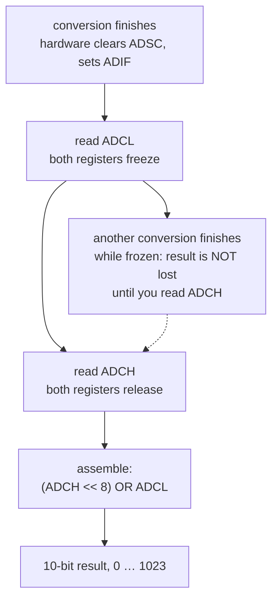
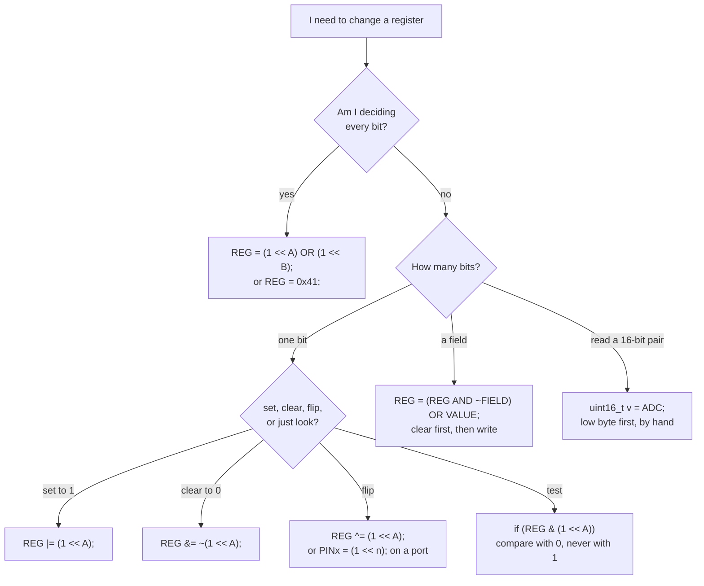

# 1. Registers, Bit by Bit

## 1.0 Quick reference

### Operators

| Symbol | Name | What it does to one bit | Section |
|---|---|---|---|
| `<<` | left shift | Moves bits left: `1 << n` puts a 1 at position $n$ | [[#1.3 Masks: a 1 moved to the bit's place]] |
| `\|` | bitwise OR | Result is 1 if **either** operand bit is 1 — forces a 1 | [[#1.3 Masks: a 1 moved to the bit's place]] |
| `&` | bitwise AND | Result is 1 only if **both** operand bits are 1 — used to test, and with `~` to force a 0 | [[#1.5 Setting and clearing one bit]] |
| `^` | bitwise XOR (exclusive OR) | A 1 in the mask **flips** the bit | [[#1.6 Toggling one bit]] |
| `~` | bitwise NOT (one's complement) | Flips **every** bit of the value — inverts a mask | [[#1.5 Setting and clearing one bit]] |
| `\|=` `&=` `^=` | compound assignment | Short for `x = x \| m`, `x = x & m`, `x = x ^ m` | [[#1.5 Setting and clearing one bit]] |
| `\|\|` | logical OR | Gives only `true`/`false` (1 or 0) — **not** a bit operation | [[#1.3 Masks: a 1 moved to the bit's place]] |
| `!` | logical NOT | Gives 1 or 0 — **not** a mask inversion | [[#1.5 Setting and clearing one bit]] |
| `0b…` | binary literal | One digit per bit: `0b01000001` | [[#1.4 Writing the whole register at once]] |
| `0x…` | hexadecimal literal | One digit per four bits: `0x41` | [[#1.4 Writing the whole register at once]] |
| `A:B` | field notation | The bits from `A` down to `B`: `MUX3:0` is `MUX3, MUX2, MUX1, MUX0` | [[#1.4 Writing the whole register at once]] |

### Registers and bit names used in this guide

| Name | Kind | Meaning | Datasheet |
|---|---|---|---|
| `ADMUX` | register | ADC (analog-to-digital converter) multiplexer: input channel and reference | p. 217 |
| `ADCSRA`, `ADCSRB` | register | ADC control and status | p. 218 |
| `ADCH`, `ADCL` | register | The high and low byte of the 10-bit result | p. 219 |
| `ADC`, `ADCW` | register | The pair `ADCH:ADCL` as one 16-bit name | p. 219 |
| `PORTB` | register | Output values of the pins of port B | p. 72 |
| `DDRB` | register | Data direction of port B: 1 = output, 0 = input | p. 72 |
| `PINB` | register | Input values — and writing a 1 toggles the matching `PORTB` bit | §13.2.2, p. 60 |
| `REFS1`, `REFS0` | bit name | Reference-voltage select, bits 7 and 6 of `ADMUX` | p. 217 |
| `ADLAR` | bit name | Left-adjust result, bit 5 of `ADMUX` | p. 217 |
| `MUX3`…`MUX0` | bit name | Channel select, bits 3 to 0 of `ADMUX` | p. 217 |
| `ADEN` | bit name | ADC enable, bit 7 of `ADCSRA` | p. 218 |
| `ADSC` | bit name | ADC start conversion, bit 6 of `ADCSRA` | p. 218 |
| `ADATE` | bit name | ADC auto trigger enable, bit 5 of `ADCSRA` | p. 218 |
| `ADIF` | bit name | ADC interrupt flag, bit 4 of `ADCSRA` | p. 218 |
| `ADIE` | bit name | ADC interrupt enable, bit 3 of `ADCSRA` | p. 218 |
| `ADPS2`…`ADPS0` | bit name | ADC clock divider, bits 2 to 0 of `ADCSRA` | p. 219 |
| `PORTB5`, `PINB5`, `DDB5` | bit name | Bit 5 of `PORTB`, `PINB`, `DDRB` — pin 13, the `L` LED | p. 72 |
| `TOV1` | bit name | Timer 1 overflow flag, in `TIFR1` | p. 112 |

### Functions and macros

| Form | Source | Same as |
|---|---|---|
| `_BV(A)` | avr-libc | `(1 << A)` |
| `bit(A)` | Arduino core | `(1 << A)` |
| `bitSet(REG, A)` | Arduino core | `REG \|= (1 << A)` |
| `bitClear(REG, A)` | Arduino core | `REG &= ~(1 << A)` |
| `bitToggle(REG, A)` | Arduino core (1.8.2+) | `REG ^= (1 << A)` |
| `bitWrite(REG, A, x)` | Arduino core | `REG = (REG & ~(1 << A)) \| (x << A)` |
| `bitRead(REG, A)` | Arduino core | `(REG & (1 << A)) != 0`, gives 0 or 1 |
| `bit_is_set(REG, A)` | avr-libc | `(REG & (1 << A)) != 0` |
| `loop_until_bit_is_clear(REG, A)` | avr-libc | `while (REG & (1 << A)) { }` |
| `sbi(REG, A)`, `cbi(REG, A)` | legacy (deprecated) | set / clear a bit — only if you include the old header |

### Abbreviations

| Abbrev. | Full term | Section |
|---|---|---|
| ADC | analog-to-digital converter | [[#1.2 A register is eight bits with names]] |
| AVR | the Atmel/Microchip 8-bit microcontroller family the ATmega328P belongs to | [[#1.2 A register is eight bits with names]] |
| ISR | interrupt service routine | [[#1.12 What the compiler makes of it]] |
| I/O | input/output | [[#1.6 Toggling one bit]] |
| LED | light-emitting diode | [[#1.6 Toggling one bit]] |
| IDE | integrated development environment (here: the Arduino IDE) | [[#1.2 A register is eight bits with names]] |
| MSB | most significant bit — bit 7 of a byte | [[#1.9 Reading a 10-bit result: low byte first]] |
| LSB | least significant bit — bit 0 of a byte | [[#1.9 Reading a 10-bit result: low byte first]] |
| MCU | microcontroller unit | [[#1.2 A register is eight bits with names]] |

### The six recipes

| Job | Line |
|---|---|
| Write every bit | `REG = (1 << A) \| (1 << B);` |
| Read it | `uint8_t v = REG;` |
| Set one bit | `REG \|= (1 << A);` |
| Clear one bit | `REG &= ~(1 << A);` |
| Toggle one bit | `REG ^= (1 << A);` (or `PINx = (1 << n);` on a port) |
| Test one bit | `if (REG & (1 << A))` — compare with 0, never with 1 |
| Change a field | `REG = (REG & ~FIELD) \| VALUE;` |
| Read a 16-bit pair | `uint16_t v = ADC;` |

---

## 1.1 How to use this guide

This is a **guide**, not a numbered module: *Programming of Embedded Systems* (Cyber & Computer Engineering · Cyber Security, Autumn 2026), Vasilis Ntinas, Department of Electronic Systems, Aalborg University — vntinas@es.aau.dk. It is written for the **Arduino Uno**, whose MCU (microcontroller unit) is the **ATmega328P**.

It shows, bit by bit, how a single line of C changes the bits of a register — written the way this course writes it. It covers writing a whole register; setting, clearing, toggling and testing one bit; changing a group of bits; and reading a result spread over two registers.

Each page of the PDF shows a line of code and, under it, the register as a row of eight cells, one per bit, **with bit 7 on the left and bit 0 on the right**. When an operation takes several steps, each step has its own page, so you can follow the bits from one page to the next.

### The colour code

The colours mean the same thing on every page, and every figure in this note follows them.

| Colour | Means |
|---|---|
| Green | a bit that becomes 1 |
| Orange | a bit that becomes 0 |
| Blue | a bit that is flipped or tested |
| Teal | names and fields |
| Grey | bits that are not touched |

_Table 1.1: The colour legend. Once you know it, you can read any page of the guide at a glance._

### Conventions

- **The page number next to a register's name** is the page of the **ATmega328P datasheet (Atmel 7810D, on Moodle)** that describes it. So "ADMUX p. 217" means: look up `ADMUX` on page 217.
- **The examples use the registers of the ADC (analog-to-digital converter) and of port B**, but the same operations work on *every* register of the chip. Once you can change one, you can change any.
- **This course writes `(1 << NAME)`** for a mask. Other people write `_BV(NAME)` or `bit(NAME)`; this note names all three and then sticks to the course style.

> [!tip] How to use the figures in this note
> Each figure is one page of the guide, cropped to the slide. Read it top to bottom: the code line first, then the register's eight cells, then the one-line summary underneath. The speaker notes that accompanied each page are in the prose below the figure.

---

## 1.2 A register is eight bits with names

![[RBB Fig 1.1 A register is eight bits with names.png]]

_Figure 1.1: `ADMUX` as eight named cells, bit 7 on the left and bit 0 on the right. On the left, the `#define` that makes `ADMUX` name the byte at address `0x7C`. On the right, the slice of data memory around it._

> [!info] Definition: Register
> A **register** is one byte inside the microcontroller that controls a piece of hardware or reports on it. `ADMUX`, for example, chooses the input and the reference voltage of the analog-to-digital converter. Each of its eight bits has a name, which the datasheet prints above the bit.

There are **two kinds of name**, and mixing them up causes the most common register bug.

| | A register name | A bit name |
|---|---|---|
| Example | `ADMUX` | `REFS0`, `MUX0` |
| What it *is* | One **byte** of data memory — here `0x7C` | Only a **number**: the bit's position, 0 to 7 |
| Defined as | `(*(volatile uint8_t *) 0x7C)` | `#define REFS0 6` |
| Says whether the bit should be 0 or 1? | — | **No.** Never |
| Use it alone? | Yes: `ADMUX = 0x41;` | **No** — build a mask: `(1 << REFS0)` |

_Table 1.2: Register names versus bit names. The whole of [[#1.10 What is wrong with these lines?]] is about confusing them._

From `<avr/io.h>`, which the Arduino IDE (integrated development environment) includes in every sketch:

```cpp
#define ADMUX (*(volatile uint8_t *) 0x7C)  // the byte at 0x7C
#define REFS0 6      // a bit's position
#define MUX0  0
```

**`uint8_t`** is an unsigned 8-bit integer — exactly one byte — and **`uint16_t`** is an unsigned 16-bit integer. Using them instead of `int` says exactly how wide you expect the value to be, which matters on an 8-bit chip.

The word **`volatile`** tells the compiler that the hardware can change this byte at any time, so every read and every write in your code really happens. Without it the compiler is free to assume the byte never changes on its own, cache it in a register, and drop writes it thinks are redundant — which silently breaks register code.

### The data memory around `ADMUX`

| Address | Register |
|---|---|
| `0x7A` | `ADCSRA` |
| `0x7B` | `ADCSRB` |
| `0x7C` | `ADMUX` |
| `0x7D` | – (reserved) |

_Table 1.3: The ADC's registers sit next to each other in data memory. Address `0x7D` is reserved._

The **dash** in bit 4 of `ADMUX` marks a **reserved bit**, which always reads as 0. Reserved bits are not yours: leave them at 0.

> [!example] Two names, one bug
> `REFS0` is the number $6$ and `MUX0` is the number $0$. Neither says anything about the value that bit should hold.
> - `ADMUX = REFS0;` writes the number $6$ into the register: `0b00000110`. It does **not** set bit `REFS0`.
> - `ADMUX = (1 << REFS0);` writes `0b01000000` $= 64 =$ `0x40`. **Check:** $1 \times 2^6 = 64$. ✓
> - Only the second one is a mask — and only the second one is what you meant.

---

## 1.3 Masks: a 1 moved to the bit's place

To change one bit of a register you first need a **mask**: a byte with a 1 exactly at that bit's position and 0 everywhere else.

![[RBB Fig 1.2 A mask - 1 moved to the bits place.png]]

_Figure 1.2: Step 2 of 4. `<<` is the left-shift operator of C. `(1 << REFS0)` moves the 1 six places to the left, because `REFS0` is the number 6. The result, `0b01000000`, is the mask for `REFS0`: 64 in decimal, `0x40` in hexadecimal._

> [!info] Definition: Mask
> A **mask** is a byte with a 1 exactly at one bit's position and 0 everywhere else:
> $$\text{mask}(n) = 1 \ll n = 2^{n}$$
> **Breakdown:**
> - $n$: the bit's position, from 0 (the LSB, least significant bit, on the right) to 7 (the MSB, most significant bit, on the left).
> - $1$: the number 1, which is `0b00000001` — only bit 0 is 1.
> - $\ll$: the C left-shift operator. It moves the 1 left by $n$ places.
> - $2^{n}$: the value of the result. The mask for bit $n$ is always the $n$th power of two.
>
> The operator is written `<<` in C. It is one of the two shift operators; `>>` moves bits right.

> [!example] Building the two masks from the guide
> - `(1 << REFS0)` moves the 1 six places left, because `REFS0` is 6:
>   $$1 \ll 6 = 2^6 = 64 = \texttt{0b01000000} = \texttt{0x40}$$
> - `(1 << MUX0)` moves the 1 zero places, because `MUX0` is 0:
>   $$1 \ll 0 = 2^0 = 1 = \texttt{0b00000001} = \texttt{0x01}$$
> - **Checks:** $2^6 = 64$ ✓ and $2^0 = 1$ ✓
>
> A shift by zero places is legal and gives the number unchanged — `(1 << MUX0)` is just `1`, spelled in a way that says *which* bit you meant.

![[RBB Fig 1.3 Bitwise OR collects several 1s into one mask.png]]

_Figure 1.3: Step 4 of 4. The single bar `|` is the bitwise OR of C: each bit of the result is 1 if that bit is 1 in either operand. `(1 << REFS0) | (1 << MUX0)` collects both 1s into one mask, `0b01000001`. Bottom line: `<<` puts a 1 at the bit's position; bitwise OR collects several 1s into one mask._

> [!example] OR collects masks
> $$(1 \ll 6) \mid (1 \ll 0) = 64 \mid 1 = 65 = \texttt{0b01000001} = \texttt{0x41}$$
> - **Breakdown:** `0b01000000` OR `0b00000001` gives `0b01000001` — a 1 wherever *either* operand has a 1.
> - **Check:** $64 + 1 = 65$, and `0x41` $= 4 \times 16 + 1 = 65$. ✓
> - **Why it only looks like addition:** adding works here only because the two masks share no 1s. `0b01000000 | 0b01000000` is `0b01000000`, not `0b10000000`. OR is not arithmetic.

> [!warning] `|` is not `||`
> The single bar `|` is the **bitwise** OR: it works on eight bits at once. The double bar `||` is the **logical** OR: it collapses everything to true or false.
> - `(1 << REFS0) | (1 << MUX0)` is `0b01000001` $= 65$.
> - `(1 << REFS0) || (1 << MUX0)` is simply **1** — both operands are non-zero, so the logical OR is true.
>
> Writing `||` where you meant `|` compiles without complaint and quietly turns your carefully built mask into the number 1.

### Three names for the same mask

`_BV(REFS0)` from avr-libc (the C library that comes with the compiler) and `bit(REFS0)` from the Arduino core do exactly what `(1 << REFS0)` does. **This course writes `(1 << REFS0)`**, which is plain C and needs no library at all.

---

## 1.4 Writing the whole register at once

![[RBB Fig 1.4 Writing the whole register at once.png]]

_Figure 1.4: Step 2 of 2. The assignment `=` replaces all eight bits at once. Green bits became 1; orange bits became 0. `ADLAR`, `MUX2` and `MUX1` were 1 before and are 0 now, although the line never mentions them. The teal frames show two fields._

```cpp
ADMUX = 0b01000001;                    // binary: one digit per bit
ADMUX = 0x41;                          // hexadecimal: one digit per four bits
ADMUX = 65;                            // decimal: legal, but unreadable
ADMUX = (1 << REFS0) | (1 << MUX0);    // bit names: the course style
ADMUX = _BV(REFS0) | _BV(MUX0);        // the same, by an avr-libc macro
ADMUX = bit(REFS0) | bit(MUX0);        // the same, by an Arduino macro
```

| Form | Written | Best for |
|---|---|---|
| Binary | `0b01000001` | Seeing every bit at once |
| Hexadecimal | `0x41` | Compact — one digit per group of four bits: `0100 0001` is `4` and `1` |
| Decimal | `65` | Nothing. The same number, but it hides the bits |
| Bit names | `(1 << REFS0) \| (1 << MUX0)` | **The course style** — reads as the meaning, not the number |
| `_BV()` | `_BV(REFS0) \| _BV(MUX0)` | avr-libc style you will meet in other people's code |
| `bit()` | `bit(REFS0) \| bit(MUX0)` | Arduino-core style |

_Table 1.4: Six ways to write the same byte. All six compile to **exactly the same machine code**._

> [!example] Reading the hexadecimal
> `0x41` is two hex digits, `4` and `1`, and each digit is four bits:
> $$\texttt{0x41} = \underbrace{\texttt{0100}}_{4}\ \underbrace{\texttt{0001}}_{1} = \texttt{0b01000001} = 4 \times 16 + 1 = 65$$
> - **Breakdown:** `0x` marks a hexadecimal literal; each following digit is one group of four bits, called a nibble.
> - **Check:** $0\texttt{b}01000001 = 64 + 1 = 65$. ✓

> [!warning] `=` writes all eight bits
> With `=`, **every bit you do not name becomes 0**. The line never mentions `ADLAR`, `MUX2` or `MUX1`, yet all three are cleared. That is right when you want to decide every bit yourself — for example when you set up a peripheral from the start — and wrong when you only meant to change one thing. See [[#1.5 Setting and clearing one bit]] for the fix, and [[#1.10 What is wrong with these lines?]] for the damage it does.

### Fields

> [!info] Definition: Field
> A **field** is a group of bits that together hold one number. It is written with the names of its first and last bit: `REFS1:0` means `REFS1` and `REFS0`; `MUX3:0` means `MUX3` down to `MUX0`.
>
> The datasheet gives the meaning of every value of a field in a table.

For `ADMUX = 0x41`:

- `REFS1:0 = 01` selects **AVCC**, the 5 V supply, as the reference (Table 23-3, p. 217).
- `MUX3:0 = 0001` selects the input **ADC1**, which is pin A1 (Table 23-4, p. 218).

> [!example] Turning a datasheet table row into code
> To use a row of a field table, **set exactly the bits that are 1 in that row** — both of them if both are 1 — and leave the bits that are 0 in that row at 0.
>
> Suppose Table 23-4 says channel ADC3 is `MUX3:0 = 0011`, and we keep `REFS1:0 = 01` (AVCC).
> - `MUX3:0 = 0011` means `MUX1` and `MUX0` are 1, `MUX3` and `MUX2` are 0.
> - Byte: `REFS1=0, REFS0=1, ADLAR=0, reserved=0, MUX3:0=0011` → `0b01000011`
> - As code: `ADMUX = (1 << REFS0) | (1 << MUX1) | (1 << MUX0);`
> - **Check:** $64 + 2 + 1 = 67 =$ `0x43`, and `0b01000011` $= 67$. ✓
>
> Note the trap: you must *clear* `MUX3` and `MUX2` too. With `=` that happens automatically; with `|=` it does not — which is why fields need the two-step recipe in [[#1.8 Changing a group of bits, keeping the rest]].

### Reading a register

Use its name on the right of the `=`, as for a variable:

```cpp
uint8_t now = ADMUX;
```

---

## 1.5 Setting and clearing one bit

`ADCSRA` controls the ADC. Its bit 7, `ADEN`, switches the ADC on (1) or off (0). Its bits 2 to 0, `ADPS2:0`, are the ADC's clock divider: `111` divides the 16 MHz clock by 128 (Table 23-5, p. 219). They are already set, and they **must stay as they are** while `ADEN` changes. So the whole register must not be overwritten: only one bit may change.

| Bit | 7 | 6 | 5 | 4 | 3 | 2 | 1 | 0 |
|---|---|---|---|---|---|---|---|---|
| Name | ADEN | ADSC | ADATE | ADIF | ADIE | ADPS2 | ADPS1 | ADPS0 |
| Before | 0 | 0 | 0 | 0 | 0 | 1 | 1 | 1 |

_Table 1.5: `ADCSRA` (p. 218) before the change: `ADEN` is 0, the clock divider `ADPS2:0` is `111` ($\div 128$)._

```cpp
ADCSRA |= (1 << ADEN);    // set: the ADC on       or  bitSet(ADCSRA, ADEN);
ADCSRA &= ~(1 << ADEN);   // clear: the ADC off    or  bitClear(ADCSRA, ADEN);
// x |= m is short for x = x | m.   ~ flips every bit of m (it is not !)
```

![[RBB Fig 1.5 Setting one bit with OR.png]]

_Figure 1.5: Step 2 of 3. To set one bit, OR the register with that bit's mask. Where the mask has a 1, the result is 1 whatever the bit was. Where the mask has a 0, $x \mid 0 = x$, so the bit is kept. Only `ADEN` changes: the ADC is on._

![[RBB Fig 1.6 Clearing one bit with AND and inverted mask.png]]

_Figure 1.6: Step 3 of 3. To clear one bit, AND the register with the inverted mask. `~` flips every bit of the mask, so `1000 0000` becomes `0111 1111`. Where the inverted mask has a 0 the result is 0; where it has a 1, $x \mathrel{\&} 1 = x$, so the bit is kept. Bottom line: OR with 1 forces a 1; AND with 0 forces a 0. Every other bit is kept._

> [!example] Set, then clear, one bit of `ADCSRA`
> Before: `0b00000111` (`ADPS2:0 = 111`, $\div 128$, and `ADEN = 0`).
> - **Set:** `0b00000111 | 0b10000000 = 0b10000111` $= $ `0x87`. The ADC is on and the divider is untouched. ✓
> - **Inverted mask:** `~(1 << ADEN)` $=$ `~0b10000000` $=$ `0b01111111` $=$ `0x7F`. ✓
> - **Clear:** `0b10000111 & 0b01111111 = 0b00000111` $= $ `0x07`. The ADC is off and the divider is still `111`. ✓
> - **Check on the divider:** the low three bits are `111` before and after both operations — $\div 128$ throughout. ✓

> [!warning] Two ways to write "clear" that clear everything
> - `(0 << ADEN)` is simply **0**. Shifting zero left is still zero.
> - `!(1 << ADEN)`, with the **logical** NOT, is also **0**.
>
> Both give `ADCSRA &= 0`, which clears the entire register — including your carefully chosen clock divider. Only `~`, the bitwise NOT, inverts a mask.

To set or clear a bit depending on a **variable** `x` that is 0 or 1, the Arduino core has `bitWrite(ADCSRA, ADEN, x)`. In plain C the same job takes two steps:

```cpp
ADCSRA = (ADCSRA & ~(1 << ADEN)) | (x << ADEN);   // clear the bit, then write x into it
```

---

## 1.6 Toggling one bit

`PORTB` holds the output values of the pins of port B. Pin 13 of the Uno — which also drives the small `L` LED (light-emitting diode) on the board — is bit 5 of port B, `PORTB5` (p. 72).

```cpp
PORTB ^= (1 << PORTB5);    // flip pin 13, the L LED    or  bitToggle(PORTB, PORTB5);
// pin 13 must be an output first: bit 5 of DDRB set
```

![[RBB Fig 1.7 Toggling one bit with XOR.png]]

_Figure 1.7: Step 2 of 3. `^` is the bitwise exclusive OR (XOR) of C: a 1 in the mask flips the bit, and a 0 in the mask keeps it. `PORTB ^= (1 << PORTB5)` turns the 1 into a 0, and the LED goes off._

![[RBB Fig 1.8 XOR twice puts the bit back.png]]

_Figure 1.8: Step 3 of 3. Running the same line again flips the bit back, and the LED is on again. Bottom line: XOR with 1 flips a bit; XOR with 0 keeps it. The same line, run twice, puts it back._

> [!example] Toggle twice, back where you started
> Start at `0b00100000` (LED on), mask `0b00100000`:
> - First toggle: `0b00100000 ^ 0b00100000 = 0b00000000` — LED off. ✓
> - Second toggle: `0b00000000 ^ 0b00100000 = 0b00100000` — LED on. ✓
> - **Check:** XOR is its own inverse: $(a \oplus m) \oplus m = a$. ✓

> [!warning] A port bit only drives its pin when the pin is an output
> For pin 13 that means bit 5 of `DDRB` must be 1 first: `DDRB |= (1 << DDB5);`. Without it the pin is an input, the `PORTB` bit only enables an internal pull-up, and the LED at most glows faintly. (The datasheet names the `DDRB` bits `DDB7:0` — if your header also defines `DDRB5`, it is the same bit.)
>
> Also: in a loop, put a pause between the toggles. Otherwise the LED switches far too fast to see and simply looks on.

### The hardware shortcut: write to `PINx`

The ports have a shortcut: **writing a 1 to a bit of the `PINx` register flips the matching `PORTx` bit** (§13.2.2, p. 60).

```cpp
PINB = (1 << PINB5);   // toggles pin 13 in a single write
```

> [!warning] Use `=` there, not `|=`
> `PINB = (1 << PINB5)` is a single write, and the 0s written to the other `PINB` bits do nothing. `PINB |= (1 << PINB5)` would first *read* `PINB`, and a read of `PINx` reports the **input** levels on the pins — so the mask would be ORed with whatever the pins happen to be reading, and other bits could get flipped.

---

## 1.7 Testing a bit, and waiting for the hardware

Some bits are changed by the **hardware** as well as by your program. Writing a 1 to `ADSC` (ADC start conversion, bit 6 of `ADCSRA`) starts one conversion; when the result is ready, the ADC itself writes `ADSC` back to 0 (p. 218). Writing a 0 to `ADSC` does nothing. So the program has to **read** the bit to find out when the conversion is finished.

```cpp
ADCSRA |= (1 << ADSC);              // ADSC, start conversion: you write the 1
while (ADCSRA & (1 << ADSC)) { }    // the ADC writes the 0 when it is done
```

![[RBB Fig 1.9 Testing a bit with AND.png]]

_Figure 1.9: Step 2 of 3. To test one bit, AND the register with that bit's mask. Every other bit of the result is 0, so the result is the mask itself — 64 — when the bit is 1, and 0 when the bit is 0._

![[RBB Fig 1.10 Waiting for the hardware to clear the bit.png]]

_Figure 1.10: Step 3 of 3. About 104 µs later the ADC clears `ADSC` and, in the same moment, sets `ADIF` (bit 4), its "conversion complete" flag. The test now gives 0 and the loop ends._

> [!example] The test result is a mask, not a 1
> `ADSC` is bit 6, so the mask is $1 \ll 6 = 64$:
> - While converting, `ADCSRA = 0b11000111`, and `0b11000111 & 0b01000000 = 0b01000000 = 64`. Non-zero → true → wait. ✓
> - When done, `ADCSRA = 0b10010111`, and `0b10010111 & 0b01000000 = 0b00000000 = 0`. Zero → false → loop ends. ✓
> - In the same byte, bit 4 (`ADIF`) has gone from 0 to 1 — the hardware set it. **Check:** $(0\texttt{b}10010111 \gg 4) \mathrel{\&} 1 = 1$. ✓

> [!warning] Compare with 0, never with 1
> `ADCSRA & (1 << ADSC)` is **64 or 0**, so `== 1` is *never* true and the test silently always fails. Write `if (ADCSRA & (1 << ADSC))` or `(ADCSRA & (1 << ADSC)) != 0`.
>
> For a mask with several bits, `(x & m) != 0` means "at least one of them is 1" and `(x & m) == m` means "all of them are 1".

### How long a conversion takes

| Quantity | Value | Where it comes from |
|---|---|---|
| ADC clock, `ADPS2:0 = 111` | $16\text{ MHz} / 128 = 125$ kHz | Table 23-5, p. 219 |
| One ADC cycle | $1 / 125\text{ kHz} = 8$ µs | — |
| One conversion | $13 \times 8 = 104$ µs | p. 208 |
| First conversion after switching the ADC on | $25 \times 8 = 200$ µs | p. 208 |

_Table 1.6: ADC conversion timing at the Arduino default divider of $\div 128$._

Other ways to write the same test: `bit_is_set(ADCSRA, ADSC)` from avr-libc, and `bitRead(ADCSRA, ADSC)` from the Arduino core, which gives 0 or 1. The whole wait can also be written `loop_until_bit_is_clear(ADCSRA, ADSC);`

---

## 1.8 Changing a group of bits, keeping the rest

The four `MUX` bits form one field, `MUX3:0`, which selects the ADC's input channel. The other bits of `ADMUX` — `REFS1:0` and `ADLAR` — must not change. The field holds `0001` (channel ADC1) and the line should switch it to channel ADC2. **Neither `=` nor a single `|=` can do that, so it takes two steps.**

> [!info] Definition: Changing a field
> $$\texttt{REG} = (\texttt{REG} \mathrel{\&} \sim\!\texttt{FIELD}) \mid \texttt{VALUE}$$
> **Breakdown:**
> - `REG`: the register being changed.
> - `FIELD`: the field's bits as a mask — for `MUX3:0` that is `0x0F`.
> - `~FIELD`: the same mask inverted, so it has 0s exactly where the field is and 1s elsewhere.
> - `REG & ~FIELD`: the register with the field cleared and everything outside it kept.
> - `VALUE`: the new bits, already shifted into the field's place.
>
> `ADMUX & 0xF0` is the same thing as `ADMUX & ~0x0F`; writing `~0x0F` **names the field you are clearing**, which is why the course prefers it.

```cpp
ADMUX = (ADMUX & ~0x0F) | 0x02;          // clear the field MUX3:0, then write channel ADC2
ADMUX = (ADMUX & ~0x0F) | (ch & 0x0F);   // the same with a variable; & 0x0F keeps ch in the field
```

![[RBB Fig 1.11 Clearing a field with AND and inverted mask.png]]

_Figure 1.11: Step 2 of 3. Step one clears the field: AND with `~0x0F`. `0x0F` is `0000 1111`, the mask of the field, and `~` inverts it to `1111 0000`. The four field bits become 0, and the top four bits are kept._

![[RBB Fig 1.12 Writing the new value into the field.png]]

_Figure 1.12: Step 3 of 3. Step two writes the new value into the empty field with OR: `0x02` is `0000 0010`, channel ADC2. The frames show the result: the left half was kept, and only the field was replaced._

> [!example] The two steps, bit by bit
> Before: `0b01000001` — `REFS1:0 = 01` (AVCC), `MUX3:0 = 0001` (ADC1).
> - **Step 1, clear:** `~0x0F = 0xF0 = 0b11110000`, and `0b01000001 & 0b11110000 = 0b01000000`. The field is now `0000`. ✓
> - **Step 2, write:** `0b01000000 | 0b00000010 = 0b01000010`, so `MUX3:0 = 0010` — channel **ADC2**. ✓
> - **Check:** the top nibble is `0100` before and after; only the bottom nibble changed, from `0001` to `0010`. ✓

> [!warning] Why `|=` alone is wrong for a field
> `ADMUX |= 0x02` would leave the old 1 in `MUX0` in place:
> $$\texttt{0001} \mid \texttt{0010} = \texttt{0011}$$
> which is channel **ADC3**, not ADC2. OR can only add 1s; it can never remove the one that was already there. **Check:** $1 \mid 2 = 3$. ✓
>
> And when the new value comes from a variable, mask it too — `(ch & 0x0F)` — so that a value that is too large cannot spill into the bits outside the field.

### The general recipe, and two datasheet rules

The same two steps work for any field: the ADC's clock divider, a timer's clock-select bits, a mode field. The datasheet adds two rules for `ADMUX`:

1. A new channel or reference **takes effect only when the conversion that is running ends** (p. 217).
2. The first reading after switching the **reference** may be inaccurate and should be **thrown away** (§23.5.2, p. 211).

---

## 1.9 Reading a 10-bit result: low byte first

```cpp
uint16_t result = ADC;      // ADC: the pair ADCH:ADCL as one 16-bit name
uint8_t low  = ADCL;        // by hand: first the low byte ...
uint8_t high = ADCH;        // ... then the high byte
```

The ADC's result has 10 bits, but a register has only 8, so the result is split over two registers. **`ADCH` holds result bits 9 and 8, and `ADCL` holds result bits 7 to 0** — as long as `ADLAR` is 0, which is the default (p. 219). The small numbers above the cells in the figures are the datasheet's bit numbers for the pair, 15 down to 0.

![[RBB Fig 1.13 Reading ADCL freezes both registers.png]]

_Figure 1.13: Step 2 of 4. Read `ADCL` first. Reading `ADCL` **freezes both registers**: the ADC will not write a new result into them, even if another conversion finishes meanwhile (pp. 206–207)._

> [!info] Definition: The ADCL freeze
> Reading `ADCL` freezes both result registers; reading `ADCH` releases them for the next result. Because of the freeze, **the two bytes you read always belong to the same conversion**, never half to one and half to the next.

![[RBB Fig 1.14 Assembling the 10-bit result.png]]

_Figure 1.14: Step 4 of 4. Then read `ADCH`. Put together, `(ADCH << 8) | ADCL` is `10 1010 0110` in binary: $512 + 128 + 32 + 4 + 2 = 678$._

> [!example] Assembling 678 from two bytes
> `ADCH = 0b00000010` (so result bits 9 and 8 are `10`) and `ADCL = 0b10100110`:
> $$(\texttt{ADCH} \ll 8) \mid \texttt{ADCL} = (2 \times 256) + 166 = 512 + 166 = 678$$
> - **Breakdown:**
>     - `ADCH`: the two most significant bits of the 10-bit result, in bit positions 1 and 0 of the byte.
>     - `ADCL`: the eight least significant bits.
>     - `<< 8`: moves the high byte into bit positions 8 and above.
>     - `|`: joins the two halves. It works here because the shifted high byte has 0s in its low eight bits.
> - **Check:** `678` in ten bits is `10 1010 0110`, and $512 + 128 + 32 + 4 + 2 = 678$. ✓
> - **Check:** $678 < 1024$, so it fits in the 10 bits the ADC produces. ✓
> - **Why the shift works:** C promotes the `uint8_t` byte to an `int` before shifting it, so the 1s are not shifted off the end.



_Figure 1.15: The read order. `ADCL` first, `ADCH` second — the freeze in between is what guarantees both bytes come from one conversion._

### Shortcuts and relatives

- **The 16-bit name `ADC`** (also called `ADCW`) reads both registers in the right order for you: `uint16_t result = ADC;` does it in one line. `analogRead()` does the same inside.
- **If 8 bits of precision are enough**, set `ADLAR`, which moves the result to the left, and read only `ADCH` (p. 219).
- **Timer 1's 16-bit registers are read low byte first too, but written high byte first** (§15.3, p. 91). Writing `TCNT1 = value;` lets the compiler get the order right.

> [!warning] Read `ADCL` first
> Reading `ADCH` first and `ADCL` second leaves the two registers **frozen after** the read of `ADCL`. In a loop that starts a conversion, waits and reads, every new result arrives while they are frozen and is lost — so the program prints the first result again and again. Read `ADCL` first, or simply use `ADC`.

---

## 1.10 What is wrong with these lines?

```cpp
ADMUX |= ADLAR;           // meant: set bit ADLAR
ADCSRA = (1 << ADEN);     // meant: switch the ADC on
uint8_t high = ADCH;      // meant: read the result
uint8_t low  = ADCL;
```

Each line compiles. There are three mistakes. Hints: what number is `ADLAR`? What else was in `ADCSRA` before this line? Which of the two bytes has to be read first?

| # | The line | What it really does | The fix |
|---|---|---|---|
| 1 | `ADMUX \|= ADLAR;` | `ADLAR` is a **bit name**, so it is only the number 5, which is `0b00000101`. This therefore sets `MUX2` and `MUX0`: from channel ADC1 it makes channel **ADC5**, and `ADLAR` itself stays 0 | `ADMUX \|= (1 << ADLAR);` |
| 2 | `ADCSRA = (1 << ADEN);` | `=` writes all eight bits, so the line also clears `ADPS2:0`, the clock divider, which was `111` ($\div 128$). `000` means $\div 2$: an **8 MHz ADC clock, forty times** the 200 kHz the datasheet allows for full precision. The readings cannot be trusted | `ADCSRA \|= (1 << ADEN);`, or name every bit you want in the register |
| 3 | `high = ADCH;` then `low = ADCL;` | `ADCL` read last leaves the registers **frozen** after the read. Every new result arrives while they are frozen and is lost | Read `ADCL` first, or simply use `ADC` |

_Table 1.7: The three mistakes, and what each line should have been._

> [!example] Mistake 1, bit by bit
> `ADMUX` holds `0b01000001` — `REFS1:0 = 01`, `MUX3:0 = 0001`, channel ADC1. `ADLAR` is the number $5 = \texttt{0b00000101}$:
> $$\texttt{0b01000001} \mid 5 = \texttt{0b01000001} \mid \texttt{0b00000101} = \texttt{0b01000101}$$
> - `MUX3:0` was `0001` $= 1$ (ADC1) and is now `0101` $= 5$ (**ADC5**). ✓
> - Bit 5, `ADLAR` itself, is **still 0** — the line set `MUX2` and `MUX0` instead. **Check:** $(\texttt{0b01000101} \gg 5) \mathrel{\&} 1 = 0$. ✓
> - The line did the opposite of what it says: it did not touch the bit it names and did touch two it does not.

> [!example] Mistake 2, and the clock it breaks
> `ADPS2:0` was `111` $= \div 128$, giving $16\text{ MHz} / 128 = 125$ kHz — comfortably inside the datasheet's 200 kHz.
> `ADCSRA = (1 << ADEN)` writes `0b10000000`, so `ADPS2:0` becomes `000` $= \div 2$:
> $$\frac{16\text{ MHz}}{2} = 8\text{ MHz}, \qquad \frac{8\text{ MHz}}{200\text{ kHz}} = 40$$
> - **Check:** the ADC clock is forty times the maximum for full precision. ✓
> - At 8 MHz one conversion would take $13 / 8\text{ MHz} = 1.6$ µs instead of $104$ µs — far too fast for the sample-and-hold to charge, so the low bits are noise.

> [!warning] `analogRead()` rewrites `ADMUX`
> `analogRead()` writes the **whole** of `ADMUX` each time it runs, and it can select only channels 0 to 7. A program that uses `analogRead()` *and* also sets `ADMUX` itself must **set `ADMUX` again before each of its own conversions** — otherwise the first call to `analogRead()` silently undoes your configuration.

---

## 1.11 Every way to write a register

![[RBB Fig 1.16 Every way to write a register.png]]

_Figure 1.16: The guide's reference page — every form from the guide in one table, with the forms you may meet in other people's code. Keep it next to you when you write register code._

| Job | C operators | avr-libc | Arduino |
|---|---|---|---|
| Whole register | `REG = 0x41;`<br>`REG = (1 << A) \| (1 << B);` | `REG = _BV(A) \| _BV(B);` | `REG = bit(A) \| bit(B);` |
| Read it | `uint8_t v = REG;` | – | – |
| Set a bit | `REG \|= (1 << A);` | `REG \|= _BV(A);` | `bitSet(REG, A);` |
| Clear a bit | `REG &= ~(1 << A);` | `REG &= ~_BV(A);` | `bitClear(REG, A);` |
| Toggle a bit | `REG ^= (1 << A);`<br>`PINx = (1 << n);` (port pin *n*) | `REG ^= _BV(A);` | `bitToggle(REG, A);` |
| Bit from a variable | `REG = (REG & ~(1 << A)) \| (x << A);` | – | `bitWrite(REG, A, x);` |
| Test a bit | `if (REG & (1 << A))` | `bit_is_set(REG, A)` | `bitRead(REG, A)` |
| Wait for a 0 | `while (REG & (1 << A)) { }` | `loop_until_bit_is_clear(REG, A);` | – |
| Change a field | `REG = (REG & ~FIELD) \| VALUE;` | – | – |
| Read a 16-bit pair | `uint16_t v = ADC;` | – | – |

_Table 1.8: Every way to write a register. Forms on one row do the same job._

Here `REG` is a register such as `ADCSRA`; `A` and `B` are bit names such as `ADEN`; `n` is the bit number of a port pin; `x` is 0 or 1; `FIELD` is the mask of a field, such as `0x0F` for `MUX3:0`; and `VALUE` is the new bits, already shifted into the field's place.

`bitRead()` gives **0 or 1**, while `REG & (1 << A)` gives **0 or the mask** — but as the condition of an `if` or a `while` they behave the same, since any non-zero value counts as true.

Opposite forms exist as well: `bit_is_clear(REG, A)` tests for a 0, and `loop_until_bit_is_set(REG, A)` waits for a 1. Older code sometimes uses `sbi(REG, A)` and `cbi(REG, A)` to set and clear a bit. They come from the Arduino core's `wiring_private.h` and from an old, deprecated part of avr-libc, and a sketch has them only if it includes one of those headers. `bitToggle()` needs version 1.8.2 or later of the Arduino AVR core.



_Figure 1.17: Which form to reach for. The first question is always whether you are deciding every bit or only changing part of the register._

---

## 1.12 What the compiler makes of it

Going further: what the processor actually runs. The AVR (the Atmel/Microchip 8-bit microcontroller family the ATmega328P belongs to) has two instructions that set or clear a single bit, **SBI** and **CBI**, but they reach only the **lowest 32 I/O (input/output) addresses**, where `DDRx`, `PORTx` and `PINx` are (p. 275).

![[RBB Fig 1.18 What the compiler makes of it.png]]

_Figure 1.18: Three lines, three different translations. `PORTB |= (1 << PORTB5)` becomes one `sbi` instruction. `PINB = (1 << PINB5)` is a single write. `ADCSRA |= (1 << ADEN)` becomes three steps: load, change, store._

| C | AVR instructions | Cost |
|---|---|---|
| `PORTB \|= (1 << PORTB5);` | `sbi 0x05, 5` | one instruction |
| `PINB = (1 << PINB5);` | `ldi r24, 0x20`<br>`out 0x03, r24` | one write |
| `ADCSRA \|= (1 << ADEN);` | `lds r24, 0x7A`<br>`ori r24, 0x80`<br>`sts 0x7A, r24` | read, change, write |

_Table 1.9: What three ordinary-looking lines compile to._

> [!example] Why `0x80` appears in the assembly
> `ADEN` is bit 7, so the mask is `1 << 7`:
> $$1 \ll 7 = 2^7 = 128 = \texttt{0x80}$$
> - **Breakdown:** `lds` loads the byte from data address `0x7A` (where `ADCSRA` lives), `ori` ORs the mask into it, `sts` stores it back.
> - **Check for `PINB`:** `PINB5` is bit 5, so $1 \ll 5 = 32 = \texttt{0x20}$ — exactly the constant in `ldi r24, 0x20`. ✓
> - **Check for `PORTB`:** `PORTB` is at I/O address `0x05`, inside the lowest 32, so `sbi 0x05, 5` can reach it in one instruction. ✓

> [!warning] Three steps means an interrupt can land in between
> `ADCSRA` is at `0x7A`, above the reach of SBI and CBI, so `|=` becomes **load, change, store**. If an ISR (interrupt service routine) changes the same register between the load and the store, the store puts back the old value and **undoes the interrupt's change**.
>
> A register that an interrupt routine also writes should therefore be changed with interrupts switched off for a moment — `noInterrupts(); … interrupts();` — or with `ATOMIC_BLOCK` from `<util/atomic.h>`.

### Flag bits are cleared by writing a 1

> [!info] Definition: Write-1-to-clear flags
> Flag bits such as `ADIF` or the timer flags in the `TIFRx` registers are **cleared by writing a 1 to them**, not a 0.
>
> A read-modify-write on a register that holds flags — such as `ADCSRA |= …` — **writes back every flag that is set, and so clears it** (p. 218).
>
> To clear one flag, write **only** its 1 with `=`: `TIFR1 = (1 << TOV1);`

> [!example] `|=` on a flag register clears flags you never mentioned
> Suppose `ADCSRA` holds `0b10010111`: `ADEN` set, `ADIF` set (a conversion just finished), `ADPS2:0 = 111`.
> - `ADCSRA |= (1 << ADEN)` reads `0b10010111`, ORs in `0b10000000`, and stores `0b10010111` back.
> - Bit 4, `ADIF`, is written back as **1** — and writing a 1 to a flag clears it. The completed-conversion flag is gone. **Check:** $(0\texttt{b}10010111 \gg 4) \mathrel{\&} 1 = 1$. ✓
> - The line looks like it only touches `ADEN`, but it also acknowledges an interrupt you never handled.

---

## 1.13 Practice: exercises and worked solutions

Work these out before you read the answers. All use the registers of this guide, on a 16 MHz Arduino Uno.

| # | Title | Practises |
|---|---|---|
| 1 | A byte from a datasheet row | Masks, fields, writing a whole register |
| 2 | Switch the ADC on, keep the clock | `\|=`, reading the divider, conversion timing |
| 3 | Three ways to blink pin 13 | Toggle, `DDRB`, the `PINx` shortcut |
| 4 | A test that never fires | Testing a bit, operator precedence |
| 5 | Switch channels safely | The two-step field recipe |
| 6 | Assemble a result | `ADCL` first, `(ADCH << 8) \| ADCL` |
| 7 | Four broken lines | Spotting all the traps at once |
| 8 | Which line is atomic | What the compiler emits, and interrupts |

_Table 1.10: Eight exercises._

### Exercise 1 · A byte from a datasheet row

**Task.** Table 23-3 gives `REFS1:0 = 01` for AVCC (5 V). Table 23-4 gives `MUX3:0 = 0011` for channel ADC3. Write the whole of `ADMUX` for AVCC plus ADC3, in the course style, and give the byte in binary, hex and decimal.

> [!example] Solution
> Set exactly the bits that are 1 in the two rows: `REFS0` (bit 6) from `REFS1:0 = 01`, and `MUX1` (bit 1) and `MUX0` (bit 0) from `MUX3:0 = 0011`. Leave `REFS1`, `ADLAR`, the reserved bit, `MUX3` and `MUX2` at 0.
> ```cpp
> ADMUX = (1 << REFS0) | (1 << MUX1) | (1 << MUX0);
> ```
> $$\texttt{0b01000011} = \texttt{0x43} = 67$$
> - **Check:** $64 + 2 + 1 = 67$, and `0x43` $= 4 \times 16 + 3 = 67$. ✓
> - **Check on the fields:** the top two bits are `01` (AVCC) and the bottom four are `0011` $= 3$ (ADC3). ✓

### Exercise 2 · Switch the ADC on, keep the clock

**Task.** `ADCSRA` holds `0b00000111`. Switch the ADC on without disturbing the clock divider. What is `ADCSRA` afterwards, what is the ADC clock, and how long does one conversion take?

> [!example] Solution
> `ADEN` is bit 7, so the mask is $1 \ll 7 = 128 = \texttt{0x80}$, and we must use `|=` because `=` would clear the divider:
> ```cpp
> ADCSRA |= (1 << ADEN);
> ```
> $$\texttt{0b00000111} \mid \texttt{0b10000000} = \texttt{0b10000111} = \texttt{0x87}$$
> - `ADPS2:0` is still `111` $= \div 128$, so the ADC clock is $16\text{ MHz} / 128 = 125$ kHz — one cycle every $8$ µs.
> - One conversion is 13 cycles: $13 \times 8 = 104$ µs.
> - **Check:** the low three bits are `111` before and after. ✓
> - **Had you written `=`:** `ADCSRA = (1 << ADEN)` gives `0b10000000`, the divider becomes `000` $= \div 2$, the clock becomes 8 MHz — forty times the 200 kHz the datasheet allows — and the readings cannot be trusted.

### Exercise 3 · Three ways to blink pin 13

**Task.** Pin 13 is `PORTB5`. List three lines that toggle it, and say what must happen first.

> [!example] Solution
> ```cpp
> DDRB  |= (1 << DDB5);        // FIRST: make pin 13 an output
> PORTB ^= (1 << PORTB5);      // 1. XOR, plain C
> bitToggle(PORTB, PORTB5);    // 2. the Arduino core's name for the same thing
> PINB   = (1 << PINB5);       // 3. the hardware shortcut: one write
> ```
> - `DDRB` must be set **first**, or the pin is an input and the LED at most glows faintly through the internal pull-up.
> - Form 3 uses `=`, **not** `|=`: a read of `PINB` reports the input levels on the pins, so `|=` would fold those into the mask.
> - **Check:** $1 \ll 5 = 32 = \texttt{0x20}$, so each line flips exactly bit 5. ✓
> - In a loop, put a pause between toggles, or the LED looks continuously on.

### Exercise 4 · A test that never fires

**Task.** This line is meant to check whether a conversion is still running, but the body never executes. Why?

```cpp
if (ADCSRA & (1 << ADSC) == 1) { /* ... */ }
```

> [!example] Solution
> In C the equality operator `==` binds **tighter** than the bitwise AND `&`, so the compiler reads:
> ```cpp
> if (ADCSRA & ((1 << ADSC) == 1)) { /* ... */ }
> ```
> - `ADSC` is bit 6, so `1 << ADSC` is **64**, and `64 == 1` is **false** $= 0$.
> - The expression becomes `ADCSRA & 0`, which is always 0 — so the body never runs. **Check:** $1 \ll 6 = 64 \neq 1$. ✓
> - Even without the precedence bug, `== 1` would be wrong: the mask is 64, so the test result is 64 or 0, never 1.
>
> Correct forms:
> ```cpp
> if (ADCSRA & (1 << ADSC)) { }                 // any non-zero value is true
> if ((ADCSRA & (1 << ADSC)) != 0) { }          // spelled out
> if (bit_is_set(ADCSRA, ADSC)) { }             // avr-libc
> if (bitRead(ADCSRA, ADSC)) { }                // Arduino core, gives 0 or 1
> ```
> And the whole wait: `loop_until_bit_is_clear(ADCSRA, ADSC);`

### Exercise 5 · Switch channels safely

**Task.** `ADMUX` holds `0b01000011`, so `MUX3:0 = 0011` (channel ADC3). Switch to channel ADC4 while keeping `REFS1:0` and `ADLAR` untouched. Show the correct two-step line, and what the naive one-liner would give.

> [!example] Solution
> Channel ADC4 is `MUX3:0 = 0100`, so `VALUE` is `0x04` and the field mask is `0x0F`:
> ```cpp
> ADMUX = (ADMUX & ~0x0F) | 0x04;          // with a constant
> ADMUX = (ADMUX & ~0x0F) | (ch & 0x0F);   // with a variable: mask ch too
> ```
> - **Step 1:** `~0x0F = 0xF0 = 0b11110000`, and `0b01000011 & 0b11110000 = 0b01000000`. The field is cleared, the top nibble survives. ✓
> - **Step 2:** `0b01000000 | 0b00000100 = 0b01000100`, so `MUX3:0 = 0100` $= 4$ — **ADC4**. ✓
> - **The naive line:** `ADMUX |= 0x04` gives `0b01000011 | 0b00000100 = 0b01000111`, so `MUX3:0 = 0111` $= 7$ — **ADC7**, not ADC4. The old `0011` was never removed. **Check:** $3 \mid 4 = 7$. ✓
> - Masking the variable matters: if `ch` were 0x1F, `(ch & 0x0F)` keeps it at 0x0F instead of spilling into `ADLAR` and `REFS1:0`.
> - Remember the datasheet rule: a new channel takes effect only when the conversion that is running ends.

### Exercise 6 · Assemble a result

**Task.** `ADCH` reads `0b00000011` and `ADCL` reads `0b11101010`. What is the 10-bit result? Give it in binary and decimal, and say which byte you must read first.

> [!example] Solution
> $$(\texttt{ADCH} \ll 8) \mid \texttt{ADCL} = (3 \times 256) + 234 = 768 + 234 = 1002$$
> - In ten bits: `11 1110 1010`.
> - **Check:** $512 + 256 + 128 + 64 + 32 + 8 + 2 = 1002$. ✓
> - **Check:** $1002 < 1024$, so it is a valid 10-bit result. ✓
> - **Read `ADCL` first.** Reading it freezes both registers; reading `ADCH` releases them. That ordering is what guarantees the two bytes came from one conversion.
> - In practice, just write `uint16_t r = ADC;` — or use `analogRead()`, which does the same inside.
> - The shift works because C promotes the byte to an `int` before shifting, so nothing is shifted off the end.

### Exercise 7 · Four broken lines

**Task.** Each line compiles and each is wrong. Say what each really does.

```cpp
ADMUX  = (1 << REFS0) | (1 << ADLAR);   // meant: keep the channel, set ADLAR
ADCSRA &= (0 << ADEN);                  // meant: switch the ADC off
if (ADCSRA & (1 << ADSC) == 1) { }      // meant: test if a conversion is running
uint16_t r = (ADCL << 8) | ADCH;        // meant: assemble the result
```

> [!example] Solution
> 1. **`=` overwrites everything.** The line decides all eight bits, so whatever channel was selected is lost: `MUX3:0` becomes `0000` (channel ADC0). To keep the channel and set one bit, use `ADMUX |= (1 << ADLAR);`. **Check:** the bottom four bits of `(1 << REFS0) | (1 << ADLAR)` $= 64 \mid 32 = 96 = \texttt{0b01100000}$ are all 0. ✓
> 2. **`(0 << ADEN)` is 0**, so `ADCSRA &= 0` clears the **entire** register — the clock divider included. To clear one bit: `ADCSRA &= ~(1 << ADEN);`. Note that `!(1 << ADEN)`, with the logical NOT, is also just 0.
> 3. **Two bugs in one line.** `==` binds tighter than `&`, so it parses as `ADCSRA & ((1 << ADSC) == 1)`; and even parenthesised, `== 1` is wrong because the mask is 64. Write `if (ADCSRA & (1 << ADSC))` — see [[#1.13 Practice: exercises and worked solutions]] Exercise 4.
> 4. **The bytes are swapped** and read in the wrong order. `(ADCL << 8) | ADCH` puts the *low* byte into the *high* position, giving a nonsense number, and reading `ADCH` first would freeze the pair the wrong way round. Write `(ADCH << 8) | ADCL`, read `ADCL` first, or simply use `ADC`.
>    - **Check with the guide's own numbers:** the correct order gives $(2 \times 256) + 166 = 678$; the swapped order gives $(166 \times 256) + 2 = 42{,}498$, which is not even a 10-bit result. ✓

### Exercise 8 · Which line is atomic

**Task.** Three lines below. For each, say how many machine steps it takes and whether an ISR (interrupt service routine) that writes the same register could have its change undone.

```cpp
PORTB  |= (1 << PORTB5);
PINB    = (1 << PINB5);
ADCSRA |= (1 << ADEN);
```

> [!example] Solution
> | Line | Machine steps | Safe against an ISR on the same register? |
> |---|---|---|
> | `PORTB \|= (1 << PORTB5);` | one: `sbi 0x05, 5` | **Yes** — one instruction cannot be interrupted part-way |
> | `PINB = (1 << PINB5);` | one write: `ldi r24, 0x20; out 0x03, r24` | Yes — a single write |
> | `ADCSRA \|= (1 << ADEN);` | three: `lds`, `ori`, `sts` | **No** — an ISR landing between the load and the store is undone by the store |
>
> - `PORTB` is at I/O address `0x05`, inside the lowest 32, which is the only range SBI and CBI can reach (p. 275). `ADCSRA` is at data address `0x7A`, well outside it.
> - **Check:** `sbi` sets one bit directly in I/O space, so there is no read-modify-write to interrupt. ✓
> - **Fix for the third line:**
>   ```cpp
>   noInterrupts();
>   ADCSRA |= (1 << ADEN);
>   interrupts();
>   ```
>   or wrap it in `ATOMIC_BLOCK` from `<util/atomic.h>`.
> - One more reason to prefer `=` over `|=` on flag registers: a read-modify-write writes back every set flag and therefore clears it. To clear one flag, write only its 1: `TIFR1 = (1 << TOV1);`

---

> [!summary] Summary
> **How to use this guide ([[#1.1 How to use this guide]]).** Bit 7 on the left, bit 0 on the right, one step per page. Green becomes 1, orange becomes 0, blue is flipped or tested, teal names a field, grey is untouched. Page numbers beside register names point at the ATmega328P datasheet (Atmel 7810D, on Moodle). The ADC and port B are only examples — the operations work on every register.
>
> **What a register is ([[#1.2 A register is eight bits with names]]).** One byte inside the MCU that controls or reports on hardware. A register name such as `ADMUX` stands for the byte at a fixed address, `0x7C`, declared `volatile` so every access really reaches the hardware. A bit name such as `REFS0` is only the number 6 — a position, never a value. Reserved bits always read 0.
>
> **Masks ([[#1.3 Masks: a 1 moved to the bit's place]]).** A mask is a byte with a 1 at one position: $1 \ll n = 2^{n}$. Bitwise OR `|` collects several masks into one; logical OR `||` collapses them to 1 and is never what you want. `(1 << NAME)` is the course style; `_BV()` and `bit()` say the same thing.
>
> **Writing the whole register ([[#1.4 Writing the whole register at once]]).** Six spellings of the same byte, all compiling to the same code. `=` replaces all eight bits, so every bit you do not name becomes 0. A field such as `MUX3:0` is a group of bits holding one number; to use a datasheet row, set exactly the bits that are 1 in it.
>
> **Setting and clearing ([[#1.5 Setting and clearing one bit]]).** `|=` with a mask forces a 1, `&= ~` with the inverted mask forces a 0, and every other bit is kept. `(0 << A)` and `!(1 << A)` are both just 0 — they clear the whole register.
>
> **Toggling ([[#1.6 Toggling one bit]]).** XOR with 1 flips; the same line twice puts the bit back. Pin 13 is `PORTB5`, and it only drives the `L` LED once bit 5 of `DDRB` is set. Writing a 1 to `PINx` toggles the matching `PORTx` bit in a single write — with `=`, never `|=`.
>
> **Testing and waiting ([[#1.7 Testing a bit, and waiting for the hardware]]).** AND with a mask and compare against zero: the result is the mask, 64 for `ADSC`, never 1. The hardware clears `ADSC` and sets `ADIF` when the conversion ends — 13 ADC cycles, 104 µs at the default $\div 128$, and 200 µs for the first conversion after switch-on.
>
> **Changing a field ([[#1.8 Changing a group of bits, keeping the rest]]).** Two steps, always: `REG = (REG & ~FIELD) | VALUE`. Clear with AND of the inverted mask, then write with OR. `|=` alone cannot remove the old bits — `0001 | 0010` is `0011`, ADC3 rather than ADC2.
>
> **Reading a 10-bit result ([[#1.9 Reading a 10-bit result: low byte first]]).** Ten bits over two registers: `ADCH` holds bits 9 and 8, `ADCL` bits 7 to 0. Read `ADCL` first — that freezes both until `ADCH` is read, so the bytes always belong to one conversion. `(ADCH << 8) | ADCL` is 678 in the guide's example; `ADC` does it in one line.
>
> **Three broken lines ([[#1.10 What is wrong with these lines?]]).** `ADMUX |= ADLAR` sets `MUX2` and `MUX0` because `ADLAR` is only the number 5. `ADCSRA = (1 << ADEN)` also clears `ADPS2:0`, giving an 8 MHz ADC clock, forty times the allowed 200 kHz. Reading `ADCH` before `ADCL` leaves the pair frozen so every later result is lost. And `analogRead()` rewrites `ADMUX`, so set it again before each of your own conversions.
>
> **Every way to write a register ([[#1.11 Every way to write a register]]).** One reference table covering whole-register writes, reads, set, clear, toggle, bit-from-a-variable, test, wait, change-a-field and read-a-pair — in C operators, avr-libc and Arduino forms.
>
> **What the compiler makes of it ([[#1.12 What the compiler makes of it]]).** SBI and CBI reach only the lowest 32 I/O addresses, so `PORTB |= (1 << PORTB5)` is one instruction while `ADCSRA |= (1 << ADEN)` is load, change, store — three steps an interrupt can land inside. Guard shared registers with `noInterrupts()` or `ATOMIC_BLOCK`. Flag bits clear when you write a 1 to them, so a read-modify-write silently acknowledges flags; clear one with `=`, not `|=`.
>
> **Practice ([[#1.13 Practice: exercises and worked solutions]]).** Eight exercises with solutions: `0b01000011` for AVCC plus ADC3; `0x87` after setting `ADEN` at $\div 128$ and 104 µs per conversion; three toggles for pin 13; why `& … == 1` never fires; `0100` for ADC4 versus the naive `0111`; 1002 from `ADCH = 3`, `ADCL = 234`; four broken lines; and which of three lines is atomic.
