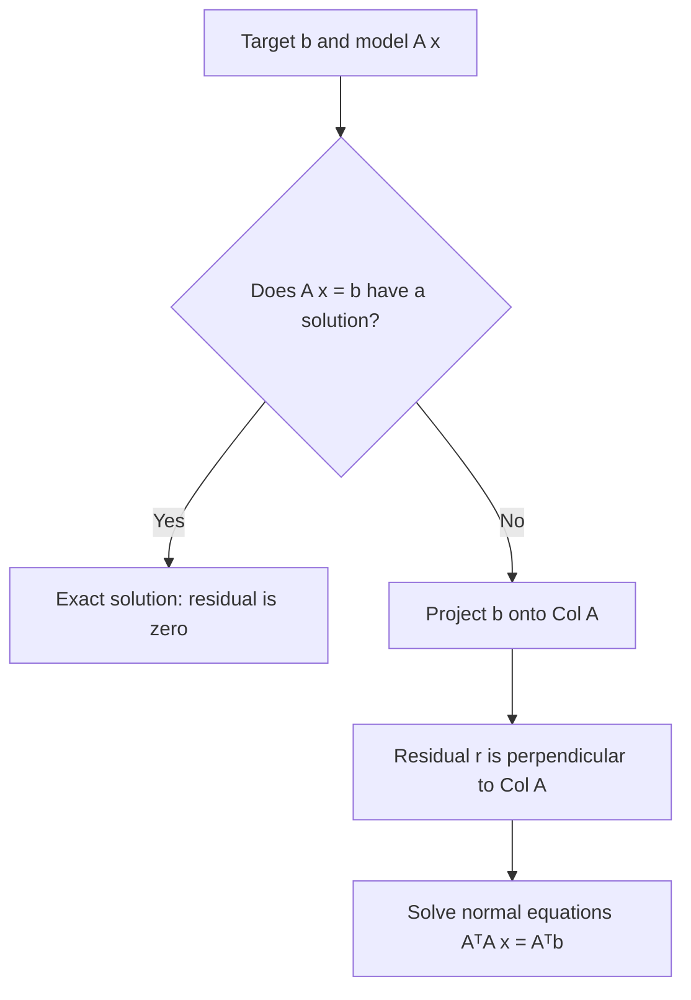

---
tags:
  - CCT3
  - Lin_Algebra
Topic: Inner Product, Length, Orthogonality, Least Squares, Orthogonal Sets
Semester: CCT3
Course: Linær Algebra
Litterature:
  - Linear Algebra and Its Applications, Global Edition, 6ed
Created: 01-11-2026
---

# 6. Orthogonality and Least Squares

| Concept or notation | Meaning |
|---|---|
| $\mathbb{R}^n$; $\mathbf{u},\mathbf{v},\mathbf{w},\mathbf{x},\mathbf{y},\mathbf{z}$ | Real coordinate space and vectors; $n$ is the dimension. |
| $\mathbf{0}$; $\mathbf{e}_i$ | Zero vector; $i$th standard basis vector. |
| $\mathbf{u}^T\mathbf{v}=\mathbf{u}\cdot\mathbf{v}$ | Transpose product / dot product $\sum_i u_i v_i$; zero means orthogonal. |
| $\|\mathbf{v}\|$; $\operatorname{dist}(\mathbf{u},\mathbf{v})$ | Euclidean norm $\sqrt{\mathbf{v}\cdot\mathbf{v}}$; distance $\|\mathbf{u}-\mathbf{v}\|$. |
| $\operatorname{Span}\{\mathbf{u}_1,\ldots,\mathbf{u}_p\}$; $W^\perp$ | Span of vectors; all vectors orthogonal to every vector in $W$. |
| $\operatorname{Row}A$, $\operatorname{Col}A$, $\operatorname{Nul}A$ | Row, column, and null spaces of matrix $A$; $A^T$ is its transpose. |
| $\theta$, $\cos\theta$ | Angle between nonzero vectors and its cosine. |
| $c_j$; $p$; $j$ | Weight of the $j$th orthogonal basis vector; $p$ is the number of vectors. |
| $\alpha$; $\hat{\mathbf{y}}$; $\operatorname{proj}_L\mathbf{y}$ | Projection weight, projected vector, and projection onto line $L$. |
| $U^TU=I_n$; $U^{-1}=U^T$ | Orthonormal columns for $m\times n$ matrix $U$; orthogonal matrix when $U$ is square. |
| $\operatorname{proj}_W\mathbf{y}$; $\mathbf{r}$ | Closest vector in subspace $W$ and orthogonal residual. |
| AI | Artificial intelligence. |
_Table 6.1: Symbols, operators, and abbreviations used throughout this note._

**Motivation — artificial intelligence and machine learning.**

> [!example] A motivating classification task
> Distinguishing a puppy from a kitten is trivial for the human eye but represents a significant challenge for machines. Advances in artificial intelligence (AI) and machine learning have rapidly improved computers' ability to interpret visual data — identifying patterns in pixels the way humans do naturally.

These approaches have applications across industries:

> [!example] Applications
> - **Mail sorting:** Post office scanners read barcodes and handwriting on envelopes with precision and speed.
> - **Retail:** Machine learning interprets color and shape patterns to design, display, and recommend clothing ensembles.
> - **Customer service:** AI assistants handle service calls, answer simple questions, and even book appointments on a user's behalf.

At its core, AI and machine learning involve developing systems that interpret external data
correctly, learn from it, and use that learning to achieve specific goals through flexibility and
adaptation. The driving engine behind many of these techniques is *linear algebra* — particularly
the concepts of orthogonality and least-squares approximation developed in this chapter.

This chapter introduces the concepts of *distance* and *orthogonality* in a vector space, then shows
how orthogonality can identify the point within a subspace $W$ that is nearest to a point
$\mathbf{y}$ lying outside of $W$. By taking $W$ to be the column space of a matrix,
a method for producing approximate ("least-squares") solutions for inconsistent linear systems is
developed — a technique central to machine learning. Orthogonal projections are also used to create
matrix factorizations widely used in numerical linear algebra, and least-squares problems are
explored in vector spaces more general than $\mathbb{R}^n$.

---

## 6.1 Inner Product, Length, and Orthogonality

Geometric concepts of length, distance, and perpendicularity — well known for $\mathbb{R}^2$ and
$\mathbb{R}^3$ — are generalized here to $\mathbb{R}^n$. These concepts provide powerful geometric tools
for solving many applied problems, including least-squares problems. All three notions are defined
in terms of the *inner product* of two vectors.

### The Inner Product

If $\mathbf{u}$ and $\mathbf{v}$ are vectors in $\mathbb{R}^n$, they can be regarded as $n \times 1$
matrices. The transpose $\mathbf{u}^T$ is a $1 \times n$ matrix, and the matrix product $\mathbf{u}^T \mathbf{v}$ is a
$1 \times 1$ matrix, which is written as a single real number (a scalar) without brackets.

> [!info] Definition: Inner Product (Dot Product)
> The *inner product* of $\mathbf{u}$ and $\mathbf{v}$ in $\mathbb{R}^n$ is the scalar $\mathbf{u}^T \mathbf{v}$, often written as $\mathbf{u} \cdot \mathbf{v}$.
> 
> If $\mathbf{u} = \begin{bmatrix} u_1 \\ u_2 \\ \vdots \\ u_n \end{bmatrix}$ and $\mathbf{v} = \begin{bmatrix} v_1 \\ v_2 \\ \vdots \\ v_n \end{bmatrix}$, then:
> 
> $$\mathbf{u} \cdot \mathbf{v} = u_1 v_1 + u_2 v_2 + \cdots + u_n v_n$$
> ![[Pasted image 20261101154745.png]]
> _Figure 6.1: Coordinatewise dot product of two vectors in $\mathbb{R}^n$._

> [!example] **Computing the Inner Product**
> Let $\mathbf{u} = \begin{bmatrix} 2 \\ -5 \\ 1 \end{bmatrix}$ and $\mathbf{v} = \begin{bmatrix} 3 \\ 2 \\ -3 \end{bmatrix}$.
> 
> $$\mathbf{u} \cdot \mathbf{v} = (2)(3) + (-5)(2) + (1)(-3) = 6 - 10 - 3 = -7$$
> 
> $$\mathbf{v} \cdot \mathbf{u} = (3)(2) + (2)(-5) + (-3)(1) = 6 - 10 - 3 = -7$$
> 
> This confirms that $\mathbf{u} \cdot \mathbf{v} = \mathbf{v} \cdot \mathbf{u}$ (commutativity). ✓

> [!summary] Theorem 1: Properties of the Inner Product
> Let $\mathbf{u}$, $\mathbf{v}$, and $\mathbf{w}$ be vectors in $\mathbb{R}^n$, and let $c$ be a scalar. Then:
> 
> a. $\mathbf{u} \cdot \mathbf{v} = \mathbf{v} \cdot \mathbf{u}$
> b. $(\mathbf{u} + \mathbf{v}) \cdot \mathbf{w} = \mathbf{u} \cdot \mathbf{w} + \mathbf{v} \cdot \mathbf{w}$
> c. $(c\mathbf{u}) \cdot \mathbf{v} = c(\mathbf{u} \cdot \mathbf{v}) = \mathbf{u} \cdot (c\mathbf{v})$
> d. $\mathbf{u} \cdot \mathbf{u} \geq 0$, and $\mathbf{u} \cdot \mathbf{u} = 0$ if and only if $\mathbf{u} = \mathbf{0}$
> 
> **Breakdown:**
> - **Property (a):** *Commutativity* — the order of the dot product does not matter.
> - **Property (b):** *Distributivity* — the inner product distributes over vector addition.
> - **Property (c):** *Scalar associativity* — a scalar can be factored out from either vector.
> - **Property (d):** *Positive definiteness* — a vector dotted with itself is always non-negative, and is zero only for the zero vector.
>
> **Proof:** Each identity follows by expanding $\mathbf{u}\cdot\mathbf{v}=\sum_{i=1}^n u_i v_i$ term by term; in particular $\mathbf{u}\cdot\mathbf{u}=\sum_i u_i^2$, which vanishes exactly when every coordinate is zero.

> [!example] Distributivity in one line
> $(1,2)\cdot((3,0)+(0,4))=(1,2)\cdot(3,4)=11$, while $(1,2)\cdot(3,0)+(1,2)\cdot(0,4)=3+8=11$. ✓

Properties (b) and (c) can be combined to produce the useful rule:

$$(c_1 \mathbf{u}_1 + \cdots + c_p \mathbf{u}_p) \cdot \mathbf{w} = c_1(\mathbf{u}_1 \cdot \mathbf{w}) + \cdots + c_p(\mathbf{u}_p \cdot \mathbf{w})$$

### The Length of a Vector

Since $\mathbf{v} \cdot \mathbf{v} \geq 0$ for any $\mathbf{v}$ in $\mathbb{R}^n$, the square root of $\mathbf{v} \cdot \mathbf{v}$ is always
well-defined.

> [!info] Definition: Length (Norm) of a Vector
> The *length* (or *norm*) of $\mathbf{v}$ is the nonnegative scalar $\|\mathbf{v}\|$ defined by:
> 
> $$\|\mathbf{v}\| = \sqrt{\mathbf{v} \cdot \mathbf{v}} = \sqrt{v_1^2 + v_2^2 + \cdots + v_n^2}$$
> 
> and $\|\mathbf{v}\|^2 = \mathbf{v} \cdot \mathbf{v}$.

> [!example] A two-coordinate norm
> For $\mathbf{v}=(3,4)$, $\|\mathbf{v}\|=\sqrt{3^2+4^2}=5$. Check: $\|\mathbf{v}\|^2=25=\mathbf{v}\cdot\mathbf{v}$. ✓

In $\mathbb{R}^2$, if $\mathbf{v} = \begin{bmatrix} a \\ b \end{bmatrix}$, then $\|\mathbf{v}\| = \sqrt{a^2 + b^2}$, which coincides with the standard geometric length
of the line segment from the origin to the point $(a, b)$ by the Pythagorean Theorem. The same
holds in $\mathbb{R}^3$ using the diagonal of a rectangular box.
![[Pasted image 20261101154812.png]]
_Figure 6.2: Euclidean norm as distance from the origin to a vector._

**Scalar multiplication and length:** For any scalar $c$,

$$\|c\mathbf{v}\| = |c| \|\mathbf{v}\|$$

This follows from $\|c\mathbf{v}\|^2 = (c\mathbf{v}) \cdot (c\mathbf{v}) = c^2 (\mathbf{v} \cdot \mathbf{v}) = c^2 \|\mathbf{v}\|^2$, then taking square roots.

**Unit vectors and normalizing:** A vector whose length is $1$ is called a *unit vector*.
Dividing a nonzero vector $\mathbf{v}$ by its length produces a unit vector $\mathbf{u}$ in the same
direction:

$$\mathbf{u} = \frac{1}{\|\mathbf{v}\|} \mathbf{v}$$

This process is called *normalizing* $\mathbf{v}$.
> [!example] **Normalizing a Vector**
> Let $\mathbf{v} = (1, -2, 2, 0)$. Find a unit vector $\mathbf{u}$ in the same direction.
> 
> **Step 1:** Compute the length.
> $$\|\mathbf{v}\|^2 = (1)^2 + (-2)^2 + (2)^2 + (0)^2 = 1 + 4 + 4 + 0 = 9$$
> $$\|\mathbf{v}\| = \sqrt{9} = 3$$
> 
> **Step 2:** Multiply by $1/\|\mathbf{v}\|$.
> $$\mathbf{u} = \frac{1}{3} \begin{bmatrix} 1 \\ -2 \\ 2 \\ 0 \end{bmatrix} = \begin{bmatrix} 1/3 \\ -2/3 \\ 2/3 \\ 0 \end{bmatrix}$$
> 
> **Verification:** $\|\mathbf{u}\|^2 = (1/3)^2 + (-2/3)^2 + (2/3)^2 + 0 = \frac{1}{9} + \frac{4}{9} + \frac{4}{9} = 1$. ✓

![[Pasted image 20261101154841.png]]
_Figure 6.3: Normalizing a nonzero vector while preserving its direction._

> [!example] **Normalizing to Find a Basis Unit Vector**
> Let $W$ be the subspace of $\mathbb{R}^2$ spanned by $\mathbf{x} = (-2/3, 1)$. Find a unit vector $\mathbf{z}$ that is a basis for $W$.
> 
> $W$ consists of all multiples of $\mathbf{x}$. To simplify, scale $\mathbf{x}$ by 3 to eliminate fractions: $\mathbf{y} = (-2, 3)$.
> 
> $$\|\mathbf{y}\|^2 = (-2)^2 + 3^2 = 4 + 9 = 13, \quad \|\mathbf{y}\| = \sqrt{13}$$
> 
> Normalize:
> $$\mathbf{z} = \frac{1}{\sqrt{13}} \begin{bmatrix} -2 \\ 3 \end{bmatrix} = \begin{bmatrix} -2/\sqrt{13} \\ 3/\sqrt{13} \end{bmatrix}$$
> 
> Another valid unit vector in $W$ is $(2/\sqrt{13}, -3/\sqrt{13})$ (the opposite direction). Check its squared length: $(4+9)/13=1$, and it is a multiple of $\mathbf{x}$. ✓

### Distance in $\mathbb{R}^n$

Recall that for real numbers $a$ and $b$, the distance on the number line is
$|a - b|$. This generalizes directly to $\mathbb{R}^n$.

> [!info] Definition: Distance Between Vectors
> For $\mathbf{u}$ and $\mathbf{v}$ in $\mathbb{R}^n$, the *distance* between $\mathbf{u}$ and $\mathbf{v}$ is:
> 
> $$\text{dist}(\mathbf{u}, \mathbf{v}) = \|\mathbf{u} - \mathbf{v}\|$$

> [!example] **Computing Distance**
> Let $\mathbf{u} = (7, 1)$ and $\mathbf{v} = (3, 2)$.
> 
> $$\mathbf{u} - \mathbf{v} = \begin{bmatrix} 7 \\ 1 \end{bmatrix} - \begin{bmatrix} 3 \\ 2 \end{bmatrix} = \begin{bmatrix} 4 \\ -1 \end{bmatrix}$$
> 
> $$\text{dist}(\mathbf{u}, \mathbf{v}) = \|\mathbf{u} - \mathbf{v}\| = \sqrt{4^2 + (-1)^2} = \sqrt{17}$$
> Check: $(7-3)^2+(1-2)^2=17$. ✓

In $\mathbb{R}^2$ and $\mathbb{R}^3$, this coincides with the standard Euclidean distance formula.
Geometrically, the distance from $\mathbf{u}$ to $\mathbf{v}$ is the same as the distance from
$\mathbf{u} - \mathbf{v}$ to the origin $\mathbf{0}$.
![[Pasted image 20261101154901.png]]
_Figure 6.4: Geometric distance between two points represented by vectors._

In $\mathbb{R}^3$, for $\mathbf{u} = (u_1, u_2, u_3)$ and $\mathbf{v} = (v_1, v_2, v_3)$:

$$\text{dist}(\mathbf{u}, \mathbf{v}) = \sqrt{(u_1 - v_1)^2 + (u_2 - v_2)^2 + (u_3 - v_3)^2}$$
![[Pasted image 20261101154926.png]]
_Figure 6.5: Distance from $\mathbf{u}$ to $\mathbf{v}$ as the norm of their difference._
### Orthogonal Vectors

The concept of perpendicular lines in Euclidean geometry generalizes to $\mathbb{R}^n$ through the
inner product. The key insight is that the lines through the origin determined by *nonzero* vectors
$\mathbf{u}$ and $\mathbf{v}$ are perpendicular if and only if the distance from $\mathbf{u}$ to
$\mathbf{v}$ equals the distance from $\mathbf{u}$ to $-\mathbf{v}$.
![[Pasted image 20261101154940.png]]
_Figure 6.6: Comparing $\mathbf{u}+\mathbf{v}$ and $\mathbf{u}-\mathbf{v}$ to detect perpendicularity._

Expanding the squared distances:

$$[\text{dist}(\mathbf{u}, -\mathbf{v})]^2 = \|\mathbf{u} + \mathbf{v}\|^2 = \|\mathbf{u}\|^2 + \|\mathbf{v}\|^2 + 2\mathbf{u} \cdot \mathbf{v}$$

$$[\text{dist}(\mathbf{u}, \mathbf{v})]^2 = \|\mathbf{u} - \mathbf{v}\|^2 = \|\mathbf{u}\|^2 + \|\mathbf{v}\|^2 - 2\mathbf{u} \cdot \mathbf{v}$$

These are equal if and only if $2\mathbf{u} \cdot \mathbf{v} = -2\mathbf{u} \cdot \mathbf{v}$, which happens if and only if $\mathbf{u} \cdot \mathbf{v} = 0$.

> [!info] Definition: Orthogonal Vectors
> Two vectors $\mathbf{u}$ and $\mathbf{v}$ in $\mathbb{R}^n$ are *orthogonal* (to each other) if $\mathbf{u} \cdot \mathbf{v} = 0$.

> [!example] Checking orthogonality
> $(2,-1)\cdot(1,2)=2-2=0$, so the vectors are orthogonal. ✓

The zero vector is orthogonal to every vector in $\mathbb{R}^n$ because $\mathbf{0}^T \mathbf{v} = 0$ for all
$\mathbf{v}$.

> [!summary] Theorem 2: The Pythagorean Theorem
> Two vectors $\mathbf{u}$ and $\mathbf{v}$ are orthogonal if and only if:
> 
> $$\|\mathbf{u} + \mathbf{v}\|^2 = \|\mathbf{u}\|^2 + \|\mathbf{v}\|^2$$
> 
> **Breakdown:**
> - **$\|\mathbf{u} + \mathbf{v}\|^2$:** The squared length of the sum vector (the "hypotenuse" when the orthogonal vectors are placed head-to-tail).
> - **$\|\mathbf{u}\|^2$:** The squared length of $\mathbf{u}$ (one "leg").
> - **$\|\mathbf{v}\|^2$:** The squared length of $\mathbf{v}$ (the other "leg").
> 
> This generalizes $a^2+b^2=c^2$ to $\mathbb{R}^n$.
>
> **Proof:** $\|\mathbf{u}+\mathbf{v}\|^2=\|\mathbf{u}\|^2+2\mathbf{u}\cdot\mathbf{v}+\|\mathbf{v}\|^2$. Therefore equality with $\|\mathbf{u}\|^2+\|\mathbf{v}\|^2$ holds exactly when $\mathbf{u}\cdot\mathbf{v}=0$.
> ![[Pasted image 20261101155000.png]]
> _Figure 6.7: Pythagorean relation for two orthogonal vectors._

> [!example] Pythagorean check
> For $(2,0)$ and $(0,3)$, $\|(2,3)\|^2=13=4+9=\|(2,0)\|^2+\|(0,3)\|^2$. ✓

### Orthogonal Complements

If a vector $\mathbf{z}$ is orthogonal to *every* vector in a subspace $W$ of $\mathbb{R}^n$,
then $\mathbf{z}$ is said to be *orthogonal to $W$*.

> [!info] Definition: Orthogonal Complement
> The *orthogonal complement* of a subspace $W$, denoted $W^\perp$ (read "W perp"), is the set of all vectors $\mathbf{z}$ that are orthogonal to every vector in $W$.

> [!example] A plane and its normal line
> If $W$ is a plane through the origin in $\mathbb{R}^3$ and $L$ is the line through the origin perpendicular to $W$, then every vector on $L$ is orthogonal to every vector in $W$. In this case, $L = W^\perp$ and $W = L^\perp$.
> For $W=\{(x,y,0):x,y\in\mathbb{R}\}$, the line $L=\{(0,0,t):t\in\mathbb{R}\}$ has precisely this property. ✓

![[Pasted image 20261101155041.png]]
_Figure 6.8: A plane through the origin and its perpendicular line as orthogonal complements._

The relation to perpendicular vectors is developed in [[#Orthogonal Vectors]]. Two key facts about
$W^\perp$:

1. A vector $\mathbf{x}$ is in $W^\perp$ if and only if $\mathbf{x}$ is orthogonal to every vector in a set that *spans* $W$. (You only need to check orthogonality against a spanning set, not every vector in $W$.)
2. $W^\perp$ is a subspace of $\mathbb{R}^n$.

> [!summary] Theorem 3: Orthogonal Complements of Fundamental Subspaces
> Let $A$ be an $m \times n$ matrix. Then:
> 
> $$(\text{Row } A)^\perp = \text{Nul } A \qquad \text{and} \qquad (\text{Col } A)^\perp = \text{Nul } A^T$$
> 
> **Breakdown:**
> - **$\text{Row } A$:** The row space of $A$ — the subspace spanned by the rows of $A$ (vectors in $\mathbb{R}^n$).
> - **$\text{Nul } A$:** The null space of $A$ — the set of all $\mathbf{x}$ such that $A\mathbf{x} = \mathbf{0}$.
> - **$\text{Col } A$:** The column space of $A$ — the subspace spanned by the columns of $A$.
> - **$\text{Nul } A^T$:** The null space of $A^T$ — the set of all $\mathbf{y}$ such that $A^T \mathbf{y} = \mathbf{0}$.
> - **$(\cdot)^\perp$:** The orthogonal complement operator.
> 
> **Proof:**
> The row–column rule for computing $A\mathbf{x}$ shows that if $\mathbf{x}$ is in $\text{Nul } A$, then $\mathbf{x}$ is orthogonal to each row of $A$ (treating rows as vectors in $\mathbb{R}^n$). Since the rows of $A$ span the row space, $\mathbf{x}$ is orthogonal to $\text{Row } A$. Conversely, if $\mathbf{x}$ is orthogonal to $\text{Row } A$, then $\mathbf{x}$ is orthogonal to each row of $A$, and hence $A\mathbf{x} = \mathbf{0}$. This proves $(\text{Row } A)^\perp = \text{Nul } A$.
> 
> Since this statement holds for *any* matrix, it holds for $A^T$. That is, $(\text{Row } A^T)^\perp = \text{Nul } A^T$. Because $\text{Row } A^T = \text{Col } A$, this gives $(\text{Col } A)^\perp = \text{Nul } A^T$.
> ![[Pasted image 20261101155114.png]]
> _Figure 6.9: Row space, null space, column space, and left null space of a matrix._

> [!example] Null space as an orthogonal complement
> With $A=\begin{bmatrix}1&1\end{bmatrix}$, $\operatorname{Row}A=\operatorname{Span}\{(1,1)\}$ and $\operatorname{Nul}A=\{(t,-t):t\in\mathbb{R}\}$. Check $(1,1)\cdot(t,-t)=t-t=0$, so the spaces are orthogonal complements. ✓

> [!tip] **Proving Set Equality**
> A common technique for proving two sets $S$ and $T$ are equal is to show $S \subseteq T$ and $T \subseteq S$ separately. In Theorem 3, this means showing an arbitrary element of $\text{Nul } A$ is in $(\text{Row } A)^\perp$, and vice versa.

### Angles in $\mathbb{R}^2$ and $\mathbb{R}^3$ (Optional)

For nonzero vectors $\mathbf{u}$ and $\mathbf{v}$ in $\mathbb{R}^2$ or $\mathbb{R}^3$, there is a direct
connection between the inner product and the angle $\theta$ between the two line segments from
the origin to the points identified with $\mathbf{u}$ and $\mathbf{v}$:

$$\mathbf{u} \cdot \mathbf{v} = \|\mathbf{u}\| \|\mathbf{v}\| \cos \theta$$

> [!note] Angle formula breakdown
> - **$\mathbf{u} \cdot \mathbf{v}$:** The inner (dot) product of the two vectors.
> - **$\|\mathbf{u}\|$, $\|\mathbf{v}\|$:** The lengths (norms) of $\mathbf{u}$ and $\mathbf{v}$.
> - **$\cos \theta$:** The cosine of the angle $\theta$ between the vectors.
> - **$\theta$:** The angle between the two vectors, measured at the origin.

This formula can be verified in $\mathbb{R}^2$ using the law of cosines on the triangle with sides
$\|\mathbf{u}\|$, $\|\mathbf{v}\|$, and $\|\mathbf{u} - \mathbf{v}\|$:

$$\|\mathbf{u} - \mathbf{v}\|^2 = \|\mathbf{u}\|^2 + \|\mathbf{v}\|^2 - 2\|\mathbf{u}\|\|\mathbf{v}\|\cos\theta$$

Rearranging and expanding yields $\|\mathbf{u}\|\|\mathbf{v}\|\cos\theta = u_1 v_1 + u_2 v_2 = \mathbf{u} \cdot \mathbf{v}$.
![[Pasted image 20261101155133.png]]
_Figure 6.10: Angle between two nonzero vectors from the origin._

> [!example] Angle from a dot product
> $(1,0)\cdot(0,1)=0$ and both lengths are $1$, so $\cos\theta=0$ and $\theta=\pi/2$. ✓

When $n > 3$, this formula can be used to *define* the angle between two vectors in $\mathbb{R}^n$.
In statistics, the value of $\cos \theta$ defined by this formula for suitable vectors is known as the
*correlation coefficient*.

## 6.2 Orthogonal Sets

> [!info] Definition: Orthogonal Set
> A set of vectors $\{\mathbf{u}_1, \ldots, \mathbf{u}_p\}$ in $\mathbb{R}^n$ is an *orthogonal set* if each pair of distinct vectors is orthogonal: $\mathbf{u}_i \cdot \mathbf{u}_j = 0$ whenever $i \neq j$.
> [!example] **Verifying an Orthogonal Set**
> Show that $\{\mathbf{u}_1, \mathbf{u}_2, \mathbf{u}_3\}$ is an orthogonal set, where:
> $$\mathbf{u}_1 = \begin{bmatrix} 3 \\ 1 \\ 1 \end{bmatrix}, \quad \mathbf{u}_2 = \begin{bmatrix} -1 \\ 2 \\ 1 \end{bmatrix}, \quad \mathbf{u}_3 = \begin{bmatrix} -1/2 \\ -2 \\ 7/2 \end{bmatrix}$$
> 
> Check all three pairs of distinct vectors:
> - $\mathbf{u}_1 \cdot \mathbf{u}_2 = (3)(-1) + (1)(2) + (1)(1) = -3 + 2 + 1 = 0$ ✓
> - $\mathbf{u}_1 \cdot \mathbf{u}_3 = (3)(-1/2) + (1)(-2) + (1)(7/2) = -3/2 - 2 + 7/2 = 0$ ✓
> - $\mathbf{u}_2 \cdot \mathbf{u}_3 = (-1)(-1/2) + (2)(-2) + (1)(7/2) = 1/2 - 4 + 7/2 = 0$ ✓
> 
> Each pair is orthogonal, so the set is an orthogonal set. The three vectors are mutually perpendicular. ✓

![[Pasted image 20261101155201.png]]
_Figure 6.11: Pairwise perpendicular vectors forming an orthogonal set._

> [!summary] Theorem 4: Orthogonal Sets Are Linearly Independent
> If $S = \{\mathbf{u}_1, \ldots, \mathbf{u}_p\}$ is an orthogonal set of *nonzero* vectors in $\mathbb{R}^n$, then $S$ is linearly independent and hence is a basis for the subspace spanned by $S$.
> 
> **Breakdown:**
> - **Orthogonal set:** Every pair of distinct vectors has a dot product of zero.
> - **Nonzero vectors:** Each $\mathbf{u}_i \neq \mathbf{0}$, which guarantees $\mathbf{u}_i \cdot \mathbf{u}_i \neq 0$.
> - **Linearly independent:** No vector in the set can be written as a linear combination of the others.
> - **Basis for span:** Because the set is linearly independent, it automatically forms a basis for whatever subspace it spans.
> 
> **Proof:**
> Suppose $\mathbf{0} = c_1 \mathbf{u}_1 + \cdots + c_p \mathbf{u}_p$ for some scalars $c_1, \ldots, c_p$. Then:
> 
> $$0 = \mathbf{0} \cdot \mathbf{u}_1 = (c_1 \mathbf{u}_1 + c_2 \mathbf{u}_2 + \cdots + c_p \mathbf{u}_p) \cdot \mathbf{u}_1$$
> 
> By distributivity and the orthogonality condition ($\mathbf{u}_j \cdot \mathbf{u}_1 = 0$ for $j \neq 1$):
> 
> $$0 = c_1(\mathbf{u}_1 \cdot \mathbf{u}_1) + c_2(\mathbf{u}_2 \cdot \mathbf{u}_1) + \cdots + c_p(\mathbf{u}_p \cdot \mathbf{u}_1) = c_1(\mathbf{u}_1 \cdot \mathbf{u}_1)$$
> 
> Since $\mathbf{u}_1$ is nonzero, $\mathbf{u}_1 \cdot \mathbf{u}_1 \neq 0$, so $c_1 = 0$. The same argument applied to each $\mathbf{u}_j$ shows $c_2 = \cdots = c_p = 0$. Thus $S$ is linearly independent.

> [!example] Independence from orthogonality
> $(1,0)$ and $(0,1)$ are nonzero and orthogonal. If $c_1(1,0)+c_2(0,1)=(0,0)$, comparing coordinates gives $c_1=c_2=0$; hence they are independent. ✓

### Orthogonal Bases

> [!info] Definition: Orthogonal Basis
> An *orthogonal basis* for a subspace $W$ of $\mathbb{R}^n$ is a basis for $W$ that is also an orthogonal set.

> [!example] A simple orthogonal basis
> $\{(1,0),(0,1)\}$ spans $\mathbb{R}^2$ and its two vectors have dot product $0$; hence it is an orthogonal basis. ✓

The key advantage of an orthogonal basis over an arbitrary basis is that the weights in a linear
combination can be computed directly — no system of equations needs to be solved.

> [!summary] Theorem 5: Computing Weights with an Orthogonal Basis
> Let $\{\mathbf{u}_1, \ldots, \mathbf{u}_p\}$ be an orthogonal basis for a subspace $W$ of $\mathbb{R}^n$. For each $\mathbf{y}$ in $W$, the weights in the linear combination $\mathbf{y} = c_1 \mathbf{u}_1 + \cdots + c_p \mathbf{u}_p$ are given by:
> 
> $$c_j = \frac{\mathbf{y} \cdot \mathbf{u}_j}{\mathbf{u}_j \cdot \mathbf{u}_j} \quad (j = 1, \ldots, p)$$
> 
> **Breakdown:**
> - **$\mathbf{y}$:** The vector in $W$ being expressed as a linear combination of the basis vectors.
> - **$\mathbf{u}_j$:** The $j$-th basis vector in the orthogonal basis.
> - **$\mathbf{y} \cdot \mathbf{u}_j$:** The inner product of $\mathbf{y}$ with the $j$-th basis vector — this "extracts" the component of $\mathbf{y}$ in the direction of $\mathbf{u}_j$.
> - **$\mathbf{u}_j \cdot \mathbf{u}_j$:** The squared length of $\mathbf{u}_j$ — this normalizes the projection.
> - **$c_j$:** The weight (scalar coefficient) for $\mathbf{u}_j$ in the linear combination.
> 
> **Proof:**
> Take the dot product of both sides of $\mathbf{y} = c_1 \mathbf{u}_1 + \cdots + c_p \mathbf{u}_p$ with $\mathbf{u}_1$:
> 
> $$\mathbf{y} \cdot \mathbf{u}_1 = (c_1 \mathbf{u}_1 + c_2 \mathbf{u}_2 + \cdots + c_p \mathbf{u}_p) \cdot \mathbf{u}_1 = c_1(\mathbf{u}_1 \cdot \mathbf{u}_1)$$
> 
> All cross terms vanish due to orthogonality. Since $\mathbf{u}_1 \cdot \mathbf{u}_1 \neq 0$, solve for $c_1$. Repeat with $\mathbf{u}_j$ for each $j$.

> [!example] **Expressing a Vector Using an Orthogonal Basis**
> The set $S = \{\mathbf{u}_1, \mathbf{u}_2, \mathbf{u}_3\}$ from the earlier example is an orthogonal basis for $\mathbb{R}^3$. Express $\mathbf{y} = \begin{bmatrix} 6 \\ 1 \\ -8 \end{bmatrix}$ as a linear combination of the vectors in $S$.
> 
> **Step 1:** Compute the needed inner products.
> - $\mathbf{y} \cdot \mathbf{u}_1 = 11$, $\quad \mathbf{u}_1 \cdot \mathbf{u}_1 = 11$
> - $\mathbf{y} \cdot \mathbf{u}_2 = -12$, $\quad \mathbf{u}_2 \cdot \mathbf{u}_2 = 6$
> - $\mathbf{y} \cdot \mathbf{u}_3 = -33$, $\quad \mathbf{u}_3 \cdot \mathbf{u}_3 = 33/2$
> 
> **Step 2:** Apply the weight formula.
> $$\mathbf{y} = \frac{11}{11}\mathbf{u}_1 + \frac{-12}{6}\mathbf{u}_2 + \frac{-33}{33/2}\mathbf{u}_3 = \mathbf{u}_1 - 2\mathbf{u}_2 - 2\mathbf{u}_3$$
> 
> **Check:** $\mathbf{u}_1-2\mathbf{u}_2-2\mathbf{u}_3=(3,1,1)+(2,-4,-2)+(1,4,-7)=(6,1,-8)=\mathbf{y}$. ✓

> [!warning] Correction: The source lists $\mathbf{y}\cdot\mathbf{u}_2=12$ and $\mathbf{y}\cdot\mathbf{u}_3=33$; direct dot products give $-12$ and $-33$. Thus the coefficients are $(1,-2,-2)$, not $(1,2,2)$.

If the basis were *not* orthogonal, finding these weights would require solving a full system of
linear equations.

### Orthogonal Projection

Given a nonzero vector $\mathbf{u}$ in $\mathbb{R}^n$, any vector $\mathbf{y}$ in $\mathbb{R}^n$ can be
decomposed into the sum of two vectors: one that is a multiple of $\mathbf{u}$, and one that is
orthogonal to $\mathbf{u}$. That is, we want to write:

$$\mathbf{y} = \hat{\mathbf{y}} + \mathbf{z}$$

where $\hat{\mathbf{y}} = \alpha \mathbf{u}$ for some scalar $\alpha$, and $\mathbf{z}$ is orthogonal to $\mathbf{u}$.
![[Pasted image 20261101155230.png]]
_Figure 6.12: Choosing a scalar so the residual is perpendicular to the projection direction._

Setting $\mathbf{z} = \mathbf{y} - \alpha \mathbf{u}$ and requiring $\mathbf{z} \cdot \mathbf{u} = 0$:

$$0 = (\mathbf{y} - \alpha \mathbf{u}) \cdot \mathbf{u} = \mathbf{y} \cdot \mathbf{u} - \alpha(\mathbf{u} \cdot \mathbf{u})$$

Solving gives $\alpha = \frac{\mathbf{y} \cdot \mathbf{u}}{\mathbf{u} \cdot \mathbf{u}}$.

> [!info] Definition: Orthogonal Projection
> The *orthogonal projection* of $\mathbf{y}$ onto $\mathbf{u}$ (or onto the line $L = \text{Span}\{\mathbf{u}\}$) is:
> 
> $$\hat{\mathbf{y}} = \text{proj}_L \mathbf{y} = \frac{\mathbf{y} \cdot \mathbf{u}}{\mathbf{u} \cdot \mathbf{u}} \mathbf{u}$$
> 
> The *component of $\mathbf{y}$ orthogonal to $\mathbf{u}$* is $\mathbf{z} = \mathbf{y} - \hat{\mathbf{y}}$.
> 
> **Breakdown:**
> - **$\hat{\mathbf{y}}$:** The projection vector — the part of $\mathbf{y}$ that lies along the direction of $\mathbf{u}$.
> - **$\mathbf{z}$:** The orthogonal component — the part of $\mathbf{y}$ that is perpendicular to $\mathbf{u}$.
> - **$\frac{\mathbf{y} \cdot \mathbf{u}}{\mathbf{u} \cdot \mathbf{u}}$:** The scalar that determines how far along $\mathbf{u}$ the projection reaches.
> - **$L = \text{Span}\{\mathbf{u}\}$:** The one-dimensional subspace (line through the origin) determined by $\mathbf{u}$. The projection depends only on this subspace, not on the specific choice of $\mathbf{u}$ — replacing $\mathbf{u}$ with $c\mathbf{u}$ (for any nonzero scalar $c$) gives the same projection.

> [!example] **Computing an Orthogonal Projection**
> Let $\mathbf{y} = \begin{bmatrix} 7 \\ 6 \end{bmatrix}$ and $\mathbf{u} = \begin{bmatrix} 4 \\ 2 \end{bmatrix}$. Find the orthogonal projection of $\mathbf{y}$ onto $\mathbf{u}$, then decompose $\mathbf{y}$.
> 
> **Step 1:** Compute inner products.
> $$\mathbf{y} \cdot \mathbf{u} = (7)(4) + (6)(2) = 28 + 12 = 40$$
> $$\mathbf{u} \cdot \mathbf{u} = (4)(4) + (2)(2) = 16 + 4 = 20$$
> 
> **Step 2:** Compute the projection.
> $$\hat{\mathbf{y}} = \frac{40}{20} \mathbf{u} = 2 \begin{bmatrix} 4 \\ 2 \end{bmatrix} = \begin{bmatrix} 8 \\ 4 \end{bmatrix}$$
> 
> **Step 3:** Compute the orthogonal component.
> $$\mathbf{z} = \mathbf{y} - \hat{\mathbf{y}} = \begin{bmatrix} 7 \\ 6 \end{bmatrix} - \begin{bmatrix} 8 \\ 4 \end{bmatrix} = \begin{bmatrix} -1 \\ 2 \end{bmatrix}$$
> 
> **Verification:** $\hat{\mathbf{y}} \cdot \mathbf{z} = (8)(-1) + (4)(2) = -8 + 8 = 0$ ✓ — the two components are indeed orthogonal.
> 
> **Decomposition:** $\mathbf{y} = \begin{bmatrix} 8 \\ 4 \end{bmatrix} + \begin{bmatrix} -1 \\ 2 \end{bmatrix}$, where the first vector is in $\text{Span}\{\mathbf{u}\}$ and the second is orthogonal to $\mathbf{u}$. The distance to the line is $\|\mathbf{z}\|=\sqrt{(-1)^2+2^2}=\sqrt{5}$. ✓

The point identified with $\hat{\mathbf{y}}$ is the *closest point* on the line $L$ to $\mathbf{y}$,
because the line segment between $\mathbf{y}$ and $\hat{\mathbf{y}}$ is perpendicular to $L$ by
construction. The distance from $\mathbf{y}$ to $L$ is therefore $\|\mathbf{y} - \hat{\mathbf{y}}\|$. The distance is
the length of the residual (computed in the preceding example).
![[Pasted image 20261101155250.png]]
_Figure 6.13: Projection of $\mathbf{y}$ onto a line through the origin._

### Geometric Interpretation

The connection with [[#Orthogonal Projection]] is especially useful: the formula for each weight
$c_j = \frac{\mathbf{y} \cdot \mathbf{u}_j}{\mathbf{u}_j \cdot \mathbf{u}_j}$ in Theorem 5 has the same form as the scalar in the orthogonal projection formula. This
means Theorem 5 decomposes a vector $\mathbf{y}$ into a *sum of orthogonal projections* onto
one-dimensional subspaces.

For instance, if $W = \mathbb{R}^2 = \text{Span}\{\mathbf{u}_1, \mathbf{u}_2\}$ with $\mathbf{u}_1$ and $\mathbf{u}_2$ orthogonal, then any $\mathbf{y}$ in
$\mathbb{R}^2$ can be written as:

$$\mathbf{y} = \frac{\mathbf{y} \cdot \mathbf{u}_1}{\mathbf{u}_1 \cdot \mathbf{u}_1} \mathbf{u}_1 + \frac{\mathbf{y} \cdot \mathbf{u}_2}{\mathbf{u}_2 \cdot \mathbf{u}_2} \mathbf{u}_2$$

The first term is the projection of $\mathbf{y}$ onto the line through $\mathbf{u}_1$, and the second is
the projection onto the line through $\mathbf{u}_2$. This expresses $\mathbf{y}$ as the sum of its
projections onto the orthogonal axes determined by $\mathbf{u}_1$ and $\mathbf{u}_2$. In general, Theorem
5 decomposes each $\mathbf{y}$ in $\text{Span}\{\mathbf{u}_1, \ldots, \mathbf{u}_p\}$ into the sum of $p$ projections onto mutually
orthogonal one-dimensional subspaces.
![[Pasted image 20261101155319.png]]
_Figure 6.14: Resolving a vector into projections along orthogonal axes._

This decomposition arises naturally in physics when a force vector $\mathbf{y}$ is broken into a
component along a direction of interest $\mathbf{u}$ (e.g., the direction of motion) and a component
orthogonal to $\mathbf{u}$.

### Orthonormal Sets

> [!info] Definition: Orthonormal Set and Orthonormal Basis
> A set $\{\mathbf{u}_1, \ldots, \mathbf{u}_p\}$ is an *orthonormal set* if it is an orthogonal set of *unit vectors* (each vector has length $1$). If $W$ is the subspace spanned by such a set, then $\{\mathbf{u}_1, \ldots, \mathbf{u}_p\}$ is an *orthonormal basis* for $W$, since the set is automatically linearly independent by Theorem 4.

> [!example] Standard orthonormal vectors
> The simplest orthonormal set is the standard basis $\{\mathbf{e}_1,\ldots,\mathbf{e}_n\}$ of $\mathbb{R}^n$. Any nonempty subset is also orthonormal: $\mathbf{e}_i\cdot\mathbf{e}_j=0$ for $i\neq j$ and $\|\mathbf{e}_i\|=1$. ✓

When the vectors in an orthogonal set of nonzero vectors are *normalized* (divided by their lengths
to produce unit vectors), the resulting vectors remain orthogonal, so the new set is orthonormal.

> [!example] **Verifying an Orthonormal Basis**
> Show that $\{\mathbf{v}_1, \mathbf{v}_2, \mathbf{v}_3\}$ is an orthonormal basis of $\mathbb{R}^3$, where:
> $$\mathbf{v}_1 = \begin{bmatrix} 3/\sqrt{11} \\ 1/\sqrt{11} \\ 1/\sqrt{11} \end{bmatrix}, \quad \mathbf{v}_2 = \begin{bmatrix} -1/\sqrt{6} \\ 2/\sqrt{6} \\ 1/\sqrt{6} \end{bmatrix}, \quad \mathbf{v}_3 = \begin{bmatrix} -1/\sqrt{66} \\ -4/\sqrt{66} \\ 7/\sqrt{66} \end{bmatrix}$$
> 
> **Orthogonality check:**
> - $\mathbf{v}_1 \cdot \mathbf{v}_2 = -3/\sqrt{66} + 2/\sqrt{66} + 1/\sqrt{66} = 0$ ✓
> - $\mathbf{v}_1 \cdot \mathbf{v}_3 = -3/\sqrt{726} - 4/\sqrt{726} + 7/\sqrt{726} = 0$ ✓
> - $\mathbf{v}_2 \cdot \mathbf{v}_3 = 1/\sqrt{396} - 8/\sqrt{396} + 7/\sqrt{396} = 0$ ✓
> 
> **Unit length check:**
> - $\mathbf{v}_1 \cdot \mathbf{v}_1 = 9/11 + 1/11 + 1/11 = 1$ ✓
> - $\mathbf{v}_2 \cdot \mathbf{v}_2 = 1/6 + 4/6 + 1/6 = 1$ ✓
> - $\mathbf{v}_3 \cdot \mathbf{v}_3 = 1/66 + 16/66 + 49/66 = 1$ ✓
> 
> The set is orthonormal and linearly independent, so it forms an orthonormal basis for $\mathbb{R}^3$.
> ![[Pasted image 20261101155348.png]]
> _Figure 6.15: Three unit vectors defining orthogonal coordinate directions._

### Matrices with Orthonormal Columns

Matrices whose columns form an orthonormal set are important in applications and in computer
algorithms for matrix computations.

> [!example] Normalizing an orthogonal set
> Normalize $(3,0)$ and $(0,-2)$ to $(1,0)$ and $(0,-1)$. Their lengths are $1$ and dot product is $0$. ✓

> [!summary] Theorem 6: Characterization of Orthonormal Columns
> An $m \times n$ matrix $U$ has orthonormal columns if and only if $U^T U = I$.
> 
> **Breakdown:**
> - **$U$:** An $m \times n$ matrix whose columns are vectors $\mathbf{u}_1, \ldots, \mathbf{u}_n$ in $\mathbb{R}^m$.
> - **$U^T$:** The transpose of $U$, an $n \times m$ matrix whose rows are $\mathbf{u}_1^T, \ldots, \mathbf{u}_n^T$.
> - **$U^T U$:** An $n \times n$ matrix whose $(i, j)$-entry is $\mathbf{u}_i^T \mathbf{u}_j = \mathbf{u}_i \cdot \mathbf{u}_j$.
> - **$I$:** The $n \times n$ identity matrix (ones on the diagonal, zeros elsewhere).
> 
> **Proof:**
> Writing $U = [\mathbf{u}_1 \;\; \mathbf{u}_2 \;\; \mathbf{u}_3]$ (three columns for simplicity), the product $U^T U$ yields a matrix whose entries are all pairwise inner products:
> 
> $$U^T U = \begin{bmatrix} \mathbf{u}_1^T \mathbf{u}_1 & \mathbf{u}_1^T \mathbf{u}_2 & \mathbf{u}_1^T \mathbf{u}_3 \\ \mathbf{u}_2^T \mathbf{u}_1 & \mathbf{u}_2^T \mathbf{u}_2 & \mathbf{u}_2^T \mathbf{u}_3 \\ \mathbf{u}_3^T \mathbf{u}_1 & \mathbf{u}_3^T \mathbf{u}_2 & \mathbf{u}_3^T \mathbf{u}_3 \end{bmatrix}$$
> 
> The columns are orthogonal if and only if all off-diagonal entries are zero ($\mathbf{u}_i^T \mathbf{u}_j = 0$ for $i \neq j$). The columns have unit length if and only if all diagonal entries are one ($\mathbf{u}_i^T \mathbf{u}_i = 1$). Together, these conditions are equivalent to $U^T U = I$.

> [!example] Testing the column criterion
> $U=\begin{bmatrix}1&0\\0&0\\0&1\end{bmatrix}$ has $U^TU=I_2$, so its two columns are orthonormal. ✓

> [!summary] Theorem 7: Preservation of Lengths and Orthogonality
> Let $U$ be an $m \times n$ matrix with orthonormal columns, and let $\mathbf{x}$ and $\mathbf{y}$ be in $\mathbb{R}^n$. Then:
> 
> a. $\|U\mathbf{x}\| = \|\mathbf{x}\|$
> b. $(U\mathbf{x}) \cdot (U\mathbf{y}) = \mathbf{x} \cdot \mathbf{y}$
> c. $(U\mathbf{x}) \cdot (U\mathbf{y}) = 0$ if and only if $\mathbf{x} \cdot \mathbf{y} = 0$
> 
> **Breakdown:**
> - **Property (a):** *Length preservation* — multiplying by $U$ does not change the length of a vector.
> - **Property (b):** *Inner product preservation* — the dot product of two vectors is unchanged after multiplication by $U$.
> - **Property (c):** *Orthogonality preservation* — two vectors are orthogonal before the transformation if and only if they are orthogonal after.
> 
> **Proof:** Since $U^TU=I$, $(U\mathbf{x})^T(U\mathbf{y})=\mathbf{x}^TU^TU\mathbf{y}=\mathbf{x}^T\mathbf{y}$. This proves (b); setting $\mathbf{y}=\mathbf{x}$ and taking nonnegative square roots proves (a), while (b) immediately gives (c).
>
> Properties (a) and (c) together mean the linear mapping $\mathbf{x} \mapsto U\mathbf{x}$ preserves the geometric structure (lengths and angles) of vectors. These properties are crucial for many computer algorithms.

> [!example] **Verifying Length Preservation**
> Let $U = \begin{bmatrix} 1/\sqrt{2} & -2/3 \\ 1/\sqrt{2} & 2/3 \\ 0 & 1/3 \end{bmatrix}$ and $\mathbf{x} = \begin{bmatrix} \sqrt{2} \\ 3 \end{bmatrix}$.
> 
> The columns of $U$ are orthonormal, and $U^T U = \begin{bmatrix} 1 & 0 \\ 0 & 1 \end{bmatrix} = I$.
> 
> Compute $U\mathbf{x}$:
> $$U\mathbf{x} = \begin{bmatrix} 1/\sqrt{2} & -2/3 \\ 1/\sqrt{2} & 2/3 \\ 0 & 1/3 \end{bmatrix} \begin{bmatrix} \sqrt{2} \\ 3 \end{bmatrix} = \begin{bmatrix} 1 - 2 \\ 1 + 2 \\ 0 + 1 \end{bmatrix} = \begin{bmatrix} -1 \\ 3 \\ 1 \end{bmatrix}$$
> 
> Verify lengths:
> $$\|U\mathbf{x}\| = \sqrt{(-1)^2 + 3^2 + 1^2} = \sqrt{11}$$
> $$\|\mathbf{x}\| = \sqrt{(\sqrt{2})^2 + 3^2} = \sqrt{2 + 9} = \sqrt{11}$$
> 
> The lengths are equal, confirming $\|U\mathbf{x}\| = \|\mathbf{x}\|$. ✓

### Orthogonal Matrices

> [!info] Definition: Orthogonal Matrix
> An *orthogonal matrix* is a square invertible matrix $U$ with $U^{-1}=U^T$.

> [!example] **An Orthogonal Matrix**
> The matrix
> $$U = \begin{bmatrix} 3/\sqrt{11} & -1/\sqrt{6} & -1/\sqrt{66} \\ 1/\sqrt{11} & 2/\sqrt{6} & -4/\sqrt{66} \\ 1/\sqrt{11} & 1/\sqrt{6} & 7/\sqrt{66} \end{bmatrix}$$
> is an orthogonal matrix because it is square and its columns are orthonormal. Its rows are orthonormal as well. Check: the first two column numerators have dot product $3(-1)+1(2)+1(1)=0$, and their squared norms are $11/11=1$ and $6/6=1$; likewise the third has squared norm $66/66=1$ and zero dot product with the first two. Thus $U^TU=I_3$, and, since $U$ is square, $UU^T=I_3$. ✓

By Theorem 6, such a matrix has orthonormal columns. Conversely, any square matrix with orthonormal
columns is an orthogonal matrix. A perhaps surprising consequence is that an orthogonal matrix must
also have orthonormal *rows*.

---

## 6.3 From Projection to Least Squares

As in [[#Orthogonal Projection]], orthogonal projection turns the geometric idea of a closest point
into a method for approximating an inconsistent linear system. For an inconsistent $A\mathbf{x}=\mathbf{b}$, seek
a vector $\hat{\mathbf{x}}$ minimizing $\|A\mathbf{x}-\mathbf{b}\|^2$. Its image $A\hat{\mathbf{x}}$ is the closest point in
$W=\operatorname{Col}A$ to $\mathbf{b}$. The residual $\mathbf{r}=\mathbf{b}-A\hat{\mathbf{x}}$ belongs to $W^\perp=\operatorname{Nul}A^T$ (Theorem 3); hence

$$A^T(\mathbf{b}-A\hat{\mathbf{x}})=\mathbf{0}\quad\Longleftrightarrow\quad A^TA\hat{\mathbf{x}}=A^T\mathbf{b}.$$

**Breakdown:** $A$ stores column directions; $\hat{\mathbf{x}}$ gives their fitted weights;
$\mathbf{b}$ is the target; $\mathbf{r}$ is the fitting error; $A^T\mathbf{r}=0$ says the error is
perpendicular to every column. These are the *normal equations*. A fitted vector $A\hat{\mathbf{x}}$ is
unique, but the coefficient vector need not be unless $A$ has independent columns.

> [!example] A one-column least-squares fit
> Let $A=\begin{bmatrix}1\\1\end{bmatrix}$ and $\mathbf{b}=\begin{bmatrix}1\\3\end{bmatrix}$. The equations $x=1$ and $x=3$ cannot both hold. The normal equation is $A^TAx=A^T\mathbf{b}$, or $2x=4$; thus $\hat{x}=2$. The fit is $(2,2)$ and residual $\mathbf{r}=(-1,1)$. Check $A^T\mathbf{r}=-1+1=0$ and $\|(t,t)-(1,3)\|^2=2(t-2)^2+2\geq2$ with equality at $t=2$. ✓

_Figure 6.16: Decision path from an exact system to a least-squares fit through projection and an orthogonal residual._

> [!warning] A least-squares solution minimizes residual length; it need not satisfy $A\mathbf{x}=\mathbf{b}$. Do not solve $A^TA\mathbf{x}=A^T\mathbf{b}$ by inverting $A^TA$ unless the columns of $A$ are independent.

---

> [!summary] Summary
> Orthogonality and least squares are connected by distance minimization: dot products define norms and perpendicularity (Section 6.1); orthogonal bases, projections, and orthonormal matrices simplify decompositions (Section 6.2); an inconsistent system is approximated by projecting its target onto the matrix column space, yielding a residual orthogonal to that space and the normal equations (Section 6.3).
