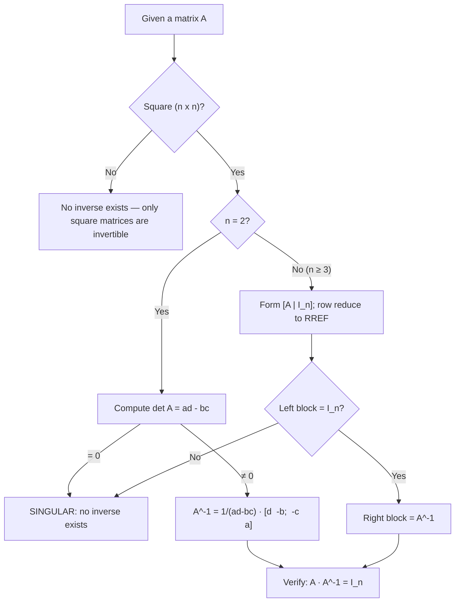

# How-To: Calculating the Inverse Matrix $A^{-1}$

| Plain Text | LaTeX Format | Description |
|---|---|---|
| Inverse of $A$ | `$A^{-1}$` | The unique matrix with $A^{-1}A = AA^{-1} = I_n$ |
| Defining property | `$A^{-1}A = I_n$ and $AA^{-1} = I_n$` | The two equations an inverse must satisfy (both sides!) |
| Identity matrix | `$I_n$` | The $n \times n$ matrix with 1s on the diagonal, 0s elsewhere |
| Singular matrix | — | A square matrix that has no inverse |
| Determinant (2×2) | `$\det A = ad - bc$` | Zero ⇔ singular (2×2 case) |
| 2×2 inverse formula | `$A^{-1} = \frac{1}{ad-bc}\begin{bmatrix} d & -b \\ -c & a \end{bmatrix}$` | Swap the diagonal, negate the off-diagonal, divide by the determinant |
| Adjugate (2×2) | `$\begin{bmatrix} d & -b \\ -c & a \end{bmatrix}$` | The matrix *before* dividing by the determinant |
| Augmented matrix | `$\begin{bmatrix} A & I_n \end{bmatrix}$` | $A$ on the left, the identity on the right |
| Row equivalence | `$\sim$` | "can be transformed into by elementary row operations" |
| Goal of the algorithm | `$\begin{bmatrix} A & I_n \end{bmatrix} \sim \begin{bmatrix} I_n & A^{-1} \end{bmatrix}$` | Left block becomes $I_n$ ⇒ right block is $A^{-1}$ |

_Table 1.1: Quick reference of the notation used in this guide._

> [!info] **Goal**
> Given a square matrix $A$, **calculate its inverse $A^{-1}$** — or determine that no inverse exists. The general recipe is in [[#General Form]]; worked demonstrations are in [[#Worked Examples]].

---

## General Form

> [!info] **Definition: Invertible (Nonsingular) and Singular Matrices**
> An $n \times n$ matrix $A$ is ***invertible*** (or *nonsingular*) if there exists an $n \times n$ matrix $C$ such that
> $$CA = I_n \quad \text{and} \quad AC = I_n$$
> where $I_n$ is the $n \times n$ identity matrix. The matrix $C$ is **unique** and is called ***the inverse of $A$***, denoted $A^{-1}$:
> $$A^{-1}A = I_n \quad \text{and} \quad AA^{-1} = I_n$$
> A square matrix that has no inverse is called ***singular***. (Only square matrices can ever be invertible.)

### The general procedures

**Method 1 — the $2 \times 2$ formula (fastest for $2 \times 2$).**
For $A = \begin{bmatrix} a & b \\ c & d \end{bmatrix}$:
1. Compute the determinant: $\det A = ad - bc$.
2. If $\det A = 0$ → $A$ is **singular**; stop, no inverse exists.
3. If $\det A \neq 0$ → apply the formula:
   $$A^{-1} = \frac{1}{ad - bc} \begin{bmatrix} d & -b \\ -c & a \end{bmatrix}$$
   (Swap the two diagonal entries, negate the two off-diagonal entries, then divide every entry by the determinant.)

**Method 2 — the Gauss–Jordan inversion algorithm (works for any $n \times n$ matrix).**
1. Form the augmented matrix $\begin{bmatrix} A & I_n \end{bmatrix}$.
2. Row reduce it to **reduced row echelon form** (RREF).
3. If the left block becomes $I_n$, then
   $$\begin{bmatrix} A & I_n \end{bmatrix} \sim \begin{bmatrix} I_n & A^{-1} \end{bmatrix}$$
   — the right block **is** $A^{-1}$.
4. If the left block cannot become $I_n$ (a zero row appears), then $A$ is **singular** and has no inverse.

**Deciding invertibility first (any size).** You never need to compute $A^{-1}$ just to learn whether it exists:
- **$2 \times 2$:** compute $\det A$; it is invertible iff $\det A \neq 0$.
- **Any $n \times n$:** row reduce $A$ and count pivots. Exactly $n$ pivots ⇔ invertible (this is statements (b) and (c) of the Invertible Matrix Theorem — one row reduction settles the question).

> [!example]
> - **Equations:** $A^{-1}A = I_n$ and $AA^{-1} = I_n$; for $2 \times 2$: $A^{-1} = \frac{1}{ad-bc}\begin{bmatrix} d & -b \\ -c & a \end{bmatrix}$; for any size: $\begin{bmatrix} A & I_n \end{bmatrix} \sim \begin{bmatrix} I_n & A^{-1} \end{bmatrix}$
> - **Breakdown:**
>     - **$A$** : The $n \times n$ square matrix you want to invert.
>     - **$A^{-1}$** : Its inverse — the matrix that "undoes" multiplication by $A$, like $\frac{1}{x}$ undoes multiplication by $x$ in ordinary arithmetic.
>     - **$I_n$** : The $n \times n$ identity matrix (1s on the main diagonal, 0s elsewhere) — the matrix analogue of the number $1$. Multiplying by it changes nothing: $I_n \mathbf{x} = \mathbf{x}$.
>     - **$C$** : A *candidate* inverse. It must satisfy **both** $CA = I_n$ and $AC = I_n$ — for square matrices, one side automatically implies the other, but the definition demands both.
>     - **$a, b, c, d$** : The four entries of a $2 \times 2$ matrix ($a$ top-left, $b$ top-right, $c$ bottom-left, $d$ bottom-right).
>     - **$\det A = ad - bc$** : The *determinant* of a $2 \times 2$ matrix. It is zero exactly when $A$ is singular.
>     - **$\begin{bmatrix} d & -b \\ -c & a \end{bmatrix}$** : The *adjugate* — swap the diagonal entries, negate the off-diagonal entries.
>     - **$\frac{1}{ad-bc}$** : Scalar division of the whole adjugate by the determinant.
>     - **$\begin{bmatrix} A & I_n \end{bmatrix}$** : The *augmented matrix* — $A$ on the left, the identity on the right. Row operations act on both blocks at once.
>     - **$\sim$** : "is row equivalent to" — the two matrices are connected by elementary row operations.

> [!tip] **Always verify a computed inverse**
> After finding $A^{-1}$, compute the product $AA^{-1}$ and check that it equals $I_n$. For square matrices, verifying **one side** ($AA^{-1} = I_n$) automatically guarantees the other ($A^{-1}A = I_n$) — so one product check is enough. This habit catches arithmetic slips in row reduction.

> [!warning] **Common pitfalls**
> - **Division by zero:** the $2 \times 2$ formula divides by $\det A$. If $\det A = 0$, the formula is undefined — that is precisely the singular case. Never write "$\frac{1}{0}$"; conclude "no inverse."
> - **Non-square matrices** ($m \times n$ with $m \neq n$) have no inverse, full stop.
> - **There is no entrywise division:** $A^{-1}$ is *not* "$1$ divided by each entry of $A$." It is a completely different computation.
> - **Order matters:** matrix multiplication is not commutative. Remember $(AB)^{-1} = B^{-1}A^{-1}$ — the order *reverses*.
> - **A zero row in the left block** during the algorithm means singular — stop immediately; no further row operation can create a pivot there.

> [!info] **Algebraic properties worth knowing**
> For invertible $n \times n$ matrices $A$, $B$ and any nonzero scalar $k$:
> $$(A^{-1})^{-1} = A, \qquad (AB)^{-1} = B^{-1}A^{-1}, \qquad (A^T)^{-1} = (A^{-1})^T, \qquad (kA)^{-1} = \frac{1}{k}A^{-1}$$
> Note the reversed order in $(AB)^{-1}$: to undo "first $B$, then $A$," you must undo $A$ first.

### Decision flow

_Figure 1.1: Decision flow for calculating (or ruling out) the inverse of a matrix._

---

## Worked Examples

> [!example] Example 1: Inverting a $3 \times 3$ matrix with the Gauss–Jordan algorithm
> **Find the inverse of** $A = \begin{bmatrix} 0 & 1 & 2 \\ 1 & 0 & 3 \\ 4 & -3 & 8 \end{bmatrix}$, **if it exists.**
>
> **Step 1 — Form the augmented matrix** $\begin{bmatrix} A & I_3 \end{bmatrix}$:
> $$\begin{bmatrix} A & I_3 \end{bmatrix} = \begin{bmatrix} 0 & 1 & 2 & 1 & 0 & 0 \\ 1 & 0 & 3 & 0 & 1 & 0 \\ 4 & -3 & 8 & 0 & 0 & 1 \end{bmatrix}$$
>
> **Step 2 — Row reduce to RREF.** Every operation is shown with its arithmetic (applied to *all six* columns).
>
> $R_1 \leftrightarrow R_2$ (bring a nonzero entry to the top-left pivot position):
> $$\sim \begin{bmatrix} 1 & 0 & 3 & 0 & 1 & 0 \\ 0 & 1 & 2 & 1 & 0 & 0 \\ 4 & -3 & 8 & 0 & 0 & 1 \end{bmatrix}$$
>
> $R_3 \to R_3 - 4R_1$: the new row 3 is $(4 - 4\cdot1,\; -3 - 4\cdot0,\; 8 - 4\cdot3 \mid 0 - 4\cdot0,\; 0 - 4\cdot1,\; 1 - 4\cdot0) = (0, -3, -4 \mid 0, -4, 1)$:
> $$\sim \begin{bmatrix} 1 & 0 & 3 & 0 & 1 & 0 \\ 0 & 1 & 2 & 1 & 0 & 0 \\ 0 & -3 & -4 & 0 & -4 & 1 \end{bmatrix}$$
>
> $R_3 \to R_3 + 3R_2$: the new row 3 is $(0 + 3\cdot0,\; -3 + 3\cdot1,\; -4 + 3\cdot2 \mid 0 + 3\cdot1,\; -4 + 3\cdot0,\; 1 + 3\cdot0) = (0, 0, 2 \mid 3, -4, 1)$:
> $$\sim \begin{bmatrix} 1 & 0 & 3 & 0 & 1 & 0 \\ 0 & 1 & 2 & 1 & 0 & 0 \\ 0 & 0 & 2 & 3 & -4 & 1 \end{bmatrix}$$
>
> $R_3 \to \tfrac{1}{2}R_3$: the new row 3 is $(0, 0, 1 \mid \tfrac{3}{2}, -2, \tfrac{1}{2})$:
> $$\sim \begin{bmatrix} 1 & 0 & 3 & 0 & 1 & 0 \\ 0 & 1 & 2 & 1 & 0 & 0 \\ 0 & 0 & 1 & \frac{3}{2} & -2 & \frac{1}{2} \end{bmatrix}$$
>
> $R_1 \to R_1 - 3R_3$: the new row 1 is $(1,\; 0,\; 3 - 3\cdot1 \mid 0 - 3\cdot\tfrac{3}{2},\; 1 - 3\cdot(-2),\; 0 - 3\cdot\tfrac{1}{2}) = (1, 0, 0 \mid -\tfrac{9}{2}, 7, -\tfrac{3}{2})$:
> $$\sim \begin{bmatrix} 1 & 0 & 0 & -\frac{9}{2} & 7 & -\frac{3}{2} \\ 0 & 1 & 2 & 1 & 0 & 0 \\ 0 & 0 & 1 & \frac{3}{2} & -2 & \frac{1}{2} \end{bmatrix}$$
>
> $R_2 \to R_2 - 2R_3$: the new row 2 is $(0,\; 1,\; 2 - 2\cdot1 \mid 1 - 2\cdot\tfrac{3}{2},\; 0 - 2\cdot(-2),\; 0 - 2\cdot\tfrac{1}{2}) = (0, 1, 0 \mid -2, 4, -1)$:
> $$\sim \begin{bmatrix} 1 & 0 & 0 & -\frac{9}{2} & 7 & -\frac{3}{2} \\ 0 & 1 & 0 & -2 & 4 & -1 \\ 0 & 0 & 1 & \frac{3}{2} & -2 & \frac{1}{2} \end{bmatrix} = \begin{bmatrix} I_3 & A^{-1} \end{bmatrix}$$
>
> **Step 3 — Read off the inverse.** The left block is $I_3$, so $A$ is invertible and the right block is $A^{-1}$:
> $$A^{-1} = \begin{bmatrix} -\frac{9}{2} & 7 & -\frac{3}{2} \\ -2 & 4 & -1 \\ \frac{3}{2} & -2 & \frac{1}{2} \end{bmatrix}$$
>
> **Step 4 — Verify by computing $AA^{-1}$ entry by entry.**
> $$AA^{-1} = \begin{bmatrix} 0 & 1 & 2 \\ 1 & 0 & 3 \\ 4 & -3 & 8 \end{bmatrix} \begin{bmatrix} -\frac{9}{2} & 7 & -\frac{3}{2} \\ -2 & 4 & -1 \\ \frac{3}{2} & -2 & \frac{1}{2} \end{bmatrix}$$
>
> Row 1 of $A$ is $(0, 1, 2)$:
> - $(1,1)$: $0 \cdot (-\frac{9}{2}) + 1 \cdot (-2) + 2 \cdot \frac{3}{2} = 0 - 2 + 3 = 1$ ✓
> - $(1,2)$: $0 \cdot 7 + 1 \cdot 4 + 2 \cdot (-2) = 0 + 4 - 4 = 0$ ✓
> - $(1,3)$: $0 \cdot (-\frac{3}{2}) + 1 \cdot (-1) + 2 \cdot \frac{1}{2} = 0 - 1 + 1 = 0$ ✓
>
> Row 2 of $A$ is $(1, 0, 3)$:
> - $(2,1)$: $1 \cdot (-\frac{9}{2}) + 0 \cdot (-2) + 3 \cdot \frac{3}{2} = -\frac{9}{2} + rac{9}{2} = 0$ ✓
> - $(2,2)$: $1 \cdot 7 + 0 \cdot 4 + 3 \cdot (-2) = 7 - 6 = 1$ ✓
> - $(2,3)$: $1 \cdot (-\frac{3}{2}) + 0 \cdot (-1) + 3 \cdot \frac{1}{2} = -\frac{3}{2} + rac{3}{2} = 0$ ✓
>
> Row 3 of $A$ is $(4, -3, 8)$:
> - $(3,1)$: $4 \cdot (-\frac{9}{2}) + (-3) \cdot (-2) + 8 \cdot \frac{3}{2} = -18 + 6 + 12 = 0$ ✓
> - $(3,2)$: $4 \cdot 7 + (-3) \cdot 4 + 8 \cdot (-2) = 28 - 12 - 16 = 0$ ✓
> - $(3,3)$: $4 \cdot (-\frac{3}{2}) + (-3) \cdot (-1) + 8 \cdot \frac{1}{2} = -6 + 3 + 4 = 1$ ✓
>
> Every entry checks out:
> $$AA^{-1} = \begin{bmatrix} 1 & 0 & 0 \\ 0 & 1 & 0 \\ 0 & 0 & 1 \end{bmatrix} = I_3 \checkmark$$
> (For a square matrix, $AA^{-1} = I_3$ automatically guarantees $A^{-1}A = I_3$ as well.)

> [!example]- Example 2: The $2 \times 2$ formula — and the singular case
> **Find the inverse of** $A = \begin{bmatrix} 3 & 4 \\ 5 & 6 \end{bmatrix}$.
>
> **Step 1 — Compute the determinant:**
> $$\det A = ad - bc = (3)(6) - (4)(5) = 18 - 20 = -2$$
>
> **Step 2 — Check:** $\det A = -2 \neq 0$ → $A$ is invertible; proceed.
>
> **Step 3 — Apply the formula** (swap the diagonal, negate the off-diagonal, divide by $\det A$):
> $$A^{-1} = \frac{1}{-2} \begin{bmatrix} 6 & -4 \\ -5 & 3 \end{bmatrix} = \begin{bmatrix} \frac{6}{-2} & \frac{-4}{-2} \\ \frac{-5}{-2} & \frac{3}{-2} \end{bmatrix} = \begin{bmatrix} -3 & 2 \\ \frac{5}{2} & -\frac{3}{2} \end{bmatrix}$$
>
> **Step 4 — Verify by computing $AA^{-1}$:**
> $$AA^{-1} = \begin{bmatrix} 3 & 4 \\ 5 & 6 \end{bmatrix} \begin{bmatrix} -3 & 2 \\ \frac{5}{2} & -\frac{3}{2} \end{bmatrix}$$
> - $(1,1)$: $3 \cdot (-3) + 4 \cdot \frac{5}{2} = -9 + 10 = 1$ ✓
> - $(1,2)$: $3 \cdot 2 + 4 \cdot (-\frac{3}{2}) = 6 - 6 = 0$ ✓
> - $(2,1)$: $5 \cdot (-3) + 6 \cdot \frac{5}{2} = -15 + 15 = 0$ ✓
> - $(2,2)$: $5 \cdot 2 + 6 \cdot (-\frac{3}{2}) = 10 - 9 = 1$ ✓
>
> $$AA^{-1} = \begin{bmatrix} 1 & 0 \\ 0 & 1 \end{bmatrix} = I_2 \checkmark$$
>
> **The singular case.** For $B = \begin{bmatrix} 1 & 2 \\ 2 & 4 \end{bmatrix}$:
> $$\det B = (1)(4) - (2)(2) = 4 - 4 = 0$$
> The determinant is zero, so the formula would require division by zero → **$B$ is singular and has no inverse.** (Notice row 2 is exactly $2 \times$ row 1 — the rows are linearly dependent, so the matrix cannot be invertible.)

> [!example]- Example 3: The algorithm detects a singular $3 \times 3$ matrix
> **Run the inversion algorithm on** $A = \begin{bmatrix} 1 & 2 & 3 \\ 4 & 5 & 6 \\ 7 & 8 & 9 \end{bmatrix}$.
>
> **Step 1 — Form** $\begin{bmatrix} A & I_3 \end{bmatrix}$:
> $$\begin{bmatrix} 1 & 2 & 3 & 1 & 0 & 0 \\ 4 & 5 & 6 & 0 & 1 & 0 \\ 7 & 8 & 9 & 0 & 0 & 1 \end{bmatrix}$$
>
> **Step 2 — Row reduce.**
> $R_2 \to R_2 - 4R_1$: the new row 2 is $(4 - 4,\; 5 - 8,\; 6 - 12 \mid 0 - 4,\; 1 - 0,\; 0 - 0) = (0, -3, -6 \mid -4, 1, 0)$:
> $$\sim \begin{bmatrix} 1 & 2 & 3 & 1 & 0 & 0 \\ 0 & -3 & -6 & -4 & 1 & 0 \\ 7 & 8 & 9 & 0 & 0 & 1 \end{bmatrix}$$
>
> $R_3 \to R_3 - 7R_1$: the new row 3 is $(7 - 7,\; 8 - 14,\; 9 - 21 \mid 0 - 7,\; 0 - 0,\; 1 - 0) = (0, -6, -12 \mid -7, 0, 1)$:
> $$\sim \begin{bmatrix} 1 & 2 & 3 & 1 & 0 & 0 \\ 0 & -3 & -6 & -4 & 1 & 0 \\ 0 & -6 & -12 & -7 & 0 & 1 \end{bmatrix}$$
>
> $R_3 \to R_3 - 2R_2$: the new row 3 is $(0,\; -6 - 2\cdot(-3),\; -12 - 2\cdot(-6) \mid -7 - 2\cdot(-4),\; 0 - 2\cdot1,\; 1 - 2\cdot0) = (0, 0, 0 \mid 1, -2, 1)$:
> $$\sim \begin{bmatrix} 1 & 2 & 3 & 1 & 0 & 0 \\ 0 & -3 & -6 & -4 & 1 & 0 \\ 0 & 0 & 0 & 1 & -2 & 1 \end{bmatrix}$$
>
> **Step 3 — Interpret.** The left block contains a **zero row**, so it can never become $I_3$ — no row operation can create a pivot there. The algorithm stops: **$A$ is singular; no inverse exists.**
>
> **Cross-check with the determinant** (cofactor expansion along the first row):
> $$\det A = 1 \cdot \det\begin{bmatrix} 5 & 6 \\ 8 & 9 \end{bmatrix} - 2 \cdot \det\begin{bmatrix} 4 & 6 \\ 7 & 9 \end{bmatrix} + 3 \cdot \det\begin{bmatrix} 4 & 5 \\ 7 & 8 \end{bmatrix}$$
> $$= 1 \cdot (5 \cdot 9 - 6 \cdot 8) - 2 \cdot (4 \cdot 9 - 6 \cdot 7) + 3 \cdot (4 \cdot 8 - 5 \cdot 7)$$
> $$= 1 \cdot (45 - 48) - 2 \cdot (36 - 42) + 3 \cdot (32 - 35)$$
> $$= 1 \cdot (-3) - 2 \cdot (-6) + 3 \cdot (-3) = -3 + 12 - 9 = 0 \checkmark$$
> $\det A = 0$ confirms: singular. (Geometrically, row 3 $= 2 \cdot$ row 2 $-$ row 1, since $2(4,5,6) - (1,2,3) = (7,8,9)$ — the rows are dependent.)

> [!example]- Example 4: Using an inverse to solve a linear system
> **Solve** $\begin{aligned} 3x_1 + 4x_2 &= 3 \\ 5x_1 + 6x_2 &= 7 \end{aligned}$ **using a matrix inverse.**
>
> **Step 1 — Write the system as** $A\mathbf{x} = \mathbf{b}$:
> $$\begin{bmatrix} 3 & 4 \\ 5 & 6 \end{bmatrix} \begin{bmatrix} x_1 \\ x_2 \end{bmatrix} = \begin{bmatrix} 3 \\ 7 \end{bmatrix}$$
>
> **Step 2 — Use the inverse from Example 2,** $A^{-1} = \begin{bmatrix} -3 & 2 \\ \frac{5}{2} & -\frac{3}{2} \end{bmatrix}$. Since $A$ is invertible, the unique solution is $\mathbf{x} = A^{-1}\mathbf{b}$:
> $$\mathbf{x} = A^{-1}\mathbf{b} = \begin{bmatrix} -3 & 2 \\ \frac{5}{2} & -\frac{3}{2} \end{bmatrix} \begin{bmatrix} 3 \\ 7 \end{bmatrix}$$
> - $x_1 = (-3)(3) + (2)(7) = -9 + 14 = 5$
> - $x_2 = \left(\frac{5}{2}\right)(3) + \left(-\frac{3}{2}\right)(7) = \frac{15}{2} - \frac{21}{2} = \frac{15 - 21}{2} = \frac{-6}{2} = -3$
>
> $$\mathbf{x} = \begin{bmatrix} 5 \\ -3 \end{bmatrix}$$
>
> **Step 3 — Verify by substituting back into the original equations:**
> - Equation 1: $3(5) + 4(-3) = 15 - 12 = 3$ ✓
> - Equation 2: $5(5) + 6(-3) = 25 - 18 = 7$ ✓
>
> Both right-hand sides are reproduced, so $\mathbf{x} = (5, -3)$ is correct.

> [!question] Self-Check
> Find the inverse of $A = \begin{bmatrix} 4 & 7 \\ 2 & 6 \end{bmatrix}$, or show that none exists. (Try it yourself first — the fully expanded solution is folded below.)

> [!example]- Self-Check: fully expanded solution
> **Step 1 — Determinant:**
> $$\det A = (4)(6) - (7)(2) = 24 - 14 = 10 \neq 0$$
> → $A$ is invertible.
>
> **Step 2 — Formula:** swap the diagonal ($4 \leftrightarrow 6$), negate the off-diagonal ($7 \to -7$, $2 \to -2$), divide by $10$:
> $$A^{-1} = \frac{1}{10} \begin{bmatrix} 6 & -7 \\ -2 & 4 \end{bmatrix} = \begin{bmatrix} \frac{6}{10} & \frac{-7}{10} \\ \frac{-2}{10} & \frac{4}{10} \end{bmatrix} = \begin{bmatrix} \frac{3}{5} & -\frac{7}{10} \\ -\frac{1}{5} & \frac{2}{5} \end{bmatrix}$$
>
> **Step 3 — Verify by computing $AA^{-1}$:**
> $$AA^{-1} = \begin{bmatrix} 4 & 7 \\ 2 & 6 \end{bmatrix} \begin{bmatrix} \frac{3}{5} & -\frac{7}{10} \\ -\frac{1}{5} & \frac{2}{5} \end{bmatrix}$$
> - $(1,1)$: $4 \cdot \frac{3}{5} + 7 \cdot (-\frac{1}{5}) = rac{12}{5} - rac{7}{5} = rac{5}{5} = 1$ ✓
> - $(1,2)$: $4 \cdot (-\frac{7}{10}) + 7 \cdot \frac{2}{5} = -rac{28}{10} + rac{14}{5} = -rac{14}{5} + rac{14}{5} = 0$ ✓
> - $(2,1)$: $2 \cdot rac{3}{5} + 6 \cdot (-\frac{1}{5}) = rac{6}{5} - rac{6}{5} = 0$ ✓
> - $(2,2)$: $2 \cdot (-\frac{7}{10}) + 6 \cdot \frac{2}{5} = -rac{14}{10} + rac{12}{5} = -rac{7}{5} + rac{12}{5} = rac{5}{5} = 1$ ✓
>
> $$AA^{-1} = \begin{bmatrix} 1 & 0 \\ 0 & 1 \end{bmatrix} = I_2 \checkmark$$

---

> [!summary]
> - Only **square** matrices can have inverses. $A^{-1}$ is the unique matrix with $A^{-1}A = AA^{-1} = I_n$; if none exists, $A$ is **singular**.
> - **$2 \times 2$ shortcut:** compute $\det A = ad - bc$. If it is $0$ → singular, stop. Otherwise $A^{-1} = \frac{1}{ad-bc}\begin{bmatrix} d & -b \\ -c & a \end{bmatrix}$ — swap the diagonal, negate the off-diagonal, divide by the determinant.
> - **Any size — the Gauss–Jordan algorithm:** row reduce $\begin{bmatrix} A & I_n \end{bmatrix}$ to RREF. Left block becomes $I_n$ ⇒ the right block is $A^{-1}$; a zero row in the left block ⇒ **singular**.
> - To decide invertibility *without* computing an inverse: $2 \times 2$ → check $\det A \neq 0$; any size → row reduce and count pivots ($n$ pivots ⇔ invertible).
> - **Always verify** by computing $AA^{-1}$ and checking the result is $I_n$ (for square matrices, one side is enough).
> - Properties to remember: $(A^{-1})^{-1} = A$, $(AB)^{-1} = B^{-1}A^{-1}$ (order reverses!), $(A^T)^{-1} = (A^{-1})^T$.
> - Application: if $A$ is invertible, the system $A\mathbf{x} = \mathbf{b}$ has the unique solution $\mathbf{x} = A^{-1}\mathbf{b}$.
