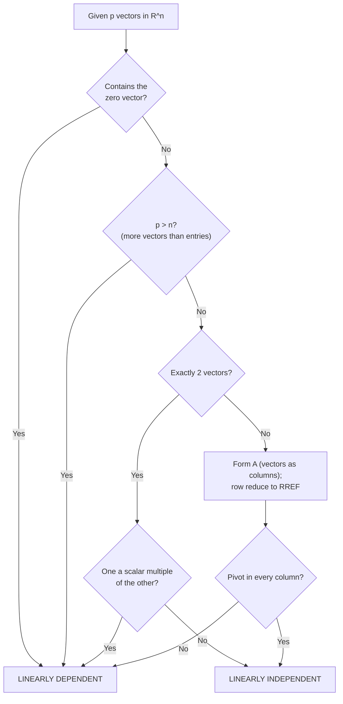

# How-To: Determining Linear (In)dependence of a Set of Vectors

| Plain Text | LaTeX Format | Description |
|---|---|---|
| Test equation | `$x_1\mathbf{v}_1 + \dots + x_p\mathbf{v}_p = \mathbf{0}$` | The linear combination set equal to the zero vector |
| Trivial solution | `$\mathbf{x} = \mathbf{0}$` (all $x_i = 0$) | Always exists; independence ⇔ it is the *only* solution |
| Nontrivial solution | at least one $x_j \neq 0$ | Existence ⇒ the set is linearly dependent |
| Linear dependence relation | `$c_1\mathbf{v}_1 + \dots + c_p\mathbf{v}_p = \mathbf{0}$` with some $c_j \neq 0$ | A "certificate" proving dependence |
| Homogeneous system | `$A\mathbf{x} = \mathbf{0}$` | The matrix form of the test equation |
| Pivot | leading $1$ in the RREF of $A$ | Pivot in every column ⇔ independent |
| Free variable | a weight whose column has no pivot | Its existence ⇒ dependent |
| Vectors in $\mathbb{R}^n$ | `$\mathbb{R}^n$` | The space of all $n$-tuples of real numbers |
| Determinant | `$\det(A)$` | For square $A$: $0$ ⇒ dependent, $\neq 0$ ⇒ independent |

_Table 1.1: Quick reference of the notation used in this guide._

> [!info] **Goal**
> Given a set of $p$ vectors in $\mathbb{R}^n$, **determine whether the set is linearly independent or linearly dependent** — and, if it is dependent, **find a linear dependence relation** that proves it. The general recipe is in [[#General Form]]; worked demonstrations are in [[#Worked Examples]].

---

## General Form

> [!info] **Definition: Linear Independence and Linear Dependence**
> An indexed set of vectors $S = \{\mathbf{v}_1, \dots, \mathbf{v}_p\}$ in $\mathbb{R}^n$ is ***linearly independent*** if the vector equation
> $$x_1\mathbf{v}_1 + x_2\mathbf{v}_2 + \dots + x_p\mathbf{v}_p = \mathbf{0}$$
> has **only the trivial solution** $x_1 = x_2 = \dots = x_p = 0$.
>
> The set is ***linearly dependent*** if there exist weights $c_1, \dots, c_p$, **not all zero**, such that
> $$c_1\mathbf{v}_1 + c_2\mathbf{v}_2 + \dots + c_p\mathbf{v}_p = \mathbf{0}$$
> Such an equation is called a ***linear dependence relation***. Equivalently (for $p \geq 2$): a set is dependent if and only if **at least one** vector in it is a linear combination of the others.

### The general procedure

1. **Step 1 — Write the test equation.** Set up $x_1\mathbf{v}_1 + \dots + x_p\mathbf{v}_p = \mathbf{0}$ with unknown weights $x_1, \dots, x_p$. Note that $\mathbf{x} = \mathbf{0}$ is *always* a solution (the trivial one) — the whole question is whether any **other** solution exists.
2. **Step 2 — Run the inspection shortcuts first.** If any of these fire, you are done — no row reduction needed:
   - **Zero-vector test:** if $\mathbf{0} \in S$ → **dependent**. (Relation: weight $1$ on $\mathbf{0}$, weight $0$ on everything else.)
   - **Count test:** if $p > n$ (more vectors than entries per vector) → **dependent**. There are more unknowns than equations, so a free variable must exist.
   - **Two-vector test:** if $p = 2$, the set is dependent **if and only if** one vector is a scalar multiple of the other.
   - **Single vector:** $\{\mathbf{v}\}$ is independent **if and only if** $\mathbf{v} \neq \mathbf{0}$.
3. **Step 3 — Build the matrix.** Form the $n \times p$ matrix whose **columns** are the vectors,
   $$A = \begin{bmatrix} \mathbf{v}_1 & \mathbf{v}_2 & \dots & \mathbf{v}_p \end{bmatrix},$$
   and rewrite the test equation as the homogeneous system $A\mathbf{x} = \mathbf{0}$, where $\mathbf{x} = \begin{bmatrix} x_1 \\ \vdots \\ x_p \end{bmatrix}$.
4. **Step 4 — Row reduce.** Bring the augmented matrix $\begin{bmatrix} A & \mathbf{0} \end{bmatrix}$ to **reduced row echelon form** (RREF) using the three row operations (swap two rows, scale a row, replace a row by itself plus a multiple of another). Row operations never change the solution set of the system.
5. **Step 5 — Count pivots.**
   - **Pivot in every column** → the only solution is the trivial one → **linearly independent**.
   - **Some column has no pivot** → that column's variable is a *free variable* → nontrivial solutions exist → **linearly dependent**.
6. **Step 6 — Extract the dependence relation (if dependent).** Set one free variable to $1$ (the other free variables to $0$), solve the basic variables from the RREF rows, and read off the relation $x_1\mathbf{v}_1 + \dots + x_p\mathbf{v}_p = \mathbf{0}$. Then **verify it by direct computation**.
7. **Step 7 — (Square matrices only, optional) Determinant cross-check.** If $p = n$ so that $A$ is square: $\det(A) \neq 0$ ⇒ independent; $\det(A) = 0$ ⇒ dependent.

> [!tip] **Why do the vectors go in the columns?**
> Matrix–vector multiplication *is* a linear combination of the columns:
> $$A\mathbf{x} = x_1\mathbf{a}_1 + x_2\mathbf{a}_2 + \dots + x_p\mathbf{a}_p$$
> So placing the vectors in the columns makes $A\mathbf{x} = \mathbf{0}$ literally the same equation as the test equation. (Placing them in the rows would answer a different question.)

> [!example]
> - **Equation:** $x_1\mathbf{v}_1 + x_2\mathbf{v}_2 + \dots + x_p\mathbf{v}_p = \mathbf{0}$, equivalently $A\mathbf{x} = \mathbf{0}$ with $A = \begin{bmatrix} \mathbf{v}_1 & \mathbf{v}_2 & \dots & \mathbf{v}_p \end{bmatrix}$
> - **Breakdown:**
>     - **$\mathbf{v}_1, \dots, \mathbf{v}_p$** : The $p$ vectors under test. Each is an $n$-tuple of real numbers (an element of $\mathbb{R}^n$).
>     - **$x_1, \dots, x_p$** : The unknown scalar *weights*. The entire question is whether they are forced to all be zero.
>     - **$\mathbf{0}$** : The zero vector in $\mathbb{R}^n$ — the target of the combination. Reaching it with nonzero weights means the vectors "collapse" onto each other, which is exactly what dependence means.
>     - **$A$** : The $n \times p$ matrix whose columns are the vectors. Its shape alone can decide the question ($p > n$ ⇒ dependent).
>     - **$\mathbf{x}$** : The column vector of weights, $\mathbf{x} = \begin{bmatrix} x_1 \\ \vdots \\ x_p \end{bmatrix}$.
>     - **pivot** : A leading $1$ in the RREF of $A$. A pivot in every column forces $\mathbf{x} = \mathbf{0}$.
>     - **free variable** : A weight whose column contains no pivot. It can be chosen freely; any free variable ⇒ dependence.
>     - **$\det(A)$** : The determinant of $A$ (only when $A$ is square, $p = n$). $\det(A) = 0$ ⇔ the columns are dependent.

> [!warning] **Common pitfalls**
> - A homogeneous system $A\mathbf{x} = \mathbf{0}$ **always** has the trivial solution — never conclude "independent" merely because a solution exists.
> - Dependence is a property of the **set**: reordering the vectors changes nothing.
> - In a dependent set, it is **not** necessarily true that *every* vector is a combination of the others — **at least one** is.
> - $p \leq n$ does **not** imply independence — you still have to row reduce.

### Decision flow

_Figure 1.1: Decision flow for determining whether a set of vectors is linearly independent or linearly dependent._

---

## Worked Examples

> [!example] Example 1: Three vectors in $\mathbb{R}^3$ — dependent, with a dependence relation
> **Determine whether** $\mathbf{v}_1 = \begin{bmatrix} 1 \\ 2 \\ 3 \end{bmatrix}$, $\mathbf{v}_2 = \begin{bmatrix} 4 \\ 5 \\ 6 \end{bmatrix}$, $\mathbf{v}_3 = \begin{bmatrix} 2 \\ 1 \\ 0 \end{bmatrix}$ **are linearly independent. If dependent, find a linear dependence relation.**
>
> **Step 1 — Write the test equation.**
> $$x_1 \begin{bmatrix} 1 \\ 2 \\ 3 \end{bmatrix} + x_2 \begin{bmatrix} 4 \\ 5 \\ 6 \end{bmatrix} + x_3 \begin{bmatrix} 2 \\ 1 \\ 0 \end{bmatrix} = \begin{bmatrix} 0 \\ 0 \\ 0 \end{bmatrix}$$
>
> **Step 2 — Inspection shortcuts.** The set contains no zero vector. Here $p = 3$ and $n = 3$, so the count test ($p > n$) does not fire. With three vectors, the scalar-multiple test does not apply. → Proceed to row reduction.
>
> **Step 3 — Build the matrix.** The vectors go in the columns of $A$ (an $n \times p = 3 \times 3$ matrix); the augmented matrix for $A\mathbf{x} = \mathbf{0}$ is
> $$\left[\begin{array}{ccc|c} 1 & 4 & 2 & 0 \\ 2 & 5 & 1 & 0 \\ 3 & 6 & 0 & 0 \end{array}\right]$$
>
> **Step 4 — Row reduce to RREF.** Every operation is shown with its arithmetic.
>
> $R_2 \to R_2 - 2R_1$: the new row 2 is $(2 - 2\cdot1,\; 5 - 2\cdot4,\; 1 - 2\cdot2,\; 0) = (0, -3, -3, 0)$:
> $$\left[\begin{array}{ccc|c} 1 & 4 & 2 & 0 \\ 0 & -3 & -3 & 0 \\ 3 & 6 & 0 & 0 \end{array}\right]$$
>
> $R_3 \to R_3 - 3R_1$: the new row 3 is $(3 - 3\cdot1,\; 6 - 3\cdot4,\; 0 - 3\cdot2,\; 0) = (0, -6, -6, 0)$:
> $$\left[\begin{array}{ccc|c} 1 & 4 & 2 & 0 \\ 0 & -3 & -3 & 0 \\ 0 & -6 & -6 & 0 \end{array}\right]$$
>
> $R_3 \to R_3 - 2R_2$: the new row 3 is $(0 - 2\cdot0,\; -6 - 2\cdot(-3),\; -6 - 2\cdot(-3),\; 0) = (0, 0, 0, 0)$:
> $$\left[\begin{array}{ccc|c} 1 & 4 & 2 & 0 \\ 0 & -3 & -3 & 0 \\ 0 & 0 & 0 & 0 \end{array}\right]$$
> (This is echelon form: leading entries move right, zero row at the bottom.)
>
> $R_2 \to -\tfrac{1}{3}R_2$: the new row 2 is $(0, 1, 1, 0)$:
> $$\left[\begin{array}{ccc|c} 1 & 4 & 2 & 0 \\ 0 & 1 & 1 & 0 \\ 0 & 0 & 0 & 0 \end{array}\right]$$
>
> $R_1 \to R_1 - 4R_2$: the new row 1 is $(1,\; 4 - 4\cdot1,\; 2 - 4\cdot1,\; 0) = (1, 0, -2, 0)$:
> $$\left[\begin{array}{ccc|c} 1 & 0 & -2 & 0 \\ 0 & 1 & 1 & 0 \\ 0 & 0 & 0 & 0 \end{array}\right]$$
> This is the **RREF**: each leading $1$ is the only nonzero entry in its column.
>
> **Step 5 — Count pivots.**
> - Column 1: pivot ✓ (row 1)
> - Column 2: pivot ✓ (row 2)
> - Column 3: **no pivot** ✗ → $x_3$ is a **free variable**.
>
> A free variable exists → nontrivial solutions exist → **the set is linearly dependent.**
>
> **Step 6 — Extract the dependence relation.** The RREF encodes the system row by row:
> $$x_1 - 2x_3 = 0 \quad\Rightarrow\quad x_1 = 2x_3$$
> $$x_2 + x_3 = 0 \quad\Rightarrow\quad x_2 = -x_3$$
> with $x_3$ free. So the general solution is
> $$\mathbf{x} = \begin{bmatrix} x_1 \\ x_2 \\ x_3 \end{bmatrix} = x_3 \begin{bmatrix} 2 \\ -1 \\ 1 \end{bmatrix}$$
> Choose $x_3 = 1$ (any nonzero value works):
> $$x_1 = 2, \qquad x_2 = -1, \qquad x_3 = 1$$
> giving the dependence relation $2\mathbf{v}_1 - \mathbf{v}_2 + \mathbf{v}_3 = \mathbf{0}$.
>
> **Verify by direct computation:**
> $$2\begin{bmatrix} 1 \\ 2 \\ 3 \end{bmatrix} - 1\begin{bmatrix} 4 \\ 5 \\ 6 \end{bmatrix} + 1\begin{bmatrix} 2 \\ 1 \\ 0 \end{bmatrix} = \begin{bmatrix} 2 \\ 4 \\ 6 \end{bmatrix} + \begin{bmatrix} -4 \\ -5 \\ -6 \end{bmatrix} + \begin{bmatrix} 2 \\ 1 \\ 0 \end{bmatrix} = \begin{bmatrix} 2 - 4 + 2 \\ 4 - 5 + 1 \\ 6 - 6 + 0 \end{bmatrix} = \begin{bmatrix} 0 \\ 0 \\ 0 \end{bmatrix} \checkmark$$
>
> Rearranging, $\mathbf{v}_3 = -2\mathbf{v}_1 + \mathbf{v}_2 = \mathbf{v}_2 - 2\mathbf{v}_1$ — the third vector is a linear combination of the first two. Check: $\begin{bmatrix} 4 \\ 5 \\ 6 \end{bmatrix} - 2\begin{bmatrix} 1 \\ 2 \\ 3 \end{bmatrix} = \begin{bmatrix} 4 - 2 \\ 5 - 4 \\ 6 - 6 \end{bmatrix} = \begin{bmatrix} 2 \\ 1 \\ 0 \end{bmatrix}$ ✓
>
> *(Any nonzero multiple of the relation is equally valid — e.g. choosing $x_3 = 5$ gives $10\mathbf{v}_1 - 5\mathbf{v}_2 + 5\mathbf{v}_3 = \mathbf{0}$.)*

> [!example]- Example 2: Three vectors in $\mathbb{R}^3$ — independent
> **Determine whether the columns of** $A = \begin{bmatrix} 0 & 1 & 4 \\ 1 & 2 & -1 \\ 5 & 8 & 0 \end{bmatrix}$ **are linearly independent.** (Equivalently: test $\mathbf{a}_1 = \begin{bmatrix} 0 \\ 1 \\ 5 \end{bmatrix}$, $\mathbf{a}_2 = \begin{bmatrix} 1 \\ 2 \\ 8 \end{bmatrix}$, $\mathbf{a}_3 = \begin{bmatrix} 4 \\ -1 \\ 0 \end{bmatrix}$.)
>
> **Step 2 — Inspection shortcuts.** No zero vector; $p = 3 = n$ so the count test does not fire; not a two-vector set. → Row reduce.
>
> **Steps 3–4 — Matrix and row reduction.**
> $$\left[\begin{array}{ccc|c} 0 & 1 & 4 & 0 \\ 1 & 2 & -1 & 0 \\ 5 & 8 & 0 & 0 \end{array}\right]$$
>
> $R_1 \leftrightarrow R_2$ (get a nonzero leading entry in row 1):
> $$\left[\begin{array}{ccc|c} 1 & 2 & -1 & 0 \\ 0 & 1 & 4 & 0 \\ 5 & 8 & 0 & 0 \end{array}\right]$$
>
> $R_3 \to R_3 - 5R_1$: the new row 3 is $(5 - 5\cdot1,\; 8 - 5\cdot2,\; 0 - 5\cdot(-1),\; 0) = (0, -2, 5, 0)$:
> $$\left[\begin{array}{ccc|c} 1 & 2 & -1 & 0 \\ 0 & 1 & 4 & 0 \\ 0 & -2 & 5 & 0 \end{array}\right]$$
>
> $R_3 \to R_3 + 2R_2$: the new row 3 is $(0,\; -2 + 2\cdot1,\; 5 + 2\cdot4,\; 0) = (0, 0, 13, 0)$:
> $$\left[\begin{array}{ccc|c} 1 & 2 & -1 & 0 \\ 0 & 1 & 4 & 0 \\ 0 & 0 & 13 & 0 \end{array}\right]$$
>
> $R_3 \to \tfrac{1}{13}R_3$: the new row 3 is $(0, 0, 1, 0)$:
> $$\left[\begin{array}{ccc|c} 1 & 2 & -1 & 0 \\ 0 & 1 & 4 & 0 \\ 0 & 0 & 1 & 0 \end{array}\right]$$
>
> $R_2 \to R_2 - 4R_3$: the new row 2 is $(0,\; 1,\; 4 - 4\cdot1,\; 0) = (0, 1, 0, 0)$:
> $$\left[\begin{array}{ccc|c} 1 & 2 & -1 & 0 \\ 0 & 1 & 0 & 0 \\ 0 & 0 & 1 & 0 \end{array}\right]$$
>
> $R_1 \to R_1 + R_3$: the new row 1 is $(1,\; 2,\; -1 + 1,\; 0) = (1, 2, 0, 0)$:
> $$\left[\begin{array}{ccc|c} 1 & 2 & 0 & 0 \\ 0 & 1 & 0 & 0 \\ 0 & 0 & 1 & 0 \end{array}\right]$$
>
> $R_1 \to R_1 - 2R_2$: the new row 1 is $(1,\; 2 - 2\cdot1,\; 0,\; 0) = (1, 0, 0, 0)$:
> $$\left[\begin{array}{ccc|c} 1 & 0 & 0 & 0 \\ 0 & 1 & 0 & 0 \\ 0 & 0 & 1 & 0 \end{array}\right] = \begin{bmatrix} I_3 & \mathbf{0} \end{bmatrix}$$
>
> **Step 5 — Count pivots.** Columns 1, 2, and 3 **all have pivots** → no free variables → the only solution of $A\mathbf{x} = \mathbf{0}$ is $\mathbf{x} = \mathbf{0}$ → the columns are **linearly independent.**
>
> **Step 7 — Determinant cross-check (square matrix).** Expanding along the first row:
> $$\det(A) = 0 \cdot \det\begin{bmatrix} 2 & -1 \\ 8 & 0 \end{bmatrix} - 1 \cdot \det\begin{bmatrix} 1 & -1 \\ 5 & 0 \end{bmatrix} + 4 \cdot \det\begin{bmatrix} 1 & 2 \\ 5 & 8 \end{bmatrix}$$
> $$= 0 - 1 \cdot \big(1\cdot0 - (-1)\cdot5\big) + 4 \cdot \big(1\cdot8 - 2\cdot5\big)$$
> $$= -1 \cdot (0 + 5) + 4 \cdot (8 - 10) = -5 + 4 \cdot (-2) = -5 - 8 = -13 \neq 0$$
> $\det(A) = -13 \neq 0$ → **linearly independent** ✓ (agrees with the pivot count).

> [!example]- Example 3: Deciding by inspection — the special criteria
> **For each set, decide (in)dependence without row reduction:**
>
> **a.** $S = \left\{ \begin{bmatrix} 1 \\ 7 \\ 6 \end{bmatrix}, \begin{bmatrix} 2 \\ 0 \\ 9 \end{bmatrix}, \begin{bmatrix} 3 \\ 1 \\ 5 \end{bmatrix}, \begin{bmatrix} 4 \\ 1 \\ 8 \end{bmatrix} \right\}$ in $\mathbb{R}^3$
>
> **Count test:** $p = 4$ vectors, $n = 3$ entries each. Since $p = 4 > n = 3$ → **linearly dependent**, immediately. (There are more unknowns than equations, so a free variable must exist.)
>
> **b.** $S = \left\{ \begin{bmatrix} 2 \\ 3 \\ 5 \end{bmatrix}, \begin{bmatrix} 0 \\ 0 \\ 0 \end{bmatrix}, \begin{bmatrix} 1 \\ 1 \\ 8 \end{bmatrix} \right\}$ in $\mathbb{R}^3$
>
> **Zero-vector test:** the set contains $\mathbf{0}$ → **linearly dependent**. A dependence relation is immediate:
> $$0 \cdot \mathbf{v}_1 + 1 \cdot \mathbf{0} + 0 \cdot \mathbf{v}_3 = \mathbf{0}$$
> (weight $1$ on the zero vector, $0$ elsewhere — not all weights are zero.)
>
> **c.** $S = \left\{ \begin{bmatrix} 2 \\ 4 \\ 6 \\ 10 \end{bmatrix}, \begin{bmatrix} 3 \\ 6 \\ 9 \\ 15 \end{bmatrix} \right\}$ in $\mathbb{R}^4$
>
> **Scalar-multiple test:** check whether $\mathbf{v}_2 = c\,\mathbf{v}_1$:
> $$\frac{3}{2}\begin{bmatrix} 2 \\ 4 \\ 6 \\ 10 \end{bmatrix} = \begin{bmatrix} 3 \\ 6 \\ 9 \\ 15 \end{bmatrix} \checkmark$$
> So $\mathbf{v}_2 = \tfrac{3}{2}\mathbf{v}_1$ → **linearly dependent**. A dependence relation (clearing the fraction by using weights $-3$ and $2$):
> $$-3\mathbf{v}_1 + 2\mathbf{v}_2 = \mathbf{0}$$
> **Verify:** $-3\begin{bmatrix} 2 \\ 4 \\ 6 \\ 10 \end{bmatrix} + 2\begin{bmatrix} 3 \\ 6 \\ 9 \\ 15 \end{bmatrix} = \begin{bmatrix} -6 + 6 \\ -12 + 12 \\ -18 + 18 \\ -30 + 30 \end{bmatrix} = \begin{bmatrix} 0 \\ 0 \\ 0 \\ 0 \end{bmatrix}$ ✓
>
> **d.** Single vector: $\{\mathbf{v}\}$ with $\mathbf{v} = \begin{bmatrix} 5 \\ -2 \end{bmatrix}$ is **linearly independent** (since $\mathbf{v} \neq \mathbf{0}$), while $\{\mathbf{0}\}$ is always **dependent** because $x_1\mathbf{0} = \mathbf{0}$ holds for *any* $x_1$.

> [!example]- Example 4: Two vectors in $\mathbb{R}^2$ — the scalar-multiple test entry by entry
> **a.** $\mathbf{v}_1 = \begin{bmatrix} 3 \\ 1 \end{bmatrix}$, $\mathbf{v}_2 = \begin{bmatrix} 6 \\ 2 \end{bmatrix}$
>
> Check whether $\mathbf{v}_2 = c\,\mathbf{v}_1$ for some scalar $c$. Entry by entry:
> $$6 = c \cdot 3 \Rightarrow c = 2, \qquad 2 = c \cdot 1 \Rightarrow c = 2$$
> Both entries agree on $c = 2$, and indeed $2\begin{bmatrix} 3 \\ 1 \end{bmatrix} = \begin{bmatrix} 6 \\ 2 \end{bmatrix}$ → **linearly dependent**. The relation $-2\mathbf{v}_1 + \mathbf{v}_2 = \mathbf{0}$ verifies directly:
> $$-2\begin{bmatrix} 3 \\ 1 \end{bmatrix} + \begin{bmatrix} 6 \\ 2 \end{bmatrix} = \begin{bmatrix} -6 + 6 \\ -2 + 2 \end{bmatrix} = \begin{bmatrix} 0 \\ 0 \end{bmatrix} \checkmark$$
>
> **b.** $\mathbf{v}_1 = \begin{bmatrix} 3 \\ 2 \end{bmatrix}$, $\mathbf{v}_2 = \begin{bmatrix} 6 \\ 2 \end{bmatrix}$
>
> Suppose $\mathbf{v}_1 = c\,\mathbf{v}_2$. Entry by entry:
> $$3 = c \cdot 6 \Rightarrow c = \tfrac{1}{2}, \qquad 2 = c \cdot 2 \Rightarrow c = 1$$
> The two entries demand different values ($\tfrac{1}{2} \neq 1$) → no scalar $c$ exists → **linearly independent**.
>
> **c. Determinant cross-check (square $2 \times 2$ matrices).** With the vectors as columns:
> $$A_{\text{a}} = \begin{bmatrix} 3 & 6 \\ 1 & 2 \end{bmatrix} \Rightarrow \det(A_{\text{a}}) = 3 \cdot 2 - 6 \cdot 1 = 6 - 6 = 0 \Rightarrow \textbf{dependent} \checkmark$$
> $$A_{\text{b}} = \begin{bmatrix} 3 & 6 \\ 2 & 2 \end{bmatrix} \Rightarrow \det(A_{\text{b}}) = 3 \cdot 2 - 6 \cdot 2 = 6 - 12 = -6 \neq 0 \Rightarrow \textbf{independent} \checkmark$$
> The determinant test agrees with the scalar-multiple test in both cases.

> [!question] Self-Check
> Determine whether $\left\{ \begin{bmatrix} 1 \\ 0 \\ 1 \end{bmatrix}, \begin{bmatrix} 0 \\ 1 \\ 1 \end{bmatrix}, \begin{bmatrix} 1 \\ 1 \\ 0 \end{bmatrix} \right\}$ in $\mathbb{R}^3$ is linearly independent. (Try it yourself first — the fully expanded solution is folded below.)

> [!example]- Self-Check: fully expanded solution
> **Step 2 — Shortcuts.** No zero vector; $p = 3 = n$; not a two-vector set → row reduce.
>
> **Steps 3–4 — Row reduce.**
> $$\left[\begin{array}{ccc|c} 1 & 0 & 1 & 0 \\ 0 & 1 & 1 & 0 \\ 1 & 1 & 0 & 0 \end{array}\right]$$
> $R_3 \to R_3 - R_1$: the new row 3 is $(1 - 1,\; 1 - 0,\; 0 - 1,\; 0) = (0, 1, -1, 0)$:
> $$\left[\begin{array}{ccc|c} 1 & 0 & 1 & 0 \\ 0 & 1 & 1 & 0 \\ 0 & 1 & -1 & 0 \end{array}\right]$$
> $R_3 \to R_3 - R_2$: the new row 3 is $(0,\; 1 - 1,\; -1 - 1,\; 0) = (0, 0, -2, 0)$:
> $$\left[\begin{array}{ccc|c} 1 & 0 & 1 & 0 \\ 0 & 1 & 1 & 0 \\ 0 & 0 & -2 & 0 \end{array}\right]$$
> $R_3 \to -\tfrac{1}{2}R_3$: the new row 3 is $(0, 0, 1, 0)$:
> $$\left[\begin{array}{ccc|c} 1 & 0 & 1 & 0 \\ 0 & 1 & 1 & 0 \\ 0 & 0 & 1 & 0 \end{array}\right]$$
> $R_1 \to R_1 - R_3$: the new row 1 is $(1,\; 0,\; 1 - 1,\; 0) = (1, 0, 0, 0)$; and $R_2 \to R_2 - R_3$: the new row 2 is $(0,\; 1,\; 1 - 1,\; 0) = (0, 1, 0, 0)$:
> $$\left[\begin{array}{ccc|c} 1 & 0 & 0 & 0 \\ 0 & 1 & 0 & 0 \\ 0 & 0 & 1 & 0 \end{array}\right] = \begin{bmatrix} I_3 & \mathbf{0} \end{bmatrix}$$
>
> **Step 5 — Count pivots.** All three columns have pivots → the only solution is $\mathbf{x} = \mathbf{0}$ → **linearly independent.**
>
> **Cross-check:** $\det\begin{bmatrix} 1 & 0 & 1 \\ 0 & 1 & 1 \\ 1 & 1 & 0 \end{bmatrix} = 1\cdot(1\cdot0 - 1\cdot1) - 0 + 1\cdot(0\cdot1 - 1\cdot1) = 1\cdot(-1) + 1\cdot(-1) = -1 - 1 = -2 \neq 0$ → **independent** ✓

---

> [!summary]
> - **The test:** $x_1\mathbf{v}_1 + \dots + x_p\mathbf{v}_p = \mathbf{0}$. Only the trivial solution ⇒ **linearly independent**; any nontrivial solution ⇒ **linearly dependent**.
> - **Shortcuts first:** zero vector in the set, $p > n$ (more vectors than entries), or — for two vectors — one being a scalar multiple of the other ⇒ immediately **dependent**. A single vector is independent iff it is nonzero.
> - **Otherwise:** put the vectors in the **columns** of $A$, row reduce $\begin{bmatrix} A & \mathbf{0} \end{bmatrix}$ to RREF, and count pivots — a pivot in every column ⇒ **independent**; a free variable ⇒ **dependent**, and the free variable hands you the dependence relation (set it to $1$, solve the rest, verify by direct computation).
> - **Square matrix:** $\det(A) = 0$ ⇔ dependent; $\det(A) \neq 0$ ⇔ independent.
> - Dependence means **at least one** vector is a linear combination of the others — geometrically, the vectors fail to point in "genuinely different directions." (This same pivot-in-every-column test is later reused to decide whether a linear transformation is one-to-one.)
