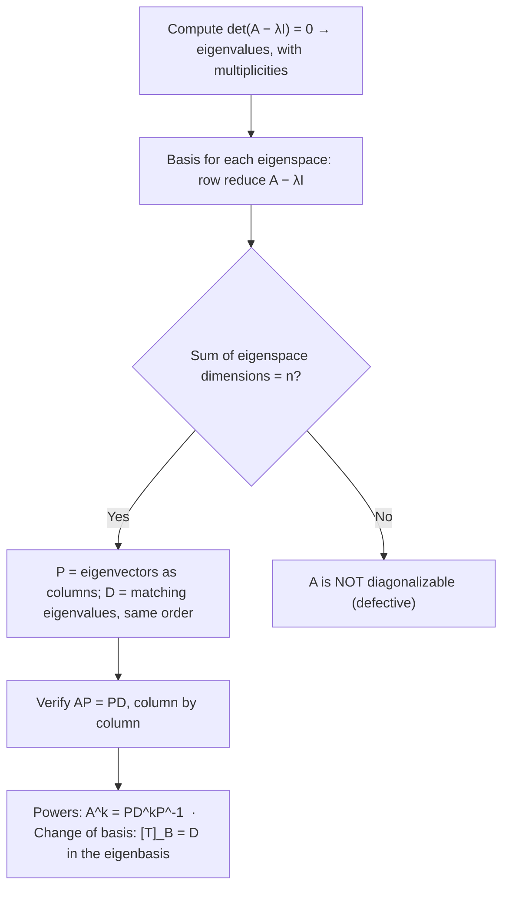

# How-To: Diagonalizing a Matrix (and Changing Basis)

| Plain Text | LaTeX Format | Description |
|---|---|---|
| Diagonalization | `$A = PDP^{-1}$` | Factorization with $D$ diagonal and $P$ invertible |
| Eigenvector matrix $P$ | `$P = [\mathbf{v}_1 \ \cdots \ \mathbf{v}_n]$` | Columns are $n$ linearly independent eigenvectors of $A$ |
| Diagonal matrix $D$ | `$D = \operatorname{diag}(\lambda_1, \dots, \lambda_n)$` | Eigenvalues on the diagonal, in the **same order** as $P$'s columns |
| Verification identity | `$AP = PD$` | Column $j$ reads $A\mathbf{v}_j = \lambda_j \mathbf{v}_j$ |
| Powers | `$A^k = PD^kP^{-1}$` | With $D^k = \operatorname{diag}(\lambda_1^k, \dots, \lambda_n^k)$ |
| Eigenvector basis | — | A basis of $\mathbb{R}^n$ consisting entirely of eigenvectors |
| Algebraic multiplicity | — | Multiplicity of $\lambda$ as a root of the characteristic polynomial |
| Geometric multiplicity | — | $\dim \operatorname{Nul}(A - \lambda I)$ = number of free variables in $(A - \lambda I)\mathbf{x} = \mathbf{0}$ |
| Matrix representation | `$[T]_\mathcal{B}$` | Matrix of $T$ relative to basis $\mathcal{B}$; column $j$ is $[T(\mathbf{b}_j)]_\mathcal{B}$ |
| Change-of-coordinates matrix | `$P_\mathcal{B} = [\mathbf{b}_1 \ \cdots \ \mathbf{b}_n]$` | Satisfies $P_\mathcal{B}[\mathbf{x}]_\mathcal{B} = \mathbf{x}$ |
| Similarity | `$C = P^{-1}AP$` | The same transformation expressed in another basis |
| Jordan block | `$\begin{bmatrix} \lambda & 1 \\ & \lambda \end{bmatrix}$` | Nearly-diagonal fallback when diagonalization fails |

_Table 1.1: Quick reference of the notation used in this guide._

> [!info] **Goal**
> Given a square matrix $A$: **decide whether it is diagonalizable**, **construct and verify** the factorization $A = PDP^{-1}$, **compute powers** $A^k$, and **interpret diagonalization as a change of basis** ($[T]_\mathcal{B} = D$). The general recipe is in [[#General Form]]; worked demonstrations are in [[#Worked Examples]].

---

## General Form

> [!info] **Definition: Diagonalizable Matrix**
> A square matrix $A$ is **diagonalizable** if it is *similar* to a diagonal matrix — that is, if there exists an **invertible** matrix $P$ and a **diagonal** matrix $D$ such that
> $$A = PDP^{-1}$$
> Nothing here requires $A$ to be invertible, symmetric, or triangular — and $D$ is allowed to contain zeros (a diagonalizable matrix may be singular).

> [!summary] **Theorem: The Diagonalization Theorem**
> An $n \times n$ matrix $A$ is diagonalizable **if and only if** $A$ has $n$ linearly independent eigenvectors. In fact, $A = PDP^{-1}$ with $D$ diagonal **if and only if** the columns of $P$ are $n$ linearly independent eigenvectors of $A$ — in which case the diagonal entries of $D$ are the corresponding eigenvalues, **in the same order**. Equivalently: $A$ is diagonalizable ⇔ its eigenvectors form a basis of $\mathbb{R}^n$ (an *eigenvector basis*).
>
> **Breakdown:**
> - $A = PDP^{-1}$ : The factorization — $A$ rewritten as "translate to eigenvector coordinates, scale, translate back."
> - $P = [\mathbf{v}_1 \ \cdots \ \mathbf{v}_n]$ : The *eigenvector matrix* ("dictionary"): columns are linearly independent eigenvectors, written in standard coordinates.
> - $D = \operatorname{diag}(\lambda_1, \dots, \lambda_n)$ : Records how much each eigen-direction is stretched.
> - $P^{-1}$ : The translator back into standard coordinates; it exists precisely because the columns of $P$ are independent (IMT).

### The general procedures

**Procedure 1 — The four-step diagonalization algorithm.**
1. **Find the eigenvalues:** solve the characteristic equation $\det(A - \lambda I) = 0$. (Shortcuts: triangular matrix → read the diagonal; $2 \times 2$ → use $\lambda^2 - (\operatorname{tr} A)\lambda + \det A = 0$.)
2. **Find a basis for each eigenspace:** for each distinct eigenvalue $\lambda$, row reduce $A - \lambda I$; one basis vector per free variable. The number of free variables is $\dim \operatorname{Nul}(A - \lambda I)$ = the **geometric multiplicity** of $\lambda$.
3. **Decide and assemble:** if the eigenspace dimensions sum to $n$, $A$ is diagonalizable — set the eigenvectors as the columns of $P$ and place the **matching** eigenvalues on the diagonal of $D$ (same order!). If the sum is less than $n$, $A$ is **not diagonalizable** — stop.
4. **Verify:** check $AP = PD$ (column by column: $A\mathbf{v}_j = \lambda_j \mathbf{v}_j$). This one multiplication confirms the eigenvalues, the pairing, the ordering, and the independence all at once.

**Procedure 2 — The multiplicity test (repeated eigenvalues).**
For each eigenvalue $\lambda$: $\lambda$ is "healthy" when its **geometric multiplicity** (eigenspace dimension) **equals** its **algebraic multiplicity** (root multiplicity in the characteristic polynomial).
- If this holds for **every** eigenvalue ⇔ the eigenspace dimensions sum to $n$ ⇔ $A$ is diagonalizable.
- If $A$ has $n$ **distinct** eigenvalues, each eigenspace is automatically 1-dimensional and the multiplicities match trivially → **diagonalizable, no extra work**.
- If some eigenspace is smaller than its multiplicity, the total falls short of $n$ → **not diagonalizable** (the matrix is *defective*; Jordan form is the fallback).

**Procedure 3 — Verification (never compute an inverse to check).**
Compute $AP$ and $PD$ and compare. If $AP = PD$ and $P$ is invertible (check $\det P \neq 0$, or just note the columns are independent), then $A = PDP^{-1}$ follows by right-multiplying by $P^{-1}$. This catches a wrong eigenvalue, a mismatched column order, and dependent eigenvectors in one stroke.

**Procedure 4 — Powers of a diagonalizable matrix.**
$$A^k = (PDP^{-1})^k = PD^kP^{-1}, \qquad D^k = \operatorname{diag}(\lambda_1^k, \dots, \lambda_n^k)$$
The middle factors cancel in pairs: $P^{-1}P = I$. Raising a diagonal matrix to a power just raises each diagonal entry — so one diagonalization gives every power of $A$ cheaply. (Sanity check: the formula at $k = 1$ must return $A$.)

**Procedure 5 — Change of basis (what diagonalization really is).**
For an ordered basis $\mathcal{B} = \{\mathbf{b}_1, \dots, \mathbf{b}_n\}$ of $\mathbb{R}^n$:
1. Form the **change-of-coordinates matrix** $P_\mathcal{B} = [\mathbf{b}_1 \ \cdots \ \mathbf{b}_n]$.
2. Convert coordinates: $P_\mathcal{B}[\mathbf{x}]_\mathcal{B} = \mathbf{x}$, i.e. $[\mathbf{x}]_\mathcal{B} = P_\mathcal{B}^{-1}\mathbf{x}$.
3. The matrix of the transformation $T(\mathbf{x}) = A\mathbf{x}$ **relative to $\mathcal{B}$** is
   $$[T]_\mathcal{B} = P_\mathcal{B}^{-1} A P_\mathcal{B}$$
   (its $j$-th column is $[A\mathbf{b}_j]_\mathcal{B}$).
4. **Diagonalization is the special case** where $\mathcal{B}$ is an *eigenvector basis*: then $A\mathbf{b}_j = \lambda_j \mathbf{b}_j$, so $[A\mathbf{b}_j]_\mathcal{B} = \lambda_j \mathbf{e}_j$ and $[T]_\mathcal{B} = D$. "Diagonalize $A$" and "find coordinates in which $T$ is diagonal" are the same task.
5. **Similarity:** $C = P^{-1}AP$ means $C$ represents the *same* transformation in another basis. Similar matrices share eigenvalues, determinant, trace, rank, invertibility, and the characteristic polynomial. When diagonalization is impossible, the best fallback is **Jordan form** — a nearly diagonal matrix whose superdiagonal 1s record the missing eigenvectors.

> [!example]
> - **Equations:** $A = PDP^{-1}$, $AP = PD$, $A^k = PD^kP^{-1}$, $[T]_\mathcal{B} = P_\mathcal{B}^{-1} A P_\mathcal{B}$
> - **Breakdown:**
>     - **$A$** : The $n \times n$ matrix being diagonalized.
>     - **$P$** : The *eigenvector matrix* — its columns are $n$ linearly independent eigenvectors of $A$, written in standard coordinates.
>     - **$D$** : $\operatorname{diag}(\lambda_1, \dots, \lambda_n)$ — the eigenvalues, **in exactly the order of the matching columns of $P$**.
>     - **$P^{-1}$** : The translator back to standard coordinates; exists because the columns of $P$ are independent (IMT).
>     - **$AP = PD$** : The verification identity. Column $j$ says $A\mathbf{v}_j = \lambda_j \mathbf{v}_j$ — each column of $P$ is an eigenvector with the eigenvalue sitting in the same position of $D$.
>     - **$D^k$** : $\operatorname{diag}(\lambda_1^k, \dots, \lambda_n^k)$ — powers of a diagonal matrix are entrywise powers.
>     - **algebraic multiplicity** : How many times $\lambda$ occurs as a root of $\det(A - \lambda I)$.
>     - **geometric multiplicity** : $\dim \operatorname{Nul}(A - \lambda I)$ — the number of free variables when $A - \lambda I$ is row reduced; always $\leq$ algebraic multiplicity.
>     - **eigenvector basis (eigenbasis)** : A basis of $\mathbb{R}^n$ made entirely of eigenvectors; exists ⇔ diagonalizable.
>     - **$\mathcal{B} = \{\mathbf{b}_1, \dots, \mathbf{b}_n\}$** : An *ordered* basis; $P_\mathcal{B} = [\mathbf{b}_1 \ \cdots \ \mathbf{b}_n]$ is its change-of-coordinates matrix.
>     - **$[T]_\mathcal{B}$** : The matrix of the transformation $T$ relative to $\mathcal{B}$; column $j$ is $[T(\mathbf{b}_j)]_\mathcal{B}$.
>     - **similar** : $C = P^{-1}AP$ — same transformation, different coordinates; similarity preserves eigenvalues, $\det$, $\operatorname{tr}$, rank, and the characteristic polynomial.
>     - **Jordan block** : $\begin{bmatrix} \lambda & 1 \\ & \lambda \end{bmatrix}$ — eigenvalue on the diagonal, 1s on the superdiagonal; the fallback representation when diagonalization fails.

> [!tip] **Habits that make diagonalization reliable**
> - **Verify with $AP = PD$** — two multiplications, no inverse. It checks eigenvalues, pairing, ordering, and independence at once.
> - **Order matters:** swapping two columns of $P$ without swapping the matching diagonal entries of $D$ breaks the factorization. Keep them in lockstep.
> - **Scale freely:** any nonzero multiple of an eigenvector is still an eigenvector — choose small integer basis vectors.
> - **Quick eigenspace dimension:** $\dim \operatorname{Nul}(A - \lambda I) = n - \operatorname{rank}(A - \lambda I)$ — a rank count beats a full reduction when only the dimension is needed.
> - **Shortcuts for eigenvalues:** triangular matrix → read the diagonal; $2 \times 2$ → trace/determinant formula.

> [!warning] **Common pitfalls**
> - **Diagonalizable ≠ invertible.** A diagonalizable matrix may have a $0$ eigenvalue (so it is singular), and an invertible matrix may fail to be diagonalizable (e.g. $\begin{bmatrix} 4 & -9 \\ 4 & -8 \end{bmatrix}$: $\det = 4 \neq 0$, yet only one independent eigenvector).
> - **Dependent eigenvectors make $P$ singular** — then "$A = PDP^{-1}$" is not a valid factorization. Always confirm $n$ *independent* eigenvectors.
> - **"Close to $n$" is not enough:** the eigenspace dimensions must sum to *exactly* $n$.
> - **Row reduction cannot find eigenvalues** — it changes them. Row reduction is only for finding *eigenvectors once $\lambda$ is known*.
> - **Same characteristic polynomial ≠ same diagonalizability:** two matrices can share all eigenvalues and multiplicities yet differ in eigenspace dimensions — that single difference decides the question.

### Decision flow

_Figure 1.1: The diagonalization decision flow — the single branch point is whether the eigenspaces supply $n$ linearly independent eigenvectors._

---

## Worked Examples

> [!example] Example 1: Diagonalizing a $3 \times 3$ matrix with a repeated eigenvalue
> **Diagonalize** $A = \begin{bmatrix} 1 & 3 & 3 \\ -3 & -5 & -3 \\ 3 & 3 & 1 \end{bmatrix}$ **— find $P$ and $D$ with $A = PDP^{-1}$.**
>
> **Step 1 — Find the eigenvalues (characteristic equation, fully expanded).**
> $$A - \lambda I = \begin{bmatrix} 1 - \lambda & 3 & 3 \\ -3 & -5 - \lambda & -3 \\ 3 & 3 & 1 - \lambda \end{bmatrix}$$
> Cofactor expansion along the first row (signs $+, -, +$):
> $$\det(A - \lambda I) = (1 - \lambda)\det\begin{bmatrix} -5 - \lambda & -3 \\ 3 & 1 - \lambda \end{bmatrix} - 3\det\begin{bmatrix} -3 & -3 \\ 3 & 1 - \lambda \end{bmatrix} + 3\det\begin{bmatrix} -3 & -5 - \lambda \\ 3 & 3 \end{bmatrix}$$
> Compute each $2 \times 2$ minor:
> - First: $(-5 - \lambda)(1 - \lambda) - (-3)(3) = (\lambda^2 + 4\lambda - 5) + 9 = \lambda^2 + 4\lambda + 4$
> - Second: $(-3)(1 - \lambda) - (-3)(3) = -3 + 3\lambda + 9 = 3\lambda + 6$
> - Third: $(-3)(3) - (-5 - \lambda)(3) = -9 + 15 + 3\lambda = 3\lambda + 6$
>
> Substitute back:
> $$\det(A - \lambda I) = (1 - \lambda)(\lambda^2 + 4\lambda + 4) - 3(3\lambda + 6) + 3(3\lambda + 6)$$
> The last two terms cancel: $-3(3\lambda + 6) + 3(3\lambda + 6) = -9\lambda - 18 + 9\lambda + 18 = 0$. Expand the first:
> $$(1 - \lambda)(\lambda^2 + 4\lambda + 4) = \lambda^2 + 4\lambda + 4 - \lambda^3 - 4\lambda^2 - 4\lambda = -\lambda^3 - 3\lambda^2 + 4$$
> **Characteristic equation:** $-\lambda^3 - 3\lambda^2 + 4 = 0$, i.e. $\lambda^3 + 3\lambda^2 - 4 = 0$. Test $\lambda = 1$: $1 + 3 - 4 = 0$ ✓, so $(\lambda - 1)$ is a factor:
> $$\lambda^3 + 3\lambda^2 - 4 = (\lambda - 1)(\lambda^2 + 4\lambda + 4) = (\lambda - 1)(\lambda + 2)^2$$
> **Eigenvalues:** $\lambda_1 = 1$ (algebraic multiplicity $1$), $\lambda_2 = -2$ (algebraic multiplicity $2$).
> **Bookkeeping check:** $\operatorname{tr} A = 1 + (-5) + 1 = -3$ and $1 + (-2) + (-2) = -3$ ✓.
>
> **Step 2 — Basis for the eigenspace of $\lambda_1 = 1$.**
> $$A - I = \begin{bmatrix} 0 & 3 & 3 \\ -3 & -6 & -3 \\ 3 & 3 & 0 \end{bmatrix}$$
> Row reduce:
> $R_1 \leftrightarrow R_2$: $$\sim \begin{bmatrix} -3 & -6 & -3 \\ 0 & 3 & 3 \\ 3 & 3 & 0 \end{bmatrix}$$
> $R_1 \to -\tfrac{1}{3}R_1$: the new row 1 is $(1, 2, 1)$:
> $$\sim \begin{bmatrix} 1 & 2 & 1 \\ 0 & 3 & 3 \\ 3 & 3 & 0 \end{bmatrix}$$
> $R_3 \to R_3 - 3R_1$: the new row 3 is $(3 - 3,\; 3 - 6,\; 0 - 3) = (0, -3, -3)$:
> $$\sim \begin{bmatrix} 1 & 2 & 1 \\ 0 & 3 & 3 \\ 0 & -3 & -3 \end{bmatrix}$$
> $R_3 \to R_3 + R_2$: the new row 3 is $(0, 0, 0)$; $R_2 \to \tfrac{1}{3}R_2$: the new row 2 is $(0, 1, 1)$; $R_1 \to R_1 - 2R_2$: the new row 1 is $(1,\; 0,\; 1 - 2) = (1, 0, -1)$:
> $$\sim \begin{bmatrix} 1 & 0 & -1 \\ 0 & 1 & 1 \\ 0 & 0 & 0 \end{bmatrix}$$
> Free variable: $x_3$. The rows read $x_1 - x_3 = 0$ and $x_2 + x_3 = 0$:
> $$x_1 = x_3, \qquad x_2 = -x_3 \quad\Rightarrow\quad \mathbf{x} = x_3 \begin{bmatrix} 1 \\ -1 \\ 1 \end{bmatrix}$$
> Basis vector: $\mathbf{v}_1 = \begin{bmatrix} 1 \\ -1 \\ 1 \end{bmatrix}$ (geometric multiplicity $1$ = algebraic multiplicity $1$ ✓).
> **Verify:** $A\mathbf{v}_1 = \begin{bmatrix} 1 - 3 + 3 \\ -3 + 5 - 3 \\ 3 - 3 + 1 \end{bmatrix} = \begin{bmatrix} 1 \\ -1 \\ 1 \end{bmatrix} = 1 \cdot \mathbf{v}_1$ ✓
>
> **Step 2 (continued) — Basis for the eigenspace of $\lambda_2 = -2$.**
> $$A + 2I = \begin{bmatrix} 3 & 3 & 3 \\ -3 & -3 & -3 \\ 3 & 3 & 3 \end{bmatrix}$$
> $R_2 \to R_2 + R_1$: the new row 2 is $(0, 0, 0)$; $R_3 \to R_3 - R_1$: the new row 3 is $(0, 0, 0)$; $R_1 \to \tfrac{1}{3}R_1$: the new row 1 is $(1, 1, 1)$:
> $$\sim \begin{bmatrix} 1 & 1 & 1 \\ 0 & 0 & 0 \\ 0 & 0 & 0 \end{bmatrix}$$
> Free variables: $x_2, x_3$. The row reads $x_1 + x_2 + x_3 = 0$:
> $$x_1 = -x_2 - x_3 \quad\Rightarrow\quad \mathbf{x} = x_2 \begin{bmatrix} -1 \\ 1 \\ 0 \end{bmatrix} + x_3 \begin{bmatrix} -1 \\ 0 \\ 1 \end{bmatrix}$$
> Basis vectors: $\mathbf{v}_2 = \begin{bmatrix} -1 \\ 1 \\ 0 \end{bmatrix}$, $\mathbf{v}_3 = \begin{bmatrix} -1 \\ 0 \\ 1 \end{bmatrix}$ (geometric multiplicity $2$ = algebraic multiplicity $2$ ✓).
> **Verify:** $A\mathbf{v}_2 = \begin{bmatrix} -1 + 3 + 0 \\ 3 - 5 + 0 \\ -3 + 3 + 0 \end{bmatrix} = \begin{bmatrix} 2 \\ -2 \\ 0 \end{bmatrix} = -2\mathbf{v}_2$ ✓ and $A\mathbf{v}_3 = \begin{bmatrix} -1 + 0 + 3 \\ 3 + 0 - 3 \\ -3 + 0 + 1 \end{bmatrix} = \begin{bmatrix} 2 \\ 0 \\ -2 \end{bmatrix} = -2\mathbf{v}_3$ ✓
>
> **Step 3 — Decide and assemble.** Eigenspace dimensions: $1 + 2 = 3 = n$ → **diagonalizable**. (Equivalently: geometric = algebraic multiplicity for both eigenvalues.)
> $$P = [\mathbf{v}_1 \ \mathbf{v}_2 \ \mathbf{v}_3] = \begin{bmatrix} 1 & -1 & -1 \\ -1 & 1 & 0 \\ 1 & 0 & 1 \end{bmatrix}, \qquad D = \begin{bmatrix} 1 & 0 & 0 \\ 0 & -2 & 0 \\ 0 & 0 & -2 \end{bmatrix}$$
> **Check that $P$ is invertible:** $\det P = 1\cdot(1\cdot1 - 0\cdot0) - (-1)\cdot((-1)\cdot1 - 0\cdot1) + (-1)\cdot((-1)\cdot0 - 1\cdot1) = 1 + (-1) + 1 = 1 \neq 0$ ✓
>
> **Step 4 — Verify with $AP = PD$.**
> Compute $AP$ column by column (each column is $A$ times an eigenvector):
> $$AP = \begin{bmatrix} A\mathbf{v}_1 & A\mathbf{v}_2 & A\mathbf{v}_3 \end{bmatrix} = \begin{bmatrix} 1 & 2 & 2 \\ -1 & -2 & 0 \\ 1 & 0 & -2 \end{bmatrix}$$
> Compute $PD$ (multiplying by a diagonal matrix scales the columns of $P$):
> $$PD = \begin{bmatrix} 1\cdot\mathbf{v}_1 & (-2)\cdot\mathbf{v}_2 & (-2)\cdot\mathbf{v}_3 \end{bmatrix} = \begin{bmatrix} 1 & 2 & 2 \\ -1 & -2 & 0 \\ 1 & 0 & -2 \end{bmatrix}$$
> $AP = PD$ ✓ — so $A = PDP^{-1}$ with the $P$ and $D$ above.

> [!example]- Example 2: Computing powers $A^k$ from a diagonalization
> **Given** $A = \begin{bmatrix} 7 & 2 \\ -4 & 1 \end{bmatrix}$ **with** $A = PDP^{-1}$, where $P = \begin{bmatrix} 1 & -1 \\ -1 & 2 \end{bmatrix}$ and $D = \begin{bmatrix} 5 & 0 \\ 0 & 3 \end{bmatrix}$: **find a formula for $A^k$.**
>
> **Step 0 — Confirm the factorization's ingredients.** $A\begin{bmatrix} 1 \\ -1 \end{bmatrix} = \begin{bmatrix} 7 - 2 \\ -4 - 1 \end{bmatrix} = \begin{bmatrix} 5 \\ -5 \end{bmatrix} = 5\begin{bmatrix} 1 \\ -1 \end{bmatrix}$ and $A\begin{bmatrix} -1 \\ 2 \end{bmatrix} = \begin{bmatrix} -7 + 4 \\ 4 + 2 \end{bmatrix} = \begin{bmatrix} -3 \\ 6 \end{bmatrix} = 3\begin{bmatrix} -1 \\ 2 \end{bmatrix}$ — the columns of $P$ are eigenvectors with eigenvalues $5$ and $3$, matching $D$ ✓.
>
> **Step 1 — Compute $P^{-1}$ with the $2 \times 2$ formula:** $\det P = (1)(2) - (-1)(-1) = 2 - 1 = 1$, so
> $$P^{-1} = \frac{1}{1}\begin{bmatrix} 2 & 1 \\ 1 & 1 \end{bmatrix} = \begin{bmatrix} 2 & 1 \\ 1 & 1 \end{bmatrix}$$
> **Check:** $PP^{-1} = \begin{bmatrix} 1 & -1 \\ -1 & 2 \end{bmatrix}\begin{bmatrix} 2 & 1 \\ 1 & 1 \end{bmatrix} = \begin{bmatrix} 2 - 1 & 1 - 1 \\ -2 + 2 & -1 + 2 \end{bmatrix} = \begin{bmatrix} 1 & 0 \\ 0 & 1 \end{bmatrix}$ ✓
>
> **Step 2 — Collapse the power.** For $k = 2$:
> $$A^2 = (PDP^{-1})(PDP^{-1}) = PD(P^{-1}P)DP^{-1} = PD(I)DP^{-1} = PD^2P^{-1}$$
> The same pairing cancels for every $k$:
> $$A^k = PD^kP^{-1}, \qquad D^k = \begin{bmatrix} 5^k & 0 \\ 0 & 3^k \end{bmatrix}$$
>
> **Step 3 — Multiply out in full.**
> $$D^kP^{-1} = \begin{bmatrix} 5^k & 0 \\ 0 & 3^k \end{bmatrix}\begin{bmatrix} 2 & 1 \\ 1 & 1 \end{bmatrix} = \begin{bmatrix} 2\cdot5^k & 5^k \\ 3^k & 3^k \end{bmatrix}$$
> $$A^k = P(D^kP^{-1}) = \begin{bmatrix} 1 & -1 \\ -1 & 2 \end{bmatrix}\begin{bmatrix} 2\cdot5^k & 5^k \\ 3^k & 3^k \end{bmatrix} = \begin{bmatrix} 2\cdot5^k - 3^k & 5^k - 3^k \\ -2\cdot5^k + 2\cdot3^k & -5^k + 2\cdot3^k \end{bmatrix}$$
>
> **Check ($k = 1$):** $2\cdot5 - 3 = 7$, $5 - 3 = 2$, $-2\cdot5 + 2\cdot3 = -4$, $-5 + 2\cdot3 = 1$ → $\begin{bmatrix} 7 & 2 \\ -4 & 1 \end{bmatrix} = A$ ✓
> **Check ($k = 2$):** $2\cdot25 - 9 = 41$, $25 - 9 = 16$, $-50 + 18 = -32$, $-25 + 18 = -7$ → $\begin{bmatrix} 41 & 16 \\ -32 & -7 \end{bmatrix}$. Direct: $A^2 = \begin{bmatrix} 7 & 2 \\ -4 & 1 \end{bmatrix}\begin{bmatrix} 7 & 2 \\ -4 & 1 \end{bmatrix} = \begin{bmatrix} 49 - 8 & 14 + 2 \\ -28 - 4 & -8 + 1 \end{bmatrix} = \begin{bmatrix} 41 & 16 \\ -32 & -7 \end{bmatrix}$ ✓

> [!example]- Example 3: A non-diagonalizable matrix (same eigenvalues, smaller eigenspace)
> **Attempt to diagonalize** $A = \begin{bmatrix} 2 & 4 & 3 \\ -4 & -6 & -3 \\ 3 & 3 & 1 \end{bmatrix}$.
>
> **Step 1 — Eigenvalues.** Cofactor expansion along the first row of $A - \lambda I = \begin{bmatrix} 2 - \lambda & 4 & 3 \\ -4 & -6 - \lambda & -3 \\ 3 & 3 & 1 - \lambda \end{bmatrix}$:
> - First minor: $(-6 - \lambda)(1 - \lambda) + 9 = (\lambda^2 + 5\lambda - 6) + 9 = \lambda^2 + 5\lambda + 3$; term: $(2 - \lambda)(\lambda^2 + 5\lambda + 3) = -\lambda^3 - 3\lambda^2 + 7\lambda + 6$
> - Second minor: $(-4)(1 - \lambda) + 9 = 4\lambda + 5$; term: $-4(4\lambda + 5) = -16\lambda - 20$
> - Third minor: $-12 - 3(-6 - \lambda) = 3\lambda + 6$; term: $+3(3\lambda + 6) = 9\lambda + 18$
>
> Sum: $-\lambda^3 - 3\lambda^2 + (7 - 16 + 9)\lambda + (6 - 20 + 18) = -\lambda^3 - 3\lambda^2 + 4$ — **identical to Example 1**. Eigenvalues: $\lambda_1 = 1$, $\lambda_2 = -2$ (multiplicity $2$).
>
> **Step 2 — Eigenspace for $\lambda_1 = 1$:** (same computation as in Example 1, since $A - I$ has the same pivot structure) basis vector $\mathbf{v}_1 = \begin{bmatrix} 1 \\ -1 \\ 1 \end{bmatrix}$, dimension $1$. **Verify:** $A\mathbf{v}_1 = \begin{bmatrix} 2 - 4 + 3 \\ -4 + 6 - 3 \\ 3 - 3 + 1 \end{bmatrix} = \begin{bmatrix} 1 \\ -1 \\ 1 \end{bmatrix} = \mathbf{v}_1$ ✓
>
> **Eigenspace for $\lambda_2 = -2$:**
> $$A + 2I = \begin{bmatrix} 4 & 4 & 3 \\ -4 & -4 & -3 \\ 3 & 3 & 3 \end{bmatrix}$$
> $R_2 \to R_2 + R_1$: the new row 2 is $(0, 0, 0)$:
> $$\sim \begin{bmatrix} 4 & 4 & 3 \\ 0 & 0 & 0 \\ 3 & 3 & 3 \end{bmatrix}$$
> $R_3 \to R_3 - \tfrac{3}{4}R_1$: the new row 3 is $(3 - 3,\; 3 - 3,\; 3 - \tfrac{9}{4}) = (0, 0, \tfrac{3}{4})$:
> $$\sim \begin{bmatrix} 4 & 4 & 3 \\ 0 & 0 & 0 \\ 0 & 0 & \frac{3}{4} \end{bmatrix}$$
> $R_2 \leftrightarrow R_3$; $R_2 \to \tfrac{4}{3}R_2$: the new row 2 is $(0, 0, 1)$; $R_1 \to R_1 - 3R_2$: the new row 1 is $(4, 4, 0)$; $R_1 \to \tfrac{1}{4}R_1$: the new row 1 is $(1, 1, 0)$:
> $$\sim \begin{bmatrix} 1 & 1 & 0 \\ 0 & 0 & 1 \\ 0 & 0 & 0 \end{bmatrix}$$
> Free variable: $x_2$ only. The rows read $x_1 + x_2 = 0$ and $x_3 = 0$:
> $$x_1 = -x_2, \qquad x_3 = 0 \quad\Rightarrow\quad \mathbf{x} = x_2 \begin{bmatrix} -1 \\ 1 \\ 0 \end{bmatrix}$$
> Basis vector: $\mathbf{v}_2 = \begin{bmatrix} -1 \\ 1 \\ 0 \end{bmatrix}$, dimension $1$. **Verify:** $A\mathbf{v}_2 = \begin{bmatrix} -2 + 4 + 0 \\ 4 - 6 + 0 \\ -3 + 3 + 0 \end{bmatrix} = \begin{bmatrix} 2 \\ -2 \\ 0 \end{bmatrix} = -2\mathbf{v}_2$ ✓
>
> **Step 3 — Decide.** Eigenspace dimensions: $1 + 1 = 2 < 3 = n$. The geometric multiplicity of $-2$ is $1$, but its algebraic multiplicity is $2$ → **$A$ is not diagonalizable.** Every eigenvector of $A$ is a multiple of $\mathbf{v}_1$ or $\mathbf{v}_2$, so no eigenvector basis of $\mathbb{R}^3$ exists.
>
> **The contrast with Example 1:** identical characteristic polynomial, identical eigenvalues and multiplicities — the *only* difference is that the eigenspace for $-2$ shrank from dimension $2$ to dimension $1$. That single number decides the whole question.

> [!example]- Example 4: Change of basis — coordinates, matrix representations, and Jordan form
> **a. Coordinates in an eigenbasis.** Let $A = \begin{bmatrix} 7 & 2 \\ -4 & 1 \end{bmatrix}$ (from Example 2) and let $\mathcal{B} = \{\mathbf{b}_1, \mathbf{b}_2\}$ with $\mathbf{b}_1 = \begin{bmatrix} 1 \\ -1 \end{bmatrix}$, $\mathbf{b}_2 = \begin{bmatrix} -1 \\ 2 \end{bmatrix}$ (the columns of $P$). The change-of-coordinates matrix is $P_\mathcal{B} = P = \begin{bmatrix} 1 & -1 \\ -1 & 2 \end{bmatrix}$, with $P^{-1} = \begin{bmatrix} 2 & 1 \\ 1 & 1 \end{bmatrix}$.
>
> Take $\mathbf{x} = \begin{bmatrix} 1 \\ 1 \end{bmatrix}$ in standard coordinates. Its $\mathcal{B}$-coordinates:
> $$[\mathbf{x}]_\mathcal{B} = P^{-1}\mathbf{x} = \begin{bmatrix} 2 & 1 \\ 1 & 1 \end{bmatrix}\begin{bmatrix} 1 \\ 1 \end{bmatrix} = \begin{bmatrix} 2 + 1 \\ 1 + 1 \end{bmatrix} = \begin{bmatrix} 3 \\ 2 \end{bmatrix}$$
> **Verify:** $3\mathbf{b}_1 + 2\mathbf{b}_2 = 3\begin{bmatrix} 1 \\ -1 \end{bmatrix} + 2\begin{bmatrix} -1 \\ 2 \end{bmatrix} = \begin{bmatrix} 3 - 2 \\ -3 + 4 \end{bmatrix} = \begin{bmatrix} 1 \\ 1 \end{bmatrix} = \mathbf{x}$ ✓
>
> Now apply $T(\mathbf{x}) = A\mathbf{x}$ in $\mathcal{B}$-coordinates. By the diagonal matrix representation theorem, $[T]_\mathcal{B} = D = \begin{bmatrix} 5 & 0 \\ 0 & 3 \end{bmatrix}$ (since $\mathcal{B}$ is an eigenbasis). So:
> $$[T(\mathbf{x})]_\mathcal{B} = D[\mathbf{x}]_\mathcal{B} = \begin{bmatrix} 5 & 0 \\ 0 & 3 \end{bmatrix}\begin{bmatrix} 3 \\ 2 \end{bmatrix} = \begin{bmatrix} 15 \\ 6 \end{bmatrix}$$
> **Verify the long way:** $A\mathbf{x} = \begin{bmatrix} 7 + 2 \\ -4 + 1 \end{bmatrix} = \begin{bmatrix} 9 \\ -3 \end{bmatrix}$, and $[A\mathbf{x}]_\mathcal{B} = P^{-1}\begin{bmatrix} 9 \\ -3 \end{bmatrix} = \begin{bmatrix} 2\cdot9 + 1\cdot(-3) \\ 1\cdot9 + 1\cdot(-3) \end{bmatrix} = \begin{bmatrix} 15 \\ 6 \end{bmatrix}$ ✓ — the coordinate computation and the standard computation agree.
>
> **b. Change of basis to Jordan form (when diagonalization fails).** Let $A = \begin{bmatrix} 4 & -9 \\ 4 & -8 \end{bmatrix}$ and $\mathcal{B} = \{\mathbf{b}_1, \mathbf{b}_2\}$ with $\mathbf{b}_1 = \begin{bmatrix} 3 \\ 2 \end{bmatrix}$, $\mathbf{b}_2 = \begin{bmatrix} 2 \\ 1 \end{bmatrix}$, so $P = \begin{bmatrix} 3 & 2 \\ 2 & 1 \end{bmatrix}$.
> **Why diagonalization fails here:** $\det(A - \lambda I) = (4 - \lambda)(-8 - \lambda) + 36 = \lambda^2 + 4\lambda + 4 = (\lambda + 2)^2$ — eigenvalue $-2$ with algebraic multiplicity $2$. But $A + 2I = \begin{bmatrix} 6 & -9 \\ 4 & -6 \end{bmatrix} \sim \begin{bmatrix} 2 & -3 \\ 0 & 0 \end{bmatrix}$ gives only one free variable → eigenspace $\operatorname{span}\left\{\begin{bmatrix} 3 \\ 2 \end{bmatrix}\right\}$, dimension $1 < 2$ → **not diagonalizable**. (Yet $\det A = (4)(-8) - (-9)(4) = -32 + 36 = 4 \neq 0$ — invertible, but not diagonalizable.)
> **Compute the $\mathcal{B}$-matrix** $[T]_\mathcal{B} = P^{-1}AP$:
> **Step 1 — $AP$:**
> $$AP = \begin{bmatrix} 4 & -9 \\ 4 & -8 \end{bmatrix}\begin{bmatrix} 3 & 2 \\ 2 & 1 \end{bmatrix} = \begin{bmatrix} 12 - 18 & 8 - 9 \\ 12 - 16 & 8 - 8 \end{bmatrix} = \begin{bmatrix} -6 & -1 \\ -4 & 0 \end{bmatrix}$$
> **Step 2 — $P^{-1}$:** $\det P = (3)(1) - (2)(2) = -1$, so
> $$P^{-1} = \frac{1}{-1}\begin{bmatrix} 1 & -2 \\ -2 & 3 \end{bmatrix} = \begin{bmatrix} -1 & 2 \\ 2 & -3 \end{bmatrix}$$
> **Step 3 — $P^{-1}AP$:**
> $$P^{-1}AP = \begin{bmatrix} -1 & 2 \\ 2 & -3 \end{bmatrix}\begin{bmatrix} -6 & -1 \\ -4 & 0 \end{bmatrix} = \begin{bmatrix} 6 - 8 & 1 + 0 \\ -12 + 12 & -2 + 0 \end{bmatrix} = \begin{bmatrix} -2 & 1 \\ 0 & -2 \end{bmatrix}$$
> The result is a **Jordan block**: the eigenvalue $-2$ on the diagonal, and a single $1$ on the superdiagonal — the fingerprint of the one missing eigenvector. **Verify via $AP = P[T]_\mathcal{B}$:**
$$P[T]_\mathcal{B} = \begin{bmatrix} 3 & 2 \\ 2 & 1 \end{bmatrix}\begin{bmatrix} -2 & 1 \\ 0 & -2 \end{bmatrix} = \begin{bmatrix} 3\cdot(-2) + 2\cdot0 & 3\cdot1 + 2\cdot(-2) \\ 2\cdot(-2) + 1\cdot0 & 2\cdot1 + 1\cdot(-2) \end{bmatrix} = \begin{bmatrix} -6 & -1 \\ -4 & 0 \end{bmatrix} = AP \checkmark$$

> [!example]- Example 5: Quick tests — given eigenvectors, counting arguments, and the invertible/diagonalizable distinction
> **a. Diagonalize from given eigenvectors.** Let $A = \begin{bmatrix} -3 & 12 \\ -2 & 7 \end{bmatrix}$, and suppose $\mathbf{v}_1 = \begin{bmatrix} 3 \\ 1 \end{bmatrix}$ and $\mathbf{v}_2 = \begin{bmatrix} 2 \\ 1 \end{bmatrix}$ are eigenvectors. Find the eigenvalues by applying $A$:
> $$A\mathbf{v}_1 = \begin{bmatrix} -9 + 12 \\ -6 + 7 \end{bmatrix} = \begin{bmatrix} 3 \\ 1 \end{bmatrix} = 1\cdot\mathbf{v}_1 \Rightarrow \lambda_1 = 1$$
> $$A\mathbf{v}_2 = \begin{bmatrix} -6 + 12 \\ -4 + 7 \end{bmatrix} = \begin{bmatrix} 6 \\ 3 \end{bmatrix} = 3\begin{bmatrix} 2 \\ 1 \end{bmatrix} \Rightarrow \lambda_2 = 3$$
> The eigenvalues are distinct → automatically diagonalizable. Assemble:
> $$P = \begin{bmatrix} 3 & 2 \\ 1 & 1 \end{bmatrix}, \qquad D = \begin{bmatrix} 1 & 0 \\ 0 & 3 \end{bmatrix}$$
> $\det P = 3 - 2 = 1$, so $P^{-1} = \begin{bmatrix} 1 & -2 \\ -1 & 3 \end{bmatrix}$.
> **Verify the full factorization $PDP^{-1} = A$:**
> $$PD = \begin{bmatrix} 3\cdot1 & 2\cdot3 \\ 1\cdot1 & 1\cdot3 \end{bmatrix} = \begin{bmatrix} 3 & 6 \\ 1 & 3 \end{bmatrix}$$
> $$PDP^{-1} = \begin{bmatrix} 3 & 6 \\ 1 & 3 \end{bmatrix}\begin{bmatrix} 1 & -2 \\ -1 & 3 \end{bmatrix} = \begin{bmatrix} 3 - 6 & -6 + 18 \\ 1 - 3 & -2 + 9 \end{bmatrix} = \begin{bmatrix} -3 & 12 \\ -2 & 7 \end{bmatrix} = A \checkmark$$
>
> **b. Counting argument (no matrix entries needed).** Suppose a $4 \times 4$ matrix has eigenvalues $5$, $3$, $2$, and the eigenspace for $\lambda = 3$ is two-dimensional. Since multiplicities sum to $n = 4$ and each listed eigenvalue has multiplicity at least $1$: the multiplicities are forced to be $5 \to 1$, $3 \to 2$, $2 \to 1$. Each eigenspace dimension satisfies $1 \leq \dim \operatorname{Nul}(A - \lambda I) \leq$ (algebraic multiplicity), so the dimensions are $1, 2, 1$ — summing to $1 + 2 + 1 = 4 = n$ → **diagonalizable**.
>
> **c. Diagonalizable ≠ invertible — both directions.**
> - *Invertible but not diagonalizable:* $A = \begin{bmatrix} 4 & -9 \\ 4 & -8 \end{bmatrix}$ (Example 4b): $\det A = 4 \neq 0$, yet only one independent eigenvector.
> - *Diagonalizable but singular:* $A = \begin{bmatrix} 2 & 1 \\ 0 & 0 \end{bmatrix}$: $\det A = 0$ (singular), but the eigenvalues are $2$ and $0$ (distinct) → diagonalizable. Eigenvectors: $A\begin{bmatrix} 1 \\ 0 \end{bmatrix} = \begin{bmatrix} 2 \\ 0 \end{bmatrix} = 2\begin{bmatrix} 1 \\ 0 \end{bmatrix}$ and $A\begin{bmatrix} 1 \\ -2 \end{bmatrix} = \begin{bmatrix} 0 \\ 0 \end{bmatrix} = 0\cdot\begin{bmatrix} 1 \\ -2 \end{bmatrix}$, giving $P = \begin{bmatrix} 1 & 1 \\ 0 & -2 \end{bmatrix}$, $D = \begin{bmatrix} 2 & 0 \\ 0 & 0 \end{bmatrix}$ ✓.

> [!question] Self-Check
> Diagonalize $A = \begin{bmatrix} 4 & -3 \\ 2 & -1 \end{bmatrix}$ from scratch (find the eigenvalues, the eigenvectors, $P$, $D$), verify your factorization, and use it to compute $A^8$. (Try it yourself first — the fully expanded solution is folded below.)

> [!example]- Self-Check: fully expanded solution
> **Step 1 — Eigenvalues ($2 \times 2$ shortcut).** $\operatorname{tr} A = 4 + (-1) = 3$ and $\det A = (4)(-1) - (-3)(2) = -4 + 6 = 2$, so
> $$\lambda^2 - 3\lambda + 2 = 0 \quad\Rightarrow\quad (\lambda - 1)(\lambda - 2) = 0 \quad\Rightarrow\quad \lambda_1 = 1, \ \lambda_2 = 2$$
> Distinct eigenvalues → diagonalizable.
>
> **Step 2 — Eigenvectors.**
> For $\lambda_1 = 1$: $A - I = \begin{bmatrix} 3 & -3 \\ 2 & -2 \end{bmatrix}$; $R_2 \to R_2 - \tfrac{2}{3}R_1$: the new row 2 is $(0, 0)$; $R_1 \to \tfrac{1}{3}R_1$: the new row 1 is $(1, -1)$:
> $$\sim \begin{bmatrix} 1 & -1 \\ 0 & 0 \end{bmatrix} \quad\Rightarrow\quad x_1 = x_2 \quad\Rightarrow\quad \mathbf{v}_1 = \begin{bmatrix} 1 \\ 1 \end{bmatrix}$$
> **Verify:** $A\mathbf{v}_1 = \begin{bmatrix} 4 - 3 \\ 2 - 1 \end{bmatrix} = \begin{bmatrix} 1 \\ 1 \end{bmatrix} = 1\cdot\mathbf{v}_1$ ✓
> For $\lambda_2 = 2$: $A - 2I = \begin{bmatrix} 2 & -3 \\ 2 & -3 \end{bmatrix}$; $R_2 \to R_2 - R_1$: the new row 2 is $(0, 0)$; $R_1 \to \tfrac{1}{2}R_1$: the new row 1 is $(1, -\tfrac{3}{2})$:
> $$\sim \begin{bmatrix} 1 & -\frac{3}{2} \\ 0 & 0 \end{bmatrix} \quad\Rightarrow\quad x_1 = \tfrac{3}{2}x_2 \quad\Rightarrow\quad \mathbf{v}_2 = \begin{bmatrix} 3 \\ 2 \end{bmatrix}$$
> **Verify:** $A\mathbf{v}_2 = \begin{bmatrix} 12 - 6 \\ 6 - 2 \end{bmatrix} = \begin{bmatrix} 6 \\ 4 \end{bmatrix} = 2\begin{bmatrix} 3 \\ 2 \end{bmatrix}$ ✓
>
> **Step 3 — Assemble and verify.**
> $$P = \begin{bmatrix} 1 & 3 \\ 1 & 2 \end{bmatrix}, \qquad D = \begin{bmatrix} 1 & 0 \\ 0 & 2 \end{bmatrix}$$
> $AP = \begin{bmatrix} A\mathbf{v}_1 & A\mathbf{v}_2 \end{bmatrix} = \begin{bmatrix} 1 & 6 \\ 1 & 4 \end{bmatrix}$; $PD = \begin{bmatrix} 1\cdot1 & 3\cdot2 \\ 1\cdot1 & 2\cdot2 \end{bmatrix} = \begin{bmatrix} 1 & 6 \\ 1 & 4 \end{bmatrix}$ → $AP = PD$ ✓
> $\det P = (1)(2) - (3)(1) = -1 \neq 0$ → $P$ invertible ✓.
>
> **Step 4 — Compute $A^8$.** $P^{-1} = \frac{1}{-1}\begin{bmatrix} 2 & -3 \\ -1 & 1 \end{bmatrix} = \begin{bmatrix} -2 & 3 \\ 1 & -1 \end{bmatrix}$ and $D^8 = \begin{bmatrix} 1^8 & 0 \\ 0 & 2^8 \end{bmatrix} = \begin{bmatrix} 1 & 0 \\ 0 & 256 \end{bmatrix}$:
> $$A^8 = PD^8P^{-1} = \begin{bmatrix} 1 & 3 \\ 1 & 2 \end{bmatrix}\begin{bmatrix} 1 & 0 \\ 0 & 256 \end{bmatrix}\begin{bmatrix} -2 & 3 \\ 1 & -1 \end{bmatrix}$$
> $$= \begin{bmatrix} 1 & 768 \\ 1 & 512 \end{bmatrix}\begin{bmatrix} -2 & 3 \\ 1 & -1 \end{bmatrix} = \begin{bmatrix} -2 + 768 & 3 - 768 \\ -2 + 512 & 3 - 512 \end{bmatrix} = \begin{bmatrix} 766 & -765 \\ 510 & -509 \end{bmatrix}$$
> **Check ($k = 1$):** replacing $D^8$ by $D$ gives $\begin{bmatrix} 1 & 6 \\ 1 & 4 \end{bmatrix}\begin{bmatrix} -2 & 3 \\ 1 & -1 \end{bmatrix} = \begin{bmatrix} 4 & -3 \\ 2 & -1 \end{bmatrix} = A$ ✓

---

> [!summary]
> - **Diagonalizable** ⇔ $A$ has $n$ linearly independent eigenvectors ⇔ the eigenvectors form an *eigenvector basis* of $\mathbb{R}^n$. Then $A = PDP^{-1}$: $P$'s columns are the eigenvectors, $D = \operatorname{diag}$ of the **matching** eigenvalues in the **same order**.
> - **The four-step algorithm:** eigenvalues from $\det(A - \lambda I) = 0$ → basis for each eigenspace (row reduce $A - \lambda I$, one vector per free variable) → eigenspace dimensions sum to $n$? → assemble $P$, $D$ → **verify $AP = PD$** (column $j$: $A\mathbf{v}_j = \lambda_j \mathbf{v}_j$); never compute an inverse to check.
> - **Repeated eigenvalues:** diagonalizable iff geometric multiplicity = algebraic multiplicity for *every* eigenvalue; $n$ distinct eigenvalues ⇒ automatically diagonalizable; a shortfall ⇒ not diagonalizable (defective; Jordan form is the fallback).
> - **Powers:** $A^k = PD^kP^{-1}$ with $D^k = \operatorname{diag}(\lambda_1^k, \dots, \lambda_n^k)$ — one diagonalization gives every power.
> - **Change of basis:** for a basis $\mathcal{B}$, $P_\mathcal{B} = [\mathbf{b}_1 \cdots \mathbf{b}_n]$, $[\mathbf{x}]_\mathcal{B} = P_\mathcal{B}^{-1}\mathbf{x}$, and $[T]_\mathcal{B} = P_\mathcal{B}^{-1} A P_\mathcal{B}$; choosing the **eigenbasis** makes $[T]_\mathcal{B} = D$ — diagonalization *is* a change of basis. Similar matrices ($C = P^{-1}AP$) share eigenvalues, $\det$, $\operatorname{tr}$, rank, and the characteristic polynomial.
> - **Watch the distinction:** diagonalizable ≠ invertible — both combinations occur.
