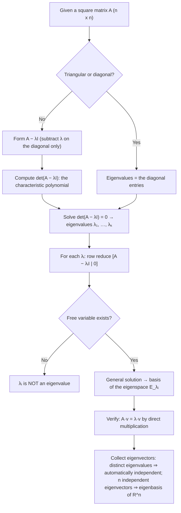

# How-To: Finding and Verifying Eigenvalues, Eigenvectors, and Eigenbases

| Plain Text | LaTeX Format | Description |
|---|---|---|
| Eigenvalue equation | `$A\mathbf{x} = \lambda \mathbf{x}$` | The defining relation; $\mathbf{x}$ must be nonzero |
| Eigenvalue | `$\lambda$` (lambda) | The scalar stretch/compress factor (may be $0$ or negative) |
| Eigenvector | `$\mathbf{x} \neq \mathbf{0}$` | A nonzero vector whose direction $A$ preserves |
| Eigenvalue test equation | `$(A - \lambda I)\mathbf{x} = \mathbf{0}$` | Has a nontrivial solution ⇔ $\lambda$ is an eigenvalue |
| Characteristic polynomial | `$\det(A - \lambda I)$` | A degree-$n$ polynomial in $\lambda$ |
| Characteristic equation | `$\det(A - \lambda I) = 0$` | Its roots are exactly the eigenvalues of $A$ |
| Eigenspace | `$\operatorname{Nul}(A - \lambda I)$` | All eigenvectors for $\lambda$, plus the zero vector |
| 2×2 characteristic polynomial | `$\lambda^2 - (\operatorname{tr} A)\lambda + \det A$` | Shortcut; the roots sum to the trace and multiply to the determinant |
| Trace | `$\operatorname{tr} A$` | Sum of the diagonal entries = sum of the eigenvalues (with multiplicity) |
| Algebraic multiplicity | — | How many times $\lambda$ appears as a root of the characteristic polynomial |
| Geometric multiplicity | — | Dimension of the eigenspace (the number of free variables in $(A - \lambda I)\mathbf{x} = \mathbf{0}$) |
| Eigenbasis | — | A basis of $\mathbb{R}^n$ consisting entirely of eigenvectors of $A$ |

_Table 1.1: Quick reference of the notation used in this guide._

> [!info] **Goal**
> Given a square matrix $A$: **find its eigenvalues** (via the characteristic equation), **find and verify its eigenvectors** (via the eigenspaces), and **build bases** — a basis for each eigenspace and, when possible, an *eigenbasis* of $\mathbb{R}^n$. The general recipe is in [[#General Form]]; worked demonstrations are in [[#Worked Examples]].

---

## General Form

> [!info] **Definition: Eigenvector and Eigenvalue**
> An **eigenvector** of an $n \times n$ matrix $A$ is a **nonzero** vector $\mathbf{x}$ such that
> $$A\mathbf{x} = \lambda \mathbf{x}$$
> for some scalar $\lambda$. The scalar $\lambda$ is called an **eigenvalue** of $A$ (provided such a nonzero $\mathbf{x}$ exists), and $\mathbf{x}$ is an eigenvector *corresponding to* $\lambda$.
>
> "Eigen" is German for "own": an eigenvector keeps its *own* direction under $A$ — it may be stretched, compressed, or reversed, but never knocked sideways. The eigenvalue records *how much* scaling happens. The zero vector is **never** an eigenvector, because $A\mathbf{0} = \lambda \mathbf{0}$ holds trivially for every $\lambda$.

### Procedure 1 — Finding the eigenvalues (the characteristic equation)

1. **Form $A - \lambda I$** — subtract $\lambda$ from the **diagonal entries only**.
2. **Compute the determinant** $\det(A - \lambda I)$. This is the **characteristic polynomial**, a degree-$n$ polynomial in $\lambda$. (For $2 \times 2$: shortcut $\lambda^2 - (\operatorname{tr} A)\lambda + \det A$.)
3. **Solve the characteristic equation** $\det(A - oldsymbol{\lambda} I) = 0$. Its roots are exactly the eigenvalues of $A$ — an $n \times n$ matrix has $n$ roots counting multiplicity (over the complex numbers; this course works with real roots).
4. **Bookkeeping check:** the eigenvalues (with multiplicity) must sum to $\operatorname{tr} A$ and their multiplicities must add up to $n$.

### Procedure 2 — Finding the eigenvectors (the eigenspace) for a known $\lambda$

1. **Form $A - \lambda I$.**
2. **Row reduce** the augmented matrix $\begin{bmatrix} A - \lambda I & \mathbf{0} \end{bmatrix}$.
3. **Check for a free variable.**
   - A pivot in *every* column → only the trivial solution → $\lambda$ is **not** an eigenvalue.
   - At least one column without a pivot → a free variable exists → $\lambda$ **is** an eigenvalue.
4. **Write the general solution** as a linear combination of vectors — one vector per free variable (set that free variable to $1$, the others to $0$). Scale to clear fractions.
5. The **eigenspace** $E_\lambda = \operatorname{Nul}(A - \lambda I)$ is the zero vector plus *all* eigenvectors for $\lambda$; the vectors from step 4 are a **basis** for it. Every nonzero vector in this span is an eigenvector for $\lambda$. The number of free variables is the **geometric multiplicity** (the dimension of the eigenspace).

### Procedure 3 — Verifying eigenpairs

- **Vector check (the one you always do):** compute $A\mathbf{v}$ and confirm $A\mathbf{v} = \lambda \mathbf{v}$ **entry by entry**. Cheap, and it catches sign errors immediately.
- **Eigenvalue check:** confirm $\det(A - \lambda I) = 0$ — or row reduce $A - \lambda I$ and confirm a free variable exists.
- **Ratio test** ("is $\mathbf{v}$ an eigenvector at all?"): compute $A\mathbf{v}$; it is a scalar multiple of $\mathbf{v}$ exactly when the ratio $(A\mathbf{v})_i / v_i$ is the same number for every nonzero component $v_i$.
- **Bookkeeping checks:** eigenvalues sum to $\operatorname{tr} A$; (for $2 \times 2$) they multiply to $\det A$; multiplicities sum to $n$.

### Procedure 4 — Building bases (eigenspace bases and eigenbases)

1. **Basis for each eigenspace:** the vectors from Procedure 2, step 4 (one per free variable).
2. **Independence for free:** eigenvectors corresponding to **distinct** eigenvalues are automatically linearly independent — no row reduction needed.
3. **Eigenbasis of $\mathbb{R}^n$:** a basis consisting of $n$ eigenvectors. It exists exactly when you can find $n$ linearly independent eigenvectors — equivalently, when the geometric multiplicities (eigenspace dimensions) sum to $n$. To certify a candidate set, form the matrix $P$ with the eigenvectors as columns and check $\det P \neq 0$ (or row reduce).
4. **Shortcuts:** for a **triangular** (or diagonal) matrix, the eigenvalues are the diagonal entries; for a diagonal matrix the standard basis vectors $\mathbf{e}_1, \dots, \mathbf{e}_n$ are themselves eigenvectors.

> [!example]
> - **Equations:** $A\mathbf{x} = \lambda \mathbf{x}$, equivalently $(A - \lambda I)\mathbf{x} = \mathbf{0}$, with eigenvalues found from $\det(A - \lambda I) = 0$
> - **Breakdown:**
>     - **$A$** : The $n \times n$ square matrix under study.
>     - **$\mathbf{x}$** : A **nonzero** vector — the eigenvector candidate. Its direction is preserved by $A$.
>     - **$\lambda$ (lambda)** : A scalar — the eigenvalue. It is the factor by which $A$ stretches ($|\lambda| > 1$), compresses ($|\lambda| < 1$), fixes ($\lambda = 1$), or reverses ($\lambda < 0$) the eigenvector. It may be $0$ (meaning $A$ crushes that direction to zero).
>     - **$A\mathbf{x} = \lambda \mathbf{x}$** : The *eigenvalue equation* — applying $A$ to $\mathbf{x}$ produces a scalar multiple of $\mathbf{x}$.
>     - **$A - \lambda I$** : The matrix formed by subtracting $\lambda$ from each **diagonal** entry of $A$ (not from every entry!).
>     - **$I$** : The $n \times n$ identity matrix.
>     - **$\det(A - \lambda I) = 0$** : The *characteristic equation*. Its roots are exactly the eigenvalues.
>     - **$\det(A - \lambda I)$** : The *characteristic polynomial* — a degree-$n$ polynomial in $\lambda$.
>     - **$\operatorname{Nul}(A - \lambda I)$** : The *eigenspace* for $\lambda$ — a subspace containing the zero vector and all eigenvectors for $\lambda$.
>     - **free variable** : One per dimension of the eigenspace; its count is the geometric multiplicity.
>     - **$\operatorname{tr} A$** : The *trace* — sum of the diagonal entries; equals the sum of the eigenvalues counted with multiplicity.
>     - **algebraic multiplicity** : How many times $\lambda$ occurs as a root of the characteristic polynomial; always ≥ the geometric multiplicity.

> [!tip] **Fast sanity checks**
> - **Triangular matrix?** Read the eigenvalues straight off the diagonal — no determinant needed.
> - **$2 \times 2$?** The characteristic polynomial is $\lambda^2 - (\operatorname{tr} A)\lambda + \det A$; if your roots do not sum to the trace and multiply to the determinant, a sign error slipped in.
> - **Is $0$ an eigenvalue?** Exactly when $A$ is singular ($A\mathbf{x} = \mathbf{0}$ has a nontrivial solution).
> - **Always verify a computed eigenvector** by direct multiplication: $A\mathbf{v} = \lambda\mathbf{v}$.

> [!warning] **Common pitfalls**
> - **Subtracting $\lambda$ from every entry** of $A$ instead of only the diagonal — it is $A - \lambda I$, not "$A$ minus $\lambda$ everywhere."
> - **Reporting $\mathbf{x} = \mathbf{0}$ as an eigenvector.** The zero vector lies in every eigenspace but is never an eigenvector. If your row reduction returns only the trivial solution, that $\lambda$ was not an eigenvalue.
> - **Using row reduction to find eigenvalues.** Row operations change eigenvalues; they are only used to find *eigenvectors once $\lambda$ is known*.
> - **Sign errors in cofactor expansion** — write the $(-1)^{i+j}$ sign, the entry, and the minor as three separate factors before multiplying.
> - **Thinking eigenvectors are unique.** If $\mathbf{v}$ is an eigenvector for $\lambda$, so is $c\mathbf{v}$ for every $c \neq 0$ — the eigenvalue belongs to the *direction*.

### Decision flow

_Figure 1.1: The full pipeline — from a square matrix to its eigenvalues, eigenvectors, eigenspace bases, and (when possible) an eigenbasis._

---

## Worked Examples

> [!example] Example 1: Full pipeline on a $2 \times 2$ matrix — eigenvalues, eigenvectors, verification, eigenbasis
> **For** $A = \begin{bmatrix} 2 & 3 \\ 3 & -6 \end{bmatrix}$: **find all eigenvalues, all eigenvectors, verify everything, and build an eigenbasis of $\mathbb{R}^2$.**
>
> ### Part A — Find the eigenvalues (characteristic equation)
>
> **Step 1 — Form $A - \lambda I$** (subtract $\lambda$ from the diagonal only):
> $$A - \lambda I = \begin{bmatrix} 2 & 3 \\ 3 & -6 \end{bmatrix} - \begin{bmatrix} \lambda & 0 \\ 0 & \lambda \end{bmatrix} = \begin{bmatrix} 2 - \lambda & 3 \\ 3 & -6 - \lambda \end{bmatrix}$$
>
> **Step 2 — Compute the determinant** (for $2 \times 2$: $\det\begin{bmatrix} a & b \\ c & d \end{bmatrix} = ad - bc$):
> $$\det(A - \lambda I) = (2 - \lambda)(-6 - \lambda) - (3)(3)$$
> Expand the product in full:
> $$(2 - \lambda)(-6 - \lambda) = 2\cdot(-6) + 2\cdot(-\lambda) + (-\lambda)\cdot(-6) + (-\lambda)\cdot(-\lambda) = -12 - 2\lambda + 6\lambda + \lambda^2 = \lambda^2 + 4\lambda - 12$$
> So:
> $$\det(A - \lambda I) = \lambda^2 + 4\lambda - 12 - 9 = \lambda^2 + 4\lambda - 21$$
>
> **Step 3 — Solve the characteristic equation** $\lambda^2 + 4\lambda - 21 = 0$ by factoring:
> $$\lambda^2 + 4\lambda - 21 = (\lambda - 3)(\lambda + 7) = 0$$
> (Check the factorization: $(\lambda - 3)(\lambda + 7) = \lambda^2 + 7\lambda - 3\lambda - 21 = \lambda^2 + 4\lambda - 21$ ✓)
> $$\lambda = 3 \quad \text{or} \quad \lambda = -7$$
>
> **Step 4 — Bookkeeping check:** $\operatorname{tr} A = 2 + (-6) = -4$ and $3 + (-7) = -4$ ✓; $\det A = (2)(-6) - (3)(3) = -12 - 9 = -21$ and $3 \cdot (-7) = -21$ ✓. (Equivalently, the $2 \times 2$ shortcut gives $\lambda^2 - (-4)\lambda + (-21) = \lambda^2 + 4\lambda - 21$ ✓.)
>
> ### Part B — Find the eigenvectors for $\lambda = 3$
>
> **Step 1 — Form $A - 3I$:**
> $$A - 3I = \begin{bmatrix} 2 - 3 & 3 \\ 3 & -6 - 3 \end{bmatrix} = \begin{bmatrix} -1 & 3 \\ 3 & -9 \end{bmatrix}$$
>
> **Step 2 — Row reduce** $\begin{bmatrix} A - 3I & \mathbf{0} \end{bmatrix}$:
> $$\begin{bmatrix} -1 & 3 & 0 \\ 3 & -9 & 0 \end{bmatrix}$$
> $R_2 \to R_2 + 3R_1$: the new row 2 is $(3 + 3\cdot(-1),\; -9 + 3\cdot3,\; 0) = (0, 0, 0)$:
> $$\sim \begin{bmatrix} -1 & 3 & 0 \\ 0 & 0 & 0 \end{bmatrix}$$
> $R_1 \to -R_1$: the new row 1 is $(1, -3, 0)$:
> $$\sim \begin{bmatrix} 1 & -3 & 0 \\ 0 & 0 & 0 \end{bmatrix}$$
>
> **Step 3 — Free variable?** Column 2 has no pivot → $x_2$ is free → $\lambda = 3$ is confirmed as an eigenvalue.
>
> **Step 4 — General solution.** The RREF row reads $x_1 - 3x_2 = 0$, so:
> $$x_1 = 3x_2$$
> $$\mathbf{x} = \begin{bmatrix} x_1 \\ x_2 \end{bmatrix} = x_2 \begin{bmatrix} 3 \\ 1 \end{bmatrix}, \quad x_2 \text{ free}$$
> The eigenspace is $E_3 = \operatorname{span}\left\{ \begin{bmatrix} 3 \\ 1 \end{bmatrix} \right\}$ — a **basis** for it is $\left\{ \begin{bmatrix} 3 \\ 1 \end{bmatrix} \right\}$. Every nonzero multiple of $(3,1)$ is an eigenvector for $\lambda = 3$.
>
> **Step 5 — Verify by direct multiplication:**
> $$A\begin{bmatrix} 3 \\ 1 \end{bmatrix} = \begin{bmatrix} 2\cdot3 + 3\cdot1 \\ 3\cdot3 + (-6)\cdot1 \end{bmatrix} = \begin{bmatrix} 6 + 3 \\ 9 - 6 \end{bmatrix} = \begin{bmatrix} 9 \\ 3 \end{bmatrix} = 3 \begin{bmatrix} 3 \\ 1 \end{bmatrix} \checkmark$$
>
> ### Part C — Find the eigenvectors for $\lambda = -7$
>
> **Step 1 — Form $A + 7I$:**
> $$A + 7I = \begin{bmatrix} 2 + 7 & 3 \\ 3 & -6 + 7 \end{bmatrix} = \begin{bmatrix} 9 & 3 \\ 3 & 1 \end{bmatrix}$$
>
> **Step 2 — Row reduce:**
> $$\begin{bmatrix} 9 & 3 & 0 \\ 3 & 1 & 0 \end{bmatrix}$$
> $R_2 \to R_2 - \tfrac{1}{3}R_1$: the new row 2 is $(3 - \tfrac{1}{3}\cdot9,\; 1 - \tfrac{1}{3}\cdot3,\; 0) = (0, 0, 0)$:
> $$\sim \begin{bmatrix} 9 & 3 & 0 \\ 0 & 0 & 0 \end{bmatrix}$$
> $R_1 \to \tfrac{1}{3}R_1$: the new row 1 is $(3, 1, 0)$; then $R_1 \to \tfrac{1}{3}R_1$ again to reach RREF — directly: $\tfrac{1}{9}R_1$ gives $(1, \tfrac{1}{3}, 0)$:
> $$\sim \begin{bmatrix} 1 & \frac{1}{3} & 0 \\ 0 & 0 & 0 \end{bmatrix}$$
>
> **Step 3 — Free variable?** Column 2 has no pivot → $x_2$ is free → confirmed.
>
> **Step 4 — General solution.** The row reads $x_1 + \tfrac{1}{3}x_2 = 0$, so:
> $$x_1 = -\frac{1}{3}x_2 \quad\Rightarrow\quad \mathbf{x} = x_2 \begin{bmatrix} -\frac{1}{3} \\ 1 \end{bmatrix}$$
> Scaling by $-3$ to clear the fraction: the eigenspace is $E_{-7} = \operatorname{span}\left\{ \begin{bmatrix} 1 \\ -3 \end{bmatrix} \right\}$ — a **basis** is $\left\{ \begin{bmatrix} 1 \\ -3 \end{bmatrix} \right\}$.
>
> **Step 5 — Verify by direct multiplication:**
> $$A\begin{bmatrix} 1 \\ -3 \end{bmatrix} = \begin{bmatrix} 2\cdot1 + 3\cdot(-3) \\ 3\cdot1 + (-6)\cdot(-3) \end{bmatrix} = \begin{bmatrix} 2 - 9 \\ 3 + 18 \end{bmatrix} = \begin{bmatrix} -7 \\ 21 \end{bmatrix} = -7 \begin{bmatrix} 1 \\ -3 \end{bmatrix} \checkmark$$
>
> ### Part D — Build the eigenbasis of $\mathbb{R}^2$
>
> The eigenvalues $3 \neq -7$ are distinct, so by the independence theorem the eigenvectors $\begin{bmatrix} 3 \\ 1 \end{bmatrix}$ and $\begin{bmatrix} 1 \\ -3 \end{bmatrix}$ are **automatically linearly independent** — no computation needed. Two independent vectors in $\mathbb{R}^2$ form a basis:
> $$\mathcal{B} = \left\{ \begin{bmatrix} 3 \\ 1 \end{bmatrix}, \begin{bmatrix} 1 \\ -3 \end{bmatrix} \right\} \text{ is an eigenbasis of } \mathbb{R}^2$$
> **Certify with a determinant:** $P = \begin{bmatrix} 3 & 1 \\ 1 & -3 \end{bmatrix}$, $\det P = (3)(-3) - (1)(1) = -9 - 1 = -10 \neq 0$ ✓ — the columns are independent, so $\mathcal{B}$ is indeed a basis.

> [!example]- Example 2: Full pipeline on a $3 \times 3$ matrix with a repeated eigenvalue
> **For** $A = \begin{bmatrix} 4 & -1 & 6 \\ 2 & 1 & 6 \\ 2 & -1 & 8 \end{bmatrix}$: **find all eigenvalues (with multiplicities), the eigenspaces with bases, verify, and build an eigenbasis of $\mathbb{R}^3$.**
>
> ### Part A — Characteristic polynomial (cofactor expansion, fully expanded)
>
> $$A - \lambda I = \begin{bmatrix} 4 - \lambda & -1 & 6 \\ 2 & 1 - \lambda & 6 \\ 2 & -1 & 8 - \lambda \end{bmatrix}$$
>
> Expand along the first row (signs $+, -, +$):
> $$\det(A - \lambda I) = (4 - \lambda)\det\begin{bmatrix} 1 - \lambda & 6 \\ -1 & 8 - \lambda \end{bmatrix} - (-1)\det\begin{bmatrix} 2 & 6 \\ 2 & 8 - \lambda \end{bmatrix} + 6\det\begin{bmatrix} 2 & 1 - \lambda \\ 2 & -1 \end{bmatrix}$$
>
> Compute each $2 \times 2$ minor:
> - First: $(1 - \lambda)(8 - \lambda) - (6)(-1) = (8 - \lambda - 8\lambda + \lambda^2) + 6 = \lambda^2 - 9\lambda + 14$
> - Second: $2(8 - \lambda) - (6)(2) = 16 - 2\lambda - 12 = 4 - 2\lambda$
> - Third: $2(-1) - (1 - \lambda)(2) = -2 - 2 + 2\lambda = 2\lambda - 4$
>
> Substitute back:
> $$\det(A - \lambda I) = (4 - \lambda)(\lambda^2 - 9\lambda + 14) + (4 - 2\lambda) + 6(2\lambda - 4)$$
> Expand the first product in full:
> $$(4 - \lambda)(\lambda^2 - 9\lambda + 14) = 4\lambda^2 - 36\lambda + 56 - \lambda^3 + 9\lambda^2 - 14\lambda = -\lambda^3 + 13\lambda^2 - 50\lambda + 56$$
> And $6(2\lambda - 4) = 12\lambda - 24$. Collect everything:
> $$\det(A - \lambda I) = -\lambda^3 + 13\lambda^2 - 50\lambda + 56 + 4 - 2\lambda + 12\lambda - 24 = -\lambda^3 + 13\lambda^2 - 40\lambda + 36$$
>
> **Characteristic equation:** $-\lambda^3 + 13\lambda^2 - 40\lambda + 36 = 0$, i.e. $\lambda^3 - 13\lambda^2 + 40\lambda - 36 = 0$.
> **Factor:** test $\lambda = 2$: $8 - 52 + 80 - 36 = 0$ ✓. Divide by $(\lambda - 2)$:
> $$\lambda^3 - 13\lambda^2 + 40\lambda - 36 = (\lambda - 2)(\lambda^2 - 11\lambda + 18) = (\lambda - 2)(\lambda - 2)(\lambda - 9) = (\lambda - 2)^2(\lambda - 9)$$
> (Check: $(\lambda - 2)(\lambda - 9) = \lambda^2 - 11\lambda + 18$ ✓)
>
> **Eigenvalues:** $\lambda = 2$ with **algebraic multiplicity 2**, and $\lambda = 9$ with algebraic multiplicity $1$.
> **Bookkeeping check:** $\operatorname{tr} A = 4 + 1 + 8 = 13$ and $2 + 2 + 9 = 13$ ✓; multiplicities $2 + 1 = 3 = n$ ✓.
>
> ### Part B — Eigenspace for $\lambda = 2$
>
> $$A - 2I = \begin{bmatrix} 4 - 2 & -1 & 6 \\ 2 & 1 - 2 & 6 \\ 2 & -1 & 8 - 2 \end{bmatrix} = \begin{bmatrix} 2 & -1 & 6 \\ 2 & -1 & 6 \\ 2 & -1 & 6 \end{bmatrix}$$
> Row reduce the augmented matrix:
> $$\begin{bmatrix} 2 & -1 & 6 & 0 \\ 2 & -1 & 6 & 0 \\ 2 & -1 & 6 & 0 \end{bmatrix}$$
> $R_2 \to R_2 - R_1$: the new row 2 is $(0, 0, 0, 0)$; $R_3 \to R_3 - R_1$: the new row 3 is $(0, 0, 0, 0)$:
> $$\sim \begin{bmatrix} 2 & -1 & 6 & 0 \\ 0 & 0 & 0 & 0 \\ 0 & 0 & 0 & 0 \end{bmatrix}$$
> $R_1 \to \tfrac{1}{2}R_1$: the new row 1 is $(1, -\tfrac{1}{2}, 3, 0)$:
> $$\sim \begin{bmatrix} 1 & -\frac{1}{2} & 3 & 0 \\ 0 & 0 & 0 & 0 \\ 0 & 0 & 0 & 0 \end{bmatrix}$$
>
> **Free variables:** columns 2 and 3 have no pivots → $x_2, x_3$ free → $\lambda = 2$ confirmed.
> The row reads $x_1 - \tfrac{1}{2}x_2 + 3x_3 = 0$, so:
> $$x_1 = \frac{1}{2}x_2 - 3x_3$$
> $$\mathbf{x} = \begin{bmatrix} x_1 \\ x_2 \\ x_3 \end{bmatrix} = x_2 \begin{bmatrix} \frac{1}{2} \\ 1 \\ 0 \end{bmatrix} + x_3 \begin{bmatrix} -3 \\ 0 \\ 1 \end{bmatrix}, \quad x_2, x_3 \text{ free}$$
> Scale the first vector by $2$ to clear the fraction. A **basis for the eigenspace** $E_2$ (a plane through the origin in $\mathbb{R}^3$):
> $$\left\{ \begin{bmatrix} 1 \\ 2 \\ 0 \end{bmatrix}, \begin{bmatrix} -3 \\ 0 \\ 1 \end{bmatrix} \right\}$$
> **Geometric multiplicity of $\lambda = 2$ is $2$** (two free variables) — equal to its algebraic multiplicity.
>
> **Verify both basis vectors by direct multiplication:**
> $$A\begin{bmatrix} 1 \\ 2 \\ 0 \end{bmatrix} = \begin{bmatrix} 4\cdot1 + (-1)\cdot2 + 6\cdot0 \\ 2\cdot1 + 1\cdot2 + 6\cdot0 \\ 2\cdot1 + (-1)\cdot2 + 8\cdot0 \end{bmatrix} = \begin{bmatrix} 4 - 2 \\ 2 + 2 \\ 2 - 2 \end{bmatrix} = \begin{bmatrix} 2 \\ 4 \\ 0 \end{bmatrix} = 2\begin{bmatrix} 1 \\ 2 \\ 0 \end{bmatrix} \checkmark$$
> $$A\begin{bmatrix} -3 \\ 0 \\ 1 \end{bmatrix} = \begin{bmatrix} 4\cdot(-3) + (-1)\cdot0 + 6\cdot1 \\ 2\cdot(-3) + 1\cdot0 + 6\cdot1 \\ 2\cdot(-3) + (-1)\cdot0 + 8\cdot1 \end{bmatrix} = \begin{bmatrix} -12 + 6 \\ -6 + 6 \\ -6 + 8 \end{bmatrix} = \begin{bmatrix} -6 \\ 0 \\ 2 \end{bmatrix} = 2\begin{bmatrix} -3 \\ 0 \\ 1 \end{bmatrix} \checkmark$$
>
> ### Part C — Eigenspace for $\lambda = 9$
>
> $$A - 9I = \begin{bmatrix} 4 - 9 & -1 & 6 \\ 2 & 1 - 9 & 6 \\ 2 & -1 & 8 - 9 \end{bmatrix} = \begin{bmatrix} -5 & -1 & 6 \\ 2 & -8 & 6 \\ 2 & -1 & -1 \end{bmatrix}$$
> Row reduce the augmented matrix. $R_1 \leftrightarrow R_3$ (smaller leading entry on top):
> $$\begin{bmatrix} 2 & -1 & -1 & 0 \\ 2 & -8 & 6 & 0 \\ -5 & -1 & 6 & 0 \end{bmatrix}$$
> $R_2 \to R_2 - R_1$: the new row 2 is $(0,\; -8 - (-1),\; 6 - (-1),\; 0) = (0, -7, 7, 0)$:
> $$\sim \begin{bmatrix} 2 & -1 & -1 & 0 \\ 0 & -7 & 7 & 0 \\ -5 & -1 & 6 & 0 \end{bmatrix}$$
> $R_3 \to R_3 + \tfrac{5}{2}R_1$: the new row 3 is $(-5 + \tfrac{5}{2}\cdot2,\; -1 + \tfrac{5}{2}\cdot(-1),\; 6 + \tfrac{5}{2}\cdot(-1),\; 0) = (0, -\tfrac{7}{2}, \tfrac{7}{2}, 0)$:
> $$\sim \begin{bmatrix} 2 & -1 & -1 & 0 \\ 0 & -7 & 7 & 0 \\ 0 & -\frac{7}{2} & \frac{7}{2} & 0 \end{bmatrix}$$
> $R_3 \to R_3 - \tfrac{1}{2}R_2$: the new row 3 is $(0,\; -\tfrac{7}{2} - \tfrac{1}{2}\cdot(-7),\; \tfrac{7}{2} - \tfrac{1}{2}\cdot7,\; 0) = (0, 0, 0, 0)$:
> $$\sim \begin{bmatrix} 2 & -1 & -1 & 0 \\ 0 & -7 & 7 & 0 \\ 0 & 0 & 0 & 0 \end{bmatrix}$$
> $R_2 \to -\tfrac{1}{7}R_2$: the new row 2 is $(0, 1, -1, 0)$; $R_1 \to R_1 + R_2$: the new row 1 is $(2,\; -1 + 1,\; -1 + (-1),\; 0) = (2, 0, -2, 0)$; $R_1 \to \tfrac{1}{2}R_1$: the new row 1 is $(1, 0, -1, 0)$:
> $$\sim \begin{bmatrix} 1 & 0 & -1 & 0 \\ 0 & 1 & -1 & 0 \\ 0 & 0 & 0 & 0 \end{bmatrix}$$
>
> **Free variable:** column 3 has no pivot → $x_3$ free → confirmed. The rows read $x_1 - x_3 = 0$ and $x_2 - x_3 = 0$:
> $$x_1 = x_3, \qquad x_2 = x_3 \quad\Rightarrow\quad \mathbf{x} = x_3 \begin{bmatrix} 1 \\ 1 \\ 1 \end{bmatrix}$$
> A **basis for** $E_9$ (a line through the origin): $\left\{ \begin{bmatrix} 1 \\ 1 \\ 1 \end{bmatrix} \right\}$.
>
> **Verify:**
> $$A\begin{bmatrix} 1 \\ 1 \\ 1 \end{bmatrix} = \begin{bmatrix} 4 - 1 + 6 \\ 2 + 1 + 6 \\ 2 - 1 + 8 \end{bmatrix} = \begin{bmatrix} 9 \\ 9 \\ 9 \end{bmatrix} = 9\begin{bmatrix} 1 \\ 1 \\ 1 \end{bmatrix} \checkmark$$
>
> ### Part D — Build the eigenbasis of $\mathbb{R}^3$
>
> Candidate eigenvectors: $\mathbf{v}_1 = \begin{bmatrix} 1 \\ 2 \\ 0 \end{bmatrix}$ ($\lambda = 2$), $\mathbf{v}_2 = \begin{bmatrix} -3 \\ 0 \\ 1 \end{bmatrix}$ ($\lambda = 2$), $\mathbf{v}_3 = \begin{bmatrix} 1 \\ 1 \\ 1 \end{bmatrix}$ ($\lambda = 9$).
> Note that $\mathbf{v}_1, \mathbf{v}_2$ share an eigenvalue, so the distinct-eigenvalue theorem does **not** certify this set — check independence directly. Form $P$ with the eigenvectors as columns:
> $$P = \begin{bmatrix} 1 & -3 & 1 \\ 2 & 0 & 1 \\ 0 & 1 & 1 \end{bmatrix}$$
> $$\det P = 1\cdot\det\begin{bmatrix} 0 & 1 \\ 1 & 1 \end{bmatrix} - (-3)\cdot\det\begin{bmatrix} 2 & 1 \\ 0 & 1 \end{bmatrix} + 1\cdot\det\begin{bmatrix} 2 & 0 \\ 0 & 1 \end{bmatrix}$$
> $$= 1\cdot(0\cdot1 - 1\cdot1) + 3\cdot(2\cdot1 - 1\cdot0) + 1\cdot(2\cdot1 - 0\cdot0)$$
> $$= 1\cdot(-1) + 3\cdot(2) + 1\cdot(2) = -1 + 6 + 2 = 7 \neq 0$$
> $\det P \neq 0$ → the three eigenvectors are linearly independent → they form an **eigenbasis of $\mathbb{R}^3$**:
> $$\mathcal{B} = \left\{ \begin{bmatrix} 1 \\ 2 \\ 0 \end{bmatrix}, \begin{bmatrix} -3 \\ 0 \\ 1 \end{bmatrix}, \begin{bmatrix} 1 \\ 1 \\ 1 \end{bmatrix} \right\}$$
> (The geometric multiplicities $2 + 1 = 3$ sum to $n = 3$ — exactly the condition for an eigenbasis to exist.)

> [!example]- Example 3: Verification techniques and shortcuts
> **a. Verify a claimed eigenpair by multiplication.** Let $A = \begin{bmatrix} 1 & 6 \\ 5 & 2 \end{bmatrix}$, and test the claim "$\mathbf{u} = \begin{bmatrix} 6 \\ -5 \end{bmatrix}$ is an eigenvector with $\lambda = -4$":
> $$A\mathbf{u} = \begin{bmatrix} 1\cdot6 + 6\cdot(-5) \\ 5\cdot6 + 2\cdot(-5) \end{bmatrix} = \begin{bmatrix} 6 - 30 \\ 30 - 10 \end{bmatrix} = \begin{bmatrix} -24 \\ 20 \end{bmatrix} = -4 \begin{bmatrix} 6 \\ -5 \end{bmatrix} = -4\mathbf{u} \checkmark$$
> The claim holds — and note the negative eigenvalue: $A$ reverses $\mathbf{u}$'s direction while stretching it by $4$.
>
> **Test the claim "$\mathbf{v} = \begin{bmatrix} 3 \\ 2 \end{bmatrix}$ is an eigenvector"** (no $\lambda$ given). Compute and use the ratio test:
> $$A\mathbf{v} = \begin{bmatrix} 1\cdot3 + 6\cdot2 \\ 5\cdot3 + 2\cdot2 \end{bmatrix} = \begin{bmatrix} 3 + 12 \\ 15 + 4 \end{bmatrix} = \begin{bmatrix} 15 \\ 19 \end{bmatrix}$$
> Ratios: $\frac{15}{3} = 5$ but $\frac{19}{2} = 9.5$ — not the same number → $A\mathbf{v}$ is **not** a scalar multiple of $\mathbf{v}$ → $\mathbf{v}$ is **not** an eigenvector.
>
> **b. Triangular shortcut.** For $T = \begin{bmatrix} 3 & 6 & -8 \\ 0 & 0 & 6 \\ 0 & 0 & 2 \end{bmatrix}$ (upper triangular), the eigenvalues are the diagonal entries: $\lambda = 3, 0, 2$ — read off directly. Since $0$ appears, $T$ is singular (not invertible).
>
> **c. Is a claimed $\lambda$ an eigenvalue? — determinant test.** Is $5$ an eigenvalue of $A = \begin{bmatrix} 6 & -3 & 1 \\ 3 & 0 & 5 \\ -2 & 2 & 6 \end{bmatrix}$?
> $$A - 5I = \begin{bmatrix} 6 - 5 & -3 & 1 \\ 3 & 0 - 5 & 5 \\ -2 & 2 & 6 - 5 \end{bmatrix} = \begin{bmatrix} 1 & -3 & 1 \\ 3 & -5 & 5 \\ -2 & 2 & 1 \end{bmatrix}$$
> Cofactor expansion along the first row (signs $+, -, +$):
> $$\det(A - 5I) = 1\cdot\det\begin{bmatrix} -5 & 5 \\ 2 & 1 \end{bmatrix} - (-3)\cdot\det\begin{bmatrix} 3 & 5 \\ -2 & 1 \end{bmatrix} + 1\cdot\det\begin{bmatrix} 3 & -5 \\ -2 & 2 \end{bmatrix}$$
> $$= 1\cdot((-5)(1) - (5)(2)) + 3\cdot((3)(1) - (5)(-2)) + 1\cdot((3)(2) - (-5)(-2))$$
> $$= 1\cdot(-5 - 10) + 3\cdot(3 + 10) + 1\cdot(6 - 10) = -15 + 39 - 4 = 20 \neq 0$$
> $\det(A - 5I) \neq 0$ → $A - 5I$ is invertible → $(A - 5I)\mathbf{x} = \mathbf{0}$ has only the trivial solution → **$5$ is not an eigenvalue.**

> [!example]- Example 4: When eigenvectors do (and don't) form a basis
> **a. Distinct eigenvalues ⇒ independence for free.** For $A = \begin{bmatrix} 1 & 6 \\ 5 & 2 \end{bmatrix}$, suppose you have found $\mathbf{v}_1 = \begin{bmatrix} 1 \\ 1 \end{bmatrix}$ for $\lambda_1 = 7$ and $\mathbf{v}_2 = \begin{bmatrix} 6 \\ -5 \end{bmatrix}$ for $\lambda_2 = -4$. Since $7 \neq -4$, the theorem guarantees $\{\mathbf{v}_1, \mathbf{v}_2\}$ is linearly independent — and two independent vectors in $\mathbb{R}^2$ form an **eigenbasis**. (Quick confirmation: neither is a scalar multiple of the other, since $\frac{1}{6} \neq \frac{1}{-5}$ ✓)
>
> **b. A repeated eigenvalue can fail to give a basis.** Let $A = \begin{bmatrix} 2 & 1 \\ 0 & 2 \end{bmatrix}$.
> **Characteristic polynomial:**
> $$\det(A - \lambda I) = \det\begin{bmatrix} 2 - \lambda & 1 \\ 0 & 2 - \lambda \end{bmatrix} = (2 - \lambda)(2 - \lambda) - (1)(0) = (2 - \lambda)^2$$
> Eigenvalue $\lambda = 2$ with **algebraic multiplicity $2$**.
> **Eigenspace:** $A - 2I = \begin{bmatrix} 0 & 1 \\ 0 & 0 \end{bmatrix}$; row reduce the augmented matrix:
> $$\begin{bmatrix} 0 & 1 & 0 \\ 0 & 0 & 0 \end{bmatrix}$$
> The row reads $x_2 = 0$, with $x_1$ free:
> $$\mathbf{x} = x_1 \begin{bmatrix} 1 \\ 0 \end{bmatrix}$$
> The eigenspace is $\operatorname{span}\left\{ \begin{bmatrix} 1 \\ 0 \end{bmatrix} \right\}$ — only **one**-dimensional. **Geometric multiplicity $1 <$ algebraic multiplicity $2$:** there is only one independent eigenvector direction, so $A$ has **no eigenbasis of $\mathbb{R}^2$** (it is not diagonalizable). This is exactly the shortfall that a repeated eigenvalue can hide.
>
> **Rule of thumb:** an eigenbasis of $\mathbb{R}^n$ exists iff the eigenspace dimensions (geometric multiplicities) add up to $n$. A quick way to see failure: a repeated eigenvalue whose eigenspace comes out smaller than its multiplicity.

> [!question] Self-Check
> For $A = \begin{bmatrix} 3 & -2 \\ 1 & 0 \end{bmatrix}$: find all eigenvalues, a basis for each eigenspace, verify your eigenvectors by multiplication, and decide whether the eigenvectors form an eigenbasis of $\mathbb{R}^2$. (Try it yourself first — the fully expanded solution is folded below.)

> [!example]- Self-Check: fully expanded solution
> **Part A — Eigenvalues.**
> $$A - \lambda I = \begin{bmatrix} 3 - \lambda & -2 \\ 1 & 0 - \lambda \end{bmatrix}$$
> $$\det(A - \lambda I) = (3 - \lambda)(-\lambda) - (-2)(1) = -3\lambda + \lambda^2 + 2 = \lambda^2 - 3\lambda + 2$$
> Factor: $\lambda^2 - 3\lambda + 2 = (\lambda - 1)(\lambda - 2) = 0$ (check: $\lambda^2 - 2\lambda - \lambda + 2 = \lambda^2 - 3\lambda + 2$ ✓)
> $$\lambda = 1, \qquad \lambda = 2$$
> Bookkeeping: $\operatorname{tr} A = 3 + 0 = 3 = 1 + 2$ ✓; $\det A = (3)(0) - (-2)(1) = 2 = 1 \cdot 2$ ✓.
>
> **Part B — Eigenspace for $\lambda = 1$.**
> $$A - I = \begin{bmatrix} 3 - 1 & -2 \\ 1 & 0 - 1 \end{bmatrix} = \begin{bmatrix} 2 & -2 \\ 1 & -1 \end{bmatrix}$$
> Row reduce: $R_2 \to R_2 - \tfrac{1}{2}R_1$: the new row 2 is $(1 - 1,\; -1 - (-1),\; 0) = (0, 0, 0)$; $R_1 \to \tfrac{1}{2}R_1$: the new row 1 is $(1, -1, 0)$:
> $$\sim \begin{bmatrix} 1 & -1 & 0 \\ 0 & 0 & 0 \end{bmatrix}$$
> $x_1 - x_2 = 0$ → $x_1 = x_2$, with $x_2$ free:
> $$\mathbf{x} = x_2 \begin{bmatrix} 1 \\ 1 \end{bmatrix} \quad\Rightarrow\quad E_1 = \operatorname{span}\left\{ \begin{bmatrix} 1 \\ 1 \end{bmatrix} \right\}$$
> **Verify:** $A\begin{bmatrix} 1 \\ 1 \end{bmatrix} = \begin{bmatrix} 3 - 2 \\ 1 + 0 \end{bmatrix} = \begin{bmatrix} 1 \\ 1 \end{bmatrix} = 1\begin{bmatrix} 1 \\ 1 \end{bmatrix}$ ✓
>
> **Part C — Eigenspace for $\lambda = 2$.**
> $$A - 2I = \begin{bmatrix} 3 - 2 & -2 \\ 1 & 0 - 2 \end{bmatrix} = \begin{bmatrix} 1 & -2 \\ 1 & -2 \end{bmatrix}$$
> Row reduce: $R_2 \to R_2 - R_1$: the new row 2 is $(0, 0, 0)$; the RREF is
> $$\sim \begin{bmatrix} 1 & -2 & 0 \\ 0 & 0 & 0 \end{bmatrix}$$
> $x_1 - 2x_2 = 0$ → $x_1 = 2x_2$, with $x_2$ free:
> $$\mathbf{x} = x_2 \begin{bmatrix} 2 \\ 1 \end{bmatrix} \quad\Rightarrow\quad E_2 = \operatorname{span}\left\{ \begin{bmatrix} 2 \\ 1 \end{bmatrix} \right\}$$
> **Verify:** $A\begin{bmatrix} 2 \\ 1 \end{bmatrix} = \begin{bmatrix} 3\cdot2 + (-2)\cdot1 \\ 1\cdot2 + 0\cdot1 \end{bmatrix} = \begin{bmatrix} 6 - 2 \\ 2 \end{bmatrix} = \begin{bmatrix} 4 \\ 2 \end{bmatrix} = 2\begin{bmatrix} 2 \\ 1 \end{bmatrix}$ ✓
>
> **Part D — Eigenbasis.** The eigenvalues $1 \neq 2$ are distinct → $\left\{ \begin{bmatrix} 1 \\ 1 \end{bmatrix}, \begin{bmatrix} 2 \\ 1 \end{bmatrix} \right\}$ is automatically independent. Certify: $\det\begin{bmatrix} 1 & 2 \\ 1 & 1 \end{bmatrix} = (1)(1) - (2)(1) = 1 - 2 = -1 \neq 0$ ✓ → **eigenbasis of $\mathbb{R}^2$**.

---

> [!summary]
> - **Definition:** $A\mathbf{x} = \lambda \mathbf{x}$ with $\mathbf{x} \neq \mathbf{0}$ — eigenvectors keep their direction under $A$; $\lambda$ is the stretch/compress factor.
> - **Find eigenvalues:** form $A - \lambda I$ (diagonal only!) and solve the characteristic equation $\det(A - \lambda I) = 0$; the roots, counted with multiplicity, are the eigenvalues. $2 \times 2$ shortcut: $\lambda^2 - (\operatorname{tr} A)\lambda + \det A = 0$.
> - **Find eigenvectors:** for each $\lambda$, row reduce $\begin{bmatrix} A - \lambda I & \mathbf{0} \end{bmatrix}$; the null space is the eigenspace $E_\lambda$, and one basis vector per free variable gives a **basis for the eigenspace**.
> - **Verify:** always compute $A\mathbf{v}$ and check $A\mathbf{v} = \lambda\mathbf{v}$ entry by entry; check $\det(A - \lambda I) = 0$ for claimed eigenvalues; use the ratio test to decide whether a vector is an eigenvector at all; eigenvalues must sum to the trace and multiplicities to $n$.
> - **Bases:** eigenvectors from *distinct* eigenvalues are automatically independent; $n$ independent eigenvectors form an **eigenbasis of $\mathbb{R}^n$**, which exists iff the geometric multiplicities sum to $n$ (watch out for repeated eigenvalues with too-small eigenspaces).
> - **Shortcuts:** triangular matrix ⇒ eigenvalues are the diagonal entries; $\lambda = 0$ ⇔ $A$ is singular; eigenvectors are never unique — any nonzero scalar multiple works.
