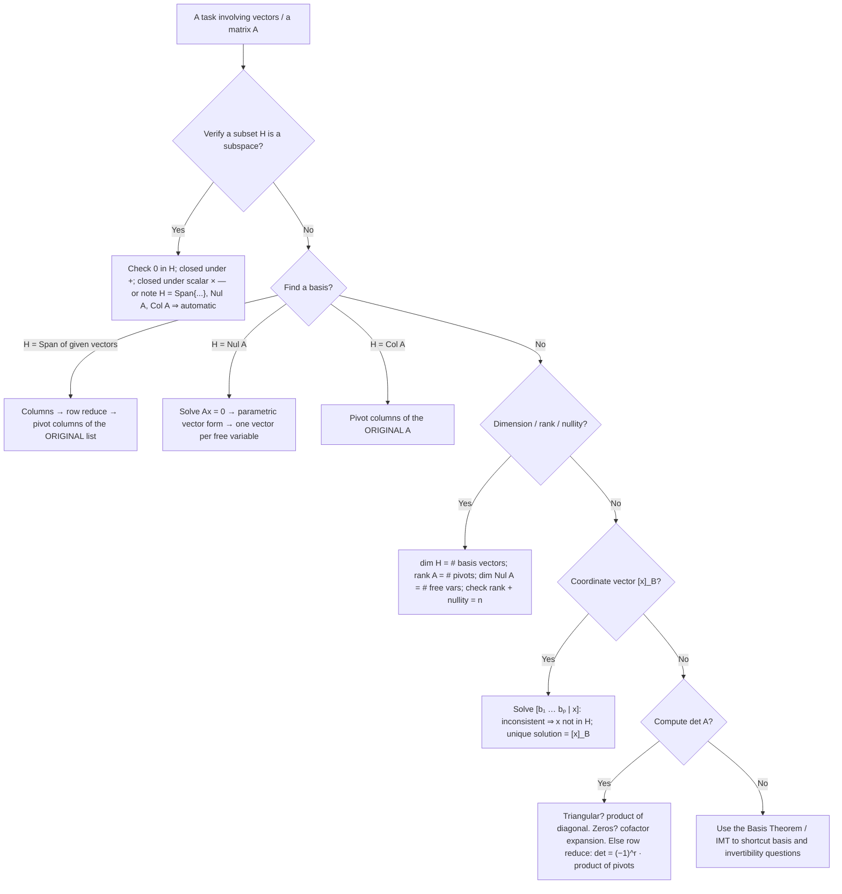

# How-To: Subspaces, Bases, Dimension, Rank, and Coordinates

| Plain Text | LaTeX Format | Description |
|---|---|---|
| Subspace $H$ | — | A subset of $\mathbb{R}^n$ containing $\mathbf{0}$ and closed under addition and scalar multiplication |
| Span | `$\operatorname{Span}\{\mathbf{v}_1, \dots, \mathbf{v}_k\}$` | The set of all linear combinations of the listed vectors |
| Basis | `$\mathcal{B} = \{\mathbf{b}_1, \dots, \mathbf{b}_p\}$` | A linearly independent set that spans $H$ |
| Coordinate vector | `$[\mathbf{x}]_\mathcal{B}$` | The unique weights with $\mathbf{x} = c_1\mathbf{b}_1 + \dots + c_p\mathbf{b}_p$ |
| Dimension | `$\dim H$` | The number of vectors in any basis of $H$ |
| Null space | `$\operatorname{Nul} A$` | All solutions of $A\mathbf{x} = \mathbf{0}$ — a subspace of $\mathbb{R}^n$ |
| Nullity | `$\dim \operatorname{Nul} A$` | The number of free variables in $A\mathbf{x} = \mathbf{0}$ |
| Column space | `$\operatorname{Col} A$` | The span of the columns of $A$ — a subspace of $\mathbb{R}^m$ |
| Rank | `$\operatorname{rank} A$` | $\dim \operatorname{Col} A$ = the number of pivot columns of $A$ |
| Rank Theorem | `$\operatorname{rank} A + \dim \operatorname{Nul} A = n$` | Pivots + free variables = number of columns |
| Pivot column | — | A column of the **original** $A$ that contains a pivot in an echelon form |
| Standard basis | `$\{\mathbf{e}_1, \dots, \mathbf{e}_n\}$` | The columns of $I_n$ |
| Basis Theorem | — | In a $p$-dimensional subspace: $p$ independent vectors ⇔ basis; $p$ spanning vectors ⇔ basis |
| Determinant | `$\det A$` | A scalar; $\det A \neq 0$ ⇔ $A$ is invertible |
| Cofactor | `$C_{ij} = (-1)^{i+j} \det A_{ij}$` | The signed minor attached to position $(i,j)$ |

_Table 1.1: Quick reference of the notation used in this guide._

> [!info] **Goal**
> Given sets of vectors and matrices: **verify subspaces**, **find bases** (for spans, for $\operatorname{Nul} A$, for $\operatorname{Col} A$), **compute dimensions, rank, and nullity**, **find coordinate vectors** $[\mathbf{x}]_\mathcal{B}$, and **compute determinants**. The general recipe is in [[#General Form]]; worked demonstrations are in [[#Worked Examples]].

---

## General Form

> [!info] **Definition: Subspace**
> A **subspace** of $\mathbb{R}^n$ is a subset $H$ satisfying three properties:
> 1. The zero vector $\mathbf{0}$ is in $H$.
> 2. Closed under addition: if $\mathbf{u}, \mathbf{v} \in H$, then $\mathbf{u} + \mathbf{v} \in H$.
> 3. Closed under scalar multiplication: if $\mathbf{u} \in H$ and $c$ is a scalar, then $c\mathbf{u} \in H$.
>
> **Shortcuts:** every set of the form $\operatorname{Span}\{\mathbf{v}_1, \dots, \mathbf{v}_p\}$ is automatically a subspace; so are $\operatorname{Nul} A$ and $\operatorname{Col} A$ for any matrix $A$. Geometrically, a subspace of $\mathbb{R}^n$ must always pass through the origin — a line or plane that misses the origin is *not* a subspace.

> [!info] **Definition: Basis**
> A **basis** for a subspace $H$ is a set $\mathcal{B} = \{\mathbf{b}_1, \dots, \mathbf{b}_p\}$ that is **linearly independent** *and* **spans** $H$:
> $$\operatorname{Span}\{\mathbf{b}_1, \dots, \mathbf{b}_p\} = H$$
> Independence gives **uniqueness**: every $\mathbf{x} \in H$ has exactly one representation $\mathbf{x} = c_1\mathbf{b}_1 + \dots + c_p\mathbf{b}_p$. The scalars $c_1, \dots, c_p$ are the **coordinates** of $\mathbf{x}$ relative to $\mathcal{B}$, collected in the **coordinate vector**
> $$[\mathbf{x}]_\mathcal{B} = \begin{bmatrix} c_1 \\ \vdots \\ c_p \end{bmatrix}$$
> The set $\{\mathbf{e}_1, \dots, \mathbf{e}_n\}$ (columns of $I_n$) is the **standard basis** of $\mathbb{R}^n$.

> [!info] **Definitions: Dimension, Rank, Nullity**
> - **$\dim H$** — the number of vectors in any basis of $H$ (all bases of $H$ have the same size!). $\dim\{\mathbf{0}\} = 0$; $\dim \mathbb{R}^n = n$.
> - **$\operatorname{rank} A = \dim \operatorname{Col} A$** — the number of pivot columns of $A$.
> - **$\dim \operatorname{Nul} A$** (the **nullity**) — the number of free variables in $A\mathbf{x} = \mathbf{0}$.
> - **Rank Theorem:** for an $m \times n$ matrix, $\operatorname{rank} A + \dim \operatorname{Nul} A = n$.

### The general procedures

**Procedure 1 — Verify that a subset $H$ is a subspace.**
1. Check $\mathbf{0} \in H$. If not, stop — not a subspace.
2. Check closure under addition for *arbitrary* $\mathbf{u}, \mathbf{v} \in H$.
3. Check closure under scalar multiplication for *arbitrary* $c$.
(To *disprove*, exhibit one concrete counterexample. Or skip the checks entirely if $H$ is given as a span, a null space, or a column space.)

**Procedure 2 — Find a basis for $H = \operatorname{Span}\{\mathbf{v}_1, \dots, \mathbf{v}_k\}$.**
1. Place the vectors as the **columns** of a matrix.
2. Row reduce to echelon form and identify the **pivot columns**.
3. The **corresponding vectors from the original list** form a basis for $H$; their number is $\dim H$.

**Procedure 3 — Find a basis for $\operatorname{Nul} A$.**
1. Row reduce $\begin{bmatrix} A & \mathbf{0} \end{bmatrix}$ to RREF.
2. Every non-pivot column corresponds to a free variable.
3. Solve for the basic variables and write the general solution in **parametric vector form**.
4. The vectors multiplying the free variables (one per free variable) form a basis for $\operatorname{Nul} A$; $\dim \operatorname{Nul} A$ = number of free variables.

**Procedure 4 — Find a basis for $\operatorname{Col} A$.**
1. Row reduce $A$ to echelon form and identify the pivot columns.
2. The pivot columns **of the original $A$** (not of the echelon form!) form a basis for $\operatorname{Col} A$; $\operatorname{rank} A$ = number of pivot columns.

**Procedure 5 — Compute dimension, rank, nullity (and settle invertibility).**
1. Row reduce once; count pivot columns ($\operatorname{rank} A$) and free variables ($\dim \operatorname{Nul} A$).
2. Check the Rank Theorem: $\operatorname{rank} A + \dim \operatorname{Nul} A = n$.
3. For a square $n \times n$ matrix, the IMT adds: the columns form a basis of $\mathbb{R}^n$ ⇔ $\operatorname{Col} A = \mathbb{R}^n$ ⇔ $\operatorname{rank} A = n$ ⇔ $\dim \operatorname{Nul} A = 0$ ⇔ $\operatorname{Nul} A = \{\mathbf{0}\}$ ⇔ $A$ is invertible.

**Procedure 6 — Find the coordinate vector $[\mathbf{x}]_\mathcal{B}$.**
1. Solve the vector equation $c_1\mathbf{b}_1 + \dots + c_p\mathbf{b}_p = \mathbf{x}$, i.e. row reduce the augmented matrix $\begin{bmatrix} \mathbf{b}_1 & \dots & \mathbf{b}_p & \mathbf{x} \end{bmatrix}$.
2. If the system is **inconsistent** → $\mathbf{x} \notin H$.
3. If consistent, the **unique** solution $(c_1, \dots, c_p)$ is $[\mathbf{x}]_\mathcal{B}$ (uniqueness is guaranteed because $\mathcal{B}$ is a basis).

**Procedure 7 — The Basis Theorem shortcut.**
If $H$ has dimension $p$, then **any** $p$ linearly independent vectors in $H$ automatically form a basis (no spanning check), and **any** $p$ vectors that span $H$ automatically form a basis (no independence check). In particular, $n$ vectors in $\mathbb{R}^n$ form a basis ⇔ they are linearly independent ⇔ the matrix with them as columns has $\det \neq 0$.

**Procedure 8 — Compute a determinant $\det A$ (square $A$).**
Choose the cheapest route:
- **(a) Triangular?** $\det A$ = product of the diagonal entries.
- **(b) Cofactor expansion:** pick the row or column with the most zeros; $\det A = \sum_j a_{ij} C_{ij}$ with $C_{ij} = (-1)^{i+j}\det A_{ij}$ (checkerboard signs $+,-,+,\dots$). Each zero entry deletes a whole term.
- **(c) Row reduction (general fallback):** reduce to echelon form $U$ using only row replacements and $r$ row interchanges; then $\det A = (-1)^r \cdot u_{11} u_{22} \cdots u_{nn}$.
- **Properties:** row replacement leaves $\det$ unchanged; a row swap flips the sign; scaling a row by $k$ multiplies $\det$ by $k$; $\det(AB) = (\det A)(\det B)$; $\det A^T = \det A$; $\det A \neq 0$ ⇔ $A$ is invertible.
- **Verify** with a second, independent expansion when the numbers allow.

> [!example]
> - **Equations:** $\mathbf{x} = c_1\mathbf{b}_1 + \dots + c_p\mathbf{b}_p$ with $[\mathbf{x}]_\mathcal{B} = \begin{bmatrix} c_1 \\ \vdots \\ c_p \end{bmatrix}$; $\operatorname{rank} A + \dim \operatorname{Nul} A = n$; $\det A = \sum_{j=1}^{n} (-1)^{1+j} a_{1j} \det A_{1j}$
> - **Breakdown:**
>     - **$H$** : A subspace of $\mathbb{R}^n$ — a "vector space in miniature" that passes through the origin.
>     - **$\mathcal{B} = \{\mathbf{b}_1, \dots, \mathbf{b}_p\}$** : An *ordered* basis of $H$: linearly independent **and** spanning. The order matters because coordinates are read off in that order.
>     - **$c_1, \dots, c_p$** : The coordinates of $\mathbf{x}$ — the unique weights in its representation (unique *because* the basis is independent).
>     - **$[\mathbf{x}]_\mathcal{B}$** : Those weights collected into a column vector in $\mathbb{R}^p$ — an "address" for $\mathbf{x}$ inside $H$.
>     - **$\dim H$** : The number of vectors in *any* basis of $H$ — an invariant of the subspace, not of the basis chosen.
>     - **$\operatorname{Nul} A$** : The null space — all solutions of $A\mathbf{x} = \mathbf{0}$; always a subspace of $\mathbb{R}^n$.
>     - **$\operatorname{Col} A$** : The column space — the span of the columns of $A$; always a subspace of $\mathbb{R}^m$ (note: rows $m$, not columns $n$!).
>     - **$\operatorname{rank} A$** : $\dim \operatorname{Col} A$ = number of pivot columns — "how many independent directions the columns provide."
>     - **pivot column** : A column of the **original** matrix that holds a pivot in an echelon form. (The pivot columns of the *echelon form* do **not** form a basis for $\operatorname{Col} A$ — row operations change the column space.)
>     - **$A_{ij}$** : The submatrix left after deleting row $i$ and column $j$.
>     - **$C_{ij} = (-1)^{i+j}\det A_{ij}$** : The cofactor — the signed minor; the $(-1)^{i+j}$ factor creates the alternating checkerboard of signs.
>     - **$\det A$** : The determinant — a single number that is nonzero exactly when $A$ is invertible.

> [!tip] **Fast sanity checks**
> - $\operatorname{rank} A = \operatorname{rank} A^T$ — if your two counts disagree, a row-reduction slip happened.
> - Each independent linear equation imposed on $\mathbb{R}^n$ removes exactly one dimension (e.g. one equation in $\mathbb{R}^3$ typically describes a plane, $\dim = 2$).
> - In a $p$-dimensional subspace, **counting replaces checking** (Procedure 7).
> - For determinants: reduce only to *echelon* form (not RREF), and keep a sign ledger ("$-1\times$") for every row swap.

> [!warning] **Common pitfalls**
> - A **spanning set is not automatically a basis** (check independence), and an **independent set is not automatically a basis** (check that it spans / matches the dimension).
> - For $\operatorname{Col} A$, take the pivot columns of the **original** matrix — the columns of the RREF generally do **not** lie in $\operatorname{Col} A$.
> - A basis needs **both** properties; "$p$ vectors in a $p$-dimensional space" is only a basis once independence or spanning is established.
> - Coordinates depend on the **order** of the basis: swapping $\mathbf{b}_1, \mathbf{b}_2$ swaps the first two coordinates.
> - A line or plane **not** through the origin is not a subspace (it fails the zero-vector test), no matter how flat it looks.

### Decision flow

_Figure 1.1: Decision flow for the subspace / basis / dimension / rank / coordinate / determinant tasks._

---

## Worked Examples

> [!example] Example 1: Null space, column space, rank, and nullity of one matrix
> **For** $A = \begin{bmatrix} 1 & 2 & 3 \\ 2 & 4 & 7 \end{bmatrix}$ (an $m \times n = 2 \times 3$ matrix): **find a basis for $\operatorname{Nul} A$, a basis for $\operatorname{Col} A$, the rank, and the nullity.**
>
> **Part A — Basis for $\operatorname{Nul} A$.**
> **Step 1 — Row reduce** $\begin{bmatrix} A & \mathbf{0} \end{bmatrix}$:
> $$\begin{bmatrix} 1 & 2 & 3 & 0 \\ 2 & 4 & 7 & 0 \end{bmatrix}$$
> $R_2 \to R_2 - 2R_1$: the new row 2 is $(2 - 2\cdot1,\; 4 - 2\cdot2,\; 7 - 2\cdot3,\; 0) = (0, 0, 1, 0)$:
> $$\sim \begin{bmatrix} 1 & 2 & 3 & 0 \\ 0 & 0 & 1 & 0 \end{bmatrix}$$
> $R_1 \to R_1 - 3R_2$: the new row 1 is $(1,\; 2,\; 3 - 3\cdot1,\; 0) = (1, 2, 0, 0)$:
> $$\sim \begin{bmatrix} 1 & 2 & 0 & 0 \\ 0 & 0 & 1 & 0 \end{bmatrix}$$
>
> **Step 2 — Pivot columns:** columns 1 and 3 → $x_2$ is the only **free variable**.
> **Step 3 — Solve:** the rows read $x_1 + 2x_2 = 0$ and $x_3 = 0$, so
> $$x_1 = -2x_2, \qquad x_3 = 0$$
> **Step 4 — Parametric vector form:**
> $$\mathbf{x} = \begin{bmatrix} x_1 \\ x_2 \\ x_3 \end{bmatrix} = x_2 \begin{bmatrix} -2 \\ 1 \\ 0 \end{bmatrix}$$
> A **basis for $\operatorname{Nul} A$** is $\left\{ \begin{bmatrix} -2 \\ 1 \\ 0 \end{bmatrix} \right\}$, so $\dim \operatorname{Nul} A = 1$ (nullity $1$).
> **Verify:** $A\begin{bmatrix} -2 \\ 1 \\ 0 \end{bmatrix} = \begin{bmatrix} 1\cdot(-2) + 2\cdot1 + 3\cdot0 \\ 2\cdot(-2) + 4\cdot1 + 7\cdot0 \end{bmatrix} = \begin{bmatrix} -2 + 2 \\ -4 + 4 \end{bmatrix} = \begin{bmatrix} 0 \\ 0 \end{bmatrix}$ ✓
>
> **Part B — Basis for $\operatorname{Col} A$.**
> The pivot columns are 1 and 3, so take **columns 1 and 3 of the original $A$**:
> $$\text{basis for } \operatorname{Col} A = \left\{ \begin{bmatrix} 1 \\ 2 \end{bmatrix}, \begin{bmatrix} 3 \\ 7 \end{bmatrix} \right\}$$
> (Column 2, $\begin{bmatrix} 2 \\ 4 \end{bmatrix}$, is excluded — indeed $\begin{bmatrix} 2 \\ 4 \end{bmatrix} = 2\begin{bmatrix} 1 \\ 2 \end{bmatrix}$, so it is redundant.)
> **Verify independence:** the two vectors are not scalar multiples ✓ (equivalently $\det\begin{bmatrix} 1 & 3 \\ 2 & 7 \end{bmatrix} = 1\cdot7 - 3\cdot2 = 1 \neq 0$ ✓).
>
> **Part C — Rank, nullity, and the Rank Theorem.**
> $$\operatorname{rank} A = \dim \operatorname{Col} A = 2, \qquad \dim \operatorname{Nul} A = 1$$
> $$\operatorname{rank} A + \dim \operatorname{Nul} A = 2 + 1 = 3 = n \checkmark$$
> Since $\operatorname{Col} A$ is a 2-dimensional subspace of $\mathbb{R}^2$, we even get $\operatorname{Col} A = \mathbb{R}^2$ (the columns span all of $\mathbb{R}^2$).

> [!example]- Example 2: Finding a basis for a span (and the dimension)
> **Let** $H = \operatorname{Span}\{\mathbf{v}_1, \mathbf{v}_2, \mathbf{v}_3, \mathbf{v}_4\}$ in $\mathbb{R}^3$, where $\mathbf{v}_1 = \begin{bmatrix} 1 \\ 2 \\ 3 \end{bmatrix}$, $\mathbf{v}_2 = \begin{bmatrix} 2 \\ 4 \\ 6 \end{bmatrix}$, $\mathbf{v}_3 = \begin{bmatrix} 3 \\ 6 \\ 9 \end{bmatrix}$, $\mathbf{v}_4 = \begin{bmatrix} 0 \\ 1 \\ 1 \end{bmatrix}$. **Find a basis for $H$ and $\dim H$.**
>
> **Step 1 — Place the vectors as columns:**
> $$\begin{bmatrix} 1 & 2 & 3 & 0 \\ 2 & 4 & 6 & 1 \\ 3 & 6 & 9 & 1 \end{bmatrix}$$
>
> **Step 2 — Row reduce.**
> $R_2 \to R_2 - 2R_1$: the new row 2 is $(2 - 2,\; 4 - 4,\; 6 - 6,\; 1 - 0) = (0, 0, 0, 1)$:
> $$\sim \begin{bmatrix} 1 & 2 & 3 & 0 \\ 0 & 0 & 0 & 1 \\ 3 & 6 & 9 & 1 \end{bmatrix}$$
> $R_3 \to R_3 - 3R_1$: the new row 3 is $(3 - 3,\; 6 - 6,\; 9 - 9,\; 1 - 0) = (0, 0, 0, 1)$:
> $$\sim \begin{bmatrix} 1 & 2 & 3 & 0 \\ 0 & 0 & 0 & 1 \\ 0 & 0 & 0 & 1 \end{bmatrix}$$
> $R_3 \to R_3 - R_2$: the new row 3 is $(0, 0, 0, 0)$:
> $$\sim \begin{bmatrix} 1 & 2 & 3 & 0 \\ 0 & 0 & 0 & 1 \\ 0 & 0 & 0 & 0 \end{bmatrix}$$
>
> **Step 3 — Pivot columns:** columns 1 and 4. So a **basis for $H$** is the corresponding *original* vectors:
> $$\left\{ \mathbf{v}_1, \mathbf{v}_4 \right\} = \left\{ \begin{bmatrix} 1 \\ 2 \\ 3 \end{bmatrix}, \begin{bmatrix} 0 \\ 1 \\ 1 \end{bmatrix} \right\}, \qquad \dim H = 2$$
>
> **Why $\mathbf{v}_2, \mathbf{v}_3$ were dropped:** they are redundant —
> $$\mathbf{v}_2 = 2\mathbf{v}_1 = 2\begin{bmatrix} 1 \\ 2 \\ 3 \end{bmatrix} = \begin{bmatrix} 2 \\ 4 \\ 6 \end{bmatrix} \checkmark \qquad \mathbf{v}_3 = 3\mathbf{v}_1 = \begin{bmatrix} 3 \\ 6 \\ 9 \end{bmatrix} \checkmark$$
>
> **Verify the basis:** the two vectors are not scalar multiples (independent), and every vector of $H$ is $c_1\mathbf{v}_1 + c_4\mathbf{v}_4$ because $\mathbf{v}_2, \mathbf{v}_3$ add nothing new. Geometrically, $H$ is a **plane through the origin** in $\mathbb{R}^3$. ✓

> [!example]- Example 3: Verifying (and refuting) subspaces
> **a. $H = \left\{ \begin{bmatrix} a \\ b \\ c \end{bmatrix} \in \mathbb{R}^3 : a - b + c = 0 \right\}$ — a subspace?**
>
> **Condition 1 (zero vector):** $\mathbf{0} = (0,0,0)$ gives $0 - 0 + 0 = 0$ ✓, so $\mathbf{0} \in H$.
> **Condition 2 (addition):** take $\mathbf{u} = (a_1, b_1, c_1)$ and $\mathbf{v} = (a_2, b_2, c_2)$ in $H$, so $a_1 - b_1 + c_1 = 0$ and $a_2 - b_2 + c_2 = 0$. Then
> $$(a_1 + a_2) - (b_1 + b_2) + (c_1 + c_2) = (a_1 - b_1 + c_1) + (a_2 - b_2 + c_2) = 0 + 0 = 0$$
> so $\mathbf{u} + \mathbf{v} \in H$ ✓.
> **Condition 3 (scalars):** for any scalar $k$,
> $$ka_1 - kb_1 + kc_1 = k(a_1 - b_1 + c_1) = k \cdot 0 = 0$$
> so $k\mathbf{u} \in H$ ✓. **All three hold → $H$ is a subspace.**
>
> *Bonus:* $H = \operatorname{Nul}\begin{bmatrix} 1 & -1 & 1 \end{bmatrix}$ — a null space, hence automatically a subspace. Solving $x_1 - x_2 + x_3 = 0$ gives $x_1 = x_2 - x_3$:
> $$\mathbf{x} = x_2 \begin{bmatrix} 1 \\ 1 \\ 0 \end{bmatrix} + x_3 \begin{bmatrix} -1 \\ 0 \\ 1 \end{bmatrix}$$
> so a basis is $\left\{ \begin{bmatrix} 1 \\ 1 \\ 0 \end{bmatrix}, \begin{bmatrix} -1 \\ 0 \\ 1 \end{bmatrix} \right\}$ and $\dim H = 2$ — a plane through the origin ✓.
>
> **b. $H = \left\{ \begin{bmatrix} a \\ b \end{bmatrix} \in \mathbb{R}^2 : a + b = 1 \right\}$ — a subspace?**
> Test the zero vector: $(0,0)$ gives $0 + 0 = 0 \neq 1$, so $\mathbf{0} \notin H$ → **not a subspace** (it is a line that misses the origin). Closure under addition also fails: $(1,0), (0,1) \in H$ but $(1,0) + (0,1) = (1,1)$ has $1 + 1 = 2 \neq 1$.
>
> **c. The first quadrant** $Q = \left\{ \begin{bmatrix} a \\ b \end{bmatrix} : a \geq 0, b \geq 0 \right\}$: $\mathbf{0} \in Q$ and addition is closed, but $-1 \cdot \begin{bmatrix} 1 \\ 1 \end{bmatrix} = \begin{bmatrix} -1 \\ -1 \end{bmatrix} \notin Q$ → **fails scalar closure → not a subspace.**

> [!example]- Example 4: Finding a coordinate vector (and testing membership)
> **Let** $\mathcal{B} = \{\mathbf{v}_1, \mathbf{v}_2\}$ with $\mathbf{v}_1 = \begin{bmatrix} 3 \\ 6 \\ 2 \end{bmatrix}$, $\mathbf{v}_2 = \begin{bmatrix} -1 \\ 0 \\ 1 \end{bmatrix}$, and let $H = \operatorname{Span}\{\mathbf{v}_1, \mathbf{v}_2\}$. **For** $\mathbf{x} = \begin{bmatrix} 3 \\ 12 \\ 7 \end{bmatrix}$: **is $\mathbf{x} \in H$, and what is $[\mathbf{x}]_\mathcal{B}$?**
>
> **Step 1 — Solve** $c_1\mathbf{v}_1 + c_2\mathbf{v}_2 = \mathbf{x}$ via the augmented matrix:
> $$\begin{bmatrix} 3 & -1 & 3 \\ 6 & 0 & 12 \\ 2 & 1 & 7 \end{bmatrix}$$
> **Step 2 — Row reduce.**
> $R_1 \to \tfrac{1}{3}R_1$: the new row 1 is $(1, -\tfrac{1}{3}, 1)$:
> $$\sim \begin{bmatrix} 1 & -\frac{1}{3} & 1 \\ 6 & 0 & 12 \\ 2 & 1 & 7 \end{bmatrix}$$
> $R_2 \to R_2 - 6R_1$: the new row 2 is $(6 - 6,\; 0 - 6\cdot(-\tfrac{1}{3}),\; 12 - 6\cdot1) = (0, 2, 6)$:
> $$\sim \begin{bmatrix} 1 & -\frac{1}{3} & 1 \\ 0 & 2 & 6 \\ 2 & 1 & 7 \end{bmatrix}$$
> $R_3 \to R_3 - 2R_1$: the new row 3 is $(2 - 2,\; 1 - 2\cdot(-\tfrac{1}{3}),\; 7 - 2\cdot1) = (0, \tfrac{5}{3}, 5)$:
> $$\sim \begin{bmatrix} 1 & -\frac{1}{3} & 1 \\ 0 & 2 & 6 \\ 0 & \frac{5}{3} & 5 \end{bmatrix}$$
> $R_2 \to \tfrac{1}{2}R_2$: the new row 2 is $(0, 1, 3)$:
> $$\sim \begin{bmatrix} 1 & -\frac{1}{3} & 1 \\ 0 & 1 & 3 \\ 0 & \frac{5}{3} & 5 \end{bmatrix}$$
> $R_3 \to R_3 - \tfrac{5}{3}R_2$: the new row 3 is $(0,\; \tfrac{5}{3} - \tfrac{5}{3},\; 5 - \tfrac{5}{3}\cdot3) = (0, 0, 0)$:
> $$\sim \begin{bmatrix} 1 & -\frac{1}{3} & 1 \\ 0 & 1 & 3 \\ 0 & 0 & 0 \end{bmatrix}$$
> $R_1 \to R_1 + \tfrac{1}{3}R_2$: the new row 1 is $(1,\; -\tfrac{1}{3} + \tfrac{1}{3},\; 1 + \tfrac{1}{3}\cdot3) = (1, 0, 2)$:
> $$\sim \begin{bmatrix} 1 & 0 & 2 \\ 0 & 1 & 3 \\ 0 & 0 & 0 \end{bmatrix}$$
>
> **Step 3 — Read off.** The system is consistent → $\mathbf{x} \in H$, and the unique solution is
> $$c_1 = 2, \qquad c_2 = 3 \quad\Rightarrow\quad [\mathbf{x}]_\mathcal{B} = \begin{bmatrix} 2 \\ 3 \end{bmatrix}$$
> **Verify:** $2\mathbf{v}_1 + 3\mathbf{v}_2 = 2\begin{bmatrix} 3 \\ 6 \\ 2 \end{bmatrix} + 3\begin{bmatrix} -1 \\ 0 \\ 1 \end{bmatrix} = \begin{bmatrix} 6 \\ 12 \\ 4 \end{bmatrix} + \begin{bmatrix} -3 \\ 0 \\ 3 \end{bmatrix} = \begin{bmatrix} 3 \\ 12 \\ 7 \end{bmatrix} = \mathbf{x}$ ✓
>
> **Membership test — is** $\mathbf{y} = \begin{bmatrix} 1 \\ 0 \\ 0 \end{bmatrix}$ **in $H$?**
> Solve $c_1\mathbf{v}_1 + c_2\mathbf{v}_2 = \mathbf{y}$:
> $$\begin{bmatrix} 3 & -1 & 1 \\ 6 & 0 & 0 \\ 2 & 1 & 0 \end{bmatrix}$$
> $R_1 \to \tfrac{1}{3}R_1$: $(1, -\tfrac{1}{3}, \tfrac{1}{3})$; $R_2 \to R_2 - 6R_1$: $(0, 2, -2)$; $R_3 \to R_3 - 2R_1$: $(0, \tfrac{5}{3}, -\tfrac{2}{3})$:
> $$\sim \begin{bmatrix} 1 & -\frac{1}{3} & \frac{1}{3} \\ 0 & 2 & -2 \\ 0 & \frac{5}{3} & -\frac{2}{3} \end{bmatrix}$$
> $R_2 \to \tfrac{1}{2}R_2$: $(0, 1, -1)$; $R_3 \to R_3 - \tfrac{5}{3}R_2$: $(0,\; 0,\; -\tfrac{2}{3} + \tfrac{5}{3}) = (0, 0, 1)$:
> $$\sim \begin{bmatrix} 1 & -\frac{1}{3} & \frac{1}{3} \\ 0 & 1 & -1 \\ 0 & 0 & 1 \end{bmatrix}$$
> The last row reads $0 = 1$ → **inconsistent** → $\mathbf{y} \notin H$. (Sanity check: $\mathbf{y}$ has second entry $0$, forcing $c_1 = 0$ from $6c_1 = 0$; then $-c_2 = 1$ gives $c_2 = -1$, but the third entry would be $2\cdot0 + 1\cdot(-1) = -1 \neq 0$ — contradiction ✓.)

> [!example]- Example 5: The Basis Theorem and the IMT in action
> **a. For which $t$ do** $\mathbf{v}_1 = \begin{bmatrix} 1 \\ t \\ 0 \end{bmatrix}$, $\mathbf{v}_2 = \begin{bmatrix} 0 \\ 1 \\ t \end{bmatrix}$, $\mathbf{v}_3 = \begin{bmatrix} t \\ 0 \\ 1 \end{bmatrix}$ **form a basis of $\mathbb{R}^3$?**
>
> $\mathbb{R}^3$ has dimension $3$, so by the Basis Theorem the three vectors form a basis **iff they are linearly independent** iff the matrix $M_t$ with them as columns has $\det M_t \neq 0$. Expand along the first row (signs $+,-,+$):
> $$M_t = \begin{bmatrix} 1 & 0 & t \\ t & 1 & 0 \\ 0 & t & 1 \end{bmatrix}$$
> $$\det M_t = 1 \cdot \det\begin{bmatrix} 1 & 0 \\ t & 1 \end{bmatrix} - 0 \cdot \det\begin{bmatrix} t & 0 \\ 0 & 1 \end{bmatrix} + t \cdot \det\begin{bmatrix} t & 1 \\ 0 & t \end{bmatrix}$$
> $$= 1 \cdot (1\cdot1 - 0\cdot t) - 0 + t \cdot (t\cdot t - 1\cdot 0) = 1 + t^3$$
> $\det M_t = 0 \iff t^3 = -1 \iff t = -1$. So the vectors form a basis **for every $t \neq -1$**.
> At $t = -1$: $\mathbf{v}_1 + \mathbf{v}_2 + \mathbf{v}_3 = (1,-1,0) + (0,1,-1) + (-1,0,1) = (0,0,0)$ — a dependence relation → not a basis; the span is only 2-dimensional.
>
> **b. Basis Theorem inside a plane.** Let $H = \{(a, b, 0) : a, b \in \mathbb{R}\}$ (the $x_1x_2$-plane in $\mathbb{R}^3$), so $\dim H = 2$.
> - The vectors $(1,1,0)$ and $(2,-1,0)$ lie in $H$ and are linearly independent (neither is a multiple of the other) → **automatically a basis of $H$** — no spanning check needed.
> - The vectors $(1,0,0)$ and $(1,1,0)$ span $H$ (since $(0,1,0) = (1,1,0) - (1,0,0)$) → **automatically a basis of $H$** — no independence check needed.
>
> **c. IMT statements (m)–(q) on two $2 \times 2$ matrices.**
> - $A = \begin{bmatrix} 2 & 0 \\ 0 & 3 \end{bmatrix}$: two pivot columns → $\operatorname{rank} A = 2 = n$; $\operatorname{Col} A = \mathbb{R}^2$; no free variables → $\operatorname{Nul} A = \{\mathbf{0}\}$, $\dim \operatorname{Nul} A = 0$; the columns are independent and span $\mathbb{R}^2$ → they form a basis of $\mathbb{R}^2$. All of (m)–(q) hold, and $\det A = 6 \neq 0$ → $A$ is invertible ✓.
> - $B = \begin{bmatrix} 1 & 2 \\ 2 & 4 \end{bmatrix}$: column 2 $= 2 \times$ column 1 → $\operatorname{rank} B = 1 \neq 2$; $\operatorname{Col} B$ is only a line; $x_1 + 2x_2 = 0$ gives $\operatorname{Nul} B = \operatorname{Span}\left\{\begin{bmatrix} -2 \\ 1 \end{bmatrix}\right\}$ with $\dim \operatorname{Nul} B = 1$. All of (m)–(q) fail, and $\det B = 4 - 4 = 0$ → $B$ is singular ✓.
> - Ledger check (Rank Theorem): for $A$: $2 + 0 = 2 = n$ ✓; for $B$: $1 + 1 = 2 = n$ ✓.

> [!example]- Example 6: Computing determinants (two methods + verification)
> **a. Row-reduction method.** Compute $\det A$ for $A = \begin{bmatrix} 1 & 4 & 2 \\ 2 & 8 & 9 \\ 1 & 7 & 0 \end{bmatrix}$.
>
> Row replacements do not change the determinant:
> $$R_2 \to R_2 - 2R_1: \text{ new row 2 } = (0, 0, 5); \qquad R_3 \to R_3 - R_1: \text{ new row 3 } = (0, 3, -2)$$
> $$\det A = \det \begin{bmatrix} 1 & 4 & 2 \\ 0 & 0 & 5 \\ 0 & 3 & -2 \end{bmatrix}$$
> One row interchange flips the sign ($r = 1$):
> $$R_2 \leftrightarrow R_3 \quad\Rightarrow\quad \det A = -\det \begin{bmatrix} 1 & 4 & 2 \\ 0 & 3 & -2 \\ 0 & 0 & 5 \end{bmatrix}$$
> The matrix is now upper triangular, so the determinant is the product of the diagonal:
> $$\det A = -(1 \cdot 3 \cdot 5) = -15$$
> **Verify by cofactor expansion along the first row:**
> $$\det A = 1\cdot\det\begin{bmatrix} 8 & 9 \\ 7 & 0 \end{bmatrix} - 4\cdot\det\begin{bmatrix} 2 & 9 \\ 1 & 0 \end{bmatrix} + 2\cdot\det\begin{bmatrix} 2 & 8 \\ 1 & 7 \end{bmatrix}$$
> $$= 1\cdot(8\cdot0 - 9\cdot7) - 4\cdot(2\cdot0 - 9\cdot1) + 2\cdot(2\cdot7 - 8\cdot1)$$
> $$= 1\cdot(-63) - 4\cdot(-9) + 2\cdot(6) = -63 + 36 + 12 = -15 \checkmark$$
>
> **b. Cofactor expansion (exploiting zeros).** Compute $\det A$ for $A = \begin{bmatrix} 1 & 5 & 0 \\ 2 & 4 & -1 \\ 0 & -2 & 0 \end{bmatrix}$.
>
> Expand along the first row; the zero entry $a_{13}$ deletes its whole term:
> $$\det A = 1\cdot\det\begin{bmatrix} 4 & -1 \\ -2 & 0 \end{bmatrix} - 5\cdot\det\begin{bmatrix} 2 & -1 \\ 0 & 0 \end{bmatrix} + 0\cdot\det\begin{bmatrix} 2 & 4 \\ 0 & -2 \end{bmatrix}$$
> $$= 1\cdot(4\cdot0 - (-1)\cdot(-2)) - 5\cdot(2\cdot0 - (-1)\cdot0) + 0$$
> $$= 1\cdot(0 - 2) - 5\cdot(0) + 0 = -2$$
> **Verify by expanding down the third column** (two zeros, signs $+,-,+$): only the middle entry survives:
> $$\det A = (-1)\cdot(-1)^{2+3}\cdot\det\begin{bmatrix} 1 & 5 \\ 0 & -2 \end{bmatrix} = (-1)(-1)\cdot(1\cdot(-2) - 5\cdot0) = 1\cdot(-2) = -2 \checkmark$$

> [!question] Self-Check
> For $A = \begin{bmatrix} 1 & 2 & 3 \\ 2 & 4 & 6 \\ 1 & 2 & 4 \end{bmatrix}$: find a basis for $\operatorname{Nul} A$ and for $\operatorname{Col} A$, compute the rank and nullity, verify the Rank Theorem, and use the IMT to decide whether $A$ is invertible. (Try it yourself first — the fully expanded solution is folded below.)

> [!example]- Self-Check: fully expanded solution
> **Part A — Basis for $\operatorname{Nul} A$.**
> $$\begin{bmatrix} 1 & 2 & 3 & 0 \\ 2 & 4 & 6 & 0 \\ 1 & 2 & 4 & 0 \end{bmatrix}$$
> $R_2 \to R_2 - 2R_1$: the new row 2 is $(0, 0, 0, 0)$; $R_3 \to R_3 - R_1$: the new row 3 is $(0, 0, 1, 0)$:
> $$\sim \begin{bmatrix} 1 & 2 & 3 & 0 \\ 0 & 0 & 1 & 0 \\ 0 & 0 & 0 & 0 \end{bmatrix}$$
> $R_1 \to R_1 - 3R_2$: the new row 1 is $(1, 2, 0, 0)$:
> $$\sim \begin{bmatrix} 1 & 2 & 0 & 0 \\ 0 & 0 & 1 & 0 \\ 0 & 0 & 0 & 0 \end{bmatrix}$$
> Pivot columns 1 and 3 → $x_2$ free. The rows read $x_1 + 2x_2 = 0$ and $x_3 = 0$:
> $$x_1 = -2x_2, \qquad x_3 = 0 \quad\Rightarrow\quad \mathbf{x} = x_2 \begin{bmatrix} -2 \\ 1 \\ 0 \end{bmatrix}$$
> Basis for $\operatorname{Nul} A$: $\left\{ \begin{bmatrix} -2 \\ 1 \\ 0 \end{bmatrix} \right\}$; nullity $= 1$.
> **Verify:** $A\begin{bmatrix} -2 \\ 1 \\ 0 \end{bmatrix} = \begin{bmatrix} -2 + 2 + 0 \\ -4 + 4 + 0 \\ -2 + 2 + 0 \end{bmatrix} = \begin{bmatrix} 0 \\ 0 \\ 0 \end{bmatrix}$ ✓
>
> **Part B — Basis for $\operatorname{Col} A$.** Pivot columns 1 and 3 of the **original** $A$:
> $$\left\{ \begin{bmatrix} 1 \\ 2 \\ 1 \end{bmatrix}, \begin{bmatrix} 3 \\ 6 \\ 4 \end{bmatrix} \right\}$$
> (Column 2 $= \begin{bmatrix} 2 \\ 4 \\ 6 \end{bmatrix} = 2\begin{bmatrix} 1 \\ 2 \\ 1 \end{bmatrix}$ is redundant ✓.) Independence: not scalar multiples ✓.
>
> **Part C — Rank, nullity, Rank Theorem, IMT.**
> $$\operatorname{rank} A = 2, \qquad \dim \operatorname{Nul} A = 1, \qquad \operatorname{rank} A + \dim \operatorname{Nul} A = 2 + 1 = 3 = n \checkmark$$
> IMT verdict: $\operatorname{rank} A = 2 < 3 = n$, $\operatorname{Col} A \neq \mathbb{R}^3$ (dimension 2), $\operatorname{Nul} A \neq \{\mathbf{0}\}$ (dimension 1), the columns do **not** form a basis of $\mathbb{R}^3$ → **$A$ is not invertible** (singular). Consistent with $\det A = 0$ (column 2 is twice column 1). ✓

---

> [!summary]
> - **Subspace:** contains $\mathbf{0}$ and is closed under addition and scalar multiplication. Every span, $\operatorname{Nul} A$, and $\operatorname{Col} A$ is automatically a subspace; geometrically, a subspace passes through the origin.
> - **Basis:** linearly independent **and** spanning. Independence ⇒ every vector has a *unique* representation; that representation's weights are the **coordinate vector** $[\mathbf{x}]_\mathcal{B}$.
> - **Finding bases:** for a span → pivot columns of the *original* list; for $\operatorname{Nul} A$ → parametric vector form, one vector per free variable; for $\operatorname{Col} A$ → pivot columns of the *original* $A$.
> - **Dimension / rank / nullity:** $\dim H$ = # basis vectors; $\operatorname{rank} A$ = # pivot columns; $\dim \operatorname{Nul} A$ = # free variables; always $\operatorname{rank} A + \dim \operatorname{Nul} A = n$ (Rank Theorem).
> - **Coordinates:** solve $\begin{bmatrix} \mathbf{b}_1 & \dots & \mathbf{b}_p & \mathbf{x} \end{bmatrix}$; inconsistent ⇒ $\mathbf{x} \notin H$; otherwise the unique solution is $[\mathbf{x}]_\mathcal{B}$.
> - **Shortcuts:** Basis Theorem — in a $p$-dimensional subspace, $p$ independent vectors ⇔ basis, $p$ spanning vectors ⇔ basis; for $n$ vectors in $\mathbb{R}^n$, basis ⇔ $\det \neq 0$. IMT: for square $A$, rank $n$ ⇔ $\operatorname{Col} A = \mathbb{R}^n$ ⇔ columns form a basis ⇔ $\dim \operatorname{Nul} A = 0$ ⇔ invertible.
> - **Determinants:** triangular → product of diagonal; zeros → cofactor expansion (checkerboard signs); otherwise row reduce with a swap-sign ledger: $\det A = (-1)^r \cdot$ product of pivots. $\det A \neq 0$ ⇔ invertible.
